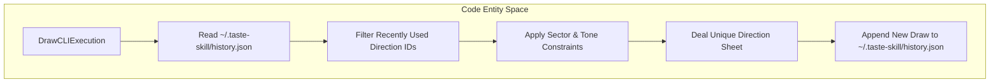
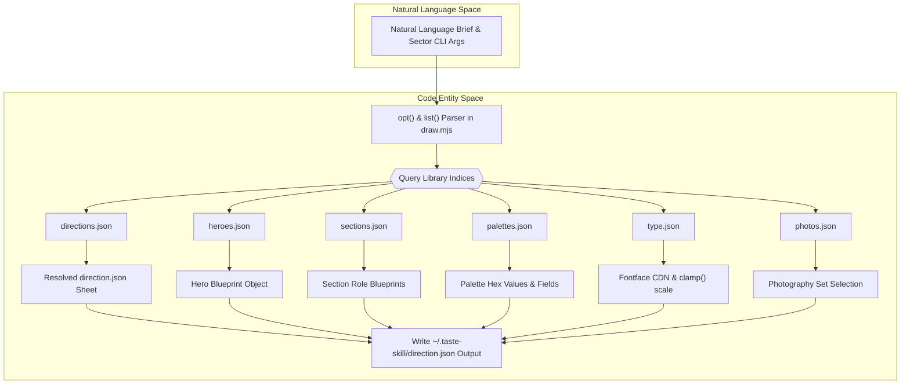
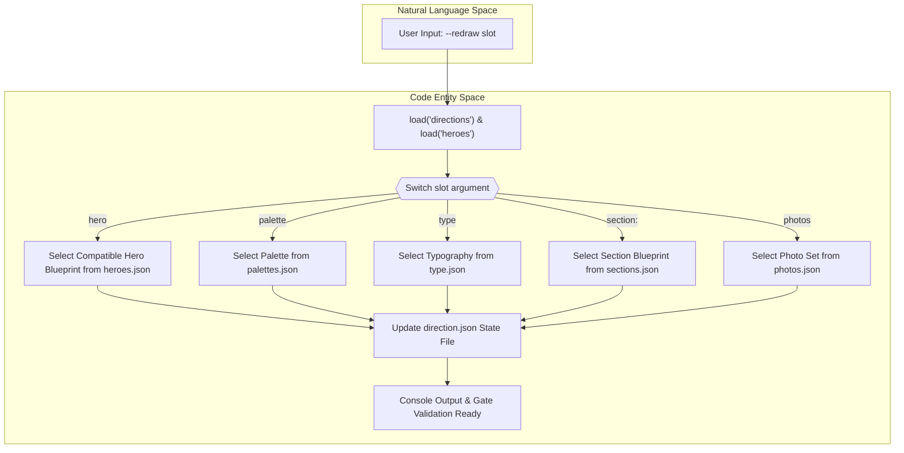

<!-- source: DeepWiki mcp.deepwiki.com · repo Leonxlnx/taste-skill · page 3.1 draw.mjs & the Direction Library · fetched 2026-10-26 -->

# draw.mjs & the Direction Library

Relevant source files

The following files were used as context for generating this wiki page:

- [skills/taste-skill/README.md](skills/taste-skill/README.md)
- [skills/taste-skill/library/directions.json](skills/taste-skill/library/directions.json)
- [skills/taste-skill/library/heroes.json](skills/taste-skill/library/heroes.json)
- [skills/taste-skill/library/photos.json](skills/taste-skill/library/photos.json)
- [skills/taste-skill/library/sections.json](skills/taste-skill/library/sections.json)
- [skills/taste-skill/scripts/assets.mjs](skills/taste-skill/scripts/assets.mjs)
- [skills/taste-skill/scripts/draw.mjs](skills/taste-skill/scripts/draw.mjs)

This page details the implementation, execution mechanics, and data flow of `draw.mjs` and the underlying JSON Direction Library within the `taste-skill` v2 composition engine [skills/taste-skill/scripts/draw.mjs:1-20](). The composition engine decouples aesthetic decision-making from LLM inference by providing a deterministic, zero-dependency Node.js script that deals structured design directions, heroes, palettes, and section layouts from a curated dataset of 247 studied gallery sites [skills/taste-skill/scripts/draw.mjs:2-20]().

---

## 1. CLI Interface & Execution Mechanics

The CLI interface is implemented entirely in vanilla Node.js with zero external dependencies [skills/taste-skill/scripts/draw.mjs:20-21](). It reads arguments via custom argument parser helpers `opt` and `list` [skills/taste-skill/scripts/draw.mjs:33-35]().

### Argument Parsing and Core Flags
CLI execution is configured through flags defined in `skills/taste-skill/scripts/draw.mjs` [skills/taste-skill/scripts/draw.mjs:8-19]():
- `--sector <sector>`: Specifies the industry vertical (e.g., `saas`, `dev-tool`, `ai-product`, `consumer-app`, `finance`, `agency`, `studio-portfolio`, `ecommerce`) [skills/taste-skill/scripts/draw.mjs:8,40]().
- `--brief "one line"`: Defines the natural language project brief [skills/taste-skill/scripts/draw.mjs:8]().
- `--tone <tone>`: Sets the aesthetic tone from options such as `quiet`, `bold`, `warm`, `technical`, `playful`, `luxury`, or `editorial` [skills/taste-skill/scripts/draw.mjs:9,41]().
- `--have <assets>`: Declares available assets (e.g., `photography`, `product-photo`, `product-ui`, `illustration`, `video`) [skills/taste-skill/scripts/draw.mjs:10]().
- `--keep <palette,type>`: Locks brand-specified attributes while allowing the engine to draw the rest [skills/taste-skill/scripts/draw.mjs:11]().
- `--avoid <id,id>`: Prevents specific direction IDs from being dealt [skills/taste-skill/scripts/draw.mjs:12]().
- `--seed <N>`: Sets a numeric seed for deterministic randomness [skills/taste-skill/scripts/draw.mjs:12]().
- `--out <DIR>`: Specifies the output directory (defaulting to `.taste-skill`) where `direction.json` is written [skills/taste-skill/scripts/draw.mjs:12,37]().
- `--options <3>`: Outputs three dealt candidate directions to choose from without writing state [skills/taste-skill/scripts/draw.mjs:13]().
- `--direction <id>`: Forces a specific direction sheet [skills/taste-skill/scripts/draw.mjs:14]().
- `--show`: Reprints the saved direction sheet [skills/taste-skill/scripts/draw.mjs:15]().
- `--redraw <slot>`: Re-deals an isolated slot such as `hero`, `type`, `palette`, `photos`, `scenes`, `section:<role>`, or `direction` [skills/taste-skill/scripts/draw.mjs:16]().
- `--list <what>`: Lists available options like `sectors`, `directions`, `roles`, `tones`, or `scenes` [skills/taste-skill/scripts/draw.mjs:17]().
- `--site <id>`: Prints one studied reference site in full detail [skills/taste-skill/scripts/draw.mjs:18]().
- `--app`: Deals a style for an app screen (dashboards, admin views) instead of a marketing page via `scripts/lib/app-draw.mjs` [skills/taste-skill/scripts/draw.mjs:19,69-71]().

The script validates sectors against `SECTORS` and tones against `TONES`, mapping requested section roles through `ROLE_ALIAS` to match keys in `library/sections.json` [skills/taste-skill/scripts/draw.mjs:39-67]().

Sources: [skills/taste-skill/scripts/draw.mjs:1-85]()

---

## 2. Seeded Randomness & History Persistence

To prevent consecutive projects from sharing identical visual traits, `draw.mjs` maintains state persistence and randomized selection controls [skills/taste-skill/scripts/draw.mjs:4-6]().

### Randomness and Recency Management
- **Seeded Randomness**: Leverages Node.js built-in `node:crypto` `randomInt` alongside optional user-provided seed parameters (`--seed`) to ensure reproducible draws when needed [skills/taste-skill/scripts/draw.mjs:12,25]().
- **History Path**: Draws and selected directions are logged to `~/.taste-skill/history.json` relative to the user's home directory [skills/taste-skill/scripts/draw.mjs:25,37]().
- **Recency Exclusion**: When dealing directions, the engine evaluates recent entries stored in `history.json` to deprioritize or eliminate recently dealt direction IDs, guaranteeing visual variety across successive agent invocations [skills/taste-skill/scripts/draw.mjs:4-6]().

Diagram: Draw History Tracking

Sources: [skills/taste-skill/scripts/draw.mjs:4-37]()

---

## 3. The JSON Library Architecture

The core aesthetic database resides in `skills/taste-skill/library/` and is loaded synchronously via helper functions using `JSON.parse(readFileSync(...))` [skills/taste-skill/scripts/draw.mjs:28-32]().

### Library Schema Overview
- **`directions.json`**: Defines high-level composition strategies (e.g., `name-as-monument`, `sentence-as-layout`, `pinned-poster`) containing structural ideas, typography specs, color rules, and pitfall warnings [skills/taste-skill/library/directions.json:1-136]().
- **`heroes.json`**: Contains viewport blueprints for the first screen, mapping archetypes like `giant-wordmark` and `type-poster` to specific layout coordinates at 1440px desktop and mobile viewports [skills/taste-skill/library/heroes.json:1-69]().
- **`sections.json`**: Modular section blueprints defining roles (`features`, `showcase`, `pricing`, `footer`), layout shapes (`list`, `pinned`, `full-bleed`, `stack`, `mosaic`), and CSS grid rules [skills/taste-skill/library/sections.json:1-118]().
- **`palettes.json`**: Curated color systems specifying `bg`, `surface`, `ink`, `muted`, `accent`, `accentInk`, and multi-tone `fields` [skills/taste-skill/library/palettes.json:1-156]().
- **`type.json`**: Font family definitions, Fontshare/Google CDN link strings, weight arrays, and fluid `clamp()` scale steps (`step-small`, `step-body`, `step-lead`, `step-head`) [skills/taste-skill/library/type.json:1-171]().
- **`photos.json`**: Zero-dependency photographic categorization sets (e.g., `fog-and-quiet`), alt text, color tags, and Picsum/Unsplash reference pointers [skills/taste-skill/library/photos.json:1-273]().
- **`motions.json`**: Timing tokens, transform rules, and animation specifications.
- **`scenes.json`**: GSAP ScrollTrigger scene definitions, hold-states, and desktop/mobile breakdown rules.
- **`sites.json`**: Metadata and extracted structural breakdowns of 247 studied Awwwards-winning gallery sites (`aww-pp-neue-montreal`, `aww-seasats`, etc.).

Sources: 
- [skills/taste-skill/scripts/draw.mjs:28-32]()
- [skills/taste-skill/library/directions.json:1-136]()
- [skills/taste-skill/library/heroes.json:1-69]()
- [skills/taste-skill/library/palettes.json:1-156]()
- [skills/taste-skill/library/sections.json:1-118]()
- [skills/taste-skill/library/photos.json:1-273]()

---

## 4. Composition Engine Data Flow & Output

To bridge natural language input parameters to deterministic code entities, the system maps CLI flags directly to structured JSON records within the library, culminating in the generation of `direction.json`.

### Diagram: Natural Language Space to Code Entity Space (CLI & Execution)
This diagram illustrates how user command-line arguments resolve through `draw.mjs` to target specific library JSON files.

Sources: [skills/taste-skill/scripts/draw.mjs:8-37](), [skills/taste-skill/library/directions.json:1-30]()

### Diagram: Direction Deal and Slot Redeal Workflow
This diagram maps the internal object resolution workflow when executing a full deal versus an isolated slot redraw.

Sources: [skills/taste-skill/scripts/draw.mjs:15-18](), [skills/taste-skill/library/heroes.json:1-15]()

---

## Sources
- [skills/taste-skill/scripts/draw.mjs:1-584]()
- [skills/taste-skill/library/directions.json:1-136]()
- [skills/taste-skill/library/heroes.json:1-69]()
- [skills/taste-skill/library/palettes.json:1-156]()
- [skills/taste-skill/library/sections.json:1-118]()
- [skills/taste-skill/library/photos.json:1-273]()

---

