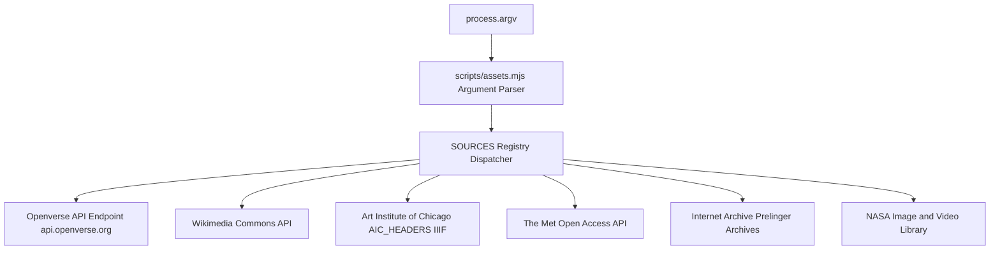
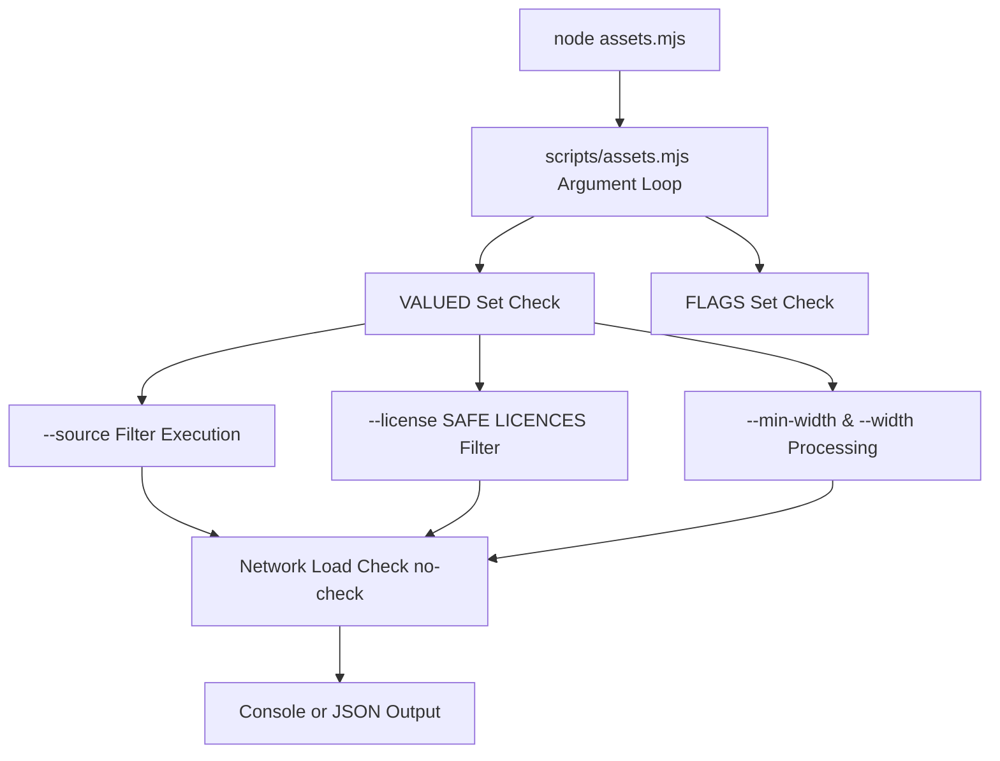
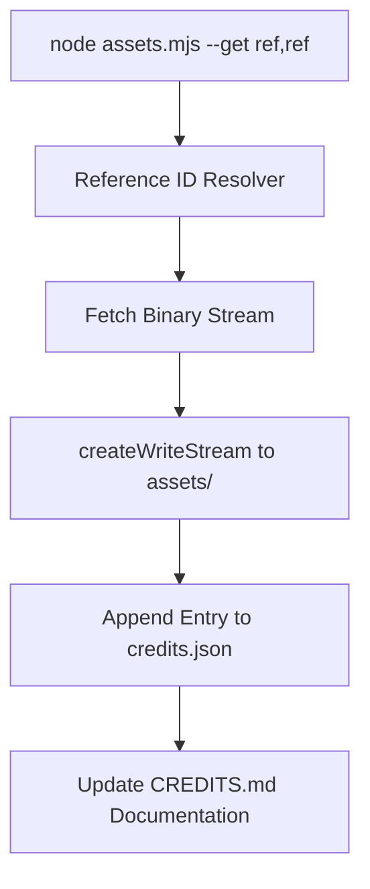

<!-- source: DeepWiki mcp.deepwiki.com · repo Leonxlnx/taste-skill · page 3.2 assets.mjs & Open-Collection Media Sourcing · fetched 2026-10-26 -->

# assets.mjs & Open-Collection Media Sourcing

Relevant source files

The following files were used as context for generating this wiki page:

- [skills/taste-skill/README.md](skills/taste-skill/README.md)
- [skills/taste-skill/library/directions.json](skills/taste-skill/library/directions.json)
- [skills/taste-skill/references/imagery.md](skills/taste-skill/references/imagery.md)
- [skills/taste-skill/scripts/assets.mjs](skills/taste-skill/scripts/assets.mjs)

## Purpose and Scope
This page documents the implementation and usage of zero-dependency asset discovery and download pipelines within the `taste-skill` v2 architecture. Specifically, it covers `skills/taste-skill/scripts/assets.mjs` [skills/taste-skill/scripts/assets.mjs:1-35]() and the imagery sourcing principles defined in `skills/taste-skill/references/imagery.md` [skills/taste-skill/references/imagery.md:1-20](). It details programmatic source integrations (Openverse, Wikimedia Commons, Art Institute of Chicago, The Metropolitan Museum of Art, Internet Archive, and NASA), command-line query flags, licensing filters, video search workflows, metadata generation for attribution, and imagery selection hierarchies.

Sources: [skills/taste-skill/scripts/assets.mjs:1-35](), [skills/taste-skill/references/imagery.md:1-20]()

---

## 1. Source Registry & System Architecture

The asset sourcing engine is implemented as a standalone Node.js script located at `skills/taste-skill/scripts/assets.mjs` [skills/taste-skill/scripts/assets.mjs:1-35](). It operates with zero external npm dependencies, using built-in modules (`node:fs`, `node:path`, `node:url`) and the global `fetch` API [skills/taste-skill/scripts/assets.mjs:29-30].

The script maps distinct third-party museum and archival APIs into a uniform query interface using internal configuration maps (`SOURCES` and `SOURCE_ALIAS`) [skills/taste-skill/scripts/assets.mjs:36-44]. Supported endpoints include Openverse (`api.openverse.org`), Wikimedia Commons, Art Institute of Chicago (AIC) via IIIF, The Metropolitan Museum of Art Open Access API, Internet Archive (Prelinger Archives), and the NASA Image and Video Library [skills/taste-skill/scripts/assets.mjs:24-28].

Diagram: Source Registry Dispatch Architecture

Sources: [skills/taste-skill/scripts/assets.mjs:24-53]()

### Source Registry Data Structures
* `SOURCES`: Defines available backends, media capabilities (`image`, `video`, or `both`), provider display names, and contextual research notes [skills/taste-skill/scripts/assets.mjs:36-43].
* `SOURCE_ALIAS`: Maps shorthand aliases (e.g., `museums` resolving to `['aic', 'met']`, `wikimedia` resolving to `['commons']`) [skills/taste-skill/scripts/assets.mjs:44].
* `AIC_HEADERS`: Sets custom User-Agent tracking (`AIC-User-Agent`) required by the Art Institute of Chicago API constraints [skills/taste-skill/scripts/assets.mjs:51-52].

Sources: [skills/taste-skill/scripts/assets.mjs:36-53]()

---

## 2. CLI Flags, Licensing Filters, and Query Parameters

The script exposes a CLI interface parsed directly from `process.argv` [skills/taste-skill/scripts/assets.mjs:78-85]. It categorizes arguments into valued options (`VALUED`) and boolean flags (`FLAGS`) [skills/taste-skill/scripts/assets.mjs:79-80].

Diagram: CLI Parsing and Query Execution Flow

Sources: [skills/taste-skill/scripts/assets.mjs:78-85]()

### Key Parameters and Default Values
* `--source`: Limits search to comma-separated providers (`openverse`, `commons`, `aic`, `met`, `archive`, `nasa`, or alias `museums`) defaulting to `all` [skills/taste-skill/scripts/assets.mjs:56-57].
* `--license`: Restricts results by licensing criteria. Defaults to `safe`, which permits commercial-safe tiers (`cc0`, `pd`, `by`, `by-sa`). Users can also select `pd` (Public Domain only) or `all` [skills/taste-skill/scripts/assets.mjs:13-14, 46-48].
* `--orientation`: Filters images by geometric aspect ratio (`landscape`, `portrait`, `square`) [skills/taste-skill/scripts/assets.mjs:59].
* `--min-width`: Enforces a lower bound on original image resolution (default `1000` pixels) [skills/taste-skill/scripts/assets.mjs:60].
* `--width`: Specifies the target width rendition for URLs or file downloads (default `1920` pixels) [skills/taste-skill/scripts/assets.mjs:61].
* `--limit`: Controls maximum results returned per source (capped at `20`, default `5`) [skills/taste-skill/scripts/assets.mjs:62].
* `--no-check`: Bypasses asynchronous HTTP HEAD requests that verify whether returned image URLs load correctly [skills/taste-skill/scripts/assets.mjs:63].

Sources: [skills/taste-skill/scripts/assets.mjs:13-14, 46-64]()

---

## 3. Video Search and Archival Footage Handling

When searching for real moving image footage rather than static graphics, the `--video` flag switches the sourcing strategy to target video repositories (Wikimedia Commons webm/mp4 transcodes, Internet Archive Prelinger Archives, and NASA Video Library) [skills/taste-skill/scripts/assets.mjs:17-20, 26-28].

### Video Parameters
* `--res`: Selects the target rendition height or short side (default `720`) [skills/taste-skill/scripts/assets.mjs:67].
* `--max-mb`: Sets a file size ceiling (default `25` megabytes). Clips exceeding this threshold are flagged in search listings, and the `--get` command refuses to download them to prevent payload bloat [skills/taste-skill/scripts/assets.mjs:18-19, 68].
* `--min-width`: Defaults to `640` pixels for video streams [skills/taste-skill/scripts/assets.mjs:69].
* `VIDEO_TYPES`: Restricts acceptable container formats to web-playable types (`video/mp4`, `video/webm`) [skills/taste-skill/scripts/assets.mjs:45].

Sources: [skills/taste-skill/scripts/assets.mjs:17-20, 26-28, 45, 65-69]()

---

## 4. Download Workflow, Metadata, and Attribution

Once assets are discovered via string queries, specific reference identifiers (e.g., `commons:36649959`, `met:707892`) are passed to the `--get` handler [skills/taste-skill/references/imagery.md:82-90].

Diagram: Download and Attribution Record Pipeline

Sources: [skills/taste-skill/scripts/assets.mjs:20-22], [skills/taste-skill/references/imagery.md:82-90]()

### Execution Steps
1. **Resolution & Download:** `--get <ref>` queries the specific provider endpoint, resolves the direct media URL, and downloads the binary payload into the project directory (configured via `--to assets`, with custom filenames accepted via `--name`) [skills/taste-skill/scripts/assets.mjs:20-21].
2. **Metadata Recording:** The utility automatically generates and updates attribution metadata records within `credits.json` [skills/taste-skill/scripts/assets.mjs:8-9].
3. **Markdown Logging:** Example outputs and project directories maintain corresponding documentation logs (such as `examples/v2/CREDITS.md`) recording title, creator, explicit license terms, and canonical source links [examples/v2/CREDITS.md:1-20].

Sources: [skills/taste-skill/scripts/assets.mjs:8-22], [examples/v2/CREDITS.md:1-20], [skills/taste-skill/references/imagery.md:82-90]()

---

## 5. Imagery Sourcing Hierarchy and Rules

According to `references/imagery.md`, generated pages often fail visually due to generic placeholders or abstract graphical blobs [skills/taste-skill/references/imagery.md:1-5]. The design system establishes a strict preference hierarchy for sourcing visual media:

1. **The project's own images:** Product shots, real locations, team members, and actual work artifacts [skills/taste-skill/references/imagery.md:46-48].
2. **Generated images:** Produced via session image tools using precise photographer briefs (subject, angle, lighting, background, crop ratio, and "no text") [skills/taste-skill/references/imagery.md:49-51].
3. **Open collection real pictures:** Archival photographs, historical maps, material textures, and museum objects sourced via `scripts/assets.mjs` [skills/taste-skill/references/imagery.md:52-57].
4. **Code-drawn subjects:** Flat shape representations of product objects, architectural tiles, street maps, or software interfaces generated purely via code [skills/taste-skill/references/imagery.md:58-62].
5. **Dealt photographs:** Stock-like background imagery dealt on direction sheets, restricted strictly to generic atmospheric contexts (e.g., open sea, fog) [skills/taste-skill/references/imagery.md:63-66].
6. **Type and colour alone:** Deliberate typographic layouts without supplementary imagery [skills/taste-skill/references/imagery.md:67].

Sources: [skills/taste-skill/references/imagery.md:1-68]()

---

