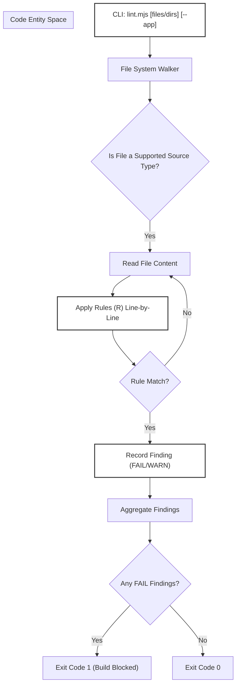
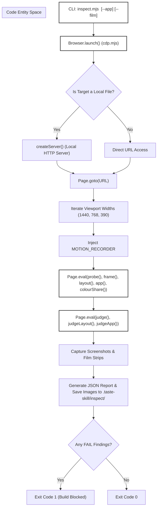

<!-- source: DeepWiki mcp.deepwiki.com · repo Leonxlnx/taste-skill · page 3.3 The Gate: Automated Compliance Checking · fetched 2026-10-26 -->

# The Gate: Automated Compliance Checking

Relevant source files

The following files were used as context for generating this wiki page:

- [skills/taste-skill/evals/evals.json](skills/taste-skill/evals/evals.json)
- [skills/taste-skill/references/critique.md](skills/taste-skill/references/critique.md)
- [skills/taste-skill/scripts/inspect.mjs](skills/taste-skill/scripts/inspect.mjs)
- [skills/taste-skill/scripts/lint.mjs](skills/taste-skill/scripts/lint.mjs)

The "Gate" is the automated compliance checking phase of the `taste-skill` pipeline. Its purpose is to validate generated web pages against the Taste Standard, ensuring adherence to design principles and avoiding common "AI tells" and anti-patterns. This phase comprises static source code analysis, real-browser inspection, and scene photography. Any `FAIL` or critical `WARN` findings will block the build process, requiring remediation.

This page provides a high-level overview of the components involved in the Gate. For detailed technical information on each component, refer to their respective child pages.

## 1. Static Source Linting: `lint.mjs`

The `lint.mjs` script performs static analysis of source files to identify banned patterns, stock phrases, and structural "tells" that violate the Taste Standard [skills/taste-skill/scripts/lint.mjs:1-3](). It operates by recursively walking through specified directories and checking file contents against a predefined set of regular expressions [skills/taste-skill/scripts/lint.mjs:23-28](). This allows for early detection of issues that might not be visible in a rendered page or are more efficiently caught at the source level. The linter can operate in `--app` mode, which adjusts rule severity for app screens [skills/taste-skill/scripts/lint.mjs:13-17]().

For details, see [lint.mjs: Static Source Linting](#3.3.1).

*Sources: [skills/taste-skill/scripts/lint.mjs:1-63]()*

## 2. Real-Browser Inspection: `inspect.mjs`

The `inspect.mjs` script drives a real browser (Chrome/Edge/Chromium) using the Chrome DevTools Protocol (CDP) to perform dynamic validation of the rendered page [skills/taste-skill/scripts/inspect.mjs:1-2](). This involves launching a throwaway HTTP server for local files, iterating through various viewport widths (e.g., 1440, 768, 390 pixels), recording motion, checking title visibility, capturing film-strip scroll sequences, auditing for reduced-motion compliance, and taking screenshots [skills/taste-skill/scripts/inspect.mjs:4-8, 18-19, 73-87](). All findings and visual artifacts are stored in the `.taste-skill/inspect/` directory.

For details, see [inspect.mjs: Real-Browser Inspection](#3.3.2).

*Sources: [skills/taste-skill/scripts/inspect.mjs:1-87](), [skills/taste-skill/scripts/lib/cdp.mjs:40-114]()*

## 3. Measurement and Judgment: `probe.mjs` & `rules.mjs`

The core of the real-browser inspection involves two key modules: `probe.mjs` and `rules.mjs`.
- **`probe.mjs`**: Contains in-page measurement functions (`probe`, `frame`, `layout`, `app`, `colourShare`, `palette`) that execute directly within the browser's page context [skills/taste-skill/scripts/inspect.mjs:19](). These functions collect detailed metrics about the DOM, layout, typography, and color usage.
- **`rules.mjs`**: Houses the rule evaluators (`judge`, `judgeLayout`, `judgeApp`) that process the measurements from `probe.mjs` against the Taste Standard [skills/taste-skill/scripts/inspect.mjs:20](). It defines the `finding` object shape and major failure codes, including `APP_SKIP` for rules that are exempted in app mode.

For details, see [probe.mjs & rules.mjs: Measurement and Judgment](#3.3.3).

## 4. Zero-Dependency Browser Driver: `cdp.mjs`

The `cdp.mjs` module provides a lightweight, zero-dependency client for interacting with the Chrome DevTools Protocol [skills/taste-skill/scripts/lib/cdp.mjs:1-2](). It handles tasks such as finding an installed Chrome/Edge/Chromium browser (`findChrome`), launching browser instances (`Browser.launch`), and providing Page APIs for navigation (`goto`), script evaluation (`eval`), screenshot capture (`screenshot`), and scroll simulation (`wheel`) [skills/taste-skill/scripts/lib/cdp.mjs:40-114](). It also manages throwaway browser profiles, marks them with `taste-skill-owner.json`, and includes a `sweepProfiles` cleanup mechanism to prevent accumulation of temporary data.

For details, see [cdp.mjs: Zero-Dependency Browser Driver](#3.3.4).

## 5. Critique Loop & Evals

After the automated Gate, the "Look" phase involves a human-like critique loop. This process uses the `references/critique.md` rubric to evaluate the generated screenshots, often leading to up to three rounds of fixes [skills/taste-skill/references/critique.md:1-5](). The `evals/evals.json` file contains a set of regression tests that define specific prompts and expected outputs, which are used to assess the skill's performance and ensure consistent adherence to the Taste Standard [skills/taste-skill/evals/evals.json:1-76]().

For details, see [Critique Loop & Evals](#3.3.5).

---

