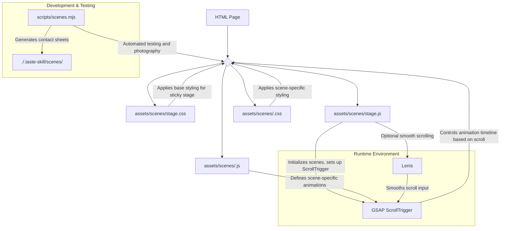
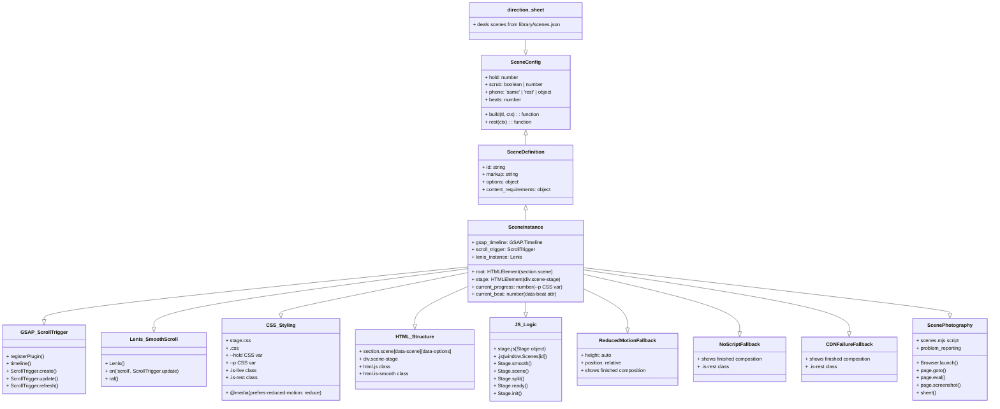

<!-- source: DeepWiki mcp.deepwiki.com · repo Leonxlnx/taste-skill · page 3.4 Scroll Scenes Engine · fetched 2026-10-26 -->

# Scroll Scenes Engine

<details>
<summary>Relevant source files</summary>

The following files were used as context for generating this wiki page:

- [skills/taste-skill/assets/scenes/stage.css](skills/taste-skill/assets/scenes/stage.css)
- [skills/taste-skill/assets/scenes/stage.js](skills/taste-skill/assets/scenes/stage.js)
- [skills/taste-skill/references/motion.md](skills/taste-skill/references/motion.md)
- [skills/taste-skill/references/research.md](skills/taste-skill/references/research.md)
- [skills/taste-skill/references/scenes.md](skills/taste-skill/references/scenes.md)
- [skills/taste-skill/scripts/scenes.mjs](skills/taste-skill/scripts/scenes.mjs)

</details>


This page details the implementation of the scroll scenes engine, a core component for creating rich, scroll-driven animations. It covers the underlying principles, the files involved (`references/scenes.md`, `scripts/scenes.mjs`, `assets/scenes/stage.js`, and `assets/scenes/stage.css`), and how these elements work together to deliver pinned GSAP ScrollTrigger scenes with optional Lenis smoothing, robust handling for various display conditions (desktop, phone, reduced-motion), and mechanisms for identifying scene failures.

## Core Concepts

A scroll scene transforms a standard columnar page layout into an interactive, full-screen experience where elements animate in response to scroll progress. The key idea is a "stage" that remains fixed in the viewport while the user scrolls, driving a GSAP timeline from 0% to 100% completion. This approach ensures that the scrollbar always reflects the true scroll position, maintaining accessibility and expected user behavior.

The engine prioritizes a "finished composition" as the fallback state for scenarios like reduced motion, no JavaScript, or CDN failures, ensuring content remains readable and accessible.

Sources: [skills/taste-skill/references/scenes.md:26-33, 107-116]()

## Architecture and Data Flow

The scroll scenes engine is composed of several interconnected parts:

*   **`references/scenes.md`**: Documentation outlining the philosophy, rules, and usage of scroll scenes.
*   **`assets/scenes/stage.css`**: Provides the foundational CSS for the scene stage, handling sticky positioning and layout containment.
*   **`assets/scenes/stage.js`**: The core JavaScript library that orchestrates scene initialization, GSAP ScrollTrigger integration, and optional Lenis smooth scrolling.
*   **`assets/scenes/<id>.css` / `assets/scenes/<id>.js`**: Scene-specific CSS and JavaScript files that define the unique animations and styling for individual scene types.
*   **`scripts/scenes.mjs`**: A Node.js script used for testing and photographing scene progress across various states and devices.

The general flow involves:
1.  A `<section class="scene">` element in the HTML, with `data-scene` and `data-options` attributes, marks a scene.
2.  `stage.js` initializes these scenes, setting up GSAP ScrollTrigger to control a timeline based on the scroll position of the section.
3.  Scene-specific JavaScript (`<id>.js`) defines the actual animations on this timeline.
4.  `stage.css` ensures the scene's stage (`.scene-stage`) sticks to the viewport during the scene's active scroll range.
5.  `scenes.mjs` automates the process of capturing screenshots at various scroll progress points and under different conditions (desktop, phone, reduced motion) to verify correct behavior.

### Scroll Scenes Engine Overview


Sources: [skills/taste-skill/references/scenes.md:46-66](), [skills/taste-skill/assets/scenes/stage.css:1-16](), [skills/taste-skill/assets/scenes/stage.js:1-22](), [skills/taste-skill/scripts/scenes.mjs:1-9]()

## Implementation Details

### HTML Structure and Scene Definition

A scroll scene is defined by a `<section>` element with the class `scene` and a `data-scene` attribute specifying its unique ID. An optional `data-options` attribute can be used to configure scene-specific parameters like `hold`. Inside this section, a `div` with the class `scene-stage` acts as the container for the animated content.

```html
<section class="scene" data-scene="<id>" data-options='{"hold": 3}' aria-label="…">
  <div class="scene-stage">
    <!-- scene-specific markup -->
  </div>
</section>
```
Sources: [skills/taste-skill/references/scenes.md:54-58]()

### `stage.css`: The Scene Stage Styling

The `stage.css` file provides the essential styling for the scroll scene mechanism.
*   The `.scene` element is `position: relative`.
*   When JavaScript is enabled and the scene is "live" (`html.js .scene.is-live`), the section's height is dynamically calculated to be `(var(--hold, 2) + 1) * 100svh`. This makes the section tall enough to hold the stage for the specified number of screens.
*   The `.scene-stage` within a live scene becomes `position: sticky`, `top: 0`, and `height: 100svh`. This ensures it sticks to the top of the viewport for the duration of the scene's scroll.
*   `overflow: clip` is used on `.scene-stage` to prevent it from becoming a scroll container itself.
*   Elements within a live scene that are animated (`[data-move]`) are given `will-change: transform, opacity` for performance optimization.
*   Reduced motion preference (`@media (prefers-reduced-motion: reduce)`) disables the sticky behavior, reverting the scene to its finished composition.

Sources: [skills/taste-skill/assets/scenes/stage.css:1-28]()

### `stage.js`: Scene Orchestration

The `stage.js` file is the central JavaScript component. It handles:

*   **Feature Detection**: Checks for `gsap`, `ScrollTrigger`, and `Lenis` availability.
*   **`Stage` Object**: A global object (`window.Stage`) exposing utility functions.
    *   `Stage.live`: Boolean indicating if GSAP and ScrollTrigger are available.
    *   `Stage.reduced`, `Stage.phone`, `Stage.touch`: Media query checks for user preferences and device type.
    *   `Stage.lenis`: Reference to the Lenis instance if smooth scrolling is enabled.
*   **`Stage.smooth()`**: Initializes Lenis for smooth scrolling. It's disabled for touch devices and reduced motion. The `lerp` value (default 0.12) controls the smoothing intensity. It integrates with `ScrollTrigger.update` to ensure animations remain synchronized.
*   **`Stage.scene(root, opts)`**: The core function for setting up an individual scroll scene.
    *   Takes the scene's root element (`<section.scene>`) and an options object.
    *   `hold`: Number of screens the stage is held for.
    *   `scrub`: Controls how tightly the animation is linked to scroll (true for locked, a number for catch-up).
    *   `build(tl, ctx)`: A callback function where scene-specific animations are added to a GSAP timeline (`tl`).
    *   `phone`: Defines behavior on phone (`'same'`, `'rest'`, or a specific plan).
    *   `rest(ctx)`: Optional callback for additional setup when the scene is in its "rest" (finished composition) state.
    *   It uses `gsap.matchMedia()` to apply different behaviors based on `prefers-reduced-motion` and `max-width: 767px`.
    *   If not `live` or `reduced` motion is preferred, the scene immediately transitions to its "rest" state by adding the `is-rest` class and removing `is-live`.
    *   A GSAP timeline is created and linked to `ScrollTrigger` for the scene's root element. The `onUpdate` callback sets a CSS variable `--p` (progress from 0 to 1) and `data-beat` attribute, allowing CSS to react to scroll progress.
*   **`Stage.split(el, type)`**: Utility for splitting text into lines, words, or characters, optionally using GSAP's `SplitText` plugin for masked animations. Provides a fallback for no `SplitText`.
*   **`Stage.ready()`**: Returns a Promise that resolves when all fonts are loaded and scene images are decoded, then refreshes `ScrollTrigger` to ensure accurate measurements.
*   **`Stage.init()`**: Iterates through all `<section.scene[data-scene]>` elements on the page, retrieves their scene ID, and calls the corresponding `window.Scenes[id]` function (defined in scene-specific JS files) to initialize each scene using `Stage.scene()`.

Sources: [skills/taste-skill/assets/scenes/stage.js:24-123]()

### `scenes.mjs`: Scene Photography and Validation

The `scenes.mjs` script is a command-line tool for systematically testing and documenting scroll scenes.
*   **Purpose**: Photographs every scroll scene on a given HTML page at precise points of its progress (0%, 10%, ..., 100% of its hold), as well as before and after the scene. It captures these states for both desktop (1440x900) and phone (390x844) viewports, and also captures the reduced-motion state.
*   **Usage**: `node scenes.mjs <url | path/to/file.html> [--out DIR] [--steps 10] [--scene "#id"] [--wait 900]`
*   **Local File Serving**: If a local HTML file is provided, `scenes.mjs` starts a temporary HTTP server to serve the file and its relative assets, mimicking a hosted environment.
*   **Browser Automation**: Uses `lib/cdp.mjs` (a zero-dependency Chrome DevTools Protocol client) to launch a headless browser, navigate to the page, and control scrolling.
*   **Screenshot Capture**: For each scene and viewport, it scrolls to specific progress points, waits for a `WAIT` duration (default 900ms), and captures a screenshot.
*   **Contact Sheet Generation**: The captured screenshots are compiled into labeled contact sheets (JPEG images) and saved to the `--out` directory (default `.taste-skill/scenes/`).
*   **Validation and Failure Codes**:
    *   Exits with code 0 if all scenes run successfully.
    *   Exits with code 1 if a scene never started, fell back to "rest" on desktop (indicating a script issue), or if the page logged errors.
    *   It logs problems like `never started` or `shows its finished composition instead of running`.
*   **Frame Timing Analysis**: For desktop scenes, it also records frame timings while wheel-scrolling through the scenes to detect performance issues.

Sources: [skills/taste-skill/scripts/scenes.mjs:1-99]()

### `motion.md`: Scroll Behavior Guidelines

The `references/motion.md` document provides guidelines for motion and animation, including scroll behaviors.
*   It emphasizes that scroll scenes are "the big, scroll-driven moments" and are built on GSAP ScrollTrigger through the shared stage in `assets/scenes/`.
*   It notes that "scroll-linked motion is locked to the scrollbar" for 14 of 18 scrubbed sites, with minimal smoothing on the others.
*   Crucially, it states that "Every recipe here keeps the finished state as the reduced state," reinforcing the accessibility requirement for scroll scenes.
*   "Pins cost length": pages with sticky/pinned elements are typically twice as long. The house rule is "at most two held stages, about one screen per step, three screens per stage."

Sources: [skills/taste-skill/references/motion.md:23-28, 70-72, 85-86, 82-84]()

### `scenes.md`: Scene Rules and Content

The `references/scenes.md` document provides detailed rules and best practices for creating and filling scroll scenes.
*   **What a scene is**: A tall section with a sticky stage, where a GSAP timeline is scrubbed by scroll. No wheel capture, scrollbar always tells the truth.
*   **Content Rules**:
    *   **Pictures**: Must be of one family (same light, grade, subject). Sourced from `assets.mjs` or project's own. Sized to largest display.
    *   **Words**: Short, readable in a breath (4-12 words for statements, 1-4 for captions). One statement on screen at a time.
    *   **Relevance**: Scene content must relate to the subject; unrelated pictures are a "gimmick."
    *   **Real Content**: Never pad with stand-ins; if content is insufficient, `--redraw scenes`.
*   **Fitting to the Page**:
    *   Scenes inherit page tokens (`--ground`, `--ink`, `--font-display`, etc.).
    *   Display type uses dealt display face and two-line headline rule.
    *   Quiet sections should separate scenes.
    *   Scenes on the first screen must be readable at 0% progress.
    *   Sections should have an `aria-label` even if the heading is not visible.
*   **Phone, Reduced Motion, No Script**:
    *   Each scene has a phone plan (`'rest'` or a simpler version).
    *   Reduced motion and no script fall back to the finished composition, ensuring content is never hidden.
    *   A failed CDN also shows the finished composition (`.is-rest` class).
*   **Checking**: `scenes.mjs` is the primary tool for checking scenes.

Sources: [skills/taste-skill/references/scenes.md:26-33, 75-91, 93-105, 107-116, 118-126]()

## Code Entity to System Name Mapping

### Scroll Scene System Components


Sources: [skills/taste-skill/references/scenes.md:26-33, 46-66, 75-91, 93-105, 107-116, 118-126](), [skills/taste-skill/assets/scenes/stage.css:1-28](), [skills/taste-skill/assets/scenes/stage.js:24-123](), [skills/taste-skill/scripts/scenes.mjs:1-99]()

## Scene Failure Codes

The `scenes.mjs` script and the `inspect.mjs` tool (part of the Gate) are responsible for identifying and reporting scene failures.

| Failure Code / Condition | Description | Source |
| :----------------------- | :---------- | :----- |
| `never started`          | A scene element (`<section.scene>`) was found, but its JavaScript initialization (via `stage.js`, the scene file, or `Stage.init()`) did not occur, or it threw an error. The scene does not have `.is-live` or `.is-rest` classes. | [skills/taste-skill/scripts/scenes.mjs:76]() |
| `shows its finished composition instead of running` | On desktop, a scene is in its "rest" state (`.is-rest` class) instead of being "live" (`.is-live`). This typically indicates GSAP was not loaded, or the scene's `build` function threw an error. | [skills/taste-skill/scripts/scenes.mjs:77]() |
| `scene-not-live`         | (Reported by `inspect.mjs`, not `scenes.mjs` directly) A scene that is expected to be live (i.e., not in reduced motion or no-script mode) is found in its finished composition state on desktop. This is a critical failure. | [skills/taste-skill/references/scenes.md:115]() |
| Console Errors           | Any JavaScript errors logged to the browser console during scene execution will cause `scenes.mjs` to exit with a non-zero code. | [skills/taste-skill/scripts/scenes.mjs:8]() |

Sources: [skills/taste-skill/scripts/scenes.mjs:76-77](), [skills/taste-skill/scripts/scenes.mjs:8](), [skills/taste-skill/references/scenes.md:115]()

---

