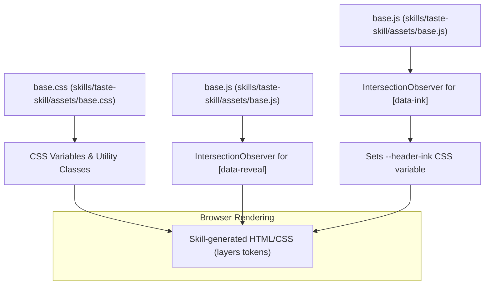

<!-- source: DeepWiki mcp.deepwiki.com · repo Leonxlnx/taste-skill · page 3.5 Neutral Foundation Assets · fetched 2026-10-26 -->

# Neutral Foundation Assets

Relevant source files

The following files were used as context for generating this wiki page:

- [skills/taste-skill/assets/base.css](skills/taste-skill/assets/base.css)
- [skills/taste-skill/assets/base.js](skills/taste-skill/assets/base.js)
- [skills/taste-skill/references/tells.md](skills/taste-skill/references/tells.md)

This page documents the neutral, unopinionated foundation of the `taste-skill` repository, comprising the baseline CSS and minimal JavaScript that set the starting point for design implementations.

## 1. Neutral Foundation: `base.css` and `base.js`

### 1.1 Purpose and Role

The neutral foundation consists of the CSS reset, tokens, and utility styles provided by `base.css`, alongside minimal JavaScript helpers in `base.js`. This foundation is:

-   **Unopinionated:** It offers no design styling or aesthetic prescription, enabling downstream code to build specifically tailored styles.
-   **Stable:** Defines a consistent baseline for typography, layout grids, spacing, and motion utilities.
-   **Performance-conscious:** Minimal and dependency-free, allowing easy inclusion in any project without bloated dependencies.
-   **Motion-aware:** Provides motion helpers that respect user preferences for reduced motion.

This foundation serves as the canvas upon which the taste-skill's directional rules and house style are applied.

### 1.2 Implementation Details

#### `base.css`

The `base.css` file [skills/taste-skill/assets/base.css:1-105]() provides a neutral starting point for styling.

-   **Tokens:** CSS custom properties define color tokens (`--bg`, `--surface`, `--ink`, `--muted`, `--accent`, `--accent-ink`), typography font stacks (`--font-display`, `--font-text`), fluid type steps (`--step-small` through `--step-display`), spacing (`--margin`, `--gutter`, `--section`), border radius (`--radius`), and easing/timing tokens for animations (`--ease-out`, `--t-press`, etc.) [skills/taste-skill/assets/base.css:7-41](). These are intended to be replaced by the dealt palette and type system.
-   **Reset & Normalization:**
    -   Global `box-sizing: border-box` [skills/taste-skill/assets/base.css:44]().
    -   Text size adjustment normalization and `scroll-behavior: auto` [skills/taste-skill/assets/base.css:45]().
    -   Margin resets for common elements like `h1`, `p`, `figure`, etc. [skills/taste-skill/assets/base.css:47]().
    -   List style removal for `ul[class]` and `ol[class]` [skills/taste-skill/assets/base.css:48]().
    -   Media elements constrained to `max-width: 100%` and `height: auto` [skills/taste-skill/assets/base.css:49-50]().
    -   Removal of default button styles and link default colors inherited for consistency [skills/taste-skill/assets/base.css:51-53]().
    -   Focus-visible outlines use accent colors for accessibility [skills/taste-skill/assets/base.css:56]().
-   **Typography:**
    -   Headlines (`h1, h2, h3`) use `var(--font-display)` with `text-wrap: balance` and `hyphens: none` [skills/taste-skill/assets/base.css:59]().
    -   Utility classes for `.display`, `.head`, `.lead`, `.small`, `.muted` apply fluid font sizes [skills/taste-skill/assets/base.css:60-64]().
    -   Paragraphs have a `max-width: 62ch` and `text-wrap: pretty` for readability [skills/taste-skill/assets/base.css:65]().
    -   Responsive class `.only-wide` for content visible only on wider screens [skills/taste-skill/assets/base.css:68-69]().
-   **Layout:**
    -   `.wrap` for page padding using `var(--margin)` [skills/taste-skill/assets/base.css:72]().
    -   `.grid` defines a 12-column CSS grid with `column-gap: var(--gutter)` [skills/taste-skill/assets/base.css:73]().
    -   `.section` for vertical spacing between blocks using `var(--section)` [skills/taste-skill/assets/base.css:74]().
    -   `.bleed` for full-width content by negating margins [skills/taste-skill/assets/base.css:76]().
    -   `.cover` for media `object-fit: cover` [skills/taste-skill/assets/base.css:77]().
    -   `.sr-only` for screen-reader-only content [skills/taste-skill/assets/base.css:78]().
-   **Controls:**
    -   `.button` with consistent padding, background, color, radius, and interactive states with scale transform on active [skills/taste-skill/assets/base.css:81-82]().
    -   `.link` and `.link-plain` classes for underline controls and hover effects [skills/taste-skill/assets/base.css:83-87]().
    -   `.field` for form input baseline styling [skills/taste-skill/assets/base.css:88]().
-   **Motion Helpers:**
    -   Classes like `.lines .line` and `.shutter` prepare elements for animation [skills/taste-skill/assets/base.css:91-93]().
    -   Conditional styles for `prefers-reduced-motion: no-preference` apply animations using `data-rise`, `data-line`, and `data-reveal` attributes [skills/taste-skill/assets/base.css:94-103]().
    -   Keyframe animations `ad-rise` and `ad-line` define the actual motion [skills/taste-skill/assets/base.css:104-105]().

The file intentionally avoids any particular look or palette — it must be replaced or extended by downstream stylesheets.

#### `base.js`

The `base.js` file [skills/taste-skill/assets/base.js:1-37]() provides minimal JavaScript to complement the CSS motion helpers.

-   **Reveal on Viewport Entry:** An IIFE handles elements with the `data-reveal` attribute [skills/taste-skill/assets/base.js:7-23]().
    -   It uses `IntersectionObserver` to add the `is-in` class when an element enters the viewport.
    -   If `IntersectionObserver` is not supported, all `data-reveal` elements immediately get the `is-in` class.
    -   The observer unobserves elements once they are revealed to prevent re-triggering.
    -   A safety net `setTimeout` ensures elements visible on load are revealed even if the observer doesn't fire immediately [skills/taste-skill/assets/base.js:20-22]().
-   **"Colour by Chapter" (Optional):** Another IIFE supports dynamic header ink color based on scroll position [skills/taste-skill/assets/base.js:25-37]().
    -   It observes elements with `data-ink` attributes.
    -   When a `data-ink` element is intersecting, it sets the `--header-ink` CSS custom property on the `documentElement` to the value of `data-ink`.
-   The script expects `document.documentElement.classList.add('js')` to be placed in the `<head>` to ensure hidden states only apply when scripting is enabled [skills/taste-skill/assets/base.js:3]().

This JS runs unobtrusively and progressively enhances page reveal without multiple reflows or intricate animation timing code.

### 1.3 Data Flow & Integration

-   The CSS and JS are meant to be **copied into the consuming project and adapted** by replacing token values in CSS with palette and type scale from the "direction sheet" (a JSON library of style directions).
-   Components and layouts generated by the skill build on top of this neutral base.
-   The JS runs automatically once loaded, affecting any `[data-reveal]` or `[data-ink]` elements that the skill-generated HTML outputs.

**Diagram: Neutral Foundation - Flow from base assets to rendered UI**

Sources:
- `skills/taste-skill/assets/base.css:1-106`()
- `skills/taste-skill/assets/base.js:1-38`()

---

