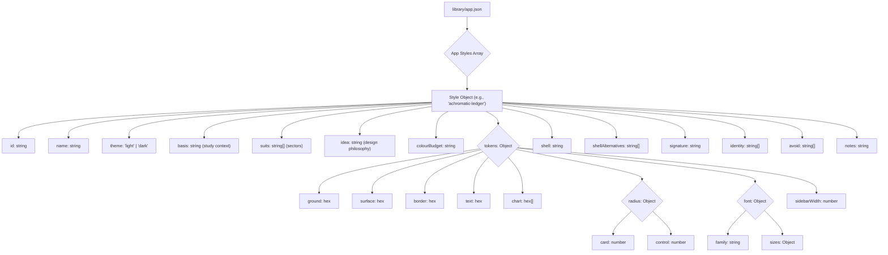
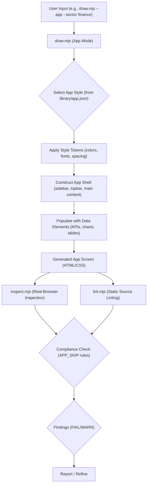

<!-- source: DeepWiki mcp.deepwiki.com · repo Leonxlnx/taste-skill · page 4 App Screens & Dashboards · fetched 2026-10-26 -->

# App Screens & Dashboards

Relevant source files

The following files were used as context for generating this wiki page:

- [skills/taste-skill/library/app.json](skills/taste-skill/library/app.json)
- [skills/taste-skill/references/app-screens.md](skills/taste-skill/references/app-screens.md)

This page provides a high-level overview of the v2.1 app-screen mode, which is designed for creating dashboards, admin views, settings pages, and inboxes. This mode diverges significantly from the rules applied to marketing-page generation, focusing on functionality, data presentation, and a "quiet" aesthetic. We will explore the core principles and components that define app screens, with links to child pages for detailed technical explanations.

The primary goal of the app-screen mode is to produce interfaces that are clean, functional, and prioritize data clarity over decorative elements. This approach is informed by a study of real-world product screens, emphasizing principles like minimal color on chrome, type-driven KPIs, flat surfaces, and data honesty [skills/taste-skill/references/app-screens.md:1-32]().

## App Screen Design Rules

The design rules for app screens are detailed in `references/app-screens.md` and configured via `library/app.json`. These rules dictate a distinct aesthetic for application interfaces, moving away from the more expressive styles of marketing pages. Key aspects include neutral shells, quiet panels, and specific guidelines for displaying KPIs, tabular numbers, and data tables. The `draw --app` command is used to apply these styles, and certain rules can be exempted via `APP_SKIP`.

The philosophy behind app screens emphasizes substance over superficial richness. This includes giving the product a distinct identity through specific typefaces, marks, and unique elements, rather than relying on generic templates [skills/taste-skill/references/app-screens.md:56-83](). Special considerations are also given to elements like calendars and timelines, with detailed rules for their layout and visual representation [skills/taste-skill/references/app-screens.md:84-97]().

For a comprehensive breakdown of these design principles and their implementation, see [App Screen Design Rules](#4.1).

Sources:
- [skills/taste-skill/references/app-screens.md:1-97]()
- [skills/taste-skill/library/app.json:1-168]()

## `app.css` & `charts.js`

The app-screen mode relies on a dedicated stylesheet, `app.css`, which provides the foundational styling for the app shell. Complementing this is `charts.js`, a dependency-free helper library specifically designed for rendering real-data charts within the generated dashboards. These components ensure that app screens are both visually consistent and capable of displaying complex data effectively.

The `library/app.json` file defines various app styles, such as `"achromatic-ledger"` and `"framed-sheet"`, each with its own set of tokens for colors, fonts, radii, and layout [skills/taste-skill/library/app.json:4-168](). These styles are carefully crafted based on measurements from real product screens to ensure a refined and functional aesthetic.

For an in-depth look at the app shell stylesheet and the chart helper, see [app.css & charts.js](#4.2).

Sources:
- [skills/taste-skill/library/app.json:4-168]()

### App Screen Style Configuration

The `library/app.json` file is central to defining the various app screen styles. Each style, identified by an `id` (e.g., `"achromatic-ledger"`, `"framed-sheet"`), specifies a `theme`, `basis`, `suits` (sectors it's suitable for), an `idea` (design philosophy), and a `colourBudget`. Crucially, it contains a `tokens` object that dictates specific design values like `ground` (background color), `surface`, `border`, `text` colors, `chart` hues, `radius` for cards and controls, `font` families and sizes, and layout parameters such as `sidebarWidth` and `gap` [skills/taste-skill/library/app.json:4-85]().

Each style also defines a `shell` type (e.g., `"open-plane"`, `"icon-rail"`) and `shellAlternatives`, indicating different structural layouts for the app interface [skills/taste-skill/library/app.json:86-90](). The `signature` and `identity` fields provide guidance on how to imbue the screen with a unique product character, while `avoid` lists common anti-patterns to prevent [skills/taste-skill/library/app.json:91-104]().

#### App Style Structure

Sources:
- [skills/taste-skill/library/app.json:4-168]()

### App Screen Generation Flow

The process of generating an app screen involves the `draw.mjs` script, which, when invoked with the `--app` flag, utilizes the configurations defined in `library/app.json` and the rules from `references/app-screens.md`. This specialized mode ensures that the output adheres to the distinct requirements of application interfaces, such as dashboards and admin panels.

The `draw.mjs` script selects an app style based on various criteria, including the specified `--sector` or `--tone` arguments, or through seeded randomness [skills/taste-skill/references/app-screens.md:56-83](). It then applies the `tokens` and `shell` definitions from the chosen style to construct the app's visual layout and styling. The `inspect.mjs` and `lint.mjs` tools are used to validate the generated app screens against the `APP_SKIP` rules and other app-specific checks, ensuring compliance with the design guidelines [skills/taste-skill/references/app-screens.md:56-83]().

#### App Screen Generation Diagram

Sources:
- [skills/taste-skill/references/app-screens.md:56-83]()
- [skills/taste-skill/library/app.json:4-168]()

---

