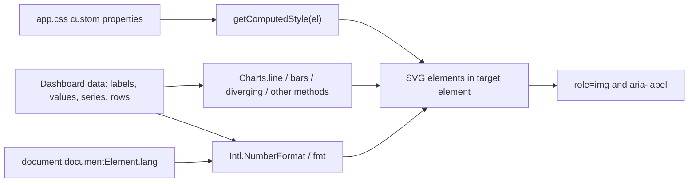
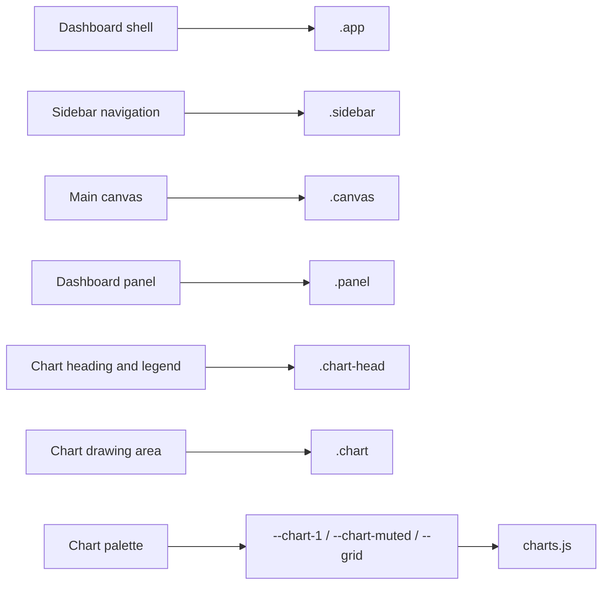
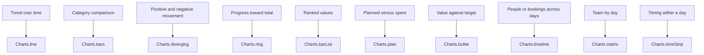

<!-- source: DeepWiki mcp.deepwiki.com · repo Leonxlnx/taste-skill · page 4.2 app.css & charts.js · fetched 2026-10-26 -->

# app.css & charts.js

Relevant source files

The following files were used as context for generating this wiki page:

- [skills/taste-skill/assets/app.css](skills/taste-skill/assets/app.css)
- [skills/taste-skill/assets/charts.js](skills/taste-skill/assets/charts.js)

## Purpose and scope

`skills/taste-skill/assets/app.css` provides a neutral CSS foundation for dashboard, admin, settings, and inbox screens. Its tokens are intended to be replaced with values from the app style sheet produced by `draw.mjs --app`. `skills/taste-skill/assets/charts.js` is a dependency-free helper that renders data-driven charts as SVG and takes its visual colors from CSS custom properties. [skills/taste-skill/assets/app.css:1-5](); [skills/taste-skill/assets/charts.js:1-7]()

Sources: `skills/taste-skill/assets/app.css`; `skills/taste-skill/assets/charts.js`

## App shell stylesheet

### Design tokens and theme

The `:root` token set establishes the shell’s ground, panel surfaces, borders, text colors, accent and status colors, typography, spacing, radii, control dimensions, and transition timings. Chart-related properties—including `--chart-1`, `--chart-2`, `--chart-3`, `--chart-muted`, `--chart-mark`, `--chart-span`, `--grid`, and `--axis-ink`—provide the CSS-side palette consumed by chart rendering. [skills/taste-skill/assets/app.css:7-50]()

The dark theme is selected with `:root[data-theme="dark"]`. It replaces the principal surface, text, status, chart-muted, grid, and shaded-span values while preserving the shared token names used by the rest of the stylesheet. [skills/taste-skill/assets/app.css:51-64]()

| Token group | Examples | Purpose |
|---|---|---|
| Surfaces and boundaries | `--ground`, `--surface`, `--raised`, `--border`, `--rule` | Distinguish the app canvas, panels, filled wells, and separators. [skills/taste-skill/assets/app.css:8-16]() |
| Text and emphasis | `--text`, `--muted`, `--faint`, `--accent`, `--primary` | Establish primary and secondary text, focus/selection emphasis, and primary-button colors. [skills/taste-skill/assets/app.css:17-23]() |
| Status and chart colors | `--positive`, `--negative`, `--warning`, `--chart-1`, `--chart-muted`, `--grid` | Supply status treatments and chart series/grid colors. [skills/taste-skill/assets/app.css:23-33]() |
| Type and layout | `--font`, `--fs-title`, `--sidebar-width`, `--pad`, `--gap`, `--card-pad` | Centralize typography and shell dimensions. [skills/taste-skill/assets/app.css:35-46]() |
| Interaction timing | `--ease-out`, `--t-press`, `--t-hover`, `--t-ui` | Provide shared timing values for interface transitions. [skills/taste-skill/assets/app.css:48-49]() |

Sources: `skills/taste-skill/assets/app.css`

### Reset, accessibility, and shell structure

The reset applies `border-box` sizing, normalizes page text sizing and default margins, and makes media elements block-level and width-constrained. Form controls inherit typography and color; links inherit color; and `:focus-visible` receives a visible accent outline. Numeric content, tables, and `.kpi-value` use tabular numerals. [skills/taste-skill/assets/app.css:66-76]()

The `.app` shell is a two-column grid: a fixed-width sidebar token and a flexible canvas. `.sidebar` is sticky and viewport-height, with its own scrolling; `.canvas` allows its grid child to shrink and receives the page padding. Sidebar navigation styling distinguishes hover from the current page via `[aria-current="page"]`; `.sidebar .bottom` pushes bottom content down with automatic top margin. [skills/taste-skill/assets/app.css:78-87]()

### Page composition and chart placement

The title block uses `.title-row` to place the page heading and adjacent content on a shared row; the heading size comes from `--fs-title`, while subtitles and stamps use muted/faint text. `.filters` wraps controls and provides a flexible `.spacer`. [skills/taste-skill/assets/app.css:89-95]()

The `.grid` uses twelve equal minmax columns and the shared gap token. `.panel` supplies the surface, border, radius, padding, and minimum-width behavior for cards. Panel headers align their contents horizontally, while `.grid.top` opts a row into start alignment. [skills/taste-skill/assets/app.css:97-106]()

For charts, `.chart-head` arranges a title alongside a legend or period label and leaves an 8px bottom margin before the SVG; `.chart` establishes a positioned, shrinkable container. [skills/taste-skill/assets/app.css:107-111]()

Sources: `skills/taste-skill/assets/app.css`

## Chart helper

### Public chart API

The file’s usage comments define `Charts` methods for common dashboard visualizations. Inputs are supplied as ordinary JavaScript data—labels, values, series, rows, and options—and each method receives the DOM element in which to render. [skills/taste-skill/assets/charts.js:8-18]()

| Method | Data shape or purpose |
|---|---|
| `Charts.line(el, options)` | Labeled series; supports formatting, annotations or spans, references, step series, “today” markers, end labels, caps, fixed y ticks, custom tick formatting, and selected x-axis labels. [skills/taste-skill/assets/charts.js:9-10](); [skills/taste-skill/assets/charts.js:19-26]() |
| `Charts.bars(el, options)` | Labeled values, with optional highlighted and dimmed bar indices. [skills/taste-skill/assets/charts.js:10]() |
| `Charts.diverging(el, options)` | Labeled `up` and `down` values, with optional marked periods and a mark label. [skills/taste-skill/assets/charts.js:11]() |
| `Charts.ring(el, options)` | A value and center label, with optional supporting text. [skills/taste-skill/assets/charts.js:12]() |
| `Charts.barList(el, rows, options)` | A ranked label/value list, with formatting and a `thin` option. [skills/taste-skill/assets/charts.js:13]() |
| `Charts.plan(el, rows, options)` | Planned and spent values, optionally including committed values; supports `row` or `plan` scaling. [skills/taste-skill/assets/charts.js:14]() |
| `Charts.bullet(el, rows)` | Values compared with targets. [skills/taste-skill/assets/charts.js:15]() |
| `Charts.timeline(el, rows, kinds, options)` | A day-based schedule with booking kinds, today, and weekend options. [skills/taste-skill/assets/charts.js:16]() |
| `Charts.matrix(el, rows, options)` | A team-by-day matrix with columns, comfort threshold, and today options. [skills/taste-skill/assets/charts.js:17]() |
| `Charts.timeStrip(el, rows, options)` | Within-day timing between an opening and closing time, with an optional comparison label. [skills/taste-skill/assets/charts.js:18]() |

The chart design contract calls for one question per chart and one series that matters, quiet horizontal gridlines, straight 2px lines without markers, square bars, and no gradients. It also specifies CSS-variable colors and tabular figures. [skills/taste-skill/assets/charts.js:1-7]()

Sources: `skills/taste-skill/assets/charts.js`

### Formatting and chart primitives

The helper is enclosed in an immediately invoked function and defines SVG namespace utilities for creating elements, adding text, and attaching SVG titles. CSS values are read from the target element with `getComputedStyle`; `cssNum` parses a numeric custom property and falls back when it is not finite. [skills/taste-skill/assets/charts.js:31-37]()

Number formatting uses `Intl.NumberFormat` with the document’s `<html lang>` value, falling back to English. The `fmt` collection includes integer, fixed-decimal, percent, currency, compact, millisecond, signed, and clock formatters. The `minutes` helper accepts null/empty values, numeric minute counts, or `HH:MM` strings. [skills/taste-skill/assets/charts.js:38-52]()

The `ticks(min, max, count)` helper chooses a rounded step from `1`, `2`, `2.5`, `5`, or `10` times a power of ten. It expands equal-valued ranges and ensures the generated upper tick sits above the maximum. [skills/taste-skill/assets/charts.js:53-61]()

`xPicks(labels, span, at)` returns supplied valid indices when explicit positions are provided. Otherwise, it estimates how many labels fit from the label length and available span, and has dedicated logic for clock labels to choose readable time intervals. [skills/taste-skill/assets/charts.js:62-82]()

Sources: `skills/taste-skill/assets/charts.js`

### Rendering contract, annotations, and legends

The helper’s documented line, bar, and diverging chart options include annotations and spans. Their labels are placed in rows above the plot; the comments specify that label placement is measured after fonts load, leader lines should not cross labels, and rows are reserved only when labels exist. A `reference` value and label are positioned where no series passes. [skills/taste-skill/assets/charts.js:19-22]()

For line charts, the comments describe optional step rendering, a dashed forecast after `today`, a `todayLabel`, an end-of-line value label, a maximum cap for a flat series with a spike, fixed y-axis ticks, separate axis formatting, and control over x-axis label indices. [skills/taste-skill/assets/charts.js:23-26]()

`diverging`, `timeline`, `matrix`, and `timeStrip` return `{ svg, legend }`; `line` returns `{ legend }` when it has at least two series. Legends are built from the same style objects as the marks, and the comments allow a caller to place the legend in a card header or pass `legend: element` (or a selector) for the helper to fill. [skills/taste-skill/assets/charts.js:27-29]()

The chart accessibility contract assigns each chart `role="img"` and an `aria-label` describing what it shows. [skills/taste-skill/assets/charts.js:30]()

Sources: `skills/taste-skill/assets/charts.js`

## Data and styling flow

The intended integration joins the app shell’s custom properties with the chart helper’s element-based rendering. The page supplies chart data and options to a `Charts` method; the helper creates SVG content and reads CSS values from the target element, while the stylesheet defines chart tokens in the app’s theme. [skills/taste-skill/assets/app.css:28-33](); [skills/taste-skill/assets/charts.js:8-18](); [skills/taste-skill/assets/charts.js:31-37]()

**Diagram: From dashboard data to themed chart**

Sources: `skills/taste-skill/assets/charts.js`; `skills/taste-skill/assets/app.css`

**Diagram: Natural-language screen concepts mapped to code entities**

Sources: `skills/taste-skill/assets/app.css`; `skills/taste-skill/assets/charts.js`

**Diagram: Natural-language chart types mapped to `Charts` methods**

Sources: `skills/taste-skill/assets/charts.js`

---

