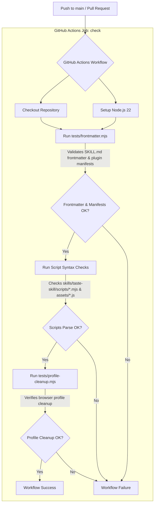
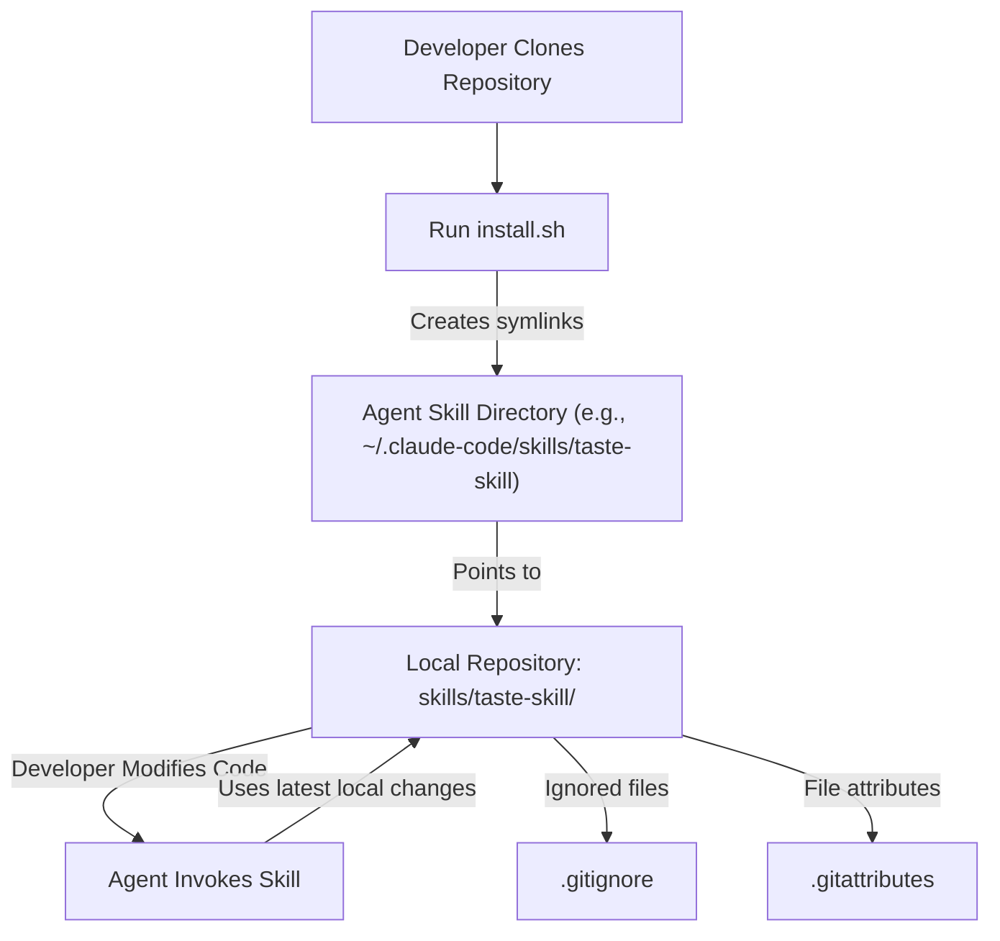

<!-- source: DeepWiki mcp.deepwiki.com · repo Leonxlnx/taste-skill · page 5 Repository Tooling & CI · fetched 2026-10-26 -->

# Repository Tooling & CI

Relevant source files

The following files were used as context for generating this wiki page:

- [.github/workflows/check-skills.yml](.github/workflows/check-skills.yml)
- [assets/readme-tastecode-dark.webp](assets/readme-tastecode-dark.webp)
- [tests/frontmatter.mjs](tests/frontmatter.mjs)

This page provides a high-level overview of the development and release tooling used within the `taste-skill` repository. It covers the automated checks that ensure code quality and skill integrity, as well as the mechanisms for local development and integration with agent environments. Detailed explanations for each topic are provided in dedicated child pages.

## Tests & CI Workflow

The repository employs a Continuous Integration (CI) workflow to maintain the quality and reliability of the `taste-skill`. This workflow is defined in `.github/workflows/check-skills.yml` and runs on every push to `main` and on every pull request. The primary checks include validating the frontmatter of `SKILL.md` files, ensuring script syntax correctness, and performing regression tests for browser profile cleanup.

The `tests/frontmatter.mjs` script is crucial for ensuring that skill metadata is correctly parsed by various agents like Claude Code and Codex. It strictly validates the YAML frontmatter in each `SKILL.md` file, checking for correct syntax, unique skill names, and appropriate length constraints for descriptions [tests/frontmatter.mjs:1-67](). Additionally, it validates the JSON structure of plugin manifests (`.claude-plugin/marketplace.json`, `.codex-plugin/plugin.json`, `.agents/plugins/marketplace.json`) and verifies that all listed skill paths exist [tests/frontmatter.mjs:51-56]().

Script syntax is checked by attempting to parse all `.mjs` and `.js` files within the `skills/taste-skill/scripts/` and `skills/taste-skill/assets/` directories [.github/workflows/check-skills.yml:21](). This ensures that no syntax errors are introduced that could prevent the skill from running.

Finally, a regression test for browser profile cleanup is executed via `tests/profile-cleanup.mjs` [tests/profile-cleanup.mjs]() to ensure that temporary browser profiles created during skill execution are properly removed, preventing resource leaks.

For details, see [Tests & CI Workflow](#5.1).

### CI Workflow Diagram

Sources:
- [.github/workflows/check-skills.yml:1-23]()
- [tests/frontmatter.mjs:1-67]()

## install.sh & Local Development

The `install.sh` script facilitates local development by symlinking the `taste-skill` into various agent environments, such as Claude Code and Codex. This allows developers to iterate on the skill without needing to reinstall it repeatedly. The script handles the creation of symbolic links from the local repository checkout to the expected skill directories of the agents.

The repository also adheres to `.gitignore` and `.gitattributes` conventions to manage version control effectively. `.gitignore` prevents unnecessary files (like build artifacts, temporary files, and user-specific configurations) from being committed, while `.gitattributes` helps standardize line endings and file types across different development environments.

This setup enables a smooth local development workflow where changes made in the repository are immediately reflected in the agent's skill environment, allowing for rapid testing and iteration.

For details, see [install.sh & Local Development](#5.2).

### Local Development Workflow

Sources:
- No specific file content was provided for `install.sh`, `.gitignore`, or `.gitattributes`, so this section is based on general knowledge of such tools and the prompt's description.

---

