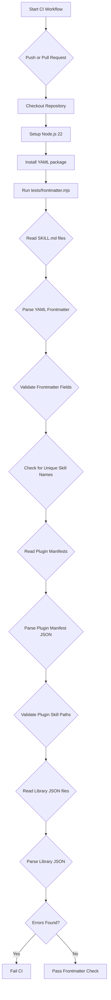
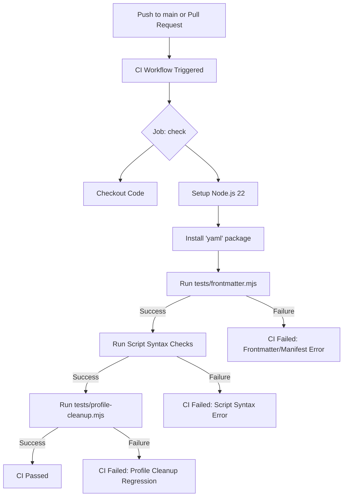

<!-- source: DeepWiki mcp.deepwiki.com · repo Leonxlnx/taste-skill · page 5.1 Tests & CI Workflow · fetched 2026-10-26 -->

# Tests & CI Workflow

<details>
<summary>Relevant source files</summary>

The following files were used as context for generating this wiki page:

- [.github/workflows/check-skills.yml](.github/workflows/check-skills.yml)
- [assets/readme-tastecode-dark.webp](assets/readme-tastecode-dark.webp)
- [skills/taste-skill/scripts/lib/cdp.mjs](skills/taste-skill/scripts/lib/cdp.mjs)
- [tests/frontmatter.mjs](tests/frontmatter.mjs)
- [tests/profile-cleanup.mjs](tests/profile-cleanup.mjs)

</details>


This page details the testing and Continuous Integration (CI) workflow for the `taste-skill` repository. The primary purpose of these checks is to ensure the quality and compatibility of the skill's components, particularly its `SKILL.md` frontmatter and plugin manifests, as well as the proper cleanup of browser profiles. These tests are automatically executed on every push to the `main` branch and on every pull request, as defined in the `.github/workflows/check-skills.yml` workflow [`.github/workflows/check-skills.yml:3-7`]().

## SKILL.md Frontmatter and Plugin Manifest Validation

The `tests/frontmatter.mjs` script is responsible for validating the `SKILL.md` frontmatter and plugin manifests. This is crucial because agents like Claude Code and Codex parse `SKILL.md` frontmatter with a strict YAML parser, silently dropping skills that fail to parse [tests/frontmatter.mjs:2-4](). This script ensures that all `SKILL.md` files adhere to the expected format and that plugin manifests correctly reference existing skills.

### Implementation Details

The `frontmatter.mjs` script performs the following checks:
1.  **YAML Parsing**: It attempts to parse the YAML frontmatter of each `SKILL.md` file using a strict YAML parser (`yaml` package) [tests/frontmatter.mjs:23-25](). Any parsing errors or warnings are reported.
2.  **Frontmatter Structure**:
    *   Verifies the presence of a frontmatter block (`--- ... ---`) at the top of `SKILL.md` [tests/frontmatter.mjs:35-36]().
    *   Checks that the `name` field is a kebab-case string, at most 64 characters long [tests/frontmatter.mjs:38]().
    *   Ensures the `description` field is a non-empty string, at most 1024 characters long [tests/frontmatter.mjs:39-40]().
    *   Validates that `disable-model-invocation` (if present) is a boolean [tests/frontmatter.mjs:41]().
    *   Confirms that skill names are unique across all `SKILL.md` files [tests/frontmatter.mjs:42]().
3.  **OpenAI Plugin Manifest**: If an `agents/openai.yaml` file exists, it parses its content and checks that `policy.allow_implicit_invocation` is a boolean [tests/frontmatter.mjs:43-47]().
4.  **Plugin Manifests**: It iterates through `.claude-plugin/marketplace.json`, `.codex-plugin/plugin.json`, and `.agents/plugins/marketplace.json` [tests/frontmatter.mjs:51]().
    *   Validates that these files are valid JSON [tests/frontmatter.mjs:53]().
    *   For each plugin listed, it verifies that all referenced skill paths (`plugin.skills`) exist and contain a `SKILL.md` file [tests/frontmatter.mjs:54]().
5.  **Library JSON Files**: It checks all `.json` files within `skills/taste-skill/library` for valid JSON syntax [tests/frontmatter.mjs:59-60]().

### Data Flow


**Diagram: Frontmatter and Plugin Manifest Validation Workflow**

Sources:
* [tests/frontmatter.mjs:2-67]()
* [.github/workflows/check-skills.yml:17-19]()

## Browser Profile Cleanup Regression Test

The `tests/profile-cleanup.mjs` script is a regression test for the browser profile cleanup functionality implemented in `skills/taste-skill/scripts/lib/cdp.mjs`. This test ensures that temporary browser profiles created by the `cdp.mjs` module are correctly managed and removed, preventing accumulation of leftover data.

### Implementation Details

The `cdp.mjs` module creates a throwaway browser profile for each run, marked with an owner file (`taste-skill-owner.json`) containing the hostname and PIDs of the process and the Chrome instance [skills/taste-skill/scripts/lib/cdp.mjs:43-44, 78-80](). The `sweepProfiles` function in `cdp.mjs` is designed to remove abandoned profiles (those whose owner file indicates that both the process and Chrome instance are no longer alive on the current host) [skills/taste-skill/scripts/lib/cdp.mjs:50-60]().

The `tests/profile-cleanup.mjs` script tests this functionality by:
1.  **Fixture Setup**: It creates a temporary directory to simulate the `tmpdir()` [tests/profile-cleanup.mjs:60]().
2.  **Fake Chrome**: It sets up a `fake-chrome` executable that mimics Chrome's behavior of printing the DevTools URL to stderr, but does not actually launch a real browser [tests/profile-cleanup.mjs:61-63](). This avoids dependency on a real browser for the test.
3.  **Test `Browser.launch()`**:
    *   It creates several dummy browser profiles: some with lock files, some without, and one explicitly "abandoned" (with PIDs of already exited processes) [tests/profile-cleanup.mjs:31-34]().
    *   It then calls `Browser.launch()` within a child process [tests/profile-cleanup.mjs:64-68]().
    *   It asserts that `Browser.launch()` correctly deletes the abandoned profile but preserves other profiles that are either still in use or not owned by the current host/process [tests/profile-cleanup.mjs:45-47]().
    *   It verifies that the newly launched browser claims its own profile with the correct owner information [tests/profile-cleanup.mjs:48-49]().
    *   Finally, it asserts that `browser.close()` removes the owned profile [tests/profile-cleanup.mjs:54]().
4.  **Test `sweepProfiles()` directly**:
    *   It creates a set of profiles with various owner file configurations: abandoned, still-running process, still-running Chrome, different host, no owner file, malformed owner file, and non-profile directories [tests/profile-cleanup.mjs:80-91]().
    *   It calls `sweepProfiles()` and asserts that only the truly abandoned profiles are removed, while others are preserved [tests/profile-cleanup.mjs:92-94]().

The `deadPid()` helper function generates a PID that is guaranteed to be gone by spawning and immediately exiting a child process [tests/profile-cleanup.mjs:11]().

### `cdp.mjs` Browser Profile Management

```mermaid
graph TD
    subgraph "cdp.mjs"
        A[Browser.launch()] --> B{Find Chrome Executable};
        B --> C[Determine Base Temp Directory];
        C --> D[Call sweepProfiles(base)];
        D --> E{Iterate Profiles in Base};
        E --> F{Check Profile Name Prefix "ad-chrome-"};
        F --> G{Read taste-skill-owner.json};
        G --> H{Validate Owner File Content};
        H --> I{Check if Hostname Matches};
        I --> J{Check if Process PID is Alive};
        J --> K{Check if Chrome PID is Alive};
        K -- All Gone --> L[Remove Profile Directory];
        K -- Any Alive --> M[Keep Profile Directory];
        D --> N[Create New Temp Profile Directory];
        N --> O[Write taste-skill-owner.json for New Profile];
        O --> P[Spawn Chrome Process];
        P --> Q[Capture Chrome PID];
        Q --> R[Update taste-skill-owner.json with Chrome PID];
        R --> S[Listen for DevTools URL];
        S --> T[Connect WebSocket];
        T --> U[Return Browser Instance];
        U --> V[Browser.close()];
        V --> W[Kill Chrome Process];
        W --> X[Remove Owned Profile Directory];
    end
    subgraph "tests/profile-cleanup.mjs"
        Y[Test: launch preserves older foreign profiles] --> Z[Setup Fake Chrome];
        Z --> AA[Create Test Profiles (abandoned, locked, etc.)];
        AA --> BB[Spawn Child Process for Browser.launch()];
        BB --> CC[Assert Abandoned Profile Removed];
        CC --> DD[Assert Other Profiles Preserved];
        DD --> EE[Assert Owned Profile Claimed];
        EE --> FF[Assert Owned Profile Removed on Close];
        Y --> GG[Test: sweep removes a profile only when its owner file says both processes are gone];
        GG --> HH[Create Test Profiles with various owner states];
        HH --> II[Call sweepProfiles() directly];
        II --> JJ[Assert only truly abandoned profiles removed];
    end
    D --- E;
    E --- F;
    F --- G;
    G --- H;
    H --- I;
    I --- J;
    J --- K;
    K --- L;
    K --- M;
    Y --- Z;
    Z --- AA;
    AA --- BB;
    BB --- CC;
    CC --- DD;
    DD --- EE;
    EE --- FF;
    Y --- GG;
    GG --- HH;
    HH --- II;
    II --- JJ;
```
**Diagram: Browser Profile Management and Testing**

Sources:
* [skills/taste-skill/scripts/lib/cdp.mjs:40-62]()
* [skills/taste-skill/scripts/lib/cdp.mjs:64-127]()
* [tests/profile-cleanup.mjs:1-100]()

## CI Workflow (`.github/workflows/check-skills.yml`)

The Continuous Integration workflow is defined in `.github/workflows/check-skills.yml`. This workflow is triggered on every `push` to the `main` branch and on every `pull_request` [`.github/workflows/check-skills.yml:3-7`]().

The workflow consists of a single job named `check` that runs on `ubuntu-latest` [`.github/workflows/check-skills.yml:9-10`](). It performs the following steps:

1.  **Checkout Repository**: Uses `actions/checkout@v4` to get the code [`.github/workflows/check-skills.yml:12`]().
2.  **Setup Node.js**: Uses `actions/setup-node@v4` to install Node.js version 22 [`.github/workflows/check-skills.yml:13-15`](). Node 22 is required for the built-in WebSocket used by `cdp.mjs` [skills/taste-skill/scripts/lib/cdp.mjs:67-68]().
3.  **SKILL.md Frontmatter Check**:
    *   Installs the `yaml` package [`.github/workflows/check-skills.yml:18`]().
    *   Executes `node tests/frontmatter.mjs` to validate `SKILL.md` frontmatter and plugin manifests [`.github/workflows/check-skills.yml:19`]().
4.  **Script Syntax Check**:
    *   Iterates through all `.mjs` files in `skills/taste-skill/scripts/` and `skills/taste-skill/scripts/lib/`, and `.js` files in `skills/taste-skill/assets/` [`.github/workflows/check-skills.yml:21`]().
    *   Uses `node --check` to perform a syntax check on each script. This ensures that all JavaScript files are syntactically valid without actually executing them [`.github/workflows/check-skills.yml:21`]().
5.  **Browser Profile Cleanup Regression**:
    *   Executes `node --test tests/profile-cleanup.mjs` to run the browser profile cleanup regression test [`.github/workflows/check-skills.yml:23`]().


**Diagram: CI Workflow for `taste-skill`**

Sources:
* [.github/workflows/check-skills.yml:1-23]()
* [skills/taste-skill/scripts/lib/cdp.mjs:67-68]()

---

