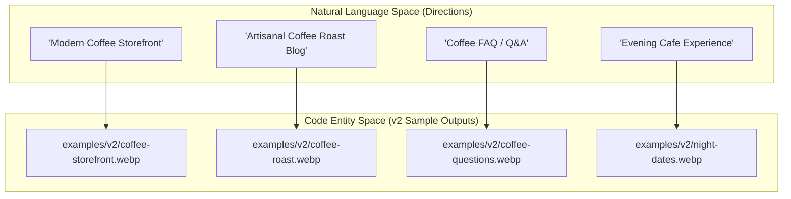
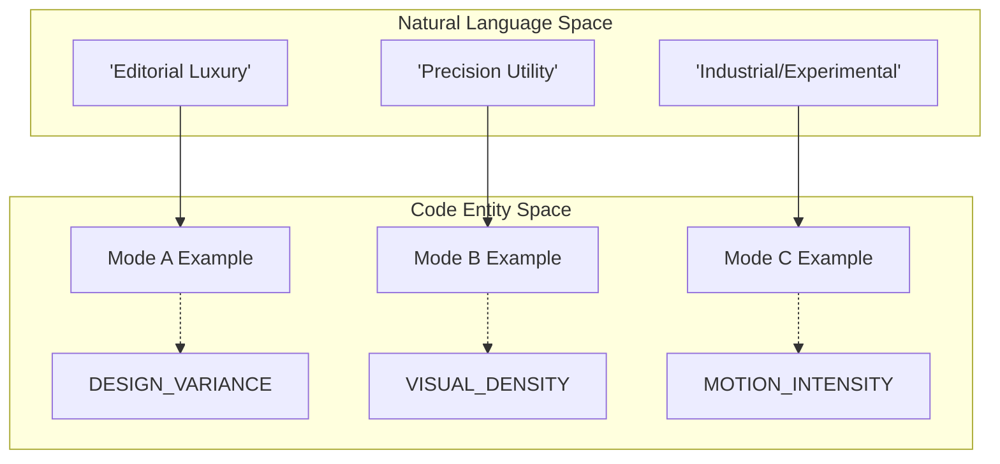
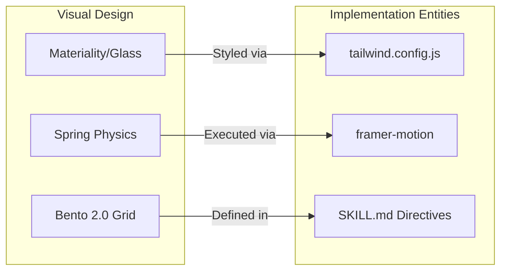

<!-- source: DeepWiki mcp.deepwiki.com · repo Leonxlnx/taste-skill · page 6 Examples & Visual Demos · fetched 2026-10-26 -->

# Examples & Visual Demos

Relevant source files

The following files were used as context for generating this wiki page:

- [assets/readme-tastecode.webp](assets/readme-tastecode.webp)
- [examples/v2/coffee-questions.webp](examples/v2/coffee-questions.webp)
- [examples/v2/coffee-roast.webp](examples/v2/coffee-roast.webp)
- [examples/v2/coffee-storefront.webp](examples/v2/coffee-storefront.webp)
- [examples/v2/night-dates.webp](examples/v2/night-dates.webp)

This section provides an overview of the practical applications of the Taste Standard. It highlights the `examples/` directory, which contains high-fidelity visual demos and reference implementations of the primary design modes. These examples serve as the "Gold Standard" for what AI agents should produce when these skills are correctly applied.

For deep-dive documentation on each file, see [v2 Example Gallery](#6.1).

## The Floria Visual Demo

The Floria demo is the flagship visual representation of the `taste-skill`. It demonstrates the transition from a standard "AI-looking" layout to a premium, high-agency interface. The demo specifically showcases the "Editorial" and "Precision" aesthetics, featuring advanced typography, asymmetric bento grids, and sophisticated materiality.

### Visual Assets
The following screenshots illustrate the expected output quality:
*   **floria-top.webp**: Showcases the hero section, typographic hierarchy, and navigation [assets/readme-tastecode.webp:1]().
*   **floria-bottom.webp**: Demonstrates footer architecture and secondary content layouts [assets/readme-tastecode.webp:1]().
*   **floria-full.webp**: A complete vertical composition showing the rhythm and flow of the entire page [assets/readme-tastecode.webp:1]().

Sources: [assets/readme-tastecode.webp:1]()

## v2 Pipeline Sample Outputs

The `examples/v2/` directory contains sample outputs generated by the `taste-skill v2` pipeline. These examples demonstrate the pipeline's ability to produce diverse, high-quality designs based on different "directions" (themes or aesthetic guidelines) and real imagery sourced through `assets.mjs`. Each example showcases specific aspects of the v2 pipeline's capabilities, including layout, typography, and image integration.

### Visual Assets
The following WebP images are representative outputs from the v2 pipeline:
*   **coffee-storefront.webp**: Illustrates a clean, modern e-commerce storefront design, demonstrating layout and product presentation [examples/v2/coffee-storefront.webp:1]().
*   **coffee-roast.webp**: Shows a content-focused page, possibly for a blog or informational site, highlighting typographic treatment and imagery [examples/v2/coffee-roast.webp:1]().
*   **coffee-questions.webp**: Presents an interactive or FAQ-style page, focusing on clear information hierarchy and user engagement elements [examples/v2/coffee-questions.webp:1]().
*   **night-dates.webp**: Features a more atmospheric or editorial design, showcasing advanced imagery and mood setting [examples/v2/night-dates.webp:1]().

Sources: [examples/v2/coffee-storefront.webp:1](), [examples/v2/coffee-roast.webp:1](), [examples/v2/coffee-questions.webp:1](), [examples/v2/night-dates.webp:1]()

### Mapping v2 Directions to Sample Outputs

The following diagram illustrates how different "directions" (conceptual design themes) processed by the `draw.mjs` module translate into the specific visual outputs found in the `examples/v2/` directory. This bridges the abstract concept of a "direction" with concrete, generated examples.

**System Mapping: v2 Directions to Sample Outputs**

Sources: [examples/v2/coffee-storefront.webp:1](), [examples/v2/coffee-roast.webp:1](), [examples/v2/coffee-questions.webp:1](), [examples/v2/night-dates.webp:1]()

## Design Mode Reference Files

The repository includes three distinct reference files in the `examples/` directory. These files are not just code samples; they are "Vibe Blueprints" that agents use to calibrate their output based on the global configuration dials.

| Example File | Primary Mode | Key Characteristics |
| :--- | :--- | :--- |
| **Mode A** | Editorial Luxury | High whitespace, large serif typography, asymmetric layouts. |
| **Mode B** | Precision Utility | High density, micro-interactions, "Linear-style" crispness. |
| **Mode C** | Installation / Experimental | Bold contrasts, large-scale motion, unconventional grids. |

### Mapping Natural Language to Code Entities

The following diagram bridges the conceptual "Design Modes" mentioned in the documentation to the specific files and configuration dials that drive them within the `taste-skill` architecture.

**System Mapping: Design Concepts to Code**

Sources: [assets/readme-tastecode.webp:1]()

## Usage as Reference Outputs

These examples are used by the system in two primary ways:
1.  **Calibration**: When a user sets a dial (e.g., `DESIGN_VARIANCE: 10`), the agent refers to the logic demonstrated in the examples to increase layout complexity [assets/readme-tastecode.webp:1]().
2.  **Audit Baseline**: The `redesign-skill` uses these examples as the target state when auditing existing boilerplate code [assets/readme-tastecode.webp:1]().

**Component Architecture Mapping**

Sources: [assets/readme-tastecode.webp:1]()

For detailed breakdowns of the code within these examples and a gallery of the Floria components, see [v2 Example Gallery](#6.1).

---

