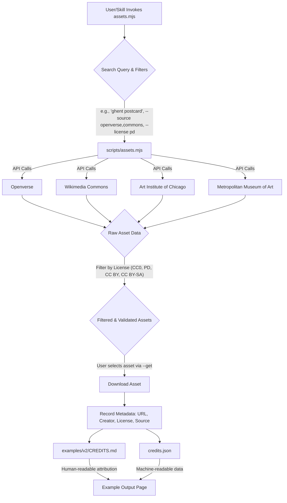
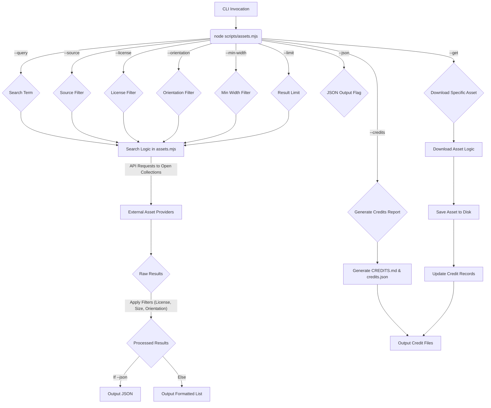

<!-- source: DeepWiki mcp.deepwiki.com · repo Leonxlnx/taste-skill · page 6.2 Asset Credits & Licensing · fetched 2026-10-26 -->

# Asset Credits & Licensing

<details>
<summary>Relevant source files</summary>

The following files were used as context for generating this wiki page:

- [examples/v2/CREDITS.md](examples/v2/CREDITS.md)
- [skills/taste-skill/references/imagery.md](skills/taste-skill/references/imagery.md)

</details>


This page details how the `taste-skill` manages media provenance for its example outputs, specifically through `examples/v2/CREDITS.md` and `credits.json`. It also outlines the licensing obligations for assets sourced from open collections, emphasizing the importance of proper attribution and adherence to usage rights.

## Media Provenance in Example Outputs

The `taste-skill` generates example web pages that often incorporate real-world imagery. To ensure transparency and compliance, the skill records the provenance of these media assets. This is primarily handled by the `scripts/assets.mjs` script, which sources images and videos from open collections.

When an example output is generated, the details of the media used are captured in two main locations:
1.  `examples/v2/CREDITS.md`: A human-readable Markdown file listing each asset, its creator, license, and a direct link to its source.
2.  `credits.json`: A machine-readable JSON file containing structured data about each asset, used for programmatic access and verification.

### `CREDITS.md` Structure

The `CREDITS.md` file provides a clear, itemized list of all photographs and films used in the example pages. Each entry includes:
*   The title or description of the media.
*   The creator's name.
*   The license under which the media is used (e.g., CC BY-SA 4.0, public domain).
*   The source platform (e.g., Wikimedia Commons, Flickr).
*   A direct URL to the media asset's page.
*   The media type (e.g., `[photograph]`, `[film]`).

This format ensures that anyone reviewing the example outputs can easily trace back the origin and licensing terms of each visual element [examples/v2/CREDITS.md:1-4]().

**Example `CREDITS.md` Entry:**
```markdown
- "2020-01-20-Helios-Leuchtturm-" by Superbass, CC BY-SA 4.0, via Wikimedia Commons [photograph](https://commons.wikimedia.org/wiki/File:2020-01-20-Helios-Leuchtturm-.jpg)
```
Sources:
* [examples/v2/CREDITS.md:1-69]()

## Open-Collection Media Sourcing and Licensing

The `taste-skill` prioritizes the use of "Real pictures of the subject's world from the open collections" [skills/taste-skill/references/imagery.md:52-56](). This is achieved through the `scripts/assets.mjs` script, which acts as a zero-dependency asset discovery and download tool [skills/taste-skill/references/imagery.md:75-77]().

### `assets.mjs` Functionality

The `assets.mjs` script searches various open sources for media, including:
*   **Openverse**: one index over Flickr, Wikimedia Commons, museums and libraries.
*   **Wikimedia Commons**: archival photographs, old maps, scans of prints and books, places as they look now.
*   **The Art Institute of Chicago** and **The Metropolitan Museum of Art**: public-domain paintings, prints, drawings, photographs, textiles and objects, in large scans [skills/taste-skill/references/imagery.md:78-83]().

The script provides command-line interface (CLI) options for searching and filtering assets:
*   `node <skill>/scripts/assets.mjs "query"`: Performs a general search.
*   `--source`: Specifies which sources to search (e.g., `openverse,commons`).
*   `--license`: Filters by license type (e.g., `pd` for public domain, which requires no credit). By default, it keeps licenses allowing commercial use (CC0, public domain, CC BY, CC BY-SA) [skills/taste-skill/references/imagery.md:92-93]().
*   `--orientation`: Filters by image orientation (e.g., `portrait`).
*   `--min-width`: Sets a minimum width for images (default is 1000 pixels) [skills/taste-skill/references/imagery.md:93-94]().
*   `--limit`: Limits the number of results.
*   `--json`: Outputs raw results in JSON format [skills/taste-skill/references/imagery.md:95-96]().
*   `--get <ref>`: Downloads a specific asset using its reference ID and records its credits [skills/taste-skill/references/imagery.md:89]().
*   `--credits`: Generates a footer line and a report list of credits [skills/taste-skill/references/imagery.md:90]().

Each search result includes a direct image URL, the source page, size, creator, license, and a credit line [skills/taste-skill/references/imagery.md:75-77]().

### Licensing Obligations

The `taste-skill` adheres to strict licensing requirements for all sourced media. The `--license` flag in `assets.mjs` is crucial for ensuring compliance. By default, the script only retrieves assets with licenses that permit commercial use and require attribution, such as Creative Commons (CC BY, CC BY-SA) and public domain (CC0) [skills/taste-skill/references/imagery.md:92-93]().

When an asset is downloaded using `--get`, its licensing information is automatically recorded. This information is then used to populate the `CREDITS.md` and `credits.json` files, fulfilling the attribution requirements of the respective licenses. For public domain assets (`--license pd`), no credit is technically required, but the skill still records the provenance for completeness and transparency.

The `imagery.md` reference document provides detailed guidance on "What to search for" [skills/taste-skill/references/imagery.md:98-114]() and "What makes a good find" [skills/taste-skill/references/imagery.md:119-124](), emphasizing the importance of relevance, quality, and appropriate licensing.

### Diagram: Asset Sourcing and Credit Generation Workflow


**Diagram: Asset Sourcing and Credit Generation Workflow**
Sources:
* [skills/taste-skill/references/imagery.md:75-96]()
* [examples/v2/CREDITS.md:1-4]()

### Diagram: `assets.mjs` CLI Options to Internal Logic


**Diagram: `assets.mjs` CLI Options to Internal Logic**
Sources:
* [skills/taste-skill/references/imagery.md:84-96]()

---

