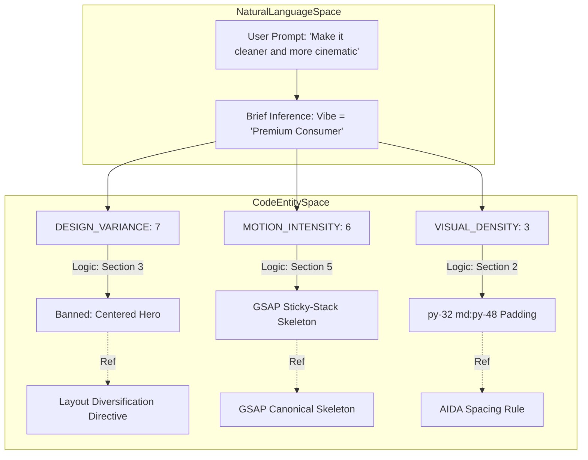
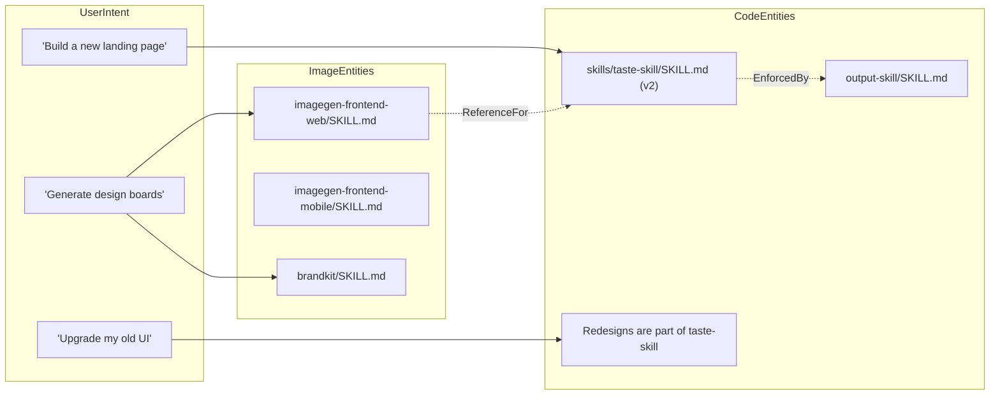

<!-- source: DeepWiki mcp.deepwiki.com · repo Leonxlnx/taste-skill · page 7 Glossary · fetched 2026-10-26 -->

# Glossary

Relevant source files

The following files were used as context for generating this wiki page:

- [CHANGELOG.md](CHANGELOG.md)
- [skills/taste-skill/SKILL.md](skills/taste-skill/SKILL.md)
- [skills/taste-skill/scripts/lib/rules.mjs](skills/taste-skill/scripts/lib/rules.mjs)

This glossary defines the technical terms, architectural patterns, and domain-specific jargon used within the `taste-skill` system. It serves as a reference for developers and AI agents to ensure consistent implementation of the "Taste Standard."

## Core Configuration Dials

The system uses three numeric variables (1–10) to programmatically adjust the personality and complexity of the generated frontend. These are the primary "knobs" used by agents to interpret a user's brief.

| Term | Definition | Code Pointer |
| :--- | :--- | :--- |
| `DESIGN_VARIANCE` | Controls layout experimentation. Low values (1-3) produce centered, symmetrical layouts. High values (8-10) trigger asymmetric, "artsy" structures and off-grid editorial compositions. | [skills/taste-skill/SKILL.md:47-47]() |
| `MOTION_INTENSITY` | Determines the volume and complexity of animations, ranging from static (1) to magnetic physics, scroll-pinning, and cinematic GSAP orchestration (8-10). | [skills/taste-skill/SKILL.md:48-48]() |
| `VISUAL_DENSITY` | Manages information architecture. Low values (1-3) prioritize whitespace and "gallery-like" breathing room; high values (8-10) optimize for data-heavy "cockpit" interfaces. | [skills/taste-skill/SKILL.md:49-49]() |

### Dial Implementation Flow
The following diagram illustrates how these natural language "dials" translate into specific code-level constraints and logic branches.

**Diagram: Dial-to-Code Mapping**

Sources: [skills/taste-skill/SKILL.md:43-78]()

---

## Architectural Terms & Directives

### Anti-Slop / AI Tells
"Slop" refers to the generic, predictable UI patterns typically generated by LLMs. The `taste-skill` v2 includes a hardened list of "AI Tells" that must be avoided to ensure a premium, human-authored feel.
*   **Em-Dash Ban:** A total prohibition of the em-dash (`—`) in all copy, including headlines and button text, as it is a common statistical marker of AI-generated prose.
*   **Banned Patterns:** Pure black backgrounds, `Inter` font for premium vibes, and generic section numbering eyebrows (e.g., "01 / FEATURES"). [skills/taste-skill/SKILL.md:19-20](), [skills/taste-skill/scripts/lib/rules.mjs:50-53](), [skills/taste-skill/scripts/lib/rules.mjs:58-61]()

### Brief Inference (Section 0)
The mandatory pre-flight phase where the agent "reads the room" before generating code. It analyzes the page kind, audience, and "vibe words" to output a one-line "Design Read."
*   **Source:** [skills/taste-skill/SKILL.md:13-41]()

### Design System Map
A logic table that directs the agent to use **official** component packages (like `@fluentui/react-components` or `govuk-frontend`) instead of hand-rolling CSS when the brief matches a known enterprise or public-sector standard.
*   **Source:** [skills/taste-skill/SKILL.md:82-105]()

### Python-Driven True Randomization
A mandatory step in `gpt-taste` where the agent simulates a Python script execution in a `<design_plan>` block. This uses a deterministic seed (prompt length) to select layouts and fonts, breaking the LLM's tendency to pick the "first" or "safest" option.
Sources: [skills/taste-skill/SKILL.md:109-110]()

---

## Technical Specifications

### GSAP Canonical Skeletons
Pre-defined, hardened code structures for complex animations that prevent common AI errors in scroll-tracking and pinning.
*   **Sticky-Stack:** Cards that pin and overlap during scroll. [CHANGELOG.md:42-43]()
*   **Horizontal-Pan:** Sections that scroll horizontally while pinned. [CHANGELOG.md:42-43]()

### Viewport Stability (100dvh)
A critical rule to prevent layout jumping on mobile browsers (specifically iOS Safari). The system bans `h-screen` in favor of dynamic viewport units.
*   **Constraint:** Use `min-h-[100dvh]` for hero sections.
Sources: [CHANGELOG.md:42-43]()

### Gapless Bento Grid
A masonry-style layout requirement where cells must interlock perfectly without "dead" cells. It requires mathematical verification of `col-span` and `row-span` and the use of `grid-flow-dense`.
Sources: [CHANGELOG.md:42-43]()

---

## System Components & Entities

The following diagram bridges the conceptual design needs to the specific skill entities and their roles in the codebase.

**Diagram: Skill Entity Relationship**

Sources: [CHANGELOG.md:31-34](), [CHANGELOG.md:35-36]()

### Glossary Table of Jargon

| Term | Definition | Implementation Detail |
| :--- | :--- | :--- |
| **slop** | Generic, uninspired, or "AI-made" design patterns that `taste-skill` aims to eliminate. | Core concept of `taste-skill`. [skills/taste-skill/SKILL.md:3-3]() |
| **tells** | Specific design patterns or visual cues that betray AI generation, which `taste-skill` actively avoids. | Examples: eyebrows, 01/02/03 numbering, monospace labels. [skills/taste-skill/SKILL.md:19-20](), [skills/taste-skill/scripts/lib/rules.mjs:50-53](), [skills/taste-skill/scripts/lib/rules.mjs:58-61]() |
| **Inventory** | The process of listing unique attributes of a client/subject (name, location, numbers, constraints, materials, rituals, printed items) to inform design decisions. | Step 1 of the `taste-skill` v2 run. [skills/taste-skill/SKILL.md:72-99]() |
| **Direction Sheet** | The art direction for a build, generated by `draw.mjs`, detailing composition, type system, palette, hero, and section compositions. | Output of `node <skill>/scripts/draw.mjs`. [skills/taste-skill/SKILL.md:24-27](), [skills/taste-skill/SKILL.md:109-110]() |
| **The Gate** | The automated compliance check for generated pages, involving static source linting (`lint.mjs`) and headless browser inspection (`inspect.mjs`). | Step 3 of `taste-skill` v2's "How it works". [skills/taste-skill/SKILL.md:21-22]() |
| **One Live Thing** | A core principle of `taste-skill` v2, ensuring the page has one interactive element or clear call to action. | This concept is implicitly part of the "substance" mentioned in [skills/taste-skill/SKILL.md:39-40](). |
| **House Style** | A strict set of design rules and aesthetic principles enforced by `taste-skill` v2, measured in a real browser. | Step 3 of `taste-skill` v2's "How it works". [skills/taste-skill/SKILL.md:21-22]() |
| **signature moment** | A memorable, often motion-led, visual experience on a website, typically implemented using scroll scenes. | The scroll-scene engine is designed to create these. [CHANGELOG.md:39-40]() |
| **scroll scene** | A section of a page where content is animated or transformed based on scroll position, often using GSAP ScrollTrigger. | Implemented via `assets/scenes/stage.js` and `stage.css`. [CHANGELOG.md:42-44]() |
| **app screen** | A type of interface designed for interaction and data display (dashboards, admin views, settings) rather than reading. It follows different rules than a marketing page. | Defined in `references/app-screens.md` and uses `draw.mjs --app`. [skills/taste-skill/SKILL.md:46-55]() |
| **APP_SKIP** | A rule exemption mechanism for app screens, allowing certain design patterns that would otherwise be flagged as "tells" on marketing pages. | Mentioned in `references/app-screens.md`. [CHANGELOG.md:59-60]() |
| **findings FAIL/WARN** | The output of the inspection process (`inspect.mjs`), indicating whether a design rule has been violated. `FAIL` means a critical issue, `WARN` is a suggestion. | Defined in `scripts/lib/rules.mjs`. [skills/taste-skill/scripts/lib/rules.mjs:1-3]() |
| **imagery mode** | The strategy for sourcing and using images, determined by what imagery truly exists for the project. | Discussed in Step 1 of the `taste-skill` v2 run. [skills/taste-skill/SKILL.md:80-83]() |
| **blueprint** | A structural plan for a section or page, detailing its composition and content arrangement. | Dealt by `draw.mjs`. [skills/taste-skill/SKILL.md:26-27]() |
| **CDP** | Chrome DevTools Protocol. A low-level API used by `inspect.mjs` to control a headless browser for inspection and photography. | Used by `inspect.mjs`. [CHANGELOG.md:45-46]() |
| **DSF** | Design System Framework. A general term for a structured set of design guidelines and components. | The `taste-skill` itself embodies a DSF. |
| **throwaway profile** | A temporary browser profile created by `cdp.mjs` for each inspection run to ensure a clean state and prevent data leakage. | Managed by `cdp.mjs` and cleaned up. [CHANGELOG.md:9-10](), [CHANGELOG.md:53-54]() |
| **dealt fonts** | The type system (fonts, sizes, weights) selected by `draw.mjs` from its library based on the chosen direction. | Part of the output of `draw.mjs`. [skills/taste-skill/SKILL.md:25-26]() |
| **film strip** | A sequence of screenshots captured during a scroll, used to audit motion and content visibility. | Captured by `inspect.mjs --film`. [CHANGELOG.md:45-46]() |
| **install name** | The unique identifier used to install a specific skill via `npx skills add`. | Examples: `design-taste-frontend`, `design-taste-frontend-v2-experimental`. [CHANGELOG.md:16-17]() |
| **open collections** | Publicly available image and media archives (e.g., Openverse, Wikimedia Commons, Art Institute of Chicago, Met) used for asset sourcing. | Used by `assets.mjs`. [skills/taste-skill/SKILL.md:97-98]() |

Sources: [skills/taste-skill/SKILL.md:3-27](), [skills/taste-skill/SKILL.md:46-55](), [skills/taste-skill/SKILL.md:72-99](), [skills/taste-skill/SKILL.md:109-110](), [skills/taste-skill/scripts/lib/rules.mjs:1-3](), [skills/taste-skill/scripts/lib/rules.mjs:50-61](), [CHANGELOG.md:9-10](), [CHANGELOG.md:16-17](), [CHANGELOG.md:39-46](), [CHANGELOG.md:53-54](), [CHANGELOG.md:59-60]()