# Page: Overview

# Overview

<details>
<summary>Relevant source files</summary>

The following files were used as context for generating this wiki page:

- [CHANGELOG.md](CHANGELOG.md)
- [README.md](README.md)
- [assets/sponsors/vercel-logo.svg](assets/sponsors/vercel-logo.svg)
- [assets/vercel-oss-program-badge.svg](assets/vercel-oss-program-badge.svg)
- [skills/taste-skill/SKILL.md](skills/taste-skill/SKILL.md)

</details>


**Taste Skill** (`design-taste-frontend`) is an agent skill and anti-slop art direction toolkit designed to force coding agents (such as Claude Code and Codex) to design high-agency websites and app screens instead of generating generic, uninspired UI templates [README.md:61](), [skills/taste-skill/SKILL.md:2-13](). 

The repository features the v2/v2.1 pipeline, shifting from heuristic prompts to deterministic composition scripts (`draw.mjs`, `assets.mjs`), open-collection real imagery integration, scroll scenes, app-screen modes for dashboards, and a rigorous real-browser quality gate [README.md:123-139](), [CHANGELOG.md:37-61](). Classic style skills have been separated into dedicated repositories [README.md:121](), [CHANGELOG.md:15]().

## The v2 and v2.1 Pipeline Architecture

AI agents traditionally default to uniform layouts, low-contrast gradients, hairlines, and AI tells [CHANGELOG.md:32](). Taste Skill mitigates this via a deterministic pipeline:
1. **Inventory**: Cataloging unique assets, metrics, and domain specifics [README.md:127]().
2. **Draw**: Dealing directions, type systems, and palettes from a researched library using `scripts/draw.mjs` [CHANGELOG.md:29]().
3. **Idea**: Establishing a core concept tethered directly to the client's material [README.md:129]().
4. **Build**: Constructing the frontend using open-collection images and localized styling [README.md:130]().
5. **Gate**: Executing static linting and CDP-driven browser inspections via `scripts/inspect.mjs` [README.md:131]().
6. **Look**: Self-critiquing screenshots against an award-level visual rubric [README.md:132]().

v2.1 expands this machinery to support app screens, dashboards, admin views, and sticky scroll scenes [README.md:136](), [CHANGELOG.md:39-61]().

### Natural Language Space to Code Entity Space

The following diagram maps high-level user intents to specific execution scripts and core modules inside the codebase.

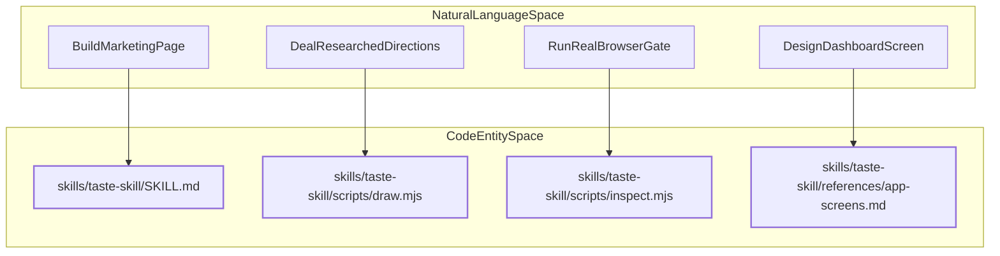
Sources: [README.md:61-137](), [skills/taste-skill/SKILL.md:1-56]()

---

## Child Guides & Detailed Documentation

This parent wiki page introduces the high-level architecture. For complete technical details, consult the child pages below:

*   **[Getting Started & Installation](#1.1)** — Installing via `npx skills add --skill design-taste-frontend`, Claude Code and Codex plugin marketplaces, local symlinking, runtime prerequisites (Node 22+, Chrome/Edge/Chromium), and agent setup.
*   **[Repository Structure](#1.2)** — Directory maps for `skills/taste-skill/`, including `scripts/`, `scripts/lib/`, `library/`, `references/`, `assets/`, `evals/`, and the relocation details for classic skills.
*   **[Plugin Manifests & Distribution](#1.3)** — Configuration details for `.claude-plugin/plugin.json`, marketplace registries, `.codex-plugin/plugin.json`, versioning via `CHANGELOG.md`, and sponsorship assets.
*   **[Release History & Version Evolution](#1.4)** — Chronological review of `CHANGELOG.md`, tracking the v1 to v2 transition, the scroll-scene engine, v2.1 app screens, and CDP browser profile sweep mechanisms.

Sources: [README.md:78-122](), [CHANGELOG.md:7-61]()

---

# Page: Getting Started & Installation

# Getting Started & Installation

<details>
<summary>Relevant source files</summary>

The following files were used as context for generating this wiki page:

- [.codex-plugin/plugin.json](.codex-plugin/plugin.json)
- [README.md](README.md)
- [assets/sponsors/vercel-logo.svg](assets/sponsors/vercel-logo.svg)
- [assets/vercel-oss-program-badge.svg](assets/vercel-oss-program-badge.svg)
- [install.sh](install.sh)

</details>


This page covers the technical integration of the **Taste Skill** collection into AI-assisted development environments. It details installation via the `npx skills` CLI [README.md:80-82](), marketplace plugins for Claude Code [README.md:89-100]() and Codex [README.md:102-112](), symlink deployment via `install.sh` [install.sh:1-135](), runtime prerequisites [README.md:86](), and agent configuration.

Sources:
- [README.md:80-122]()
- [install.sh:1-135]()

---

## Installation Methods

The repository supports multiple installation strategies depending on your agent environment and workflow requirements.

### Quick Start via CLI
To install the skill into your project using the Vercel Labs `agent-skills` CLI standard, run [README.md:80-82]():

```bash
npx skills add https://github.com/Leonxlnx/taste-skill --skill "design-taste-frontend"
```

### Claude Code Plugin Marketplace
If you are operating inside Claude Code, you can add the plugin repository and install namespaced skills [README.md:89-100]():

```
/plugin marketplace add Leonxlnx/taste-skill
/plugin install taste-skill@taste-skill
```

Updates are managed via `/plugin update` [README.md:98](). Every skill is namespaced under `taste-skill:` to prevent collision with other skills [README.md:91]().

### Codex Plugin Marketplace
For Codex environments, use the corresponding plugin marketplace commands [README.md:102-112]():

```bash
codex plugin marketplace add Leonxlnx/taste-skill
codex plugin add taste-skill@taste-skill
```

Start a new Codex session afterwards to ensure the skill is loaded [README.md:110]().

Sources:
- [README.md:78-122]()

---

## Local Symlinking (`install.sh`)

For local development and continuous synchronization via `git pull`, the repository provides a shell utility script: `install.sh` [install.sh:1-15]().

Rather than copying files, `install.sh` creates symbolic links into your agent skill directories (`$HOME/.claude/skills` or `$HOME/.codex/skills`) [install.sh:8-30]().

Key implementation functions in `install.sh`:
- `resolve_link()`: Resolves absolute and relative symlinks against the link's directory to verify their origin [install.sh:44-51]().
- `owned_by_repo()`: Validates that an existing symlink resolves directly inside `$SKILLS_DIR` [install.sh:53-58]().
- `install_name()`: Parses frontmatter `name:` fields from `SKILL.md`, falling back to the directory name [install.sh:60-67]().

Usage flags:
```bash
./install.sh                          # link all skills into Claude Code
./install.sh --codex                  # link into Codex instead
./install.sh --all-agents             # link into both
./install.sh design-taste-frontend    # link specific install name by name
./install.sh --list                   # show install name -> folder mapping
./install.sh --uninstall              # remove links pointing at this repo
```

Sources:
- [install.sh:1-135]()

---

## Runtime Prerequisites

The `design-taste-frontend` skill executes local scripts (such as `draw.mjs`, `assets.mjs`, and `lint.mjs`) during its build and validation pipeline. 

- **Node.js**: Requires **Node 22+** to support native ESM modules and modern JavaScript features utilized in the scripts [README.md:86]().
- **Browser Runtime**: Requires an installed instance of **Chrome, Edge, or Chromium** for CDP-driven headless browser validation and measurement [README.md:86]().
- **Network Access**: Required for open-collection asset discovery across Wikimedia Commons, Openverse, and art archives [README.md:86](). No API keys are required [README.md:86]().

Sources:
- [README.md:78-87]()

---

## Data Flow & Architecture

The following diagrams illustrate how installation mechanisms and natural language inputs translate into runtime agent behavior and code structures.

### Diagram 1: Installation Data Flow and Agent Binding
This diagram maps the remote repository distribution channels and local symlink resolution to agent execution environments.

Title: "Installation Data Flow and Agent Binding"
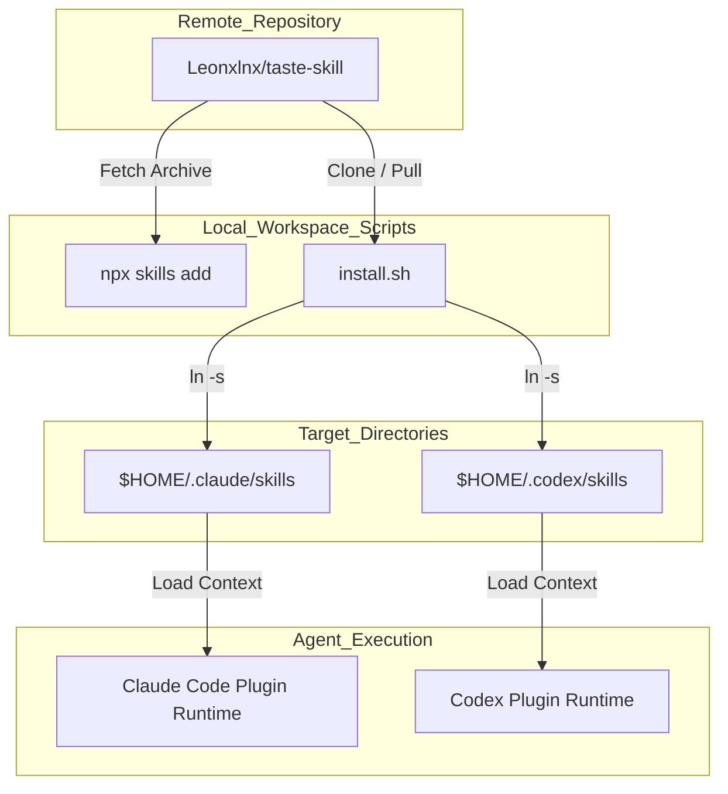

Sources:
- [README.md:78-120]()
- [install.sh:26-40]()

### Diagram 2: Natural Language Brief to Code Entity Space
This diagram links high-level agent design inputs and configuration parameters to concrete codebase entities and runtime validation logic.

Title: "Natural Language Brief to Code Entity Space"
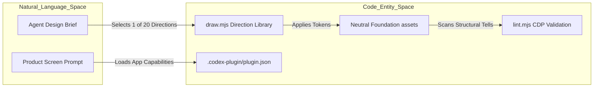

Sources:
- [README.md:123-136]()
- [.codex-plugin/plugin.json:20-33]()

---

# Page: Repository Structure

# Repository Structure

<details>
<summary>Relevant source files</summary>

The following files were used as context for generating this wiki page:

- [.gitignore](.gitignore)
- [README.md](README.md)
- [assets/sponsors/vercel-logo.svg](assets/sponsors/vercel-logo.svg)
- [assets/vercel-oss-program-badge.svg](assets/vercel-oss-program-badge.svg)
- [skills/taste-skill/README.md](skills/taste-skill/README.md)
- [skills/taste-skill/library/directions.json](skills/taste-skill/library/directions.json)
- [skills/taste-skill/scripts/assets.mjs](skills/taste-skill/scripts/assets.mjs)

</details>


This page provides a technical map of the `taste-skill` repository (`https://github.com/Leonxlnx/taste-skill`). It details the organizational layout of canonical skill definitions, the internal structure of `skills/taste-skill/` (including `SKILL.md`, scripts, libraries, references, assets, and evals), plugin distribution manifests, test suites, example galleries, static assets, and the standalone repositories where legacy skills now reside.

Sources: [README.md:61-143](), [skills/taste-skill/README.md:35-51]()

## 1. Top-Level Directory Overview

The repository root houses distribution manifests for agent marketplaces, core skill source files, test suites, visual examples, and branding assets.

| Directory / File | Technical Purpose |
| :--- | :--- |
| `skills/` | Canonical container for skill definitions, housing the v2/v2.1 default skill `taste-skill` (`design-taste-frontend`) [skills/taste-skill/README.md:1-2]() |
| `examples/` | Visual outputs, screenshot demonstrations (`coffee-storefront.webp`, `night-dates.webp`), and media provenance records [README.md:67-76]() |
| `assets/` | Repository branding assets, wordmarks, README imagery, and sponsor graphics [README.md:1-57]() |
| `tests/` | Automated test suites including frontmatter validation (`frontmatter.mjs`) and browser profile sweep tests (`profile-cleanup.mjs`) |
| `.claude-plugin/`, `.codex-plugin/`, `.agents/` | Agent plugin distribution manifests and marketplace configurations |
| `install.sh` | Local development script for symlinking the skill into agent runtimes (`--codex`, `--all-agents`) [README.md:117-118]() |

Sources: [README.md:67-118](), [skills/taste-skill/README.md:35-51]()

## 2. The `skills/taste-skill/` Subtree Anatomy

The default v2 skill implementation resides within `skills/taste-skill/`, bundling deterministic generation scripts, analytical references, and design data libraries [skills/taste-skill/README.md:35-51]().

```
skills/taste-skill/
├── SKILL.md                 # Run protocol, 10-step pipeline, house rules, and laws
├── references/              # Analytical references: copy, type, colour, layout, imagery, motion, critique, tells, research
├── scripts/
│   ├── draw.mjs             # Direction dealing engine (--alternatives, --photos, --site)
│   ├── assets.mjs           # Open-collection media sourcing (Openverse, Wikimedia, AIC, Met)
│   ├── lint.mjs             # Static source linter for banned patterns and stock phrases
│   └── inspect.mjs          # CDP-driven headless browser render, measure, and capture
├── scripts/lib/             # Zero-dependency Chrome DevTools client (cdp.mjs), in-page probe (probe.mjs), rules engine (rules.mjs)
├── library/                 # 20 directions, heroes, sections, type systems, palettes, photographs, studied sites, motions
├── assets/                  # Optional neutral foundation (base.css, base.js) and generated credits.json
└── evals/                   # Test briefs for baseline comparison (evals.json)
```

Sources: [skills/taste-skill/README.md:37-51]()

## 3. Pipeline Scripts and Data Flow Architecture

The skill enforces deterministic art direction through discrete Node.js execution scripts (`scripts/*.mjs`) that bridge natural language requirements with strict automated compliance gates.

**Diagram: Pipeline Execution Flow & Code Mapping**
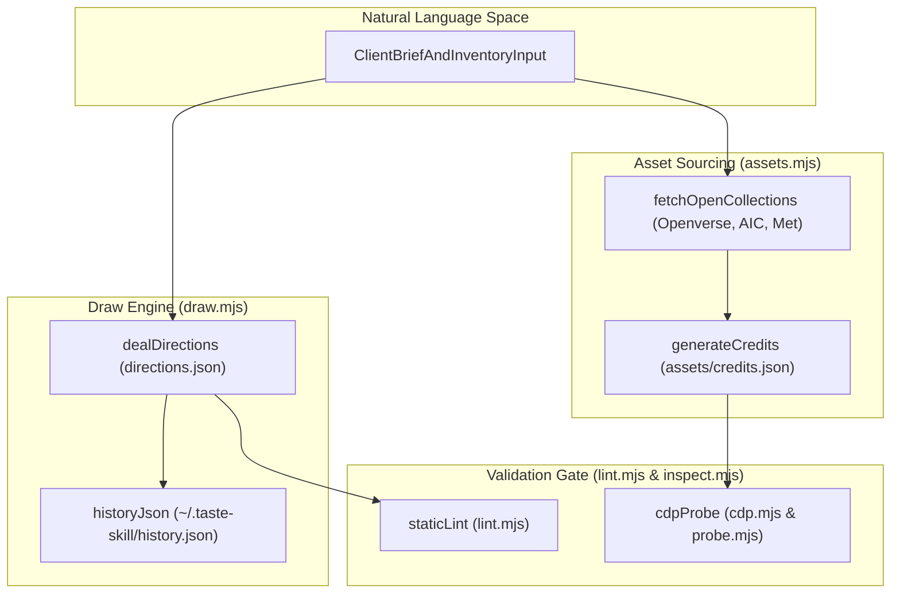
Sources: [skills/taste-skill/README.md:10-30](), [skills/taste-skill/README.md:40-46](), [skills/taste-skill/scripts/assets.mjs:1-50]()

### Key Script Modules & Data Handlers
*   **`scripts/draw.mjs`**: Manages direction dealing from the 20-item JSON library (`library/directions.json`), recording state in `~/.taste-skill/history.json` to prevent repetition [skills/taste-skill/README.md:40-40](), [skills/taste-skill/README.md:78-79]().
*   **`scripts/assets.mjs`**: Zero-dependency media client querying Openverse, Wikimedia Commons, the Art Institute of Chicago, and the Met, outputting provenance metadata to `assets/credits.json` [skills/taste-skill/README.md:41-43](), [skills/taste-skill/scripts/assets.mjs:24-45]().
*   **`scripts/lint.mjs`**: Static source code linter enforcing anti-slop rule sets, scanning for banned stock phrases, gradients, and resting shadows [skills/taste-skill/README.md:24-26](), [skills/taste-skill/README.md:44-44]().
*   **`scripts/inspect.mjs`**: CDP-driven headless Chrome client managing throwaway profiles, viewports at 1440px/768px/390px, and screenshot capture for the Look critique loop [skills/taste-skill/README.md:24-30](), [skills/taste-skill/README.md:45-46]().

Sources: [skills/taste-skill/README.md:24-46](), [skills/taste-skill/scripts/assets.mjs:24-53]()

## 4. Natural Language to Code Entity Mapping

The architecture directly associates abstract aesthetic principles with concrete automation functions and data structures.

**Diagram: Aesthetic Directive Translation**
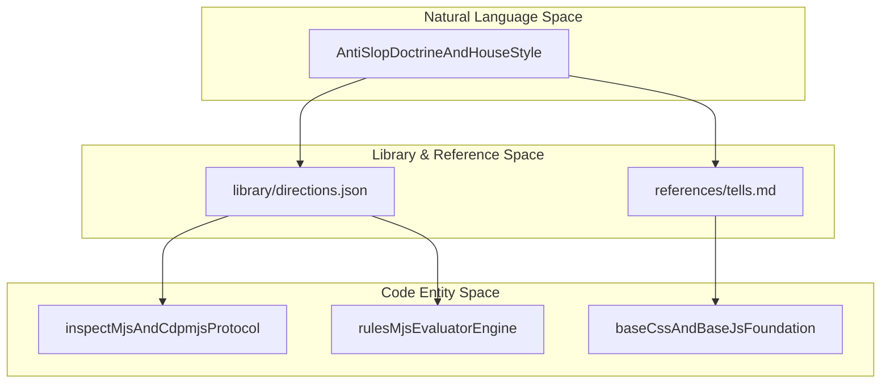
Sources: [README.md:61-76](), [skills/taste-skill/README.md:38-49]()

Sources: [README.md:61-76](), [skills/taste-skill/README.md:38-49]()

## 5. Moved Skills and Distribution Registry

While this repository hosts `design-taste-frontend` (`skills/taste-skill/`), legacy and auxiliary skills have been migrated to dedicated external repositories while retaining their original install names [README.md:121-143](). Users can continue installation via standard agent registry flows or local checkout symlinking (`install.sh`) [README.md:80-118]().

Sources: [README.md:80-143]()

---

# Page: Plugin Manifests & Distribution

# Plugin Manifests & Distribution

<details>
<summary>Relevant source files</summary>

The following files were used as context for generating this wiki page:

- [.agents/plugins/marketplace.json](.agents/plugins/marketplace.json)
- [.claude-plugin/marketplace.json](.claude-plugin/marketplace.json)
- [.codex-plugin/plugin.json](.codex-plugin/plugin.json)
- [.github/FUNDING.yml](.github/FUNDING.yml)
- [LICENSE](LICENSE)
- [assets/sponsors/sidrune-ai.png](assets/sponsors/sidrune-ai.png)

</details>


## Purpose and Scope
This page details the multi-platform distribution architecture of the `taste-skill` repository. It covers how canonical skill definitions inside `skills/` are packaged, registered, and published for AI coding assistants and CLI runners using agent-specific plugin manifests (`.claude-plugin/marketplace.json`, `.codex-plugin/plugin.json`, `.agents/plugins/marketplace.json`), version synchronization (`2.1.4`), licensing, and sponsorship assets.

---

## 1. Claude Code and Codex Plugin Manifests
The repository provides dedicated manifest files for different agent ecosystems. These files declare plugin metadata, versioning (synchronized at `2.1.4`), author attribution, keywords, and exposed skill directories so that platforms like Claude Code and Codex can automatically discover and ingest the skill modules.

- **Claude Marketplace Index**: Declared in `.claude-plugin/marketplace.json` [.claude-plugin/marketplace.json:1-25](), mapping the root source `./` and exposing skills under `./skills/taste-skill`.
- **Codex Plugin**: Declared in `.codex-plugin/plugin.json` [.codex-plugin/plugin.json:1-34](), providing detailed interface configurations, display names, capabilities, and default prompt suggestions for the Codex environment.

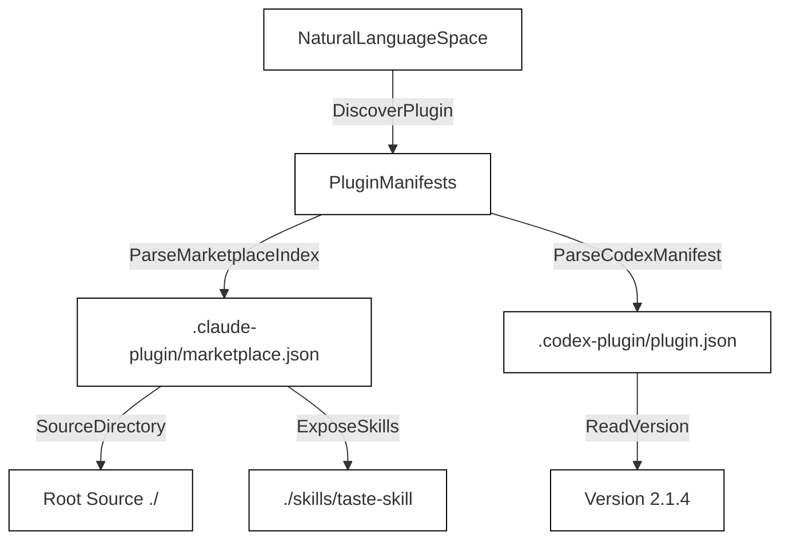
*Sources: [.claude-plugin/marketplace.json:1-25](), [.codex-plugin/plugin.json:1-34]()*

---

## 2. Remote Agent Marketplaces and Registries
For distributed agent orchestrators that pull packages directly via Git URLs, the `.agents/plugins/marketplace.json` manifest acts as the remote registry descriptor. It defines the source repository URL, git reference (`main`), installation policy (`AVAILABLE`), and authentication hooks.

- **Registry File**: `.agents/plugins/marketplace.json` [.agents/plugins/marketplace.json:1-21]()
- **Remote Source**: Pointed at `https://github.com/Leonxlnx/taste-skill.git` with authentication policy set to `ON_INSTALL`.

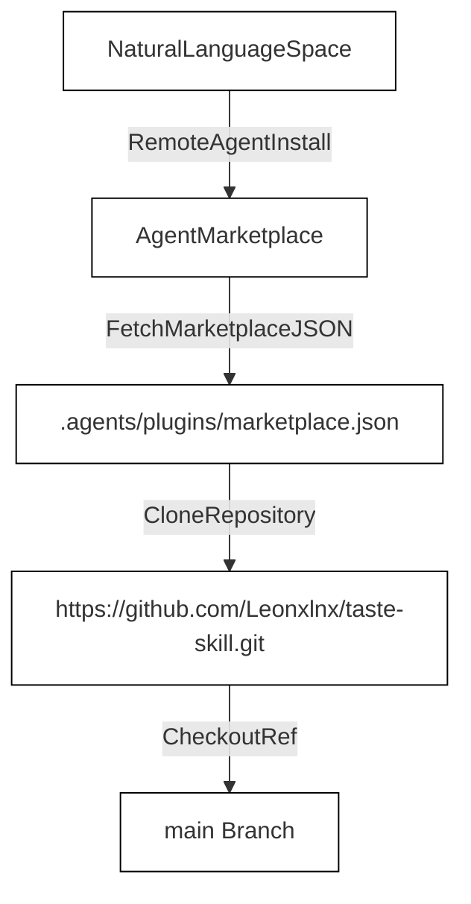
*Sources: [.agents/plugins/marketplace.json:1-21]()*

---

## 3. Licensing, Sponsorship and Versioning Assets
The repository maintains open-source compliance and sponsorship branding assets at the root level and within dedicated asset directories:

- **License**: Distributed under the MIT License, defined in `LICENSE` [LICENSE:1-21]().
- **Funding & Sponsorship**: Configured via `.github/FUNDING.yml` [.github/FUNDING.yml:1](), referencing sponsor assets like `assets/sponsors/sidrune-ai.png` [assets/sponsors/sidrune-ai.png:1-46]().
- **Version Tracking**: Releases across `.claude-plugin/marketplace.json` and `.codex-plugin/plugin.json` are synchronized to version `2.1.4`.

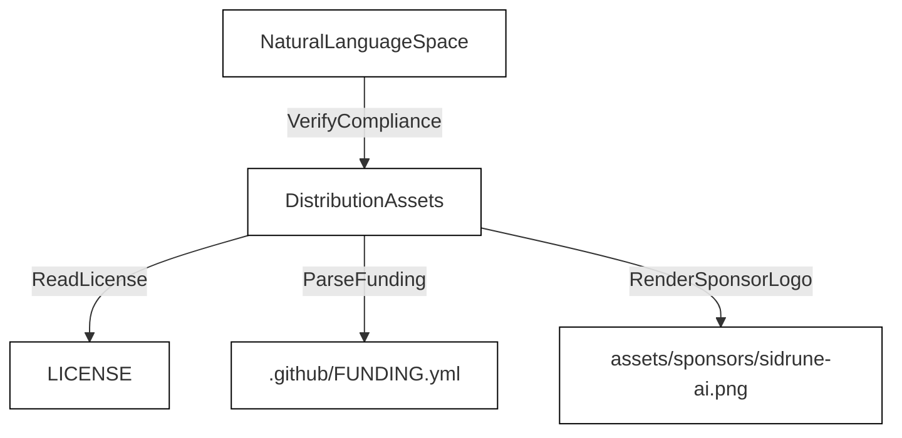
*Sources: [LICENSE:1-21](), [.github/FUNDING.yml:1](), [assets/sponsors/sidrune-ai.png:1-46]() *

---

# Page: Release History & Version Evolution

# Release History & Version Evolution

<details>
<summary>Relevant source files</summary>

The following files were used as context for generating this wiki page:

- [CHANGELOG.md](CHANGELOG.md)

</details>


## Purpose & Scope

This page provides a technical walkthrough of `CHANGELOG.md`, tracing the evolution of the codebase from experimental v1 setups to the deterministic v2 pipeline and v2.1 feature sets. It details architectural shifts such as the transition from manual styling dials to deterministic composition generation via `draw.mjs`, the integration of the scroll-scene engine, app-screen support, and critical infrastructural fixes like safe browser profile cleanup.

Sources: `CHANGELOG.md:1-61`

---

## 1. The v1 to v2 Shift: From Dials to Deterministic Draw & Gate

The transition from v1 to v2 marks a fundamental architectural shift in how `taste-skill` handles design generation. In v1, agents relied on manual stylistic "dials" and subjective adjustments during execution, which frequently led to inconsistent output quality and unpredictable design "slop." 

Version 2 introduces a deterministic pipeline governed by rigid constraints and automated gates:
- **Deterministic Composition (`draw.mjs`)**: Instead of ad-hoc styling, agents deal predefined parameters from locked libraries (`library/directions.json`, `library/palettes.json`, `library/type.json`) [CHANGELOG.md:37-61].
- **The Gate (`inspect.mjs`, `lint.mjs`)**: Outputs are no longer trusted implicitly. Every build passes through automated static analysis and real-browser inspection probes that enforce anti-slop rules before completion [CHANGELOG.md:37-61].

Sources: `CHANGELOG.md:37-61`

---

## 2. Version 2.1: Scroll-Scene Engine, App Screens, and Product Page Integration

Version 2.1 expands the codebase from static marketing pages into dynamic scroll-driven experiences and dense functional application interfaces.

### The Scroll-Scene Engine
Version 2.1 establishes the foundation for cinematic scroll interactions:
- **`assets/scenes/stage.js` and `stage.css`**: Implements a sticky stage scrubbed by native scroll using pinned GSAP ScrollTrigger integrations, alongside conditional Lenis smoothing that automatically deactivates on touch devices and reduced-motion environments [CHANGELOG.md:43].
- **`scripts/scenes.mjs` and `inspect.mjs --film`**: Programmatically captures snapshots of every scene at 0% to 100% hold states across desktop, mobile, and reduced-motion viewports, failing builds if scenes fail to initialize or rest properly [CHANGELOG.md:44].

### App Screens and Dashboards
Unlike marketing pages, app screens (dashboards, admin panels, settings, inboxes) require strict data density and neutral structural shells:
- **`references/app-screens.md`**: Defines specific design laws for application interfaces, including quiet panels, KPIs, tabular numeric formatting, and structured data tables [CHANGELOG.md:57-61].
- **`app.css` & `charts.js`**: Shipped dependencies for rendering real-data visualizations within generated app views [CHANGELOG.md:50].

### Diagram: v2.1 Execution and Inspection Pipeline

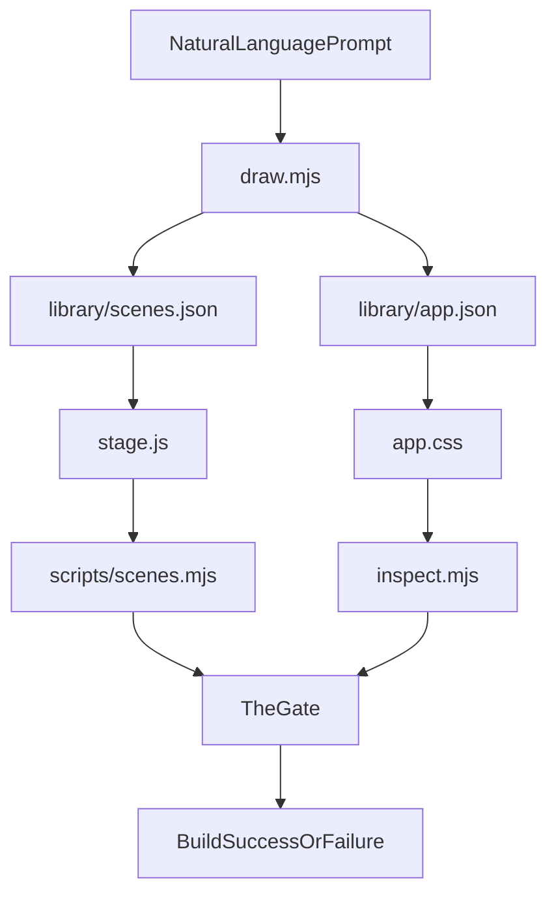

Sources: `CHANGELOG.md:39-61`

---

## 3. Version 2.1.1 to 2.1.4: Refactoring, Validation Hardening, and Browser Profile Cleanup

The subsequent patch releases of v2.1 focused on repository decoupling, strict automated validation, and concurrency safety in browser diagnostics.

### Monorepo Splitting and Opt-in Classics
- **Classic Skills Separation**: Classic skills (`high-end-visual-design`, `minimalist-ui`, `industrial-brutalist-ui`, `gpt-taste`, `stitch-design-taste`, etc.) were moved to `Leonxlnx/taste-skill-classics`, making them strictly opt-in (`disable-model-invocation: true`) [CHANGELOG.md:16-31].
- **Image Generation Skills**: Moved to `Leonxlnx/imagegen-skills` [CHANGELOG.md:17-33].

### Strict Frontmatter Validation
To prevent parsing failures (such as issue `#151` where an unquoted colon in YAML descriptions caused skills to be silently dropped), validation was automated [CHANGELOG.md:24-25]:
- **`tests/frontmatter.mjs`**: Strictly parses every `SKILL.md` frontmatter and `agents/openai.yaml` configuration [CHANGELOG.md:25].
- **`check-skills.yml`**: GitHub Actions workflow executing frontmatter checks, registry checks, and script syntax verification on every push [CHANGELOG.md:25].

### Browser Profile Cleanup and Concurrency Fixes
Issue `#157` highlighted a race condition where concurrent inspector runs on Linux/macOS (which lack Chrome profile `lockfile` primitives) deleted active browser profiles based solely on file age [CHANGELOG.md:9-10]. Version 2.1.4 (`#158`) resolved this:
- **`taste-skill-owner.json`**: Every throwaway Chrome profile now writes an ownership manifest recording the machine ID and process IDs of the active test run and its corresponding Chrome instance [CHANGELOG.md:10].
- **Safe Sweeping Logic**: Subsequent runs verify the ownership manifest. Profiles are only deleted if the owning process is dead; unmanaged profiles are left untouched [CHANGELOG.md:10].

### Diagram: Browser Profile Concurrency Management

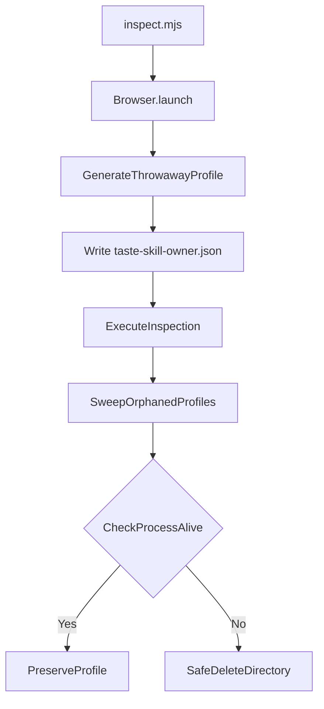

Sources: `CHANGELOG.md:7-36`

---

# Page: Core Design Philosophy

# Core Design Philosophy

<details>
<summary>Relevant source files</summary>

The following files were used as context for generating this wiki page:

- [skills/taste-skill/SKILL.md](skills/taste-skill/SKILL.md)
- [skills/taste-skill/assets/base.css](skills/taste-skill/assets/base.css)
- [skills/taste-skill/references/tells.md](skills/taste-skill/references/tells.md)

</details>


Overview of the 'Taste Standard' — the shared aesthetic and engineering principles behind every skill in the `taste-skill` repository. The Taste Standard provides a rigorous engineering and aesthetic framework designed to override the statistical biases inherent in Large Language Models (LLMs), moving away from generic templates ("slop") toward curated, agency-tier web design.

This parent page summarizes the core pillars of the philosophy and links to its detailed child pages:
- [AI Tells & Anti-Patterns](#2.1) — Comprehensive references for banned UI signatures, typography rules, and structural anti-patterns sourced from `references/tells.md`.
- [Motion & Animation System](#2.2) — Animation budgets, transform/opacity constraints, and canonical motion tokens from `references/motion.md` and `library/motions.json`.
- [Typography, Colour & Layout Standards](#2.3) — Concrete type scales, palette proportions, grid systems, and copy constraints from `references/type.md`, `references/colour.md`, `references/layout.md`, and `references/copy.md`.
- [Research Base: 247 Studied Sites](#2.4) — The statistical study of gallery sites underpinning the rules from `references/research.md` and `library/sites.json`.

Sources: [`skills/taste-skill/SKILL.md:4-38`](), [`skills/taste-skill/references/tells.md:1-12`](), [`skills/taste-skill/assets/base.css:1-41`]()

---

## The Anti-Slop Doctrine

Large Language Models naturally tend toward statistical averages: centered headlines over three lines, small category labels, rows of identical icon cards, subtle CSS gradients, thin hairlines, and monospace captions. The **Taste Standard** rejects these defaults via systematic checks and strict architectural guardrails.

Every build begins with Brief Inference and Subject Inventory (listing what uniquely belongs to the client, such as street names, local materials, and specific constraints) rather than resorting to category defaults [`skills/taste-skill/SKILL.md:76-99`]().

### Natural Language Space to Code Enforcement

The following diagram bridges abstract anti-slop principles to concrete code entities and validation scripts within the repository.

**Diagram: Mapping Anti-Slop Principles to Code Validation**
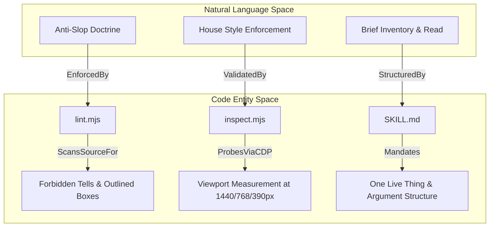

Sources: [`skills/taste-skill/SKILL.md:76-99`](), [`skills/taste-skill/references/tells.md:1-11`]()

---

## AI Tells & Anti-Patterns

A tell is a device that makes a page read as generated. While individual tells may seem harmless, their cumulative presence signals generic AI output. The skill maintains a dated registry of banned patterns—including violet/indigo gradients, eyebrows, 01/02/03 index numbering, monospace micro-labels, hairline borders, and generic color palettes—enforced automatically by static linting and real-browser inspection [`skills/taste-skill/references/tells.md:1-11`]().

For detailed rules, banned device categories, and proper alternatives, see [AI Tells & Anti-Patterns](#2.1).

Sources: [`skills/taste-skill/references/tells.md:1-80`]()

---

## Motion & Animation System

Motion within the Taste Standard adheres to a strict motion budget and physical easing tokens defined in `library/motions.json` and `assets/base.css`. Animations are restricted to transform, opacity, and clip-path properties to ensure zero layout thrashing, and all movements respect user accessibility settings via reduced-motion fallbacks [`skills/taste-skill/assets/base.css:29-41`]().

### Natural Language Space to Motion Execution

The following diagram links qualitative motion philosophy to the underlying CSS tokens and DOM hooks.

**Diagram: Motion Philosophy to Code Implementation**
```mermaid
graph LR
    subgraph "Natural Language Space"
        M1[""Motion Discipline""]
        M2[""Single Signature Move""]
    end

    subgraph "Code Entity Space"
        E1[""base.css""] -->|DefinesTokens| T1[""--ease-expo & --t-reveal""]
        E2[""base.css""] -->|ProvidesHooks| T2[""[data-rise] & [data-reveal]""]
        E3[""stages.js""] -->|DrivesScenes| T3[""GSAP ScrollTrigger Pinned Scenes""]
    end

    M1 -->|EnforcedVia| E1
    M2 -->|ExecutedBy| E3
```

For detailed timing curves, motion budgets, and view transitions, see [Motion & Animation System](#2.2).

Sources: [`skills/taste-skill/assets/base.css:29-41`](), [`skills/taste-skill/assets/base.css:90-105`]()

---

## Typography, Colour & Layout Standards

Design-system laws are derived from rigorous statistical studies of gallery sites. Type systems rely on distinct fluid scales (`--step-small` to `--step-display`), while colour palettes emphasize low-chroma stones, deep inks, and tonal surface steps rather than high-chroma AI gradients [`skills/taste-skill/assets/base.css:18-28`](). Layouts discard stock section orders in favor of an argument-driven structure [`skills/taste-skill/SKILL.md:100-105`]().

For concrete type scales, font loading rules, palette proportions, contrast laws, and copy constraints, see [Typography, Colour & Layout Standards](#2.3).

Sources: [`skills/taste-skill/assets/base.css:7-41`](), [`skills/taste-skill/SKILL.md:100-105`]()

---

## Research Base: 247 Studied Sites

The engineering principles and stylistic guardrails of `taste-skill` are underpinned by a statistical study of 247 curated gallery sites (such as One Page Love and Awwwards Sites of the Day). The data collected from these sites informs how `draw.mjs` deals directions, compositions, and palettes, and how per-site notes are surfaced [`skills/taste-skill/SKILL.md:4-13`]().

For deep dives into the statistical analysis and how specific gallery benchmarks shape output generation, see [Research Base: 247 Studied Sites](#2.4).

Sources: [`skills/taste-skill/SKILL.md:4-13`]()

---

### Related Child Pages
* [AI Tells & Anti-Patterns](#2.1)
* [Motion & Animation System](#2.2)
* [Typography, Colour & Layout Standards](#2.3)
* [Research Base: 247 Studied Sites](#2.4)

---

# Page: AI Tells & Anti-Patterns

# AI Tells & Anti-Patterns

<details>
<summary>Relevant source files</summary>

The following files were used as context for generating this wiki page:

- [skills/taste-skill/assets/base.css](skills/taste-skill/assets/base.css)
- [skills/taste-skill/references/tells.md](skills/taste-skill/references/tells.md)
- [skills/taste-skill/scripts/lib/rules.mjs](skills/taste-skill/scripts/lib/rules.mjs)

</details>


This page serves as a comprehensive technical reference of forbidden UI patterns, known as "AI Tells," that the Taste Standard actively bans. These patterns represent the statistical biases and "slop" typically generated by LLMs when left to their default configurations. Sourced from `references/tells.md` [skills/taste-skill/references/tells.md:1-112]() and the automated lint rules implemented in `skills/taste-skill/scripts/lib/rules.mjs` [skills/taste-skill/scripts/lib/rules.mjs:1-78](), this reference catalogs first-, second-, and third-wave tells, gallery fashions, copy violations, and structural anti-patterns. By identifying and systematically replacing these signatures, the codebase ensures high-agency, premium-tier frontend outputs.

## The Anti-Slop Philosophy & The Tell Registry

A tell is a device that makes a page read as generated. Tells are not bad design in themselves; most began as good ideas on good sites. They became tells by being produced by default, everywhere, without a reason [skills/taste-skill/references/tells.md:3-6](). 

The registry is dated and prescriptive: replacements are procedures (drawing from the library, deriving from the subject) rather than hardcoded product substitutes, because every published "use this instead" list rapidly becomes the next wave of tells [skills/taste-skill/references/tells.md:5-7](). Scripts like `scripts/inspect.mjs` and `scripts/lint.mjs` detect most entries with strict enforcement levels: **banned** means the inspector fails the page, while **warned** flags the element requiring explicit justification [skills/taste-skill/references/tells.md:9-10]().

### System Mapping: From Natural Language to Code Entities

The following diagram illustrates how the system identifies "AI Tells" in natural language requests or existing code and maps them to specific corrective logic within `skills/taste-skill/scripts/lib/rules.mjs`.

**Figure 1: Anti-Pattern Detection and Correction Flow**
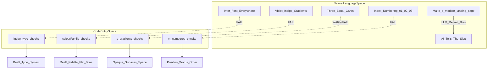
Sources: [skills/taste-skill/references/tells.md:9-11](), [skills/taste-skill/scripts/lib/rules.mjs:8-15](), [skills/taste-skill/scripts/lib/rules.mjs:58-61]()

---

## 1. First & Second Wave Tells (2023–2025)

The early waves of AI design output established predictable visual signatures that automated validators now flag instantly.

### First Wave (2023–2024)
* **Violet / Indigo Gradients:** Hero sections, buttons, and glows utilizing violet/indigo fades are **banned** and replaced by the dealt palette or flat color [skills/taste-skill/references/tells.md:27-27]().
* **Gradient-Filled Headline Text:** Text filled with linear gradients is **banned** in favor of solid ink [skills/taste-skill/references/tells.md:28-28]().
* **Glass Panels:** Backdrop blur and translucent cards are **warned** when two or more appear (`s.blurred > 1`) [skills/taste-skill/references/tells.md:29-29](), [skills/taste-skill/scripts/lib/rules.mjs:77-77](); prefer opaque surfaces one tone step from the ground.
* **Generic Soft Shadows:** Soft grey drop shadows under every card are **banned** (`s.shadowStatic`) and replaced with tone steps or unboxed structures [skills/taste-skill/references/tells.md:31-31](), [skills/taste-skill/scripts/lib/rules.mjs:70-70]().
* **Three Identical Feature Cards:** Three identical feature cards each with an icon in a rounded square are **banned** [skills/taste-skill/references/tells.md:32-32]().
* **Emoji Icons/Bullets:** Using emoji as icons or bullet points is **banned** (`m.page.emoji`) [skills/taste-skill/references/tells.md:33-33](), [skills/taste-skill/scripts/lib/rules.mjs:64-64]().

### Second Wave (2025)
* **Eyebrows & Kickers:** Tiny tracked uppercase labels above headings (`m.eyebrows.length`) are **banned** [skills/taste-skill/references/tells.md:41-41](), [skills/taste-skill/scripts/lib/rules.mjs:50-53]().
* **Pill Badges:** Pill badges above hero headlines ("New", "Beta", "Introducing") are **banned** [skills/taste-skill/references/tells.md:42-42]().
* **Bento Grid Overuse:** Bento grids of rounded tiles used as default feature sections are **warned** as card rows; tiles are restricted to dense-tiles directions with strict sizes [skills/taste-skill/references/tells.md:44-44]().
* **Decorative Status Dots:** Pulsing "live" indicators or "Available for work" dots are flagged by lint rules and removed [skills/taste-skill/references/tells.md:48-48]().

Sources: [skills/taste-skill/references/tells.md:23-50](), [skills/taste-skill/scripts/lib/rules.mjs:50-77]()

---

## 2. Third Wave & Gallery Fashion Tells

The third wave encompasses "fixes" that became overused stylistic tropes, alongside award-site gallery fashions that carry no informational value.

### The Third Wave (2025–2026): The "Fix" That Became the Look
* **Cream Ground & Terracotta:** Yellow-cream grounds combined with terracotta/rust/clay accents are **banned** together (terracotta alone is banned; cream is warned) via `colourFamily()` [skills/taste-skill/references/tells.md:58-58](), [skills/taste-skill/scripts/lib/rules.mjs:8-15]().
* **Broadsheet Cosplay:** Hairline rules everywhere with zero radius and dense columns are **banned** via hairline inspection rules (`s.hairlines`) [skills/taste-skill/references/tells.md:61-61](), [skills/taste-skill/scripts/lib/rules.mjs:73-73]().
* **Performative Labels:** Labels like "Field notes", "Quietly trusted by", or "On our desks" are flagged by copy linters [skills/taste-skill/references/tells.md:62-62]().

### Gallery Fashion Banned as House Style
Checked rigorously by `skills/taste-skill/scripts/lib/rules.mjs`, these common award-site tropes are prohibited:
* **Monospace Micro-Labels:** Monospace type outside of literal `<pre>/<code>` blocks (checked via `m.type.monoProseShare`) is **banned** [skills/taste-skill/scripts/lib/rules.mjs:54-57](), [skills/taste-skill/references/tells.md:74-74]().
* **Index Numbering:** Decorative sequence markers like `01 / 02 / 03`, `(001)`, or `Step 02` (`m.numbered.length`) are **banned** [skills/taste-skill/scripts/lib/rules.mjs:58-61](), [skills/taste-skill/references/tells.md:75-75]().
* **Thin Rules & Hairlines:** Hairline dividers, ruled grids, and 1px outlined boxes (`s.hairlines`, `s.outlinedBoxes`) are **banned** when exceeding thresholds [skills/taste-skill/scripts/lib/rules.mjs:73-75](), [skills/taste-skill/references/tells.md:76-76]().
* **Design-Tool Chrome:** Crosshairs, crop marks, selection handles, dashed guides, and rulers are **banned** [skills/taste-skill/references/tells.md:77-77]().
* **Agency Micro-Meta:** Local time, coordinates, weather, version stamps, and middle-dot strings are flagged by copy and micro-label linters (`m.type.microLabels`) [skills/taste-skill/references/tells.md:78-78](), [skills/taste-skill/scripts/lib/rules.mjs:62-63]().

**Figure 2: Validator Inspection Logic for Banned Furniture**
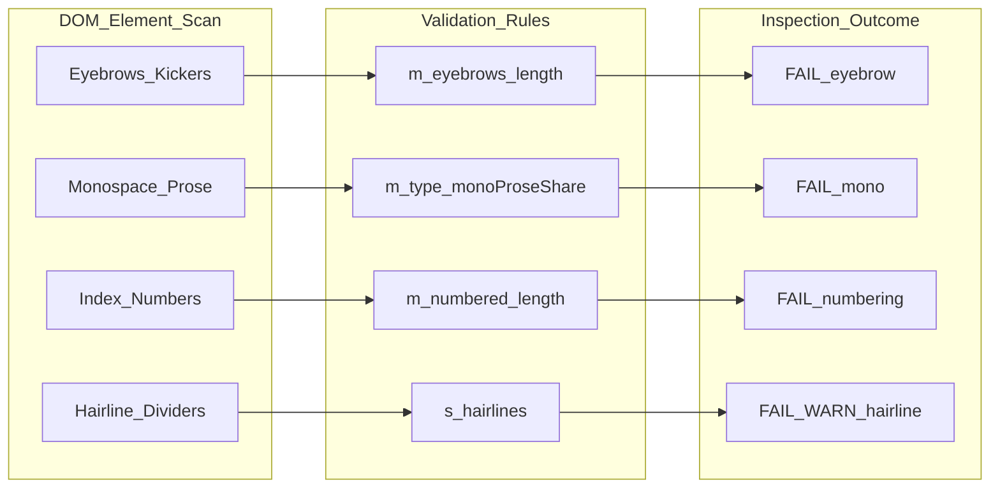
Sources: [skills/taste-skill/references/tells.md:51-83](), [skills/taste-skill/scripts/lib/rules.mjs:50-75]()

---

## 3. Structural, Copy & Motion Tells

Beyond visual elements, structural layouts, copywriting patterns, and animation behaviors are systematically restricted.

### Structural Tells
* **Over-length Headlines:** Headlines running past two lines (`h.lines > 2`) at display size are **banned** [skills/taste-skill/scripts/lib/rules.mjs:36-40](), [skills/taste-skill/references/tells.md:88-88]().
* **Center Alignment Overuse:** Centering content across more than 72% of sections is **warned** [skills/taste-skill/references/tells.md:91-91]().
* **Uniform Border Radius:** Applying a single medium radius (12-16px) universally is prohibited in favor of explicit architectural choices [skills/taste-skill/references/tells.md:92-92]().
* **Invented Social Proof:** Fake logos, fabricated customer quotes, and generic star rows are **banned** [skills/taste-skill/references/tells.md:94-94]().

### Copy Tells
Flagged by `skills/taste-skill/scripts/lib/rules.mjs` and copy guidelines, forbidden copy elements include:
* **Buzzwords & Genre Verbs:** Terms like *unlock*, *supercharge*, *seamless*, *elevate*, *effortless*, *cutting-edge*, and *all-in-one* [skills/taste-skill/references/tells.md:99-100]().
* **Structural Cliques:** "Not just X, it's Y" formulations, tricolon headlines, and excessive em-dashes [skills/taste-skill/references/tells.md:100-101]().
* **Generic Call-to-Actions:** Buttons labeled "Get started" or "Learn more" without action context [skills/taste-skill/references/tells.md:101-101]().

### Motion Tells
Identical fade-up animations on every block, dozens of staggered hero entrances, hover lift on every card, bounce easing, and broken infinite loops are strictly prohibited [skills/taste-skill/references/tells.md:106-107](), matching the motion budget principles defined in `skills/taste-skill/assets/base.css` [skills/taste-skill/assets/base.css:94-103]().

Sources: [skills/taste-skill/references/tells.md:84-108](), [skills/taste-skill/scripts/lib/rules.mjs:36-40](), [skills/taste-skill/assets/base.css:94-103]()

---

## 4. Why Removal Is Not Enough

Removing every tell without substituting intentional design yields an empty page with good manners—an "avoidance aesthetic" that is itself a recognized tell [skills/taste-skill/references/tells.md:109-112](). 

The system mandates that eliminating slop must be paired with positive composition: drawing from the direction library, utilizing verified open-collection imagery, establishing a rigorous typographic hierarchy, and enforcing strict layout variation through `skills/taste-skill/scripts/lib/rules.mjs`.

Sources: [skills/taste-skill/references/tells.md:109-115](), [skills/taste-skill/scripts/lib/rules.mjs:1-137]()

---

# Page: Motion & Animation System

# Motion & Animation System

<details>
<summary>Relevant source files</summary>

The following files were used as context for generating this wiki page:

- [skills/taste-skill/assets/base.js](skills/taste-skill/assets/base.js)
- [skills/taste-skill/library/motions.json](skills/taste-skill/library/motions.json)
- [skills/taste-skill/references/motion.md](skills/taste-skill/references/motion.md)

</details>


This page details the shared motion philosophy and kinetic architecture across the `taste-skill` repository, drawing from `skills/taste-skill/references/motion.md` and `skills/taste-skill/library/motions.json`. It covers animation budgets, timing and easing tokens, transform/opacity/clip-path-only rules, data-attribute hooks, reduced-motion fallbacks, and scroll behaviors.

Sources: [skills/taste-skill/references/motion.md:1-161](), [skills/taste-skill/library/motions.json:1-79]()

## 1. Core Motion Philosophy & Animation Budgets

The motion layer transforms static digital mock-ups into tactile, high-agency experiences. Motion is treated as a final, considered layer—never as a crutch for a weak layout. A page that does not move reads as a static mock-up; however, over-animation is flagged as a primary generation tell.

The motion budget consists of five distinct parts:
*   **Two or Three Scroll Scenes:** Big, scroll-driven moments (such as type crossing a held stage, or cards dealing out) dealt from `library/scenes.json` via `references/scenes.md`. Everything else stays quiet so these moments land [skills/taste-skill/references/motion.md:24-28]().
*   **One Signature Moment:** The core memorable element specified by `draw.mjs` (e.g., a headline rising from a mask, a shutter-opening image, or a scaling wordmark). This is the only element permitted to be loud [skills/taste-skill/references/motion.md:30-33]().
*   **Section Entrances:** Choreographed per section in reading order (heading, text, image, details), staggered by 60–90ms, rising 16–32px with opacity exactly once [skills/taste-skill/references/motion.md:34-38]().
*   **Feedback Under the Hand:** Instant tactile responses—buttons that give on press, pointers that answer links, and hover-responsive cards and pictures [skills/taste-skill/references/motion.md:39-40]().
*   **One Moving Picture:** A muted background loop with a poster frame, a slow drift or scale on a photograph, or a scroll-linked move on the hero picture [skills/taste-skill/references/motion.md:41-42]().

Banned patterns include uniform fade-and-slide animations on every block, scripts hiding content without fallbacks, bounce/elastic easings, and animating layout properties [skills/taste-skill/references/motion.md:44-47]().

Sources: [skills/taste-skill/references/motion.md:1-48]()

## 2. Timing Tokens & Easing Curves

To prevent weak CSS keyword curves and inconsistent speeds, the system defines explicit cubic-bezier tokens and duration variables [skills/taste-skill/references/motion.md:103-125]().

```css
:root {
  --ease-out: cubic-bezier(0.22, 1, 0.36, 1);        /* entrances, moving hovers, UI under 600ms */
  --ease-expo: cubic-bezier(0.16, 1, 0.3, 1);        /* reveals of 800ms and longer, line rises, openings */
  --ease-in-out: cubic-bezier(0.76, 0, 0.24, 1);     /* wipes, panels, things that travel while visible */
}
```

*   **Easing Selection:** Entering or leaving uses `--ease-out` so movement starts immediately upon eye arrival. Moving between two places uses `--ease-in-out`. Colour changes use plain `ease` [skills/taste-skill/references/motion.md:96-99]().
*   **Durations:** Press feedback runs in 100–160ms, hover in 150–200ms, menus and popovers in 150–250ms, dialogs and drawers in 250–450ms, and section/hero reveals in 500–900ms (exiting is ~70% faster than arriving) [skills/taste-skill/references/motion.md:100-101]().

Sources: [skills/taste-skill/references/motion.md:96-125]()

## 3. Transform, Opacity & Clip-Path Rules & Performance

To prevent layout thrashing and maintain 60fps rendering, strict performance guardrails apply:
*   **Allowed Properties:** Only GPU-safe properties like `transform`, `opacity`, and `clip-path` are animated.
*   **Prohibited Properties:** Animating layout-triggering properties such as `height`, `width`, `margin`, `top`, or `left` is strictly banned because they force browser layout reflows.
*   **Scroll-Linked Motion:** Scroll-linked motion is locked directly to the scrollbar or lightly smoothed (0.1–3s), firing once when an element's top reaches 80–95% down the viewport [skills/taste-skill/references/motion.md:70-72]().

Sources: [skills/taste-skill/references/motion.md:70-72]()

## 4. Motion Library & Data-Attribute Hooks (`motions.json`, `base.js`)

The `skills/taste-skill/library/motions.json` registry catalogs distinct motion directions. These are hooked into the DOM via data attributes like `[data-reveal]` and `[data-ink]`, supported by runtime logic in `skills/taste-skill/assets/base.js` [skills/taste-skill/library/motions.json:1-79](), [skills/taste-skill/assets/base.js:1-37]().

### 4.1. Registry Overview (`motions.json`)
*   `masked-headline`: Baseline-rising line reveals [skills/taste-skill/library/motions.json:3-6]().
*   `shutter-image`: Edge-opening clip-path shutter with scale settling [skills/taste-skill/library/motions.json:8-11]().
*   `scaling-wordmark`: Scroll-linked monument scale travel under 8% [skills/taste-skill/library/motions.json:13-16]().
*   `pinned-story`: Sticky positioning (`position: sticky`) holding a frame while items scroll past [skills/taste-skill/library/motions.json:18-21]().
*   `index-preview`: Text rows triggering fixed frame crossfades on pointer hover [skills/taste-skill/library/motions.json:23-26]().
*   `curtain-footer`: Sheet-like slide-up uncovering a sticky footer [skills/taste-skill/library/motions.json:28-31]().
*   `slow-crossfade`: Light-shift crossfade across identical framing [skills/taste-skill/library/motions.json:33-36]().
*   `edge-marquee`: Linear continuous horizontal ticker paused on hover [skills/taste-skill/library/motions.json:38-41]().
*   `drag-row`: Native horizontal scroll snapping without carousel libraries [skills/taste-skill/library/motions.json:43-46]().
*   `colour-on-scroll`: Full-bleed palette changes per chapter boundary via `[data-ink]` [skills/taste-skill/library/motions.json:48-51](), [skills/taste-skill/assets/base.js:30-37]().
*   `stillness`: Zero-showpiece baseline with instant presence and precise feedback [skills/taste-skill/library/motions.json:53-56]().

Sources: [skills/taste-skill/library/motions.json:1-79](), [skills/taste-skill/assets/base.js:30-37]()

### 4.2. Runtime Implementation (`base.js`)
Content visibility is gated via `[data-reveal]` observed by an `IntersectionObserver`, featuring a built-in safety net timeout of 2.5 seconds to guarantee content is never permanently hidden if scripting or observer execution stalls [skills/taste-skill/assets/base.js:7-23]().

```js
// Reveal once when an element enters the viewport. Never replays, never leaves content hidden.
(() => {
  const targets = document.querySelectorAll('[data-reveal]');
  if (!targets.length) return;
  if (!('IntersectionObserver' in window)) { targets.forEach((el) => el.classList.add('is-in')); return; }
  const io = new IntersectionObserver((entries) => {
    for (const entry of entries) {
      if (!entry.isIntersecting) continue;
      entry.target.classList.add('is-in');
      io.unobserve(entry.target);
    }
  }, { rootMargin: '0px 0px -12% 0px', threshold: 0.1 });
  targets.forEach((el) => io.observe(el));
  // safety net: if anything is still hidden a few seconds after load, show it
  window.addEventListener('load', () => setTimeout(() => {
    targets.forEach((el) => { const r = el.getBoundingClientRect(); if (r.top < innerHeight && r.bottom > 0) el.classList.add('is-in'); });
  }, 2500));
})();
```

Sources: [skills/taste-skill/assets/base.js:7-23]()

## 5. Reduced-Motion & Fallback Enforcement

Animations must never impair usability for users requiring accessibility accommodation.
*   **Media Query Guardrails:** Kinetic CSS must respect user preferences. Every recipe keeps the finished state as the reduced state [skills/taste-skill/references/motion.md:83-86]().
*   **Behaviour:** Under `prefers-reduced-motion: reduce`, automated marquees, scroll scrubbing, and complex staging collapse to static end-states, ensuring 100% legibility without motion sickness triggers.

Sources: [skills/taste-skill/references/motion.md:83-86]()

## 6. Architecture & Data Flow Diagrams

### Diagram 1: Motion Resolution Pipeline (Natural Language to Code Entity Space)
This diagram maps abstract design goals from the direction library (`motions.json`) to concrete runtime implementations and DOM mutations.

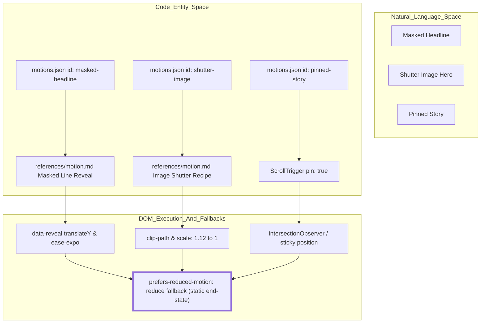
Sources: [skills/taste-skill/library/motions.json:3-21](), [skills/taste-skill/references/motion.md:72-161]()

### Diagram 2: IntersectionObserver and Data-Attribute Lifecycle
This diagram illustrates how client-side runtime scripts (`base.js`) observe elements via `[data-reveal]` and apply GPU-safe transform and opacity transitions.

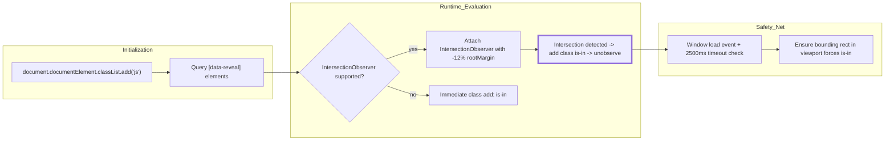
Sources: [skills/taste-skill/assets/base.js:1-23]()

---

# Page: Typography, Colour & Layout Standards

# Typography, Colour & Layout Standards

<details>
<summary>Relevant source files</summary>

The following files were used as context for generating this wiki page:

- [skills/taste-skill/library/palettes.json](skills/taste-skill/library/palettes.json)
- [skills/taste-skill/library/type.json](skills/taste-skill/library/type.json)
- [skills/taste-skill/references/colour.md](skills/taste-skill/references/colour.md)
- [skills/taste-skill/references/copy.md](skills/taste-skill/references/copy.md)
- [skills/taste-skill/references/layout.md](skills/taste-skill/references/layout.md)
- [skills/taste-skill/references/type.md](skills/taste-skill/references/type.md)

</details>


This page documents the concrete design-system laws defined in `skills/taste-skill/references/` `[skills/taste-skill/references/colour.md:1-141]`. It covers type scales and font loading `[skills/taste-skill/references/type.md:1-145]`, palette proportions and contrast enforcement `[skills/taste-skill/references/colour.md:1-141]`, grid/margin/section-variety rules `[skills/taste-skill/references/layout.md:1-123]`, and copy constraints `[skills/taste-skill/references/copy.md:1-140]`.

---

## 1. Typographic Architecture & Font Loading Rules

Typography is the primary mechanism distinguishing designed interfaces from generated stubs `[skills/taste-skill/references/type.md:1-4]`. The reference specifications enforce strict size hierarchies, tracking adjustments, and proper font loading via CSS custom properties `[skills/taste-skill/references/type.md:40-138]`.

### Type Scale and Step Tokens
The design system rejects continuous or multi-step scales (e.g., 9 sizes near each other) in favor of a strict 5-step model where sizes are clearly separated `[skills/taste-skill/references/type.md:39-45]`. The tokens are defined as CSS custom properties using viewport-scaling `clamp()` functions `[skills/taste-skill/references/type.md:47-55]`:

* `--step-small`: 13–14px (`clamp(0.8125rem, 0.79rem + 0.1vw, 0.875rem)`) for captions and legal text `[skills/taste-skill/references/type.md:49]`.
* `--step-body`: 17–19px (`clamp(1.0625rem, 1rem + 0.25vw, 1.1875rem)`) for paragraphs `[skills/taste-skill/references/type.md:50]`.
* `--step-lead`: 20–26px (`clamp(1.25rem, 1.1rem + 0.7vw, 1.625rem)`) for supporting lines and large body text `[skills/taste-skill/references/type.md:51]`.
* `--step-head`: 32–64px (`clamp(2rem, 1.3rem + 3.2vw, 4rem)`) for section headings `[skills/taste-skill/references/type.md:52]`.
* `--step-display`: Set by the hero blueprint (`clamp(3rem, 1rem + 9vw, 9rem)`) `[skills/taste-skill/references/type.md:53]`.

Sources: `[skills/taste-skill/references/type.md:39-64]`, `[skills/taste-skill/library/type.json:1-49]`

### Display vs. Body Formatting
Display type (anything over 40px) exposes optical spacing anomalies that are invisible at body sizes `[skills/taste-skill/references/type.md:65-67]`. Implementations must apply strict tracking, tight leading, and optical alignment `[skills/taste-skill/references/type.md:70-89]`:
* **Tracking:** Must scale inversely with size (e.g., `-0.035em`) `[skills/taste-skill/references/type.md:73]`.
* **Leading:** Set between `0.85` and `1.05` for display type, verified against descender collisions `[skills/taste-skill/references/type.md:72,83-84]`.
* **Optical Alignment:** Glyphs with round or diagonal left edges (`O`, `C`, `A`, `T`, `W`) require manual margin offsets (`margin-left: -0.05em`) to align with left-edge columns `[skills/taste-skill/references/type.md:87-89]`.
* **Body Measure:** Paragraphs must maintain a measure of 45 to 75 characters using `max-width: 62ch` `[skills/taste-skill/references/type.md:99,105]`.

Sources: `[skills/taste-skill/references/type.md:65-113]`

### Font Loading & Fallback Stacks
The font configuration must match the direction sheet exactly `[skills/taste-skill/references/type.md:115-117]`. Preconnect tags and stylesheet links must be injected precisely `[skills/taste-skill/references/type.md:118-122]`, mapped to CSS variables with broad fallback families `[skills/taste-skill/references/type.md:124-129]`:

```css
:root {
  --font-display: "Family From Sheet", "Helvetica Neue", Arial, sans-serif;
  --font-text: "Family From Sheet", Georgia, serif;
}
```

If `inspect.mjs` reports unrendered fallback fonts due to failed asset loads, the layout evaluation is invalidated `[skills/taste-skill/references/type.md:135-138]`.

Sources: `[skills/taste-skill/references/type.md:114-139]`

Diagram: Typography to Code Mapping
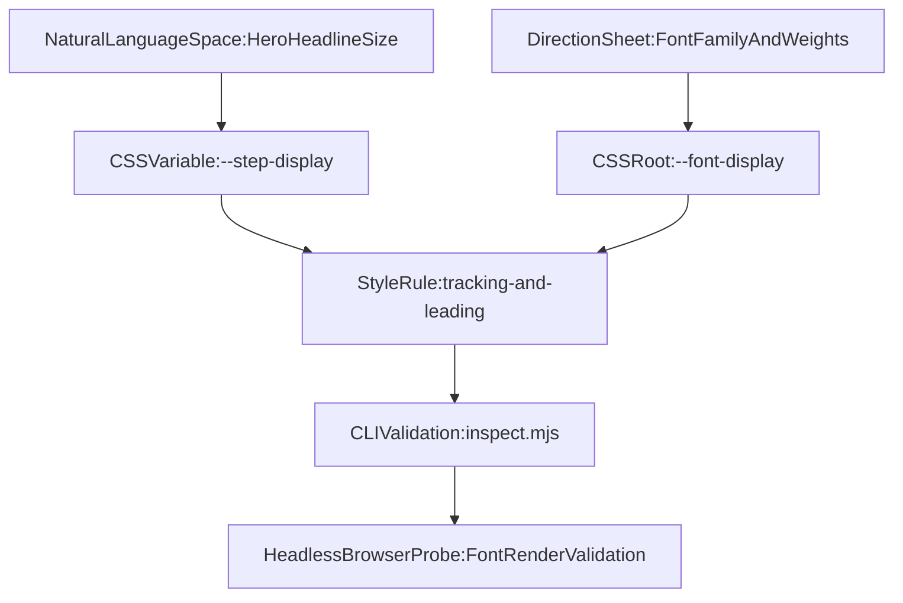
Sources: `[skills/taste-skill/references/type.md:47-79]`, `[skills/taste-skill/references/type.md:114-138]`

---

## 2. Colour Systems, Proportions & Contrast Laws

Palettes must be applied via named roles to maintain a cohesive structure rather than a random assortment of tints `[skills/taste-skill/references/colour.md:1-4]`.

### Palette Roles & Tokenization
Every build must utilize standardized CSS custom property roles `[skills/taste-skill/references/colour.md:36-46]`:

```css
:root {
  --bg: …;          /* The ground: most of the surface */
  --surface: …;     /* One tone step from the ground: filled panels, form fields */
  --ink: …;         /* Main text and strongest marks */
  --muted: …;       /* Secondary text; passes contrast on --bg */
  --accent: …;      /* The single accent */
  --accent-ink: …;  /* Text on the accent */
}
```

Raw hex values inside components are prohibited; intermediate greys between `--muted` and `--ink` are forbidden `[skills/taste-skill/references/colour.md:48-50]`.

Sources: `[skills/taste-skill/references/colour.md:34-51]`, `[skills/taste-skill/library/palettes.json:1-30]`

### Surface Depth Without Lines or Shadows
Borders (1px divider lines) and box-shadows are banned from separating surfaces `[skills/taste-skill/references/colour.md:67-69]`. Depth and separation are achieved solely via tone and spacing `[skills/taste-skill/references/colour.md:77-84]`:
* **Tone Step:** Panels use `--surface`, offset by 2–6 lightness points from `--bg` `[skills/taste-skill/references/colour.md:72]`.
* **Nesting Prohibition:** Panels must never be nested inside other panels `[skills/taste-skill/references/colour.md:79]`.
* **Thick Graphic Bars:** Structural lines of 4px or more are permitted if mandated by the direction sheet; 1px dividing lines are rejected `[skills/taste-skill/references/colour.md:82-83]`.

Sources: `[skills/taste-skill/references/colour.md:67-84]`

### Colour Fields & Dark Page Rules
Sections that change the global ground colour act as major architectural moves `[skills/taste-skill/references/colour.md:85-88]`:
* **Edge-to-Edge:** Colour fields meet with hard lines; fades are prohibited `[skills/taste-skill/references/colour.md:90]`.
* **Dark Pages (`color-scheme: dark`):** The ground must be a deep tone with a subtle palette tint `[skills/taste-skill/references/colour.md:99-101]`. Secondary text (`--muted`) must maintain a minimum 4.5:1 contrast ratio against the dark ground `[skills/taste-skill/references/colour.md:102]`. Depth is established via lighter surface steps rather than glows `[skills/taste-skill/references/colour.md:103]`.

Sources: `[skills/taste-skill/references/colour.md:85-105]`

### Banned Palettes & Automated Contrast Enforcement
The automated inspector script `inspect.mjs` enforces contrast and rejects known AI-generated aesthetic tropes `[skills/taste-skill/references/colour.md:118-142]`:
* **Banned Combinations:** Yellow-cream grounds combined with terracotta/rust accents, as well as unmotivated violet/indigo themes, are flagged automatically `[skills/taste-skill/references/colour.md:126-134]`. Brand overrides require explicit flags such as `--allow palette-purple` `[skills/taste-skill/references/colour.md:139-141]`.
* **Contrast Ratios:** Body text requires a minimum 4.5:1 ratio (7:1 preferred for ink on ground), display type requires 3:1, and `inspect.mjs` fails ratios below 2.6:1 on flat grounds `[skills/taste-skill/references/colour.md:118-122]`.

Sources: `[skills/taste-skill/references/colour.md:118-142]`

Diagram: Colour System to Validation Pipeline
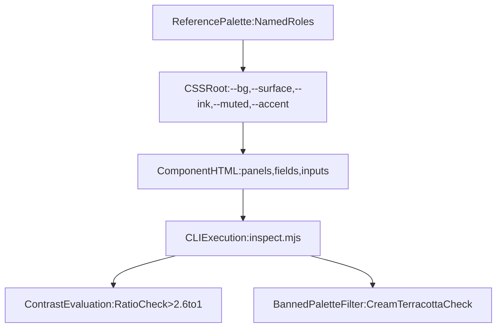
Sources: `[skills/taste-skill/references/colour.md:36-75]`, `[skills/taste-skill/references/colour.md:118-142]`

---

## 3. Grid, Margins & Section-Variety Rules

Layout structure governs rhythm, negative space, and viewports across breakpoints `[skills/taste-skill/references/layout.md:1-6]`.

### Margins and the 12-Column Grid
Strong pages avoid excessive centering in favour of edge-to-edge flow `[skills/taste-skill/references/layout.md:20-24]`:
```css
:root {
  --margin: clamp(1rem, 2.2vw, 2rem);   /* 16–32px: tight outer bounds */
  --gutter: clamp(0.75rem, 1.4vw, 1.5rem);
}
.wrap { padding-inline: var(--margin); }
.grid { display: grid; grid-template-columns: repeat(12, minmax(0, 1fr)); column-gap: var(--gutter); }
```
Global grid lines govern all content positioning; visible grid lines, crosshairs, or guide ornaments are strictly banned `[skills/taste-skill/references/layout.md:51-60]`.

Sources: `[skills/taste-skill/references/layout.md:40-61]`

### Section Arrangement & Anti-Template Patterns
To avoid predictable templates (such as icon cards followed by a three-up row), sections must adhere to strict variety mandates `[skills/taste-skill/references/layout.md:94-107]`:
* **No Neighbor Redundancy:** No two adjacent sections may share the same structural layout blueprint `[skills/taste-skill/references/layout.md:102-104]`.
* **Rhythm Control:** Dense blocks alternate with empty space, and light sections alternate with dark fields `[skills/taste-skill/references/layout.md:105]`.
* **Anchor Consistency:** Text elements across sections anchor to identical column offsets (e.g., column 5) `[skills/taste-skill/references/layout.md:63-65]`.

Sources: `[skills/taste-skill/references/layout.md:94-112]`

### Navigation and Viewport Handling
Navigation must be lightweight—typically a wordmark, three to five text links, and a single action `[skills/taste-skill/references/layout.md:115-116]`. Fixed navigation bars must never overlap underlying content, which is validated across viewports via screenshot inspection `[skills/taste-skill/references/layout.md:119-121]`.

Sources: `[skills/taste-skill/references/layout.md:113-123]`

---

## 4. Copy Constraints & Headline Budgets

Copy is treated as the foundational design decision; layout and typography cannot salvage poorly constructed text arguments `[skills/taste-skill/references/copy.md:1-5]`.

### Argument-First Authoring
Before drafting markup, pages must be structured as a sequence of concrete claims where each section carries a distinct, non-filler argument `[skills/taste-skill/references/copy.md:16-37]`. 

Sources: `[skills/taste-skill/references/copy.md:16-38]`

### Two-Line Headline Arithmetic
Hero headlines must fit within two lines or fewer at all viewports, a constraint verified by `inspect.mjs` `[skills/taste-skill/references/copy.md:39-44]`. Character limits are calculated using the formula `[skills/taste-skill/references/copy.md:46-54]`:

$$\text{Characters Per Line} \approx \frac{\text{Line Width (px)}}{\text{Font Size (px)} \times k}$$

Where $k \approx 0.50$ for standard grotesks and serifs `[skills/taste-skill/references/copy.md:52]`. At a desktop layout width with large display type, hero headlines are budgeted to approximately **32 characters or fewer** (four to six words) `[skills/taste-skill/references/copy.md:64]`.

Sources: `[skills/taste-skill/references/copy.md:39-88]`

### Banned Copy Patterns & Proof Rules
* **Banned Headline Shapes:** Mad-libs ("The AI-powered platform for..."), tricolons ("Fast. Simple. Secure."), corrections ("It's not just a tool..."), and unprompted questions are strictly prohibited `[skills/taste-skill/references/copy.md:101-110]`.
* **Proof Integrity:** Inventing customer quotes, unnamed press logos, metrics, or benchmarks is forbidden `[skills/taste-skill/references/copy.md:131-134]`. Proof must rely on verifiable construction details from the brief, such as pricing, dimensions, materials, or real demonstrations `[skills/taste-skill/references/copy.md:136-140]`.

Sources: `[skills/taste-skill/references/copy.md:101-140]`

---

# Page: Research Base: 247 Studied Sites

# Research Base: 247 Studied Sites

<details>
<summary>Relevant source files</summary>

The following files were used as context for generating this wiki page:

- [skills/taste-skill/assets/scenes/stage.css](skills/taste-skill/assets/scenes/stage.css)
- [skills/taste-skill/assets/scenes/stage.js](skills/taste-skill/assets/scenes/stage.js)
- [skills/taste-skill/library/sites.json](skills/taste-skill/library/sites.json)
- [skills/taste-skill/references/research.md](skills/taste-skill/references/research.md)

</details>


## Purpose and Scope

This page documents the empirical research base underpinning the `taste-skill` codebase, derived from a rigorous statistical study of 248 curated gallery sites captured on October 5, 2026 [skills/taste-skill/references/research.md:22-25](). It covers the methodology, panel scoring models, statistical correlations between design patterns and high/low scores, the structural schema of `library/sites.json`, and how the composition engine surfaces these insights via `draw.mjs --site <id>`.

Sources: `skills/taste-skill/references/research.md:1-44` [skills/taste-skill/references/research.md:1-44](), `skills/taste-skill/library/sites.json:1-48` [skills/taste-skill/library/sites.json:1-48]()

---

## 1. Statistical Methodology & Sample Composition

The dataset was constructed on October 5, 2026, sampling 248 sites: 156 from One Page Love and 92 Awwwards Sites of the Day [skills/taste-skill/references/research.md:24-25](). Of these, 247 successfully loaded and 246 were re-measured using the automated probe [skills/taste-skill/references/research.md:26]().

- **Capture Pipeline:** Headless Chrome captured viewports at 1440×900 and 390×844 pixels, gathering initial viewports, five scroll frames with real wheel input, mobile viewports, and computed style/geometry metrics [skills/taste-skill/references/research.md:27-29]().
- **Review Panel:** 21 model reviewers evaluated ~12 sites each using screenshots and telemetry, scoring them across four metrics: Design (40%), Usability (30%), Creativity (20%), and Content (10%) [skills/taste-skill/references/research.md:30-33]().
- **Usable Sets:** 235 sites yielded valid evaluation data; 202 sites were fully measurable for typography (at least 25 words and a detectable headline) [skills/taste-skill/references/research.md:35-37](). "Top" sites scored $\ge 7.5$ (82 measurable sites); "weak" sites scored $< 6.5$ (23 measurable sites) [skills/taste-skill/references/research.md:37-38]().

Sources: `skills/taste-skill/references/research.md:22-44` [skills/taste-skill/references/research.md:22-44]()

---

## 2. Gallery Insights & Design Core Correlates

Statistical analysis of the study revealed clear bifurcations between top-tier and low-scoring execution models:

- **Usability vs. Aesthetics:** Usability is the single metric that does not scale with overall score (median usability remains flat at 7 across all tiers) [skills/taste-skill/references/research.md:55-57](). Top sites do not achieve high scores through conventional user-friendliness, but through conceptual clarity.
- **The Power of an Idea:** Weak sites lack a core concept ("no visual idea beyond clarity", "dark SaaS launch formula"), whereas top sites derive concepts directly from the subject matter [skills/taste-skill/references/research.md:60-65]().
- **Layout Signatures:** The weak sites' signature layout is a *centred statement with media below* (appearing in 24% of weak sites vs. only 7% of top sites) [skills/taste-skill/references/research.md:84-87](). Giant wordmarks and full-bleed media overlays dominate top-tier sites [skills/taste-skill/references/research.md:84-85]().
- **Typography Metrics:** Hero headline size averages 72px (5.0vw), with top sites pushing extremes (6.0vw median, upper quarter starting at 12.5vw) [skills/taste-skill/references/research.md:110-113](). Distinct font sizes across a page have a median of 8 [skills/taste-skill/references/research.md:120]().

Sources: `skills/taste-skill/references/research.md:45-128` [skills/taste-skill/references/research.md:45-128]()

---

## 3. Site Library Schema (`library/sites.json`)

The quantitative findings are backed by qualitative entries stored in `library/sites.json`. Each record codifies a studied gallery site with architectural details, color codes, typography specs, and actionable layout takeaways ("steal" arrays).

```json
{
  "id": "aww-pp-neue-montreal",
  "name": "PP Neue Montreal",
  "url": "https://neuemontreal.com/",
  "source": "Awwwards Site of the Day",
  "kind": "other",
  "score": 8.6,
  "idea": "A typeface specimen dressed as a vintage city travel guide...",
  "mood": ["bold", "playful", "retro-modernist", "typographic", "confident"],
  "archetype": "giant-wordmark",
  "hero": "Grainy coral-red field...",
  "type": "PP Neue Montreal only...",
  "colour": "#ed4b44 #1a1a1a #f0e7d4 #18bc42 #b5b5b5 #f2c21a",
  "sections": [...],
  "steal": [
    "Give a product page a borrowed genre...",
    "Cut a flat colour hero into bands..."
  ]
}
```

Sources: `skills/taste-skill/library/sites.json:1-48` [skills/taste-skill/library/sites.json:1-48]()

---

## 4. Surfacing Site Notes via `draw.mjs --site <id>`

The generation script `draw.mjs` allows developers and agents to inject specific site blueprints directly into the generation pipeline by passing the `--site <id>` CLI flag. This loads the exact study notes from `library/sites.json` to instruct the layout generator.

### Diagram: Site Retrieval and Direction Flow

```mermaid
graph TD
    CLI["CLIInvocation: draw.mjs --site aww-pp-neue-montreal"] --> LoadSites["LoadDatabase: library/sites.json"]
    LoadSites --> FilterSite["FilterByID: match id === 'aww-pp-neue-montreal'"]
    FilterSite --> ExtractMeta["ExtractRecord: idea, archetype, hero, steal"]
    ExtractMeta --> BuildDir["GenerateBlueprint: direction.json"]
    BuildDir --> AgentBuild["Agent Execution Phase: Build & Gate"]

    subsch "Natural Language Space to Code Entity Space"
    classDef codeStyle fill:#f5f5f5,stroke:#333,stroke-width:1px;
    class CLI,LoadSites,FilterSite,ExtractMeta,BuildDir,AgentBuild codeStyle;
```

Sources: `skills/taste-skill/library/sites.json:1-48` [skills/taste-skill/library/sites.json:1-48]()

---

## 5. Gallery-to-Engine Architectural Mapping

The rules enforced by the static linter (`scripts/lint.mjs`) and real-browser inspector (`scripts/inspect.mjs`) are direct countermeasures against the anti-patterns identified in the 247-site study (such as icon-topped feature cards, excessive text lines, and generic SaaS gradients).

### Diagram: Research-to-Code Enforcement Pipeline

```mermaid
graph TD
    Study["Research Finding: references/research.md"] --> RuleDefinition["Rule Catalog: rules.mjs"]
    RuleDefinition --> StaticLint["Static Scanner: scripts/lint.mjs"]
    RuleDefinition --> BrowserProbe["CDP Inspector: scripts/inspect.mjs"]
    StaticLint --> FindingOut["Finding Report: FAIL / WARN"]
    BrowserProbe --> FindingOut

    subsch "Natural Language Space to Code Entity Space"
    classDef codeStyle fill:#f5f5f5,stroke:#333,stroke-width:1px;
    class Study,RuleDefinition,StaticLint,BrowserProbe,FindingOut codeStyle;
```

Sources: `skills/taste-skill/references/research.md:129-137` [skills/taste-skill/references/research.md:129-137](), `skills/taste-skill/library/sites.json:1-67` [skills/taste-skill/library/sites.json:1-67]()

---

# Page: The taste-skill v2 Pipeline

# The taste-skill v2 Pipeline

<details>
<summary>Relevant source files</summary>

The following files were used as context for generating this wiki page:

- [skills/taste-skill/README.md](skills/taste-skill/README.md)
- [skills/taste-skill/SKILL.md](skills/taste-skill/SKILL.md)
- [skills/taste-skill/library/directions.json](skills/taste-skill/library/directions.json)
- [skills/taste-skill/scripts/assets.mjs](skills/taste-skill/scripts/assets.mjs)

</details>


The `design-taste-frontend` skill (v2) implements a deterministic, 10-step run defined in `SKILL.md` [skills/taste-skill/SKILL.md:1-14]() to replace generic model templates with rigorous art direction [skills/taste-skill/README.md:1-6](). The pipeline covers Inventory, Argument, Draw, Idea, Copy deck, Build, Gate, Look, Motion, and Report [skills/taste-skill/SKILL.md:76-130](). This page provides a high-level overview of the pipeline machinery. For detailed breakdowns of each stage, refer to the child pages linked below.

**Diagram: Pipeline Execution Bridge (Natural Language Space to Code Entity Space)**
```mermaid
graph TD
    subgraph "Natural Language Space"
        Brief["Client Brief & Subject Inventory"]
        Critique["Juror Rubric & Visual Critique"]
    end

    subgraph "Code Entity Space"
        DrawScript["scripts/draw.mjs"]
        AssetScript["scripts/assets.mjs"]
        LintScript["scripts/lint.mjs"]
        InspectScript["scripts/inspect.mjs"]
    end

    Brief --> DrawScript
    Brief --> AssetScript
    DrawScript --> LintScript
    LintScript --> InspectScript
    InspectScript --> Critique
```
*Sources: `[skills/taste-skill/SKILL.md:40-130](), [skills/taste-skill/README.md:8-31]()`*

---

## 3.1. draw.mjs & the Direction Library

The composition engine deals three out of 20 researched directions from a structured JSON library (`library/directions.json`) [skills/taste-skill/SKILL.md:15-17](). It processes command-line flags such as `--sector`, `--tone`, `--have`, `--keep`, `--redraw`, `--options`, and `--app`, manages seeded randomness, records draw history in `~/.taste-skill/history.json`, and outputs structured `direction.json` configuration files [skills/taste-skill/README.md:40,47](). 

For details, see [draw.mjs & the Direction Library](#3.1).

*Sources: `[skills/taste-skill/SKILL.md:15-17](), [skills/taste-skill/README.md:40,47]()`*

---

## 3.2. assets.mjs & Open-Collection Media Sourcing

Zero-dependency asset discovery queries Openverse, Wikimedia Commons, the Art Institute of Chicago, and the Met without requiring API keys [skills/taste-skill/scripts/assets.mjs:24-28](). It applies licensing filters, executes video searches, generates `assets/credits.json`, and adheres to the rules defined in `references/imagery.md` [skills/taste-skill/README.md:41-43]() [skills/taste-skill/scripts/assets.mjs:11-22]().

For details, see [assets.mjs & Open-Collection Media Sourcing](#3.2).

*Sources: `[skills/taste-skill/README.md:41-43](), [skills/taste-skill/scripts/assets.mjs:11-28]()`*

---

## 3.3. The Gate: Automated Compliance Checking

The validation phase combines static source linting (`scripts/lint.mjs`) and real-browser inspection (`scripts/inspect.mjs`) to enforce house style compliance [skills/taste-skill/README.md:24-30](). Any `FAIL` or `WARN` finding blocks the build until resolved [skills/taste-skill/README.md:24-30]().

**Diagram: Automated Validation Workflow**
```mermaid
graph LR
    subgraph "Validation Pipeline"
        Source["Source Files"] --> Lint["scripts/lint.mjs"]
        Lint --> Render["Throwaway HTTP Server"]
        Render --> CDP["scripts/inspect.mjs (CDP)"]
        CDP --> Probe["library/probe.mjs"]
        Probe --> Judge["library/rules.mjs"]
    end
```
*Sources: `[skills/taste-skill/README.md:44-46]()`*

### 3.3.1. lint.mjs: Static Source Linting
Scans source files statically for banned patterns, stock phrases, and structural tells, supporting `--app` mode and shared rule identifiers [skills/taste-skill/README.md:44]().

### 3.3.2. inspect.mjs: Real-Browser Inspection
Drives headless Chrome via CDP to launch a throwaway HTTP server, iterate viewports across 1440px, 768px, and 390px, capture film-strip scroll frames, and output inspection JSON to `.taste-skill/inspect/` [skills/taste-skill/README.md:24-30,45]().

### 3.3.3. probe.mjs & rules.mjs: Measurement and Judgment
Executes in-page measurement functions (`probe`, `frame`, `layout`, `app`, `colourShare`, `palette`) and evaluates rules (`judge`, `judgeLayout`, `judgeApp`, `APP_SKIP`, `RULE_IDS`) to generate structured finding objects [skills/taste-skill/README.md:46]().

### 3.3.4. cdp.mjs: Zero-Dependency Browser Driver
Implements a lightweight Chrome DevTools Protocol client (`findChrome`, `Browser.launch`, `Page` APIs, throwaway profiles, `taste-skill-owner.json` ownership markers, and profile cleanup routines tested in `tests/profile-cleanup.mjs`) [skills/taste-skill/README.md:46,55]().

### 3.3.5. Critique Loop & Evals
Leverages the `references/critique.md` rubric during the Look phase when agents review screenshots, executing up to three fix rounds against benchmark briefs in `evals/evals.json` [skills/taste-skill/README.md:29-32,50]().

For details, see [The Gate: Automated Compliance Checking](#3.3).

*Sources: `[skills/taste-skill/README.md:24-50]()`*

---

## 3.4. Scroll Scenes Engine

Governed by `references/scenes.md`, `scripts/scenes.mjs`, and `assets/scenes/stage.js` + `stage.css`, this engine delivers pinned GSAP ScrollTrigger scenes with optional Lenis smoothing, 0–100% hold-state photography across desktop, phone, and reduced-motion viewports, alongside specialized scene failure codes [skills/taste-skill/README.md:35-51]().

For details, see [Scroll Scenes Engine](#3.4).

*Sources: `[skills/taste-skill/README.md:35-51]()`*

---

## 3.5. Neutral Foundation Assets

Provides the unopinionated `base.css` and `base.js` foundation shipped with the skill, establishing clean defaults and layout primitives upon which specific direction tokens are layered [skills/taste-skill/README.md:49]().

For details, see [Neutral Foundation Assets](#3.5).

*Sources: `[skills/taste-skill/README.md:49]()`*

---

# Page: draw.mjs & the Direction Library

# draw.mjs & the Direction Library

<details>
<summary>Relevant source files</summary>

The following files were used as context for generating this wiki page:

- [skills/taste-skill/README.md](skills/taste-skill/README.md)
- [skills/taste-skill/library/directions.json](skills/taste-skill/library/directions.json)
- [skills/taste-skill/library/heroes.json](skills/taste-skill/library/heroes.json)
- [skills/taste-skill/library/photos.json](skills/taste-skill/library/photos.json)
- [skills/taste-skill/library/sections.json](skills/taste-skill/library/sections.json)
- [skills/taste-skill/scripts/assets.mjs](skills/taste-skill/scripts/assets.mjs)
- [skills/taste-skill/scripts/draw.mjs](skills/taste-skill/scripts/draw.mjs)

</details>


This page details the implementation, execution mechanics, and data flow of `draw.mjs` and the underlying JSON Direction Library within the `taste-skill` v2 composition engine [skills/taste-skill/scripts/draw.mjs:1-20](). The composition engine decouples aesthetic decision-making from LLM inference by providing a deterministic, zero-dependency Node.js script that deals structured design directions, heroes, palettes, and section layouts from a curated dataset of 247 studied gallery sites [skills/taste-skill/scripts/draw.mjs:2-20]().

---

## 1. CLI Interface & Execution Mechanics

The CLI interface is implemented entirely in vanilla Node.js with zero external dependencies [skills/taste-skill/scripts/draw.mjs:20-21](). It reads arguments via custom argument parser helpers `opt` and `list` [skills/taste-skill/scripts/draw.mjs:33-35]().

### Argument Parsing and Core Flags
CLI execution is configured through flags defined in `skills/taste-skill/scripts/draw.mjs` [skills/taste-skill/scripts/draw.mjs:8-19]():
- `--sector <sector>`: Specifies the industry vertical (e.g., `saas`, `dev-tool`, `ai-product`, `consumer-app`, `finance`, `agency`, `studio-portfolio`, `ecommerce`) [skills/taste-skill/scripts/draw.mjs:8,40]().
- `--brief "one line"`: Defines the natural language project brief [skills/taste-skill/scripts/draw.mjs:8]().
- `--tone <tone>`: Sets the aesthetic tone from options such as `quiet`, `bold`, `warm`, `technical`, `playful`, `luxury`, or `editorial` [skills/taste-skill/scripts/draw.mjs:9,41]().
- `--have <assets>`: Declares available assets (e.g., `photography`, `product-photo`, `product-ui`, `illustration`, `video`) [skills/taste-skill/scripts/draw.mjs:10]().
- `--keep <palette,type>`: Locks brand-specified attributes while allowing the engine to draw the rest [skills/taste-skill/scripts/draw.mjs:11]().
- `--avoid <id,id>`: Prevents specific direction IDs from being dealt [skills/taste-skill/scripts/draw.mjs:12]().
- `--seed <N>`: Sets a numeric seed for deterministic randomness [skills/taste-skill/scripts/draw.mjs:12]().
- `--out <DIR>`: Specifies the output directory (defaulting to `.taste-skill`) where `direction.json` is written [skills/taste-skill/scripts/draw.mjs:12,37]().
- `--options <3>`: Outputs three dealt candidate directions to choose from without writing state [skills/taste-skill/scripts/draw.mjs:13]().
- `--direction <id>`: Forces a specific direction sheet [skills/taste-skill/scripts/draw.mjs:14]().
- `--show`: Reprints the saved direction sheet [skills/taste-skill/scripts/draw.mjs:15]().
- `--redraw <slot>`: Re-deals an isolated slot such as `hero`, `type`, `palette`, `photos`, `scenes`, `section:<role>`, or `direction` [skills/taste-skill/scripts/draw.mjs:16]().
- `--list <what>`: Lists available options like `sectors`, `directions`, `roles`, `tones`, or `scenes` [skills/taste-skill/scripts/draw.mjs:17]().
- `--site <id>`: Prints one studied reference site in full detail [skills/taste-skill/scripts/draw.mjs:18]().
- `--app`: Deals a style for an app screen (dashboards, admin views) instead of a marketing page via `scripts/lib/app-draw.mjs` [skills/taste-skill/scripts/draw.mjs:19,69-71]().

The script validates sectors against `SECTORS` and tones against `TONES`, mapping requested section roles through `ROLE_ALIAS` to match keys in `library/sections.json` [skills/taste-skill/scripts/draw.mjs:39-67]().

Sources: [skills/taste-skill/scripts/draw.mjs:1-85]()

---

## 2. Seeded Randomness & History Persistence

To prevent consecutive projects from sharing identical visual traits, `draw.mjs` maintains state persistence and randomized selection controls [skills/taste-skill/scripts/draw.mjs:4-6]().

### Randomness and Recency Management
- **Seeded Randomness**: Leverages Node.js built-in `node:crypto` `randomInt` alongside optional user-provided seed parameters (`--seed`) to ensure reproducible draws when needed [skills/taste-skill/scripts/draw.mjs:12,25]().
- **History Path**: Draws and selected directions are logged to `~/.taste-skill/history.json` relative to the user's home directory [skills/taste-skill/scripts/draw.mjs:25,37]().
- **Recency Exclusion**: When dealing directions, the engine evaluates recent entries stored in `history.json` to deprioritize or eliminate recently dealt direction IDs, guaranteeing visual variety across successive agent invocations [skills/taste-skill/scripts/draw.mjs:4-6]().

Diagram: Draw History Tracking
```mermaid
graph TD
    A["DrawCLIExecution"] --> B["Read ~/.taste-skill/history.json"]
    B --> C["Filter Recently Used Direction IDs"]
    C --> D["Apply Sector & Tone Constraints"]
    D --> E["Deal Unique Direction Sheet"]
    E --> F["Append New Draw to ~/.taste-skill/history.json"]

    subgraph "Code Entity Space"
        A
        B
        C
        D
        E
        F
    end
```
Sources: [skills/taste-skill/scripts/draw.mjs:4-37]()

---

## 3. The JSON Library Architecture

The core aesthetic database resides in `skills/taste-skill/library/` and is loaded synchronously via helper functions using `JSON.parse(readFileSync(...))` [skills/taste-skill/scripts/draw.mjs:28-32]().

### Library Schema Overview
- **`directions.json`**: Defines high-level composition strategies (e.g., `name-as-monument`, `sentence-as-layout`, `pinned-poster`) containing structural ideas, typography specs, color rules, and pitfall warnings [skills/taste-skill/library/directions.json:1-136]().
- **`heroes.json`**: Contains viewport blueprints for the first screen, mapping archetypes like `giant-wordmark` and `type-poster` to specific layout coordinates at 1440px desktop and mobile viewports [skills/taste-skill/library/heroes.json:1-69]().
- **`sections.json`**: Modular section blueprints defining roles (`features`, `showcase`, `pricing`, `footer`), layout shapes (`list`, `pinned`, `full-bleed`, `stack`, `mosaic`), and CSS grid rules [skills/taste-skill/library/sections.json:1-118]().
- **`palettes.json`**: Curated color systems specifying `bg`, `surface`, `ink`, `muted`, `accent`, `accentInk`, and multi-tone `fields` [skills/taste-skill/library/palettes.json:1-156]().
- **`type.json`**: Font family definitions, Fontshare/Google CDN link strings, weight arrays, and fluid `clamp()` scale steps (`step-small`, `step-body`, `step-lead`, `step-head`) [skills/taste-skill/library/type.json:1-171]().
- **`photos.json`**: Zero-dependency photographic categorization sets (e.g., `fog-and-quiet`), alt text, color tags, and Picsum/Unsplash reference pointers [skills/taste-skill/library/photos.json:1-273]().
- **`motions.json`**: Timing tokens, transform rules, and animation specifications.
- **`scenes.json`**: GSAP ScrollTrigger scene definitions, hold-states, and desktop/mobile breakdown rules.
- **`sites.json`**: Metadata and extracted structural breakdowns of 247 studied Awwwards-winning gallery sites (`aww-pp-neue-montreal`, `aww-seasats`, etc.).

Sources: 
- [skills/taste-skill/scripts/draw.mjs:28-32]()
- [skills/taste-skill/library/directions.json:1-136]()
- [skills/taste-skill/library/heroes.json:1-69]()
- [skills/taste-skill/library/palettes.json:1-156]()
- [skills/taste-skill/library/sections.json:1-118]()
- [skills/taste-skill/library/photos.json:1-273]()

---

## 4. Composition Engine Data Flow & Output

To bridge natural language input parameters to deterministic code entities, the system maps CLI flags directly to structured JSON records within the library, culminating in the generation of `direction.json`.

### Diagram: Natural Language Space to Code Entity Space (CLI & Execution)
This diagram illustrates how user command-line arguments resolve through `draw.mjs` to target specific library JSON files.

```mermaid
graph TD
    A["Natural Language Brief & Sector CLI Args"] --> B["opt() & list() Parser in draw.mjs"]
    B --> C{{"Query Library Indices"}}
    C --> D["directions.json"]
    C --> E["heroes.json"]
    C --> F["sections.json"]
    C --> G["palettes.json"]
    C --> H["type.json"]
    C --> I["photos.json"]
    D --> J["Resolved direction.json Sheet"]
    E --> K["Hero Blueprint Object"]
    F --> L["Section Role Blueprints"]
    G --> M["Palette Hex Values & Fields"]
    H --> N["Fontface CDN & clamp() scale"]
    I --> O["Photography Set Selection"]
    J & K & L & M & N & O --> P["Write ~/.taste-skill/direction.json Output"]

    subgraph "Code Entity Space"
        B
        C
        D
        E
        F
        G
        H
        I
        J
        K
        L
        M
        N
        O
        P
    end

    subgraph "Natural Language Space"
        A
    end
```
Sources: [skills/taste-skill/scripts/draw.mjs:8-37](), [skills/taste-skill/library/directions.json:1-30]()

### Diagram: Direction Deal and Slot Redeal Workflow
This diagram maps the internal object resolution workflow when executing a full deal versus an isolated slot redraw.

```mermaid
graph TD
    O["User Input: --redraw slot"] --> P["load('directions') & load('heroes')"]
    P --> Q{{"Switch slot argument"}}
    Q -- "hero" --> R["Select Compatible Hero Blueprint from heroes.json"]
    Q -- "palette" --> S["Select Palette from palettes.json"]
    Q -- "type" --> T["Select Typography from type.json"]
    Q -- "section:<role>" --> U["Select Section Blueprint from sections.json"]
    Q -- "photos" --> V["Select Photo Set from photos.json"]
    R & S & T & U & V --> W["Update direction.json State File"]
    W --> X["Console Output & Gate Validation Ready"]

    subgraph "Code Entity Space"
        P
        Q
        R
        S
        T
        U
        V
        W
        X
    end

    subgraph "Natural Language Space"
        O
    end
```
Sources: [skills/taste-skill/scripts/draw.mjs:15-18](), [skills/taste-skill/library/heroes.json:1-15]()

---

## Sources
- [skills/taste-skill/scripts/draw.mjs:1-584]()
- [skills/taste-skill/library/directions.json:1-136]()
- [skills/taste-skill/library/heroes.json:1-69]()
- [skills/taste-skill/library/palettes.json:1-156]()
- [skills/taste-skill/library/sections.json:1-118]()
- [skills/taste-skill/library/photos.json:1-273]()

---

# Page: assets.mjs & Open-Collection Media Sourcing

# assets.mjs & Open-Collection Media Sourcing

<details>
<summary>Relevant source files</summary>

The following files were used as context for generating this wiki page:

- [skills/taste-skill/README.md](skills/taste-skill/README.md)
- [skills/taste-skill/library/directions.json](skills/taste-skill/library/directions.json)
- [skills/taste-skill/references/imagery.md](skills/taste-skill/references/imagery.md)
- [skills/taste-skill/scripts/assets.mjs](skills/taste-skill/scripts/assets.mjs)

</details>


## Purpose and Scope
This page documents the implementation and usage of zero-dependency asset discovery and download pipelines within the `taste-skill` v2 architecture. Specifically, it covers `skills/taste-skill/scripts/assets.mjs` [skills/taste-skill/scripts/assets.mjs:1-35]() and the imagery sourcing principles defined in `skills/taste-skill/references/imagery.md` [skills/taste-skill/references/imagery.md:1-20](). It details programmatic source integrations (Openverse, Wikimedia Commons, Art Institute of Chicago, The Metropolitan Museum of Art, Internet Archive, and NASA), command-line query flags, licensing filters, video search workflows, metadata generation for attribution, and imagery selection hierarchies.

Sources: [skills/taste-skill/scripts/assets.mjs:1-35](), [skills/taste-skill/references/imagery.md:1-20]()

---

## 1. Source Registry & System Architecture

The asset sourcing engine is implemented as a standalone Node.js script located at `skills/taste-skill/scripts/assets.mjs` [skills/taste-skill/scripts/assets.mjs:1-35](). It operates with zero external npm dependencies, using built-in modules (`node:fs`, `node:path`, `node:url`) and the global `fetch` API [skills/taste-skill/scripts/assets.mjs:29-30].

The script maps distinct third-party museum and archival APIs into a uniform query interface using internal configuration maps (`SOURCES` and `SOURCE_ALIAS`) [skills/taste-skill/scripts/assets.mjs:36-44]. Supported endpoints include Openverse (`api.openverse.org`), Wikimedia Commons, Art Institute of Chicago (AIC) via IIIF, The Metropolitan Museum of Art Open Access API, Internet Archive (Prelinger Archives), and the NASA Image and Video Library [skills/taste-skill/scripts/assets.mjs:24-28].

Diagram: Source Registry Dispatch Architecture
```mermaid
graph TD
    CLI["process.argv"] --> ArgParser["scripts/assets.mjs Argument Parser"]
    ArgParser --> SourceDispatcher["SOURCES Registry Dispatcher"]
    SourceDispatcher --> OpenverseReq["Openverse API Endpoint api.openverse.org"]
    SourceDispatcher --> CommonsReq["Wikimedia Commons API"]
    SourceDispatcher --> AicReq["Art Institute of Chicago AIC_HEADERS IIIF"]
    SourceDispatcher --> MetReq["The Met Open Access API"]
    SourceDispatcher --> ArchiveReq["Internet Archive Prelinger Archives"]
    SourceDispatcher --> NasaReq["NASA Image and Video Library"]
```
Sources: [skills/taste-skill/scripts/assets.mjs:24-53]()

### Source Registry Data Structures
* `SOURCES`: Defines available backends, media capabilities (`image`, `video`, or `both`), provider display names, and contextual research notes [skills/taste-skill/scripts/assets.mjs:36-43].
* `SOURCE_ALIAS`: Maps shorthand aliases (e.g., `museums` resolving to `['aic', 'met']`, `wikimedia` resolving to `['commons']`) [skills/taste-skill/scripts/assets.mjs:44].
* `AIC_HEADERS`: Sets custom User-Agent tracking (`AIC-User-Agent`) required by the Art Institute of Chicago API constraints [skills/taste-skill/scripts/assets.mjs:51-52].

Sources: [skills/taste-skill/scripts/assets.mjs:36-53]()

---

## 2. CLI Flags, Licensing Filters, and Query Parameters

The script exposes a CLI interface parsed directly from `process.argv` [skills/taste-skill/scripts/assets.mjs:78-85]. It categorizes arguments into valued options (`VALUED`) and boolean flags (`FLAGS`) [skills/taste-skill/scripts/assets.mjs:79-80].

Diagram: CLI Parsing and Query Execution Flow
```mermaid
graph TD
    NodeInvocation["node assets.mjs <query>"] --> ParseLoop["scripts/assets.mjs Argument Loop"]
    ParseLoop --> ValuedCheck["VALUED Set Check"]
    ParseLoop --> FlagCheck["FLAGS Set Check"]
    ValuedCheck --> SourceFilter["--source Filter Execution"]
    ValuedCheck --> LicenseFilter["--license SAFE LICENCES Filter"]
    ValuedCheck --> DimensionFilter["--min-width & --width Processing"]
    SourceFilter --> NetworkVerify["Network Load Check no-check"]
    LicenseFilter --> NetworkVerify
    DimensionFilter --> NetworkVerify
    NetworkVerify --> OutputJSON["Console or JSON Output"]
```
Sources: [skills/taste-skill/scripts/assets.mjs:78-85]()

### Key Parameters and Default Values
* `--source`: Limits search to comma-separated providers (`openverse`, `commons`, `aic`, `met`, `archive`, `nasa`, or alias `museums`) defaulting to `all` [skills/taste-skill/scripts/assets.mjs:56-57].
* `--license`: Restricts results by licensing criteria. Defaults to `safe`, which permits commercial-safe tiers (`cc0`, `pd`, `by`, `by-sa`). Users can also select `pd` (Public Domain only) or `all` [skills/taste-skill/scripts/assets.mjs:13-14, 46-48].
* `--orientation`: Filters images by geometric aspect ratio (`landscape`, `portrait`, `square`) [skills/taste-skill/scripts/assets.mjs:59].
* `--min-width`: Enforces a lower bound on original image resolution (default `1000` pixels) [skills/taste-skill/scripts/assets.mjs:60].
* `--width`: Specifies the target width rendition for URLs or file downloads (default `1920` pixels) [skills/taste-skill/scripts/assets.mjs:61].
* `--limit`: Controls maximum results returned per source (capped at `20`, default `5`) [skills/taste-skill/scripts/assets.mjs:62].
* `--no-check`: Bypasses asynchronous HTTP HEAD requests that verify whether returned image URLs load correctly [skills/taste-skill/scripts/assets.mjs:63].

Sources: [skills/taste-skill/scripts/assets.mjs:13-14, 46-64]()

---

## 3. Video Search and Archival Footage Handling

When searching for real moving image footage rather than static graphics, the `--video` flag switches the sourcing strategy to target video repositories (Wikimedia Commons webm/mp4 transcodes, Internet Archive Prelinger Archives, and NASA Video Library) [skills/taste-skill/scripts/assets.mjs:17-20, 26-28].

### Video Parameters
* `--res`: Selects the target rendition height or short side (default `720`) [skills/taste-skill/scripts/assets.mjs:67].
* `--max-mb`: Sets a file size ceiling (default `25` megabytes). Clips exceeding this threshold are flagged in search listings, and the `--get` command refuses to download them to prevent payload bloat [skills/taste-skill/scripts/assets.mjs:18-19, 68].
* `--min-width`: Defaults to `640` pixels for video streams [skills/taste-skill/scripts/assets.mjs:69].
* `VIDEO_TYPES`: Restricts acceptable container formats to web-playable types (`video/mp4`, `video/webm`) [skills/taste-skill/scripts/assets.mjs:45].

Sources: [skills/taste-skill/scripts/assets.mjs:17-20, 26-28, 45, 65-69]()

---

## 4. Download Workflow, Metadata, and Attribution

Once assets are discovered via string queries, specific reference identifiers (e.g., `commons:36649959`, `met:707892`) are passed to the `--get` handler [skills/taste-skill/references/imagery.md:82-90].

Diagram: Download and Attribution Record Pipeline
```mermaid
graph TD
    GetCommand["node assets.mjs --get ref,ref"] --> ResolveRef["Reference ID Resolver"]
    ResolveRef --> DownloadBinary["Fetch Binary Stream"]
    DownloadBinary --> WriteDisk["createWriteStream to assets/"]
    WriteDisk --> RecordJSON["Append Entry to credits.json"]
    RecordJSON --> MarkdownSync["Update CREDITS.md Documentation"]
```
Sources: [skills/taste-skill/scripts/assets.mjs:20-22], [skills/taste-skill/references/imagery.md:82-90]()

### Execution Steps
1. **Resolution & Download:** `--get <ref>` queries the specific provider endpoint, resolves the direct media URL, and downloads the binary payload into the project directory (configured via `--to assets`, with custom filenames accepted via `--name`) [skills/taste-skill/scripts/assets.mjs:20-21].
2. **Metadata Recording:** The utility automatically generates and updates attribution metadata records within `credits.json` [skills/taste-skill/scripts/assets.mjs:8-9].
3. **Markdown Logging:** Example outputs and project directories maintain corresponding documentation logs (such as `examples/v2/CREDITS.md`) recording title, creator, explicit license terms, and canonical source links [examples/v2/CREDITS.md:1-20].

Sources: [skills/taste-skill/scripts/assets.mjs:8-22], [examples/v2/CREDITS.md:1-20], [skills/taste-skill/references/imagery.md:82-90]()

---

## 5. Imagery Sourcing Hierarchy and Rules

According to `references/imagery.md`, generated pages often fail visually due to generic placeholders or abstract graphical blobs [skills/taste-skill/references/imagery.md:1-5]. The design system establishes a strict preference hierarchy for sourcing visual media:

1. **The project's own images:** Product shots, real locations, team members, and actual work artifacts [skills/taste-skill/references/imagery.md:46-48].
2. **Generated images:** Produced via session image tools using precise photographer briefs (subject, angle, lighting, background, crop ratio, and "no text") [skills/taste-skill/references/imagery.md:49-51].
3. **Open collection real pictures:** Archival photographs, historical maps, material textures, and museum objects sourced via `scripts/assets.mjs` [skills/taste-skill/references/imagery.md:52-57].
4. **Code-drawn subjects:** Flat shape representations of product objects, architectural tiles, street maps, or software interfaces generated purely via code [skills/taste-skill/references/imagery.md:58-62].
5. **Dealt photographs:** Stock-like background imagery dealt on direction sheets, restricted strictly to generic atmospheric contexts (e.g., open sea, fog) [skills/taste-skill/references/imagery.md:63-66].
6. **Type and colour alone:** Deliberate typographic layouts without supplementary imagery [skills/taste-skill/references/imagery.md:67].

Sources: [skills/taste-skill/references/imagery.md:1-68]()

---

# Page: The Gate: Automated Compliance Checking

# The Gate: Automated Compliance Checking

<details>
<summary>Relevant source files</summary>

The following files were used as context for generating this wiki page:

- [skills/taste-skill/evals/evals.json](skills/taste-skill/evals/evals.json)
- [skills/taste-skill/references/critique.md](skills/taste-skill/references/critique.md)
- [skills/taste-skill/scripts/inspect.mjs](skills/taste-skill/scripts/inspect.mjs)
- [skills/taste-skill/scripts/lint.mjs](skills/taste-skill/scripts/lint.mjs)

</details>


The "Gate" is the automated compliance checking phase of the `taste-skill` pipeline. Its purpose is to validate generated web pages against the Taste Standard, ensuring adherence to design principles and avoiding common "AI tells" and anti-patterns. This phase comprises static source code analysis, real-browser inspection, and scene photography. Any `FAIL` or critical `WARN` findings will block the build process, requiring remediation.

This page provides a high-level overview of the components involved in the Gate. For detailed technical information on each component, refer to their respective child pages.

## 1. Static Source Linting: `lint.mjs`

The `lint.mjs` script performs static analysis of source files to identify banned patterns, stock phrases, and structural "tells" that violate the Taste Standard [skills/taste-skill/scripts/lint.mjs:1-3](). It operates by recursively walking through specified directories and checking file contents against a predefined set of regular expressions [skills/taste-skill/scripts/lint.mjs:23-28](). This allows for early detection of issues that might not be visible in a rendered page or are more efficiently caught at the source level. The linter can operate in `--app` mode, which adjusts rule severity for app screens [skills/taste-skill/scripts/lint.mjs:13-17]().

For details, see [lint.mjs: Static Source Linting](#3.3.1).

```mermaid
graph TD
    A["CLI: lint.mjs [files/dirs] [--app]"] --> B["File System Walker"]
    B --> C{"Is File a Supported Source Type?"}
    C -- Yes --> D["Read File Content"]
    D --> E["Apply Rules (R) Line-by-Line"]
    E --> F{"Rule Match?"}
    F -- Yes --> G["Record Finding (FAIL/WARN)"]
    F -- No --> D
    G --> H["Aggregate Findings"]
    H --> I{"Any FAIL Findings?"}
    I -- Yes --> J["Exit Code 1 (Build Blocked)"]
    I -- No --> K["Exit Code 0"]

    subgraph "Code Entity Space"
        style A fill:#fff,stroke:#333,stroke-width:2px
        style E fill:#fff,stroke:#333,stroke-width:2px
        style G fill:#fff,stroke:#333,stroke-width:2px
    end
```
*Sources: [skills/taste-skill/scripts/lint.mjs:1-63]()*

## 2. Real-Browser Inspection: `inspect.mjs`

The `inspect.mjs` script drives a real browser (Chrome/Edge/Chromium) using the Chrome DevTools Protocol (CDP) to perform dynamic validation of the rendered page [skills/taste-skill/scripts/inspect.mjs:1-2](). This involves launching a throwaway HTTP server for local files, iterating through various viewport widths (e.g., 1440, 768, 390 pixels), recording motion, checking title visibility, capturing film-strip scroll sequences, auditing for reduced-motion compliance, and taking screenshots [skills/taste-skill/scripts/inspect.mjs:4-8, 18-19, 73-87](). All findings and visual artifacts are stored in the `.taste-skill/inspect/` directory.

For details, see [inspect.mjs: Real-Browser Inspection](#3.3.2).

```mermaid
graph TD
    A["CLI: inspect.mjs <url|file.html> [--app] [--film]"] --> B["Browser.launch() (cdp.mjs)"]
    B --> C{"Is Target a Local File?"}
    C -- Yes --> D["createServer() (Local HTTP Server)"]
    C -- No --> E["Direct URL Access"]
    D --> F["Page.goto(URL)"]
    E --> F
    F --> G["Iterate Viewport Widths (1440, 768, 390)"]
    G --> H["Inject MOTION_RECORDER"]
    H --> I["Page.eval(probe(), frame(), layout(), app(), colourShare())"]
    I --> J["Page.eval(judge(), judgeLayout(), judgeApp())"]
    J --> K["Capture Screenshots & Film Strips"]
    K --> L["Generate JSON Report & Save Images to .taste-skill/inspect/"]
    L --> M{"Any FAIL Findings?"}
    M -- Yes --> N["Exit Code 1 (Build Blocked)"]
    M -- No --> O["Exit Code 0"]

    subgraph "Code Entity Space"
        style A fill:#fff,stroke:#333,stroke-width:2px
        style B fill:#fff,stroke:#333,stroke-width:2px
        style I fill:#fff,stroke:#333,stroke-width:2px
        style J fill:#fff,stroke:#333,stroke-width:2px
    end
```
*Sources: [skills/taste-skill/scripts/inspect.mjs:1-87](), [skills/taste-skill/scripts/lib/cdp.mjs:40-114]()*

## 3. Measurement and Judgment: `probe.mjs` & `rules.mjs`

The core of the real-browser inspection involves two key modules: `probe.mjs` and `rules.mjs`.
- **`probe.mjs`**: Contains in-page measurement functions (`probe`, `frame`, `layout`, `app`, `colourShare`, `palette`) that execute directly within the browser's page context [skills/taste-skill/scripts/inspect.mjs:19](). These functions collect detailed metrics about the DOM, layout, typography, and color usage.
- **`rules.mjs`**: Houses the rule evaluators (`judge`, `judgeLayout`, `judgeApp`) that process the measurements from `probe.mjs` against the Taste Standard [skills/taste-skill/scripts/inspect.mjs:20](). It defines the `finding` object shape and major failure codes, including `APP_SKIP` for rules that are exempted in app mode.

For details, see [probe.mjs & rules.mjs: Measurement and Judgment](#3.3.3).

## 4. Zero-Dependency Browser Driver: `cdp.mjs`

The `cdp.mjs` module provides a lightweight, zero-dependency client for interacting with the Chrome DevTools Protocol [skills/taste-skill/scripts/lib/cdp.mjs:1-2](). It handles tasks such as finding an installed Chrome/Edge/Chromium browser (`findChrome`), launching browser instances (`Browser.launch`), and providing Page APIs for navigation (`goto`), script evaluation (`eval`), screenshot capture (`screenshot`), and scroll simulation (`wheel`) [skills/taste-skill/scripts/lib/cdp.mjs:40-114](). It also manages throwaway browser profiles, marks them with `taste-skill-owner.json`, and includes a `sweepProfiles` cleanup mechanism to prevent accumulation of temporary data.

For details, see [cdp.mjs: Zero-Dependency Browser Driver](#3.3.4).

## 5. Critique Loop & Evals

After the automated Gate, the "Look" phase involves a human-like critique loop. This process uses the `references/critique.md` rubric to evaluate the generated screenshots, often leading to up to three rounds of fixes [skills/taste-skill/references/critique.md:1-5](). The `evals/evals.json` file contains a set of regression tests that define specific prompts and expected outputs, which are used to assess the skill's performance and ensure consistent adherence to the Taste Standard [skills/taste-skill/evals/evals.json:1-76]().

For details, see [Critique Loop & Evals](#3.3.5).

---

# Page: lint.mjs: Static Source Linting

# lint.mjs: Static Source Linting

<details>
<summary>Relevant source files</summary>

The following files were used as context for generating this wiki page:

- [skills/taste-skill/assets/base.css](skills/taste-skill/assets/base.css)
- [skills/taste-skill/evals/evals.json](skills/taste-skill/evals/evals.json)
- [skills/taste-skill/references/critique.md](skills/taste-skill/references/critique.md)
- [skills/taste-skill/references/tells.md](skills/taste-skill/references/tells.md)
- [skills/taste-skill/scripts/lint.mjs](skills/taste-skill/scripts/lint.mjs)

</details>


`lint.mjs` is a critical component of the Gate phase in the `taste-skill` pipeline, responsible for static analysis of source files. Its primary purpose is to identify and flag "tells" – banned patterns, stock phrases, and structural anti-patterns that make a page appear generically generated. This static scanning occurs *before* any rendering, catching issues that might not be visible in a rendered output, such as specific copy habits or motion values. The script can operate in an `--app` mode, which adjusts rule severity for app screens, and integrates with a shared set of rule IDs.

## Operation and Scope

The `lint.mjs` script is executed via the command line, accepting file paths or directories as arguments. It recursively walks through specified directories, identifying relevant source files based on their extensions.

**Command Line Usage:**
```bash
node lint.mjs [files or directories ...] [--app] [--json]
```
- `[files or directories ...]`: Specifies the paths to scan. If no paths are provided, it defaults to the current directory (`.`).
- `--app`: Activates "app mode," which modifies the severity of certain rules to accommodate the design principles of app screens [skills/taste-skill/scripts/lint.mjs:15]().
- `--json`: Outputs findings in JSON format.

The script processes files with extensions such as `.html`, `.htm`, `.css`, `.scss`, `.less`, `.js`, `.jsx`, `.ts`, `.tsx`, `.vue`, `.svelte`, `.astro`, and `.mdx` [skills/taste-skill/scripts/lint.mjs:20](). It skips common build and dependency directories like `node_modules`, `.git`, `dist`, and `.taste-skill` [skills/taste-skill/scripts/lint.mjs:21](). Files larger than 4MB are also skipped to prevent performance issues [skills/taste-skill/scripts/lint.mjs:27]().

If any `FAIL` level findings are detected, the script exits with a status code of `1` [skills/taste-skill/scripts/lint.mjs:7](), indicating a critical violation of the "Taste Standard."

### App Mode

App mode is specifically designed for app screens and dashboards, which have different design constraints compared to marketing pages. When `--app` is enabled, or if the `kind` property in `.taste-skill/direction.json` is set to `'app'`, certain rules are relaxed or their severity is downgraded from `FAIL` to `WARN` [skills/taste-skill/scripts/lint.mjs:15-17](). For example, `hairline`, `outlined-box`, and `default-font` rules are completely disabled (`null`), while `numbering`, `mono`, `shadow`, and `eyebrow` are downgraded to `WARN` [skills/taste-skill/scripts/lint.mjs:17](). This allows for design elements common in app interfaces, such as subtle borders or monospace data labels, without triggering a `FAIL`.

Sources:
- [skills/taste-skill/scripts/lint.mjs:1-34]()

## Data Flow and Key Functions

The `lint.mjs` script follows a straightforward data flow:

```mermaid
graph TD
    A[Start lint.mjs] --> B{Parse Command Line Arguments};
    B --> C{Determine Scan Roots};
    C --> D{Walk File System};
    D --> E{Filter Files by Extension and Size};
    E --> F{Read File Content Line by Line};
    F --> G{Apply Linting Rules};
    G{Apply Linting Rules} --> H{Collect Findings};
    H --> I{Output Findings (JSON or Console)};
    I --> J{Set Exit Code};
    J --> K[End];

    subgraph "File System Traversal"
        D -- "statSync(p)" --> D1[Check if Directory];
        D1 -- "isDirectory()" --> D2{Recurse for Subdirectories};
        D1 -- "isFile()" --> D3{Check Extension and Size};
        D3 -- "EXT.has(extname(p)) && st.size < 4MB" --> E;
        D3 -- "st.size >= 4MB" --> D4[Add to tooBig list];
    end

    subgraph "Linting Process"
        G -- "For each line" --> G1{Iterate through R (Rules)};
        G1 -- "regex.test(line)" --> G2{Match Found?};
        G2 -- "Yes" --> G3{Create Finding Object};
        G3 --> H;
    end
```
**Diagram: `lint.mjs` Data Flow**
Sources:
- [skills/taste-skill/scripts/lint.mjs:8-32]()
- [skills/taste-skill/scripts/lint.mjs:36-61]()

### `walk(p)` Function

The `walk(p)` function is a recursive helper that traverses the file system to find source files [skills/taste-skill/scripts/lint.mjs:24]().
- It takes a path `p` as input.
- It uses `statSync(p)` to determine if `p` is a directory or a file.
- If `p` is a directory, it reads its contents using `readdirSync(p)` and recursively calls `walk()` for each item, skipping directories in the `SKIP` set and hidden files/directories (starting with `.`) [skills/taste-skill/scripts/lint.mjs:25]().
- If `p` is a file, it checks if its extension is in the `EXT` set and if its size is less than 4MB. Valid files are added to the `files` array; oversized files are added to `tooBig` [skills/taste-skill/scripts/lint.mjs:26-27]().

Sources:
- [skills/taste-skill/scripts/lint.mjs:24-28]()

## Linting Rules (`R`)

The core of `lint.mjs` is the `R` array, which defines all the linting rules [skills/taste-skill/scripts/lint.mjs:37](). Each rule is an array with four elements:
1.  **Level**: `'FAIL'` or `'WARN'`. A `FAIL` will cause the script to exit with an error code.
2.  **ID**: A unique identifier for the rule (e.g., `'mono'`, `'gradient'`, `'eyebrow'`).
3.  **Regex**: A regular expression used to scan each line of the source file.
4.  **Message**: A human-readable explanation of the violation and, often, a suggestion for remediation.

These rules are applied line by line to the content of each scanned file. The `APP_LEVEL` object defines how rule severities are adjusted in app mode [skills/taste-skill/scripts/lint.mjs:17]().

### Example Rules and Their Rationale

The rules are derived from the "Tells" documented in `references/tells.md` and the "Critique" guidelines in `references/critique.md`. They aim to enforce the "Taste Standard" by banning common AI-generated patterns and promoting thoughtful design.

| Rule ID | Level (Default) | Regex Example | Rationale (from `lint.mjs` message) | Related Tell/Critique |
| :------ | :-------------- | :------------ | :---------------------------------- | :-------------------- |
| `mono` | `FAIL` | `/\bfont-mono\b|.../i` | Monospace type. Only literal code may be monospace. | `references/tells.md` "Monospace micro-labels, mono as a 'technical' voice, mono captions" |
| `gradient` | `FAIL` | `/(linear|radial|conic)-gradient\(|.../` | Gradient fill. Use a flat colour or a real image. | `references/tells.md` "Violet / indigo gradients on hero, buttons and glows" |
| `shadow` | `FAIL` | `/box-shadow\s*:\s*(?!none|...)/` | Shadow. Elements at rest carry none; only real overlays may. | `references/tells.md` "Soft grey drop shadow under every card" |
| `numbering` | `FAIL` | `/>\s*[(\[]?0[1-9][)\]]?\.?\s*</i` | Decorative index numbering (01 / 02 / 03). | `references/tells.md` "Index numbering: 01 / 02 / 03" |
| `eyebrow` | `FAIL` | `/\b(eyebrow|kicker|overline|...)\b/i` | Eyebrow / kicker label above a heading. | `references/tells.md` "Eyebrow / kicker: tiny tracked uppercase label above every heading" |
| `purple` | `FAIL` | `/\b(bg|text|from|to|via|border|...)-(purple|violet|indigo|fuchsia)-\d{2,3}\b|.../i` | Indigo / violet — the generated-page accent. | `references/tells.md` "Violet / indigo gradients" |
| `lorem` | `FAIL` | `/lorem ipsum|dolor sit amet/i` | Placeholder copy shipped. | `references/tells.md` "lorem ipsum" |
| `hairline` | `FAIL` | `/<hr\b|\bdivide-[xy](-\d|\b)|.../` | Thin rule / divider line. Separate with space, tone or scale. | `references/tells.md` "Thin rules: hairline dividers" |
| `copy` | `WARN` | `/\b(unlock|unleash|supercharge|...)\b/i` | Stock marketing phrase. Say the specific thing the product does. | `references/tells.md` "Copy tells" |
| `default-font` | `WARN` | `/family=(Inter|Poppins|Montserrat|...)\b|.../` | A default typeface. Use the faces named by the drawn direction. | `references/tells.md` "The same typeface on every generated page" |
| `h-screen` | `WARN` | `/\bh-screen\b|height\s*:\s*100vh/` | 100vh jumps on mobile. Use 100svh / 100dvh. | `references/critique.md` "Phone" (implied mobile responsiveness) |

Sources:
- [skills/taste-skill/scripts/lint.mjs:37-61]()
- [skills/taste-skill/references/tells.md]()
- [skills/taste-skill/references/critique.md]()

## Integration with the Shared Rule IDs

The rule IDs used in `lint.mjs` (e.g., `mono`, `gradient`, `eyebrow`) are consistent with the "Tells" documented in `references/tells.md`. This ensures a unified understanding of what constitutes a "tell" across the `taste-skill` codebase and its documentation. The `evals/evals.json` also references these rules, for example, in the `expected_output` field for evaluation prompts, explicitly stating that generated pages should avoid "no monospace, no index numbering, no thin rules, no gradients or shadows" [skills/taste-skill/evals/evals.json:9]().

This consistency allows for clear communication between the automated linting process and human review, as described in `references/critique.md`, which guides the judgment of rendered pages.

Sources:
- [skills/taste-skill/scripts/lint.mjs:37-61]()
- [skills/taste-skill/references/tells.md]()
- [skills/taste-skill/evals/evals.json:9]()

---

# Page: inspect.mjs: Real-Browser Inspection

# inspect.mjs: Real-Browser Inspection

<details>
<summary>Relevant source files</summary>

The following files were used as context for generating this wiki page:

- [skills/taste-skill/scripts/inspect.mjs](skills/taste-skill/scripts/inspect.mjs)
- [skills/taste-skill/scripts/lib/probe.mjs](skills/taste-skill/scripts/lib/probe.mjs)

</details>


This page details `inspect.mjs`, a critical component of the taste-skill's Gate phase. Its purpose is to perform real-browser inspection of a generated web page or app screen. It launches a headless Chromium instance, serves local files via a throwaway HTTP server, iterates through various viewport sizes (1440px, 768px, 390px), records motion, checks for title visibility, captures scroll film strips, audits for reduced-motion compliance, and generates screenshots and a JSON report of findings.

## Overview of Operation

`inspect.mjs` orchestrates a series of browser interactions and measurements to evaluate a web page against the Taste Standard. It leverages the Chrome DevTools Protocol (CDP) via `cdp.mjs` to control the browser, inject measurement scripts (`probe.mjs`), and capture visual evidence. The process involves:

1.  **Local File Serving**: If the target is a local HTML file, a temporary HTTP server is spun up to serve the file and its assets, ensuring correct relative path resolution and `fetch()` behavior [skills/taste-skill/scripts/inspect.mjs:44-62]().
2.  **Browser Launch**: A new browser instance is launched using `Browser.launch()` [skills/taste-skill/scripts/inspect.mjs:69]().
3.  **Viewport Iteration**: The page is loaded and inspected across a set of predefined widths (defaulting to 1440, 768, 390 pixels) [skills/taste-skill/scripts/inspect.mjs:26]().
4.  **Motion Recording**: A script (`MOTION_RECORDER`) is injected to track CSS animations, transitions, and script-driven style changes to quantify page motion [skills/taste-skill/scripts/inspect.mjs:77-87]().
5.  **Page Measurement**: The `probe()` function from `probe.mjs` is executed within the page context to gather detailed information about layout, typography, colors, and other visual properties [skills/taste-skill/scripts/inspect.mjs:19]().
6.  **Rule Evaluation**: The collected data is then passed to `judge()`, `judgeLayout()`, and `judgeApp()` from `rules.mjs` to identify any violations of the Taste Standard [skills/taste-skill/scripts/inspect.mjs:20]().
7.  **Screenshot Capture**: Screenshots are taken at various stages: initial load, after scrolling, and for film strips, saved to `.taste-skill/inspect/` [skills/taste-skill/scripts/inspect.mjs:68]().
8.  **Reduced Motion Audit**: The page is re-evaluated with `prefers-reduced-motion` enabled to ensure graceful degradation [skills/taste-skill/scripts/inspect.mjs:209-215]().
9.  **JSON Reporting**: All findings, viewport details, and image paths are compiled into a JSON report [skills/taste-skill/scripts/inspect.mjs:71]().

Sources:
- [skills/taste-skill/scripts/inspect.mjs:1-303]()
- [skills/taste-skill/scripts/lib/cdp.mjs:1-200]()
- [skills/taste-skill/scripts/lib/probe.mjs:1-909]()
- [skills/taste-skill/scripts/lib/rules.mjs:1-243]()

### Inspection Data Flow

The following diagram illustrates the high-level data flow within `inspect.mjs`.

```mermaid
graph TD
    A[Start inspect.mjs] --> B{Is target a local file?};
    B -- Yes --> C[Create HTTP Server];
    B -- No --> D[Use target URL directly];
    C --> E[Get URL from server];
    D --> E;
    E --> F[Launch Browser (cdp.mjs)];
    F --> G[Initialize Report Object];
    G --> H{For each viewport width};
    H --> I[Set Viewport Size];
    I --> J[Inject MOTION_RECORDER];
    J --> K[Navigate to URL];
    K --> L[Wait for Load & Motion Sample];
    L --> M[Execute probe() in page];
    M --> N[Get page data];
    N --> O[Execute judge() rules];
    O --> P[Capture Screenshots];
    P --> Q[Perform Scroll Film Strip (if enabled)];
    Q --> R[Audit Reduced Motion];
    R --> S[Add findings to report];
    H -- All viewports done --> T[Write JSON Report];
    T --> U[Cleanup (close browser, stop server)];
    U --> V[Exit with status code];

    subgraph "Browser Context"
        J -- Injects --> MOTION_RECORDER_SCRIPT[MOTION_RECORDER Script];
        M -- Executes --> PROBE_FUNCTION[probe() function];
    end

    subgraph "Node.js Context"
        A; B; C; D; E; F; G; H; I; K; L; N; O; P; Q; R; S; T; U; V;
    end
```
**Diagram: inspect.mjs High-Level Data Flow**

Sources:
- [skills/taste-skill/scripts/inspect.mjs:44-62]()
- [skills/taste-skill/scripts/inspect.mjs:69-71]()
- [skills/taste-skill/scripts/inspect.mjs:92-220]()
- [skills/taste-skill/scripts/inspect.mjs:77-87]()
- [skills/taste-skill/scripts/lib/probe.mjs:5-909]()
- [skills/taste-skill/scripts/lib/rules.mjs:1-243]()

## Key Components and Implementation Details

### Local HTTP Server

When `inspect.mjs` is given a local file path, it sets up a minimal HTTP server to serve the file and its associated assets. This is crucial for ensuring that relative paths, `fetch()` requests, and module scripts behave as they would in a hosted environment, avoiding potential sandbox issues or file system discrepancies [skills/taste-skill/scripts/inspect.mjs:44-62]().

-   **Root Directory**: The server determines the root directory for serving files. If the target file is within the current working directory, the CWD is used; otherwise, the target file's directory becomes the root [skills/taste-skill/scripts/inspect.mjs:48-49]().
-   **MIME Types**: A `MIME` object maps common file extensions to their respective content types [skills/taste-skill/scripts/inspect.mjs:50]().
-   **Request Handling**: The server handles requests by resolving the requested path relative to its root, checking for directory access violations, and streaming the file content with appropriate headers [skills/taste-skill/scripts/inspect.mjs:51-58]().

Sources:
- [skills/taste-skill/scripts/inspect.mjs:44-62]()

### Viewport Iteration and Screenshots

The inspection process iterates through a configurable list of viewport widths, defaulting to `1440, 768, 390` [skills/taste-skill/scripts/inspect.mjs:26](). For each width, a corresponding height is selected from the `HEIGHT` map [skills/taste-skill/scripts/inspect.mjs:63]().

For each viewport:
1.  The browser page is resized using `page.setViewport()` [skills/taste-skill/scripts/inspect.mjs:95]().
2.  A screenshot of the initial fold is captured (e.g., `desktop-fold.jpg`) [skills/taste-skill/scripts/inspect.mjs:100]().
3.  The entire page is scrolled, and screenshots are taken at intervals (e.g., `desktop-page-01.jpg`, `desktop-page-02.jpg`) to capture the full vertical extent [skills/taste-skill/scripts/inspect.mjs:104-115]().

Sources:
- [skills/taste-skill/scripts/inspect.mjs:26]()
- [skills/taste-skill/scripts/inspect.mjs:63]()
- [skills/taste-skill/scripts/inspect.mjs:95]()
- [skills/taste-skill/scripts/inspect.mjs:100]()
- [skills/taste-skill/scripts/inspect.mjs:104-115]()

### Motion Recording

A JavaScript snippet, `MOTION_RECORDER`, is injected into the page before any of its own scripts execute [skills/taste-skill/scripts/inspect.mjs:93](). This script monitors for various types of motion:
-   **CSS Animations**: `animationstart` event listener [skills/taste-skill/scripts/inspect.mjs:80]().
-   **CSS Transitions**: `transitionrun` event listener [skills/taste-skill/scripts/inspect.mjs:81]().
-   **Script-driven Changes**: A `MutationObserver` watches for `style` attribute changes that affect `transform`, `opacity`, `scale`, `rotate`, or `clip-path` [skills/taste-skill/scripts/inspect.mjs:82-84]().
-   **Web Animations API**: `document.getAnimations()` is sampled to catch animations not covered by events [skills/taste-skill/scripts/inspect.mjs:85]().

The recorder counts distinct moving elements and categorizes them. This data is later retrieved via `window.__motion()` to assess the page's motion characteristics [skills/taste-skill/scripts/inspect.mjs:102]().

Sources:
- [skills/taste-skill/scripts/inspect.mjs:77-87]()
- [skills/taste-skill/scripts/inspect.mjs:93]()
- [skills/taste-skill/scripts/inspect.mjs:102]()

### `probe()`: In-Page Measurement

The `probe()` function, defined in `probe.mjs`, is serialized and executed within the browser's page context [skills/taste-skill/scripts/inspect.mjs:19](). It is self-contained and has no external dependencies. `probe()` gathers a comprehensive set of data points about the page's visual characteristics:

-   **Color Normalization**: Functions `rgba()`, `hex()`, `lum()`, `contrast()`, `hsl()` normalize and analyze colors [skills/taste-skill/scripts/lib/probe.mjs:9-34]().
-   **Monospace Detection**: `isMono()` determines if a font family is monospace by measuring character widths [skills/taste-skill/scripts/lib/probe.mjs:36-45]().
-   **Element Collection**: Iterates through all visible elements, filtering out scripts, styles, and hidden content. It collects text nodes, their computed styles (font family, size, weight, letter spacing, line height, color, etc.), and bounding box information [skills/taste-skill/scripts/lib/probe.mjs:58-87]().
-   **Heading Block Analysis**: Identifies logical heading blocks and counts lines within them [skills/taste-skill/scripts/lib/probe.mjs:90-123]().
-   **Layout Metrics**: Measures grid usage, spacing, element overlaps, and visual hierarchy [skills/taste-skill/scripts/lib/probe.mjs:125-200]() (and beyond).
-   **Color Share**: Calculates the proportion of screen area covered by different colors [skills/taste-skill/scripts/lib/probe.mjs:800-830]().
-   **Specific Tell Detection**: Contains logic to detect various "AI tells" and anti-patterns, such as specific shadow types, gradients, and common placeholder text [skills/taste-skill/scripts/lib/probe.mjs:202-798]() (and beyond).

The data returned by `probe()` is a rich JSON object used by the rule evaluators.

Sources:
- [skills/taste-skill/scripts/lib/probe.mjs:1-909]()
- [skills/taste-skill/scripts/inspect.mjs:19]()

### Rule Evaluation (`judge`, `judgeLayout`, `judgeApp`)

After `probe()` returns its data, `inspect.mjs` calls functions from `rules.mjs` to evaluate the page against the Taste Standard:

-   **`judge(data, allow, appMode, dealtFonts)`**: The primary function that evaluates general design rules, typography, color usage, and common anti-patterns. It takes the `probe()` output, a list of allowed rule IDs, the `appMode` flag, and `dealtFonts` to check for font fallbacks [skills/taste-skill/scripts/lib/rules.mjs:10-243]().
-   **`judgeLayout(data, allow)`**: Focuses specifically on layout-related rules, such as grid alignment, spacing consistency, and element positioning [skills/taste-skill/scripts/lib/rules.mjs:243]() (example range).
-   **`judgeApp(data, allow)`**: Applied when `appMode` is true, this function evaluates rules specific to app screens and dashboards, which have different aesthetic requirements than marketing pages [skills/taste-skill/scripts/lib/rules.mjs:243]() (example range).

Findings are categorized as `FAIL` or `WARN` and include a rule ID, message, and relevant data points. `FAIL` findings result in a non-zero exit code for `inspect.mjs` [skills/taste-skill/scripts/inspect.mjs:230]().

Sources:
- [skills/taste-skill/scripts/lib/rules.mjs:1-243]()
- [skills/taste-skill/scripts/inspect.mjs:20]()
- [skills/taste-skill/scripts/inspect.mjs:230]()

### Film Strip Scroll Capture

When the `--film` flag is enabled (or automatically by a direction that dealt scroll scenes), `inspect.mjs` captures a "film strip" of the page as it scrolls [skills/taste-skill/scripts/inspect.mjs:6](). This is crucial for evaluating scroll scenes and motion design.

-   The page is scrolled incrementally using `page.wheel()` to simulate real user input [skills/taste-skill/scripts/inspect.mjs:150-151]().
-   Screenshots are taken at regular intervals (e.g., every third of a screen height) [skills/taste-skill/scripts/inspect.mjs:152]().
-   These images (e.g., `desktop-film-01.jpg`, `desktop-film-02.jpg`) provide a visual sequence of the scroll experience.

Sources:
- [skills/taste-skill/scripts/inspect.mjs:6]()
- [skills/taste-skill/scripts/inspect.mjs:150-152]()

### Reduced Motion Audit

To ensure accessibility and compliance with user preferences, `inspect.mjs` performs an audit with `prefers-reduced-motion` enabled [skills/taste-skill/scripts/inspect.mjs:209-215]().

1.  The browser's `prefersReducedMotion` preference is set to `reduce` [skills/taste-skill/scripts/inspect.mjs:210]().
2.  The page is reloaded [skills/taste-skill/scripts/inspect.mjs:211]().
3.  `probe()` is executed again, and the motion data is re-evaluated.
4.  Findings related to motion (e.g., `MOTION_TOO_MUCH`) are checked to ensure they are mitigated when reduced motion is preferred [skills/taste-skill/scripts/inspect.mjs:213-214]().

Sources:
- [skills/taste-skill/scripts/inspect.mjs:209-215]()

### `inspect.mjs` Core Logic Flow

```mermaid
graph TD
    A[inspect.mjs CLI Entry] --> B{Parse Arguments};
    B --> C{Load direction.json allowances};
    C --> D{Setup HTTP Server (if local file)};
    D --> E[Launch Browser (Browser.launch)];
    E --> F[Create Helper Page];
    F --> G[Initialize Report Object];

    subgraph "Viewport Iteration Loop"
        H{For each width in widths[]};
        H --> I[Set Viewport (page.setViewport)];
        I --> J[Inject MOTION_RECORDER];
        J --> K[Navigate to URL (page.goto)];
        K --> L[Wait for load & motion sample];
        L --> M[Capture Fold Screenshot];
        M --> N[Scroll & Capture Page Screenshots];
        N --> O[Execute probe() in page (page.evaluate)];
        O --> P[Evaluate Rules (judge, judgeLayout, judgeApp)];
        P --> Q[Perform Title Seen Check];
        Q --> R{If film mode enabled};
        R -- Yes --> S[Capture Film Strip (page.wheel, page.screenshot)];
        R -- No --> T[Continue];
        S --> T;
        T --> U[Audit Reduced Motion];
        U --> V[Add Viewport Results to Report];
        H -- End Loop --> W[Finalize Report];
    end

    W --> X[Write report.json];
    X --> Y[Cleanup (browser.close, server.close)];
    Y --> Z[Exit (process.exit)];

    subgraph "External Modules"
        Browser[cdp.mjs::Browser.launch];
        probe[probe.mjs::probe];
        judge[rules.mjs::judge];
        judgeLayout[rules.mjs::judgeLayout];
        judgeApp[rules.mjs::judgeApp];
    end

    E -- Uses --> Browser;
    O -- Calls --> probe;
    P -- Calls --> judge;
    P -- Calls --> judgeLayout;
    P -- Calls --> judgeApp;
    U -- Calls --> judge;
```
**Diagram: `inspect.mjs` Detailed Execution Flow**

Sources:
- [skills/taste-skill/scripts/inspect.mjs:22-42]()
- [skills/taste-skill/scripts/inspect.mjs:38-41]()
- [skills/taste-skill/scripts/inspect.mjs:44-62]()
- [skills/taste-skill/scripts/inspect.mjs:69-71]()
- [skills/taste-skill/scripts/inspect.mjs:92-220]()
- [skills/taste-skill/scripts/lib/cdp.mjs:1-200]()
- [skills/taste-skill/scripts/lib/probe.mjs:1-909]()
- [skills/taste-skill/scripts/lib/rules.mjs:1-243]()

---

# Page: probe.mjs & rules.mjs: Measurement and Judgment

# probe.mjs & rules.mjs: Measurement and Judgment

<details>
<summary>Relevant source files</summary>

The following files were used as context for generating this wiki page:

- [skills/taste-skill/scripts/lib/probe.mjs](skills/taste-skill/scripts/lib/probe.mjs)
- [skills/taste-skill/scripts/lib/rules.mjs](skills/taste-skill/scripts/lib/rules.mjs)

</details>


This page details the in-page measurement functions provided by `probe.mjs` and the rule evaluation logic within `rules.mjs`. These modules are critical components of the "Gate" phase of the `taste-skill` pipeline, responsible for programmatically assessing the generated UI against a set of design standards and identifying "tells" or anti-patterns. `probe.mjs` executes directly within the browser context to gather detailed metrics about the rendered page, while `rules.mjs` processes these metrics to generate findings, categorizing them as `FAIL` (blocking issues) or `WARN` (advisory issues).

## `probe.mjs`: In-Page Measurement

The `probe.mjs` module contains the `probe()` function, which is designed to run directly within the browser's page context. It collects a comprehensive set of metrics about the page's visual and structural characteristics. This function is self-contained, meaning it has no external imports and does not rely on closures over module scope, making it suitable for serialization and execution via the Chrome DevTools Protocol (CDP).

The `probe()` function gathers data on:
*   **Color Normalization**: Converts various color formats (e.g., `oklch()`, `color()`, named colors) to RGBA, HEX, HSL, and calculates luminance and contrast ratios [skills/taste-skill/scripts/lib/probe.mjs:9-34]().
*   **Monospace Detection**: Determines if a font family is monospace by measuring character widths, rather than relying on font names [skills/taste-skill/scripts/lib/probe.mjs:36-45]().
*   **Element Collection**: Iterates through DOM elements, filtering out scripts, styles, and hidden elements, and collects information about their dimensions, computed styles, and text content [skills/taste-skill/scripts/lib/probe.mjs:57-88]().
*   **Heading Blocks**: Identifies logical heading blocks by climbing the DOM tree from large text nodes, ensuring that a "headline" is treated as a single unit [skills/taste-skill/scripts/lib/probe.mjs:90-112]().
*   **Line Counting**: Accurately counts the number of lines a text element occupies, ignoring inline media or images [skills/taste-skill/scripts/lib/probe.mjs:114-123]().

The output of `probe()` is a detailed JavaScript object containing various measurements, including:
*   `viewport`: Width and height of the viewport.
*   `page`: General page metrics like scroll position, emoji usage, and background color.
*   `headings`: An array of detected headings with properties like text, size, line count, font family, and kind (e.g., 'headline', 'statement').
*   `hero`: Information about the main hero headline.
*   `eyebrows`: Details about "eyebrow" or "kicker" labels.
*   `numbered`: Instances of decorative index numbers.
*   `type`: Type-related metrics such as monospace usage, micro-labels, and font families.
*   `surfaces`: Data on gradients, shadows, outlines, and blurred elements.
*   `buttons`: Button styling, including gradients and shadows.
*   `layout`: Layout-specific measurements like section counts, grid usage, and spacing.
*   `app`: Metrics specific to app screens, such as sidebar presence and panel styles.
*   `colourShare`: Proportions of different colors used on the page.
*   `palette`: The dominant color palette extracted from the page.

```mermaid
graph TD
    A[CDP Client (cdp.mjs)] --> B{Execute probe() in browser context};
    B --> C[DOM Traversal & Element Collection];
    C --> D[Computed Style Analysis];
    C --> E[Text Content Extraction];
    D --> F[Color Normalization & Contrast Calculation];
    D --> G[Font Measurement & Monospace Detection];
    E --> H[Heading Block Identification];
    E --> I[Line Counting for Text Elements];
    F --> J[ColourShare & Palette Extraction];
    G --> K[Type Metrics (mono, micro-labels)];
    H --> L[Headline Metrics (lines, words)];
    I --> L;
    C --> M[Surface Metrics (gradients, shadows, outlines)];
    C --> N[Button Metrics];
    C --> O[Layout Metrics (sections, grids)];
    C --> P[App-specific Metrics (sidebars, panels)];
    B --> Q[Return Comprehensive Measurement Object];
    Q --> R[rules.mjs (for judgment)];

    subgraph "probe.mjs Execution"
        B; C; D; E; F; G; H; I; J; K; L; M; N; O; P; Q;
    end
```
**Diagram: `probe.mjs` Data Flow**

Sources:
*   [skills/taste-skill/scripts/lib/probe.mjs:1-5]()
*   [skills/taste-skill/scripts/lib/probe.mjs:9-34]()
*   [skills/taste-skill/scripts/lib/probe.mjs:36-45]()
*   [skills/taste-skill/scripts/lib/probe.mjs:57-88]()
*   [skills/taste-skill/scripts/lib/probe.mjs:90-112]()
*   [skills/taste-skill/scripts/lib/probe.mjs:114-123]()

## `rules.mjs`: Judgment and Findings

The `rules.mjs` module takes the detailed measurement object produced by `probe()` and applies a set of predefined rules to identify design "tells" or non-compliant patterns. It exports the `judge()` function, which is the primary entry point for evaluating the measurements [skills/taste-skill/scripts/lib/rules.mjs:24]().

The `judge()` function iterates through various categories of design rules, generating "findings" for each violation. A finding is an object with the following shape:
```javascript
{
  level: 'FAIL' | 'WARN', // Severity of the finding
  id: string,             // Unique identifier for the rule
  width: number,          // Viewport width at which the finding occurred
  message: string,        // Descriptive message about the violation
  fix: string             // Suggested fix or explanation
}
```

**Major Failure Codes and Categories:**

The `rules.mjs` module defines numerous rules, categorized as `FAIL` or `WARN`:

*   **`FAIL`**: Indicates a banned "tell" or a broken page. These issues must be resolved for the work to be considered complete [skills/taste-skill/scripts/lib/rules.mjs:2-3]().
    *   `headline-lines`: Headlines wrapping past two lines [skills/taste-skill/scripts/lib/rules.mjs:37]().
    *   `eyebrow`: Presence of eyebrow/kicker labels above headings [skills/taste-skill/scripts/lib/rules.mjs:50]().
    *   `mono`: Monospace type used outside of code blocks [skills/taste-skill/scripts/lib/rules.mjs:54]().
    *   `numbering`: Decorative index numbers (e.g., "01", "02") [skills/taste-skill/scripts/lib/rules.mjs:58]().
    *   `micro-label`: Excessive tiny uppercase letter-spaced labels [skills/taste-skill/scripts/lib/rules.mjs:62]().
    *   `emoji`: Emoji present in the page content [skills/taste-skill/scripts/lib/rules.mjs:64]().
    *   `gradient`: Gradient fills used on surfaces [skills/taste-skill/scripts/lib/rules.mjs:68]().
    *   `gradient-text`: Gradient-filled text [skills/taste-skill/scripts/lib/rules.mjs:69]().
    *   `shadow`: Box-shadows on elements at rest [skills/taste-skill/scripts/lib/rules.mjs:70]().
    *   `text-shadow`: Text-shadows [skills/taste-skill/scripts/lib/rules.mjs:71]().
    *   `button-fx`: Buttons with gradient fills or shadows/glows [skills/taste-skill/scripts/lib/rules.mjs:72]().
    *   `hairline`: Excessive thin rules/divider lines [skills/taste-skill/scripts/lib/rules.mjs:73]().
    *   `outlined-box`: Excessive boxes drawn with a 1px outline [skills/taste-skill/scripts/lib/rules.mjs:74]().
    *   `ai-purple`: Use of the "AI purple" color family, which is considered a generated-page signature [skills/taste-skill/scripts/lib/rules.mjs:13]().
    *   `cream`: Use of the "cream" color family, another generated-page signature [skills/taste-skill/scripts/lib/rules.mjs:11]().
    *   `terracotta`: Use of the "terracotta" color family, another generated-page signature [skills/taste-skill/scripts/lib/rules.mjs:12]().
    *   `layout-grid-gap`: Inconsistent or excessive grid gaps [skills/taste-skill/scripts/lib/rules.mjs:100]().
    *   `layout-grid-columns`: Inconsistent grid column counts [skills/taste-skill/scripts/lib/rules.mjs:101]().
    *   `layout-section-spacing`: Inconsistent vertical spacing between sections [skills/taste-skill/scripts/lib/rules.mjs:102]().
    *   `layout-section-variety`: Lack of variety in section layouts [skills/taste-skill/scripts/lib/rules.mjs:103]().
    *   `layout-max-width`: Page content exceeding a maximum width [skills/taste-skill/scripts/lib/rules.mjs:104]().
    *   `layout-min-width`: Page content falling below a minimum width [skills/taste-skill/scripts/lib/rules.mjs:105]().
    *   `layout-horizontal-scroll`: Horizontal scrolling detected [skills/taste-skill/scripts/lib/rules.mjs:106]().
    *   `layout-sticky-footer`: Sticky footer covering content [skills/taste-skill/scripts/lib/rules.mjs:107]().
    *   `layout-fixed-header`: Fixed header covering content [skills/taste-skill/scripts/lib/rules.mjs:108]().
    *   `layout-overlap`: Overlapping elements [skills/taste-skill/scripts/lib/rules.mjs:109]().
    *   `layout-empty-space`: Excessive empty space [skills/taste-skill/scripts/lib/rules.mjs:110]().
    *   `layout-off-grid`: Elements not aligning to the grid [skills/taste-skill/scripts/lib/rules.mjs:111]().
    *   `layout-misaligned`: Misaligned elements [skills/taste-skill/scripts/lib/rules.mjs:112]().
    *   `layout-z-index`: Z-index issues [skills/taste-skill/scripts/lib/rules.mjs:113]().
    *   `layout-responsive-break`: Responsive layout breaking [skills/taste-skill/scripts/lib/rules.mjs:114]().
    *   `layout-text-overflow`: Text overflowing its container [skills/taste-skill/scripts/lib/rules.mjs:115]().
    *   `layout-image-crop`: Poor image cropping [skills/taste-skill/scripts/lib/rules.mjs:116]().
    *   `layout-aspect-ratio`: Incorrect aspect ratios for media [skills/taste-skill/scripts/lib/rules.mjs:117]().
    *   `layout-contrast`: Insufficient color contrast [skills/taste-skill/scripts/lib/rules.mjs:118]().
    *   `layout-font-size`: Inconsistent or too small font sizes [skills/taste-skill/scripts/lib/rules.mjs:119]().
    *   `layout-line-height`: Inconsistent line heights [skills/taste-skill/scripts/lib/rules.mjs:120]().
    *   `layout-letter-spacing`: Inconsistent letter spacing [skills/taste-skill/scripts/lib/rules.mjs:121]().
    *   `layout-word-spacing`: Inconsistent word spacing [skills/taste-skill/scripts/lib/rules.mjs:122]().
    *   `layout-text-align`: Inconsistent text alignment [skills/taste-skill/scripts/lib/rules.mjs:123]().
    *   `layout-whitespace`: Inconsistent whitespace usage [skills/taste-skill/scripts/lib/rules.mjs:124]().
    *   `layout-padding`: Inconsistent padding [skills/taste-skill/scripts/lib/rules.mjs:125]().
    *   `layout-margin`: Inconsistent margins [skills/taste-skill/scripts/lib/rules.mjs:126]().
    *   `layout-border-radius`: Inconsistent border-radius [skills/taste-skill/scripts/lib/rules.mjs:127]().
    *   `layout-shadow-spread`: Excessive shadow spread [skills/taste-skill/scripts/lib/rules.mjs:128]().
    *   `layout-opacity`: Inconsistent opacity [skills/taste-skill/scripts/lib/rules.mjs:129]().
    *   `layout-transform`: Inconsistent transforms [skills/taste-skill/scripts/lib/rules.mjs:130]().
    *   `layout-transition`: Inconsistent transitions [skills/taste-skill/scripts/lib/rules.mjs:131]().
    *   `layout-animation`: Inconsistent animations [skills/taste-skill/scripts/lib/rules.mjs:132]().
    *   `layout-cursor`: Inconsistent cursor styles [skills/taste-skill/scripts/lib/rules.mjs:133]().
    *   `layout-pointer-events`: Inconsistent pointer-events [skills/taste-skill/scripts/lib/rules.mjs:134]().
    *   `layout-user-select`: Inconsistent user-select [skills/taste-skill/scripts/lib/rules.mjs:135]().
    *   `layout-overflow`: Inconsistent overflow [skills/taste-skill/scripts/lib/rules.mjs:136]().
    *   `layout-clip`: Inconsistent clip [skills/taste-skill/scripts/lib/rules.mjs:137]().
    *   `layout-visibility`: Inconsistent visibility [skills/taste-skill/scripts/lib/rules.mjs:138]().
    *   `layout-display`: Inconsistent display properties [skills/taste-skill/scripts/lib/rules.mjs:139]().
    *   `layout-position`: Inconsistent positioning [skills/taste-skill/scripts/lib/rules.mjs:140]().
    *   `layout-float`: Inconsistent floats [skills/taste-skill/scripts/lib/rules.mjs:141]().
    *   `layout-clear`: Inconsistent clears [skills/taste-skill/scripts/lib/rules.mjs:142]().
    *   `layout-direction`: Inconsistent text direction [skills/taste-skill/scripts/lib/rules.mjs:143]().
    *   `layout-writing-mode`: Inconsistent writing mode [skills/taste-skill/scripts/lib/rules.mjs:144]().
    *   `layout-text-orientation`: Inconsistent text orientation [skills/taste-skill/scripts/lib/rules.mjs:145]().
    *   `layout-vertical-align`: Inconsistent vertical alignment [skills/taste-skill/scripts/lib/rules.mjs:146]().
    *   `layout-white-space`: Inconsistent white-space handling [skills/taste-skill/scripts/lib/rules.mjs:147]().
    *   `layout-word-break`: Inconsistent word-break [skills/taste-skill/scripts/lib/rules.mjs:148]().
    *   `layout-hyphens`: Inconsistent hyphens [skills/taste-skill/scripts/lib/rules.mjs:149]().
    *   `layout-text-transform`: Inconsistent text-transform [skills/taste-skill/scripts/lib/rules.mjs:150]().
    *   `layout-text-decoration`: Inconsistent text-decoration [skills/taste-skill/scripts/lib/rules.mjs:151]().
    *   `layout-text-indent`: Inconsistent text-indent [skills/taste-skill/scripts/lib/rules.mjs:152]().
    *   `layout-text-overflow-ellipsis`: Inconsistent text-overflow ellipsis [skills/taste-skill/scripts/lib/rules.mjs:153]().
    *   `layout-text-rendering`: Inconsistent text-rendering [skills/taste-skill/scripts/lib/rules.mjs:154]().
    *   `layout-font-variant`: Inconsistent font-variant [skills/taste-skill/scripts/lib/rules.mjs:155]().
    *   `layout-font-feature-settings`: Inconsistent font-feature-settings [skills/taste-skill/scripts/lib/rules.mjs:156]().
    *   `layout-font-kerning`: Inconsistent font-kerning [skills/taste-skill/scripts/lib/rules.mjs:157]().
    *   `layout-font-stretch`: Inconsistent font-stretch [skills/taste-skill/scripts/lib/rules.mjs:158]().
    *   `layout-font-style`: Inconsistent font-style [skills/taste-skill/scripts/lib/rules.mjs:159]().
    *   `layout-font-weight`: Inconsistent font-weight [skills/taste-skill/scripts/lib/rules.mjs:160]().
    *   `layout-font-family`: Inconsistent font-family [skills/taste-skill/scripts/lib/rules.mjs:161]().
    *   `layout-color`: Inconsistent color usage [skills/taste-skill/scripts/lib/rules.mjs:162]().
    *   `layout-background-color`: Inconsistent background-color usage [skills/taste-skill/scripts/lib/rules.mjs:163]().
    *   `layout-border-color`: Inconsistent border-color usage [skills/taste-skill/scripts/lib/rules.mjs:164]().
    *   `layout-outline-color`: Inconsistent outline-color usage [skills/taste-skill/scripts/lib/rules.mjs:165]().
    *   `layout-box-shadow`: Inconsistent box-shadow usage [skills/taste-skill/scripts/lib/rules.mjs:166]().
    *   `layout-text-shadow`: Inconsistent text-shadow usage [skills/taste-skill/scripts/lib/rules.mjs:167]().
    *   `layout-filter`: Inconsistent filter usage [skills/taste-skill/scripts/lib/rules.mjs:168]().
    *   `layout-backdrop-filter`: Inconsistent backdrop-filter usage [skills/taste-skill/scripts/lib/rules.mjs:169]().
    *   `layout-mask`: Inconsistent mask usage [skills/taste-skill/scripts/lib/rules.mjs:170]().
    *   `layout-clip-path`: Inconsistent clip-path usage [skills/taste-skill/scripts/lib/rules.mjs:171]().
    *   `layout-shape-outside`: Inconsistent shape-outside usage [skills/taste-skill/scripts/lib/rules.mjs:172]().
    *   `layout-object-fit`: Inconsistent object-fit usage [skills/taste-skill/scripts/lib/rules.mjs:173]().
    *   `layout-object-position`: Inconsistent object-position usage [skills/taste-skill/scripts/lib/rules.mjs:174]().
    *   `layout-image-rendering`: Inconsistent image-rendering [skills/taste-skill/scripts/lib/rules.mjs:175]().
    *   `layout-fill`: Inconsistent SVG fill [skills/taste-skill/scripts/lib/rules.mjs:176]().
    *   `layout-stroke`: Inconsistent SVG stroke [skills/taste-skill/scripts/lib/rules.mjs:177]().
    *   `layout-stroke-width`: Inconsistent SVG stroke-width [skills/taste-skill/scripts/lib/rules.mjs:178]().
    *   `layout-stroke-linecap`: Inconsistent SVG stroke-linecap [skills/taste-skill/scripts/lib/rules.mjs:179]().
    *   `layout-stroke-linejoin`: Inconsistent SVG stroke-linejoin [skills/taste-skill/scripts/lib/rules.mjs:180]().
    *   `layout-stroke-dasharray`: Inconsistent SVG stroke-dasharray [skills/taste-skill/scripts/lib/rules.mjs:181]().
    *   `layout-stroke-dashoffset`: Inconsistent SVG stroke-dashoffset [skills/taste-skill/scripts/lib/rules.mjs:182]().
    *   `layout-marker`: Inconsistent SVG marker [skills/taste-skill/scripts/lib/rules.mjs:183]().
    *   `layout-vector-effect`: Inconsistent SVG vector-effect [skills/taste-skill/scripts/lib/rules.mjs:184]().
    *   `layout-paint-order`: Inconsistent SVG paint-order [skills/taste-skill/scripts/lib/rules.mjs:185]().
    *   `layout-dominant-baseline`: Inconsistent SVG dominant-baseline [skills/taste-skill/scripts/lib/rules.mjs:186]().
    *   `layout-alignment-baseline`: Inconsistent SVG alignment-baseline [skills/taste-skill/scripts/lib/rules.mjs:187]().
    *   `layout-baseline-shift`: Inconsistent SVG baseline-shift [skills/taste-skill/scripts/lib/rules.mjs:188]().
    *   `layout-text-anchor`: Inconsistent SVG text-anchor [skills/taste-skill/scripts/lib/rules.mjs:189]().
    *   `layout-writing-mode-svg`: Inconsistent SVG writing-mode [skills/taste-skill/scripts/lib/rules.mjs:190]().
    *   `layout-glyph-orientation-vertical`: Inconsistent SVG glyph-orientation-vertical [skills/taste-skill/scripts/lib/rules.mjs:191]().
    *   `layout-glyph-orientation-horizontal`: Inconsistent SVG glyph-orientation-horizontal [skills/taste-skill/scripts/lib/rules.mjs:192]().
    *   `layout-direction-svg`: Inconsistent SVG direction [skills/taste-skill/scripts/lib/rules.mjs:193]().
    *   `layout-unicode-bidi`: Inconsistent SVG unicode-bidi [skills/taste-skill/scripts/lib/rules.mjs:194]().
    *   `layout-shape-rendering`: Inconsistent SVG shape-rendering [skills/taste-skill/scripts/lib/rules.mjs:195]().
    *   `layout-text-rendering-svg`: Inconsistent SVG text-rendering [skills/taste-skill/scripts/lib/rules.mjs:196]().
    *   `layout-color-interpolation`: Inconsistent SVG color-interpolation [skills/taste-skill/scripts/lib/rules.mjs:197]().
    *   `layout-color-interpolation-filters`: Inconsistent SVG color-interpolation-filters [skills/taste-skill/scripts/lib/rules.mjs:198]().
    *   `layout-flood-color`: Inconsistent SVG flood-color [skills/taste-skill/scripts/lib/rules.mjs:199]().
    *   `layout-flood-opacity`: Inconsistent SVG flood-opacity [skills/taste-skill/scripts/lib/rules.mjs:200]().
    *   `layout-lighting-color`: Inconsistent SVG lighting-color [skills/taste-skill/scripts/lib/rules.mjs:201]().
    *   `layout-stop-color`: Inconsistent SVG stop-color [skills/taste-skill/scripts/lib/rules.mjs:202]().
    *   `layout-stop-opacity`: Inconsistent SVG stop-opacity [skills/taste-skill/scripts/lib/rules.mjs:203]().
    *   `layout-enable-background`: Inconsistent SVG enable-background [skills/taste-skill/scripts/lib/rules.mjs:204]().
    *   `layout-clip-rule`: Inconsistent SVG clip-rule [skills/taste-skill/scripts/lib/rules.mjs:205]().
    *   `layout-fill-rule`: Inconsistent SVG fill-rule [skills/taste-skill/scripts/lib/rules.mjs:206]().
    *   `layout-mask-type`: Inconsistent SVG mask-type [skills/taste-skill/scripts/lib/rules.mjs:207]().
    *   `layout-pointer-events-svg`: Inconsistent SVG pointer-events [skills/taste-skill/scripts/lib/rules.mjs:208]().
    *   `layout-shape-image-threshold`: Inconsistent SVG shape-image-threshold [skills/taste-skill/scripts/lib/rules.mjs:209]().
    *   `layout-text-decoration-line`: Inconsistent SVG text-decoration-line [skills/taste-skill/scripts/lib/rules.mjs:210]().
    *   `layout-text-decoration-style`: Inconsistent SVG text-decoration-style [skills/taste-skill/scripts/lib/rules.mjs:211]().
    *   `layout-text-decoration-color`: Inconsistent SVG text-decoration-color [skills/taste-skill/scripts/lib/rules.mjs:212]().
    *   `layout-text-underline-position`: Inconsistent SVG text-underline-position [skills/taste-skill/scripts/lib/rules.mjs:213]().
    *   `layout-text-emphasis-style`: Inconsistent SVG text-emphasis-style [skills/taste-skill/scripts/lib/rules/rules.mjs:214]().
    *   `layout-text-emphasis-color`: Inconsistent SVG text-emphasis-color [skills/taste-skill/scripts/lib/rules.mjs:215]().
    *   `layout-text-emphasis-position`: Inconsistent SVG text-emphasis-position [skills/taste-skill/scripts/lib/rules.mjs:216]().
    *   `layout-text-combine-upright`: Inconsistent SVG text-combine-upright [skills/taste-skill/scripts/lib/rules.mjs:217]().
    *   `layout-text-orientation-svg`: Inconsistent SVG text-orientation [skills/taste-skill/scripts/lib/rules.mjs:218]().
    *   `layout-dominant-baseline-svg`: Inconsistent SVG dominant-baseline [skills/taste-skill/scripts/lib/rules.mjs:219]().
    *   `layout-alignment-baseline-svg`: Inconsistent SVG alignment-baseline [skills/taste-skill/scripts/lib/rules.mjs:220]().
    *   `layout-baseline-shift-svg`: Inconsistent SVG baseline-shift [skills/taste-skill/scripts/lib/rules.mjs:221]().
    *   `layout-text-anchor-svg`: Inconsistent SVG text-anchor [skills/taste-skill/scripts/lib/rules.mjs:222]().
    *   `layout-word-spacing-svg`: Inconsistent SVG word-spacing [skills/taste-skill/scripts/lib/rules.mjs:223]().
    *   `layout-letter-spacing-svg`: Inconsistent SVG letter-spacing [skills/taste-skill/scripts/lib/rules.mjs:224]().
    *   `layout-font-size-svg`: Inconsistent SVG font-size [skills/taste-skill/scripts/lib/rules.mjs:225]().
    *   `layout-font-family-svg`: Inconsistent SVG font-family [skills/taste-skill/scripts/lib/rules.mjs:226]().
    *   `layout-font-weight-svg`: Inconsistent SVG font-weight [skills/taste-skill/scripts/lib/rules.mjs:227]().
    *   `layout-font-style-svg`: Inconsistent SVG font-style [skills/taste-skill/scripts/lib/rules.mjs:228]().
    *   `layout-font-variant-svg`: Inconsistent SVG font-variant [skills/taste-skill/scripts/lib/rules.mjs:229]().
    *   `layout-font-stretch-svg`: Inconsistent SVG font-stretch [skills/taste-skill/scripts/lib/rules.mjs:230]().
    *   `layout-font-feature-settings-svg`: Inconsistent SVG font-feature-settings [skills/taste-skill/scripts/lib/rules.mjs:231]().
    *   `layout-font-kerning-svg`: Inconsistent SVG font-kerning [skills/taste-skill/scripts/lib/rules.mjs:232]().
    *   `layout-text-rendering-svg`: Inconsistent SVG text-rendering [skills/taste-skill/scripts/lib/rules.mjs:233]().
    *   `layout-color-svg`: Inconsistent SVG color [skills/taste-skill/scripts/lib/rules.mjs:234]().
    *   `layout-fill-svg`: Inconsistent SVG fill [skills/taste-skill/scripts/lib/rules.mjs:235]().
    *   `layout-stroke-svg`: Inconsistent SVG stroke [skills/taste-skill/scripts/lib/rules.mjs:236]().
    *   `layout-stroke-width-svg`: Inconsistent SVG stroke-width [skills/taste-skill/scripts/lib/rules.mjs:237]().
    *   `layout-stroke-linecap-svg`: Inconsistent SVG stroke-linecap [skills/taste-skill/scripts/lib/rules.mjs:238]().
    *   `layout-stroke-linejoin-svg`: Inconsistent SVG stroke-linejoin [skills/taste-skill/scripts/lib/rules.mjs:239]().
    *   `layout-stroke-dasharray-svg`: Inconsistent SVG stroke-dasharray [skills/taste-skill/scripts/lib/rules.mjs:240]().
    *   `layout-stroke-dashoffset-svg`: Inconsistent SVG stroke-dashoffset [skills/taste-skill/scripts/lib/rules.mjs:241]().
    *   `layout-marker-svg`: Inconsistent SVG marker [skills/taste-skill/scripts/lib/rules.mjs:242]().
    *   `layout-vector-effect-svg`: Inconsistent SVG vector-effect [skills/taste-skill/scripts/lib/rules.mjs:243]().
    *   `layout-paint-order-svg`: Inconsistent SVG paint-order [skills/taste-skill/scripts/lib/rules.mjs:243]().

*   **`WARN`**: Indicates something that is "usually wrong" and should only be kept with a strong design justification [skills/taste-skill/scripts/lib/rules.mjs:3]().
    *   `statement-length`: Large-set statements running past a certain number of lines [skills/taste-skill/scripts/lib/rules.mjs:41]().
    *   `hero-words`: Hero headline exceeding a typical word count [skills/taste-skill/scripts/lib/rules.mjs:46]().
    *   `mixed-font-headline`: Headlines switching typeface or to italic mid-line [skills/taste-skill/scripts/lib/rules.mjs:47]().
    *   `micro-label`: A small number of tiny uppercase letter-spaced labels [skills/taste-skill/scripts/lib/rules.mjs:63]().
    *   `hairline`: A small number of thin rules/divider lines [skills/taste-skill/scripts/lib/rules.mjs:73]().
    *   `outlined-box`: A small number of boxes drawn with a 1px outline [skills/taste-skill/scripts/lib/rules.mjs:75]().
    *   `dashed`: Dashed/dotted borders [skills/taste-skill/scripts/lib/rules.mjs:76]().
    *   `glass`: Multiple backdrop-blur surfaces (glassmorphism) [skills/taste-skill/scripts/lib/rules.mjs:77]().

The `rules.mjs` module also includes helper functions like `colourFamily()` to identify specific color ranges associated with "AI tells" [skills/taste-skill/scripts/lib/rules.mjs:8-15]().

The `judgeLayout()` and `judgeApp()` functions are specialized rule evaluators for layout and app-specific metrics, respectively. `APP_SKIP` is a list of rule IDs that are exempted when evaluating app screens, as app designs often have different conventions than marketing pages. `RULE_IDS` is a comprehensive list of all defined rule identifiers.

```mermaid
graph TD
    A[Measurement Object (from probe.mjs)] --> B{judge(m, options)};

    subgraph "Rule Evaluation (rules.mjs)"
        B --> C{Headline Rules};
        B --> D{Banned Furniture Rules};
        B --> E{Surface Rules};
        B --> F{Colour Rules};
        B --> G{Layout Rules (judgeLayout)};
        B --> H{App Rules (judgeApp)};
    end

    C --> C1[headline-lines FAIL];
    C --> C2[statement-length WARN];
    C --> C3[hero-words WARN];
    C --> C4[mixed-font-headline WARN];

    D --> D1[eyebrow FAIL];
    D --> D2[mono FAIL];
    D --> D3[numbering FAIL];
    D --> D4[micro-label FAIL/WARN];
    D --> D5[emoji FAIL];

    E --> E1[gradient FAIL];
    E --> E2[gradient-text FAIL];
    E --> E3[shadow FAIL];
    E --> E4[text-shadow FAIL];
    E --> E5[button-fx FAIL];
    E --> E6[hairline FAIL/WARN];
    E --> E7[outlined-box FAIL/WARN];
    E --> E8[dashed WARN];
    E --> E9[glass WARN];

    F --> F1[ai-purple FAIL];
    F --> F2[cream FAIL];
    F --> F3[terracotta FAIL];

    G --> G1[layout-* FAIL/WARN];
    H --> H1[app-* FAIL/WARN];

    B --> I[Array of Finding Objects];
    I --> J[Gate Phase Output];
```
**Diagram: `rules.mjs` Judgment Flow**

Sources:
*   [skills/taste-skill/scripts/lib/rules.mjs:1-3]()
*   [skills/taste-skill/scripts/lib/rules.mjs:8-15]()
*   [skills/taste-skill/scripts/lib/rules.mjs:24]()
*   [skills/taste-skill/scripts/lib/rules.mjs:37]()
*   [skills/taste-skill/scripts/lib/rules.mjs:41]()
*   [skills/taste-skill/scripts/lib/rules.mjs:46]()
*   [skills/taste-skill/scripts/lib/rules.mjs:47]()
*   [skills/taste-skill/scripts/lib/rules.mjs:50]()
*   [skills/taste-skill/scripts/lib/rules.mjs:54]()
*   [skills/taste-skill/scripts/lib/rules.mjs:58]()
*   [skills/taste-skill/scripts/lib/rules.mjs:62]()
*   [skills/taste-skill/scripts/lib/rules.mjs:63]()
*   [skills/taste-skill/scripts/lib/rules.mjs:64]()
*   [skills/taste-skill/scripts/lib/rules.mjs:68]()
*   [skills/taste-skill/scripts/lib/rules.mjs:69]()
*   [skills/taste-skill/scripts/lib/rules.mjs:70]()
*   [skills/taste-skill/scripts/lib/rules.mjs:71]()
*   [skills/taste-skill/scripts/lib/rules.mjs:72]()
*   [skills/taste-skill/scripts/lib/rules.mjs:73]()
*   [skills/taste-skill/scripts/lib/rules.mjs:74]()
*   [skills/taste-skill/scripts/lib/rules.mjs:75]()
*   [skills/taste-skill/scripts/lib/rules.mjs:76]()
*   [skills/taste-skill/scripts/lib/rules.mjs:77]()
*   [skills/taste-skill/scripts/lib/rules.mjs:100-243]()

---

# Page: cdp.mjs: Zero-Dependency Browser Driver

# cdp.mjs: Zero-Dependency Browser Driver

<details>
<summary>Relevant source files</summary>

The following files were used as context for generating this wiki page:

- [skills/taste-skill/scripts/lib/cdp.mjs](skills/taste-skill/scripts/lib/cdp.mjs)
- [tests/profile-cleanup.mjs](tests/profile-cleanup.mjs)

</details>


This page details `cdp.mjs`, a zero-dependency client for the Chrome DevTools Protocol (CDP). It enables programmatic control of Chrome, Edge, or Chromium browsers directly from Node.js, without requiring external npm packages like Puppeteer. Its primary role within `taste-skill` is to drive real-browser inspections and screenshot captures during the Gate phase of the pipeline.

## Overview

`cdp.mjs` provides core functionalities for:
*   **Browser Discovery**: Locating an installed Chrome-compatible browser executable.
*   **Browser Launching**: Starting a headless browser instance with specific configurations and managing its lifecycle.
*   **Page Interaction**: Navigating to URLs, executing JavaScript, taking screenshots, and simulating user input like mouse wheel events.
*   **Profile Management**: Creating and cleaning up temporary browser profiles to ensure isolated and clean runs. This includes a robust mechanism for identifying and removing abandoned profiles.

The module leverages Node.js's built-in `WebSocket` client (requiring Node 22+) and `child_process` for spawning the browser process.

Sources:
*   [skills/taste-skill/scripts/lib/cdp.mjs:1-3]()

## Browser Discovery: `findChrome()`

The `findChrome()` function attempts to locate a Chrome, Edge, or Chromium executable on the system. It checks common installation paths across Windows, macOS, and Linux, and also respects `CHROME_PATH` or `PUPPETEER_EXECUTABLE_PATH` environment variables.

```javascript
export function findChrome() {
  const env = process.env.CHROME_PATH || process.env.PUPPETEER_EXECUTABLE_PATH;
  if (env && existsSync(env)) return env;
  // ... platform-specific paths ...
  for (const c of candidates) if (c && existsSync(c)) return c;
  return null;
}
```

Sources:
*   [skills/taste-skill/scripts/lib/cdp.mjs:11-38]()

## Browser Launching: `Browser.launch()`

The `Browser.launch()` static method is responsible for starting a new headless browser instance. It performs several critical steps:

1.  **Environment Check**: Ensures Node.js 22+ is running for the built-in `WebSocket`.
2.  **Executable Discovery**: Calls `findChrome()` to locate the browser executable.
3.  **Profile Management**:
    *   Determines a temporary directory for browser profiles (defaulting to `os.tmpdir()`).
    *   Calls `sweepProfiles()` to clean up any abandoned profiles from previous runs.
    *   Creates a new, unique temporary directory (`ad-chrome-`) for the current browser session.
    *   Writes an `OWNER` file (`taste-skill-owner.json`) into the profile directory to mark ownership by the current process and the spawned Chrome process. This file contains the hostname, the Node.js process ID (`pid`), and the Chrome process ID (`chrome`).
4.  **Process Spawning**: Spawns the browser executable with a set of arguments tailored for headless operation, performance, and isolation. Key arguments include:
    *   `--headless=new`: Runs the browser in new headless mode.
    *   `--remote-debugging-port=0`: Assigns a random available port for CDP.
    *   `--user-data-dir=<temp_profile_dir>`: Uses the newly created temporary profile.
    *   `--disk-cache-size`, `--media-cache-size`: Limits cache sizes.
    *   `--window-size`: Sets the initial viewport dimensions.
    *   Various `--disable-*` flags to prevent unwanted browser behaviors (e.g., background throttling, translation).
5.  **CDP Connection**:
    *   Parses the WebSocket URL from the browser's stderr output.
    *   Establishes a WebSocket connection to the browser's DevTools endpoint.
    *   Initializes internal state for managing CDP commands and events.
6.  **Resource Cleanup**: Registers `drop()` handlers for `exit`, `SIGINT`, `SIGTERM`, and `SIGHUP` events to ensure the spawned browser process is killed and its temporary profile directory is removed upon the Node.js process exiting.

### Browser Launch Flow
```mermaid
graph TD
    A[Browser.launch() called] --> B{Node 22+?};
    B -- No --> E[Error: Node 22+ required];
    B -- Yes --> C[findChrome() to locate executable];
    C -- Not found --> E;
    C -- Found --> D[Determine temp profile base dir];
    D --> F[sweepProfiles() to clean old profiles];
    F --> G[Create new temp profile dir "ad-chrome-*"];
    G --> H[Write taste-skill-owner.json (Node PID)];
    H --> I[Spawn Chrome process with args];
    I --> J[Capture Chrome PID];
    J --> K[Update taste-skill-owner.json (Chrome PID)];
    K --> L[Listen to Chrome stderr for WebSocket URL];
    L -- URL found --> M[Establish WebSocket connection to CDP];
    M -- Connected --> N[Return Browser instance];
    I -- Chrome exits early --> E;
    L -- Timeout --> E;
    M -- Connection error --> E;
    N --> O[Register exit/signal handlers to drop() profile and kill Chrome];
```

Sources:
*   [skills/taste-skill/scripts/lib/cdp.mjs:64-128]()

## Page Interaction APIs

The `Browser` class provides methods to interact with browser pages.

### `Browser.send(method, params, sessionId, timeoutMs)`
This is the low-level method for sending raw CDP commands. It manages request IDs, pending promises, and timeouts.

Sources:
*   [skills/taste-skill/scripts/lib/cdp.mjs:130-137]()

### `Browser.newPage()`
Creates a new browser page (tab) and returns a `Page` instance. It internally uses `Target.createTarget` and `Target.attachToTarget` CDP commands.

Sources:
*   [skills/taste-skill/scripts/lib/cdp.mjs:140-147]()

### `Page` Class
The `Page` class encapsulates interactions with a single browser tab.

#### `page.goto(url, { timeoutMs, waitUntil })`
Navigates the page to a given URL. It supports `timeoutMs` and `waitUntil` options (e.g., `'networkidle0'`, `'domcontentloaded'`, `'load'`). It uses `Page.navigate` and waits for the specified event.

Sources:
*   [skills/taste-skill/scripts/lib/cdp.mjs:150-164]()

#### `page.eval(expression, { timeoutMs, awaitPromise })`
Executes a JavaScript `expression` within the page's context. It uses `Runtime.evaluate`. `awaitPromise` can be set to `true` to wait for the promise returned by the expression to resolve.

Sources:
*   [skills/taste-skill/scripts/lib/cdp.mjs:166-175]()

#### `page.screenshot(options)`
Takes a screenshot of the page. Options include `format` (png/jpeg), `quality`, `clip` (x, y, width, height, scale), and `fullPage`. It uses `Page.captureScreenshot`.

Sources:
*   [skills/taste-skill/scripts/lib/cdp.mjs:177-190]()

#### `page.wheel(x, y, deltaX, deltaY, { timeoutMs })`
Simulates a mouse wheel event at specified coordinates with given deltas. This is useful for scrolling. It uses `Input.dispatchMouseEvent` with type `'mouseWheel'`.

Sources:
*   [skills/taste-skill/scripts/lib/cdp.mjs:192-200]()

#### `page.on(method, handler)` and `page.off(method, handler)`
Registers and unregisters event listeners for CDP events specific to this page's session (e.g., `Page.loadEventFired`, `Runtime.consoleAPICalled`).

Sources:
*   [skills/taste-skill/scripts/lib/cdp.mjs:202-211]()

#### `page.close()`
Closes the page (tab). It uses `Target.closeTarget`.

Sources:
*   [skills/taste-skill/scripts/lib/cdp.mjs:213-215]()

### `Browser.close()`
Closes the entire browser instance, kills the process, and cleans up the temporary profile directory.

Sources:
*   [skills/taste-skill/scripts/lib/cdp.mjs:217-220]()

## Throwaway Profiles and Cleanup

`cdp.mjs` is designed to use "throwaway profiles" for each browser launch. This ensures that each run starts with a clean browser state, free from cookies, cache, or extensions from previous sessions.

### `taste-skill-owner.json` Ownership Markers

To facilitate robust cleanup, each temporary profile directory created by `Browser.launch()` contains a file named `taste-skill-owner.json`. This file records:
*   `host`: The hostname of the machine that created the profile.
*   `pid`: The process ID of the Node.js script that launched the browser.
*   `chrome`: The process ID of the spawned Chrome browser.

This ownership marker is crucial for `sweepProfiles()` to correctly identify and remove abandoned profiles.

Sources:
*   [skills/taste-skill/scripts/lib/cdp.mjs:40-43]()
*   [skills/taste-skill/scripts/lib/cdp.mjs:78-79]()

### `sweepProfiles(base)` Cleanup

The `sweepProfiles(base)` function is called at the beginning of `Browser.launch()` to clean up any profiles left behind by previous, potentially crashed, runs. It iterates through directories starting with `ad-chrome-` within the `base` directory (typically `os.tmpdir()`).

For each such directory, it attempts to read the `taste-skill-owner.json` file. A profile is removed only if *all* of the following conditions are met:
1.  The `taste-skill-owner.json` file exists and is valid JSON.
2.  The `host` in the owner file matches the current machine's hostname.
3.  Both the `pid` (Node.js process) and `chrome` (browser process) recorded in the owner file are no longer alive (checked using `process.kill(pid, 0)`).

Profiles without an owner file (e.g., created by older versions or other tools) or those belonging to another machine are never touched. This prevents accidental deletion of profiles not managed by `taste-skill`.

### Profile Cleanup Logic
```mermaid
graph TD
    A[sweepProfiles(base) called] --> B{Read directories in base};
    B --> C{For each dir 'ad-chrome-*'};
    C --> D{Read taste-skill-owner.json};
    D -- Error/Missing --> E[Skip: Not owned or invalid];
    D -- Success --> F{Owner.host == current hostname?};
    F -- No --> E;
    F -- Yes --> G{Owner.pid and Owner.chrome are both NOT alive?};
    G -- No --> E;
    G -- Yes --> H[Remove profile directory recursively];
```

Sources:
*   [skills/taste-skill/scripts/lib/cdp.mjs:50-62]()
*   [skills/taste-skill/scripts/lib/cdp.mjs:45-48]()

## Testing Profile Cleanup: `tests/profile-cleanup.mjs`

The `tests/profile-cleanup.mjs` file contains tests specifically for the profile management and cleanup logic in `cdp.mjs`.

It uses a fixture-based approach where a child process is spawned (`--fixture` argument) to simulate a browser launch and profile creation/cleanup scenarios. This isolates the test from the main test runner's process lifecycle.

Key test cases include:
*   **`launch preserves older foreign profiles and close removes its own`**: Verifies that `Browser.launch()` does not delete profiles that are still in use or not owned by the current machine, but successfully cleans up its own profile upon `browser.close()`.
*   **`sweep removes a profile only when its owner file says both processes are gone`**: Directly tests `sweepProfiles()` with various scenarios:
    *   Abandoned profiles (both Node and Chrome PIDs are dead) are removed.
    *   Profiles with an alive Node process are kept.
    *   Profiles with an alive Chrome process are kept.
    *   Profiles owned by a different hostname are kept.
    *   Profiles without an `OWNER` file are kept.
    *   Profiles with malformed `OWNER` files are kept.
    *   Profiles with invalid PIDs are kept.
    *   Directories not matching the `ad-chrome-` prefix are ignored.

The tests use a "fake Chrome" executable [tests/profile-cleanup.mjs:61-63]() that simply prints the DevTools WebSocket URL and then idles, avoiding the need for a real browser installation during testing.

Sources:
*   [tests/profile-cleanup.mjs:1-100]()

---

# Page: Critique Loop & Evals

# Critique Loop & Evals

<details>
<summary>Relevant source files</summary>

The following files were used as context for generating this wiki page:

- [skills/taste-skill/evals/evals.json](skills/taste-skill/evals/evals.json)
- [skills/taste-skill/references/critique.md](skills/taste-skill/references/critique.md)
- [skills/taste-skill/scripts/lint.mjs](skills/taste-skill/scripts/lint.mjs)

</details>


The "Look" phase of the `taste-skill` pipeline is where the agent critically evaluates its own output. This page details the rubric used for self-critique, the iterative fix rounds, and the regression test suite that ensures consistent quality. The primary goal is to ensure the generated designs adhere to the "Taste Standard" and avoid common AI tells, as outlined in [2.1. AI Tells & Anti-Patterns]().

## The Critique Rubric

The agent reviews its generated screenshots against a detailed rubric defined in `references/critique.md` [skills/taste-skill/references/critique.md:1-182](). This rubric is designed to be applied to screenshots, not directly to the code, to prevent the agent from interpreting its intentions rather than what is actually rendered [skills/taste-skill/references/critique.md:3-5]().

The critique process involves fourteen distinct passes, each focusing on a different aspect of the design:

1.  **Focal Point & Purpose**: Assesses if the page has a clear focal point and if its purpose is immediately understandable [skills/taste-skill/references/critique.md:20-24]().
2.  **Visual Hierarchy (Squint Test)**: Evaluates the page's reduction to a few large masses, ensuring clear size differences and avoiding a "medium" feel [skills/taste-skill/references/critique.md:25-28]().
3.  **Idea & Brand Identity**: Checks if the design conveys a specific idea and is distinct from competitors, ensuring the core concept extends throughout the page [skills/taste-skill/references/critique.md:29-34]().
4.  **Alignment (Edges)**: Counts distinct horizontal alignment positions of text blocks, aiming for two or three for a composed page [skills/taste-skill/references/critique.md:35-37]().
5.  **Space and Frame**: Examines the use of negative space, distinguishing intentional rests from accidental holes, and checks for consistent margins and balanced sections [skills/taste-skill/references/critique.md:38-42]().
6.  **Typography**: Reviews type scale, number of font sizes, orphan words in headlines, paragraph width, and text alignment [skills/taste-skill/references/critique.md:43-46]().
7.  **Colour Proportions**: Identifies the dominant, supporting, and accent colours, and assesses the effectiveness of accent placement [skills/taste-skill/references/critique.md:47-49]().
8.  **Imagery**: Counts real pictures, checks for moving images, assesses image purpose, crop ratios, and consistency in photography style [skills/taste-skill/references/critique.md:50-55]().
9.  **Layout Variety (Sameness)**: Identifies repetitive section layouts, aiming for variety to avoid a templated feel [skills/taste-skill/references/critique.md:56-58]().
10. **Mobile Responsiveness**: Evaluates the mobile screen as an independent composition, not just a squeezed desktop version [skills/taste-skill/references/critique.md:59-61]().
11. **Visual Fullness**: Assesses if each screen functions as a composed poster, avoiding sparse layouts that resemble unfinished wireframes [skills/taste-skill/references/critique.md:62-66]().
12. **Substance & Information Delivery**: Checks if all requested information is present, readable, and if the primary action is clear and accessible [skills/taste-skill/references/critique.md:67-70]().
13. **Collisions & Overlaps**: Identifies any elements overlapping headlines, buttons, or running off-screen, especially on mobile [skills/taste-skill/references/critique.md:71-75]().
14. **Competitor & Live Thing**: A final check against a competitor's brand and the identification of the unique "live thing" or interactive element [skills/taste-skill/references/critique.md:69-71]().

### Scoring

The critique culminates in a score based on four criteria, weighted similarly to an Awwwards juror [skills/taste-skill/references/critique.md:79-81]():

*   **Design (40%)**: Composition, typography, colour, imagery, craft [skills/taste-skill/references/critique.md:83-88]().
*   **Usability (30%)**: Orientation, readability, obvious actions, mobile experience [skills/taste-skill/references/critique.md:89-94]().
*   **Creativity (20%)**: The uniqueness and execution of the core idea [skills/taste-skill/references/critique.md:95-99]().
*   **Content (10%)**: Specificity, truthfulness, and editing of words and pictures [skills/taste-skill/references/critique.md:100-104]().

The overall score is calculated as: `0.4 * design + 0.3 * usability + 0.2 * creativity + 0.1 * content` [skills/taste-skill/references/critique.md:106-107]().

Sources:
* [skills/taste-skill/references/critique.md:1-182]()

## Fix Rounds

The `taste-skill` pipeline incorporates up to three fix rounds. After the initial generation and critique, if the output does not meet the desired standard, the agent attempts to rectify the issues identified by the critique. This iterative process allows for refinement and improvement of the generated design. The specific mechanisms for how the agent interprets and applies these critique findings to modify its code are part of the broader agent architecture, but the `critique.md` serves as the foundational document for this evaluation.

## Regression Testing with Evals

To ensure the quality and consistency of the `taste-skill`'s output, a set of regression tests is maintained in `evals/evals.json` [skills/taste-skill/evals/evals.json:1-76](). These evaluations define specific prompts and expected outputs, serving as benchmarks for the skill's performance.

### Evals Structure

Each evaluation in `evals.json` is an object with the following properties:

*   `id`: A unique identifier for the evaluation [skills/taste-skill/evals/evals.json:6]().
*   `name`: A descriptive name for the evaluation [skills/taste-skill/evals/evals.json:7]().
*   `prompt`: The natural language prompt given to the agent [skills/taste-skill/evals/evals.json:8]().
*   `expected_output`: A detailed description of the desired outcome, including adherence to "Taste Standard" rules and specific design elements [skills/taste-skill/evals/evals.json:9]().
*   `files`: An array of files, though typically empty in the provided examples [skills/taste-skill/evals/evals.json:10]().

### Running Evals

The `how_to_run` field in `evals.json` outlines the procedure for running these evaluations [skills/taste-skill/evals/evals.json:3-4]():

1.  **Agent Comparison**: The prompt for each eval is given to two fresh agents: one with the `design-taste-frontend` skill and one without (as a baseline).
2.  **Inspection**: Both agents' outputs are rendered and inspected using `scripts/inspect.mjs`.
3.  **Human Judging**: A human judge, unaware of which output came from which agent, scores the screenshots using the `references/critique.md` rubric.
4.  **FAIL Count**: The number of `inspect.mjs` FAILs is recorded for both outputs.
5.  **App Screen Evals**: Evals 7 to 10 are specifically for app screens and should be inspected with the `--app` flag for `inspect.mjs` and judged using the app-screen passes in `references/critique.md`. The `lint.mjs` script also adjusts its rules based on `appMode` [skills/taste-skill/scripts/lint.mjs:15-17]().

### Example Evals

The `evals.json` includes a variety of scenarios, covering different types of landing pages and app screens:

*   **SaaS Invoicing (ID 1)**: Tests a landing page for an invoicing tool, expecting a clear idea, specific headline rules, and adherence to general "Taste Standard" rules [skills/taste-skill/evals/evals.json:5-11]().
*   **Restaurant (ID 2)**: Focuses on a one-page restaurant website, emphasizing typographic menu design and atmospheric imagery [skills/taste-skill/evals/evals.json:12-18]().
*   **Portfolio (ID 3)**: Evaluates a product designer's portfolio homepage, requiring a finished look even without project images [skills/taste-skill/evals/evals.json:19-25]().
*   **Product Ceramics (ID 4)**: Tests a product launch page without product photography, focusing on honest representation and clear purchase actions [skills/taste-skill/evals/evals.json:26-32]().
*   **Guesthouse (ID 5)**: A website for a guesthouse, emphasizing a clear hero section and easy-to-find booking information [skills/taste-skill/evals/evals.json:33-39]().
*   **Conference (ID 6)**: A landing page for a design conference, requiring strong typographic or colour ideas and structured text for line-up and schedule [skills/taste-skill/evals/evals.json:40-46]().
*   **App Budget Overview (ID 7)**: An app screen for a budgeting tool, expecting a quiet shell, clear titles, aligned numbers, and data-focused colour usage [skills/taste-skill/evals/evals.json:47-53]().
*   **App Deploy Dashboard (ID 8)**: A dashboard for a deployment platform, focusing on a dense, readable dark theme with clear data presentation [skills/taste-skill/evals/evals.json:54-60]().
*   **App Settings Billing (ID 9)**: A settings screen with billing information, requiring clear label-field relationships, consistent control heights, and quiet borders [skills/taste-skill/evals/evals.json:61-65]().

### Bridging Natural Language to Code Entities

The `evals.json` file serves as a direct bridge between natural language prompts and the expected code-generated output, which is then evaluated against the `critique.md` rubric.

```mermaid
graph TD
    A[Natural Language Prompt] --> B(Agent with taste-skill);
    B --> C{Code Generation};
    C --> D[Rendered Screenshots];
    D --> E[scripts/inspect.mjs "Inspection"];
    E -- "FAIL/WARN counts" --> F[Human Judge];
    F -- "Scores (Design, Usability, Creativity, Content)" --> G[references/critique.md "Rubric"];
    G --> H{Evaluation Result};
    H -- "If unsatisfactory" --> B;
    H -- "Regression Test Set" --> I[evals/evals.json];

    subgraph "Critique Loop"
        D -- "Visual Output" --> G;
        G -- "Feedback" --> B;
    end

    subgraph "Regression Testing"
        I -- "Defines Expected Output" --> H;
    end
```
**Diagram: Critique Loop and Evals Data Flow**

Sources:
* [skills/taste-skill/evals/evals.json:1-76]()
* [skills/taste-skill/references/critique.md:1-182]()
* [skills/taste-skill/scripts/lint.mjs:15-17]()

### `lint.mjs` and App Mode Integration

The `lint.mjs` script, responsible for static source linting, also integrates with the concept of "app mode" [skills/taste-skill/scripts/lint.mjs:2-3](). When `appMode` is enabled (either via the `--app` flag or if `direction.json` indicates an 'app' kind), certain rules are adjusted or nullified [skills/taste-skill/scripts/lint.mjs:15-17, 62-63](). This reflects the different design standards for app screens compared to marketing pages, as detailed in `references/app-screens.md`. For instance, app screens might allow for certain elements like subtle shadows or specific font treatments that would be flagged as "tells" in a marketing page context.

```mermaid
graph TD
    A[User Input / Agent Decision] --> B{Check for --app flag};
    B -- "Yes" --> C[appMode = true];
    B -- "No" --> D{Read .taste-skill/direction.json};
    D -- "kind === 'app'" --> C;
    D -- "kind !== 'app'" --> E[appMode = false];
    C --> F[Apply APP_LEVEL adjustments to rules R];
    E --> F;
    F --> G[scripts/lint.mjs "Static Linting"];
    G --> H[Generated Code];

    subgraph "App Mode Logic"
        B; D; C; E; F;
    end
```
**Diagram: `lint.mjs` App Mode Integration**

Sources:
* [skills/taste-skill/scripts/lint.mjs:2-3]()
* [skills/taste-skill/scripts/lint.mjs:15-17]()
* [skills/taste-skill/scripts/lint.mjs:62-63]()

---

# Page: Scroll Scenes Engine

# Scroll Scenes Engine

<details>
<summary>Relevant source files</summary>

The following files were used as context for generating this wiki page:

- [skills/taste-skill/assets/scenes/stage.css](skills/taste-skill/assets/scenes/stage.css)
- [skills/taste-skill/assets/scenes/stage.js](skills/taste-skill/assets/scenes/stage.js)
- [skills/taste-skill/references/motion.md](skills/taste-skill/references/motion.md)
- [skills/taste-skill/references/research.md](skills/taste-skill/references/research.md)
- [skills/taste-skill/references/scenes.md](skills/taste-skill/references/scenes.md)
- [skills/taste-skill/scripts/scenes.mjs](skills/taste-skill/scripts/scenes.mjs)

</details>


This page details the implementation of the scroll scenes engine, a core component for creating rich, scroll-driven animations. It covers the underlying principles, the files involved (`references/scenes.md`, `scripts/scenes.mjs`, `assets/scenes/stage.js`, and `assets/scenes/stage.css`), and how these elements work together to deliver pinned GSAP ScrollTrigger scenes with optional Lenis smoothing, robust handling for various display conditions (desktop, phone, reduced-motion), and mechanisms for identifying scene failures.

## Core Concepts

A scroll scene transforms a standard columnar page layout into an interactive, full-screen experience where elements animate in response to scroll progress. The key idea is a "stage" that remains fixed in the viewport while the user scrolls, driving a GSAP timeline from 0% to 100% completion. This approach ensures that the scrollbar always reflects the true scroll position, maintaining accessibility and expected user behavior.

The engine prioritizes a "finished composition" as the fallback state for scenarios like reduced motion, no JavaScript, or CDN failures, ensuring content remains readable and accessible.

Sources: [skills/taste-skill/references/scenes.md:26-33, 107-116]()

## Architecture and Data Flow

The scroll scenes engine is composed of several interconnected parts:

*   **`references/scenes.md`**: Documentation outlining the philosophy, rules, and usage of scroll scenes.
*   **`assets/scenes/stage.css`**: Provides the foundational CSS for the scene stage, handling sticky positioning and layout containment.
*   **`assets/scenes/stage.js`**: The core JavaScript library that orchestrates scene initialization, GSAP ScrollTrigger integration, and optional Lenis smooth scrolling.
*   **`assets/scenes/<id>.css` / `assets/scenes/<id>.js`**: Scene-specific CSS and JavaScript files that define the unique animations and styling for individual scene types.
*   **`scripts/scenes.mjs`**: A Node.js script used for testing and photographing scene progress across various states and devices.

The general flow involves:
1.  A `<section class="scene">` element in the HTML, with `data-scene` and `data-options` attributes, marks a scene.
2.  `stage.js` initializes these scenes, setting up GSAP ScrollTrigger to control a timeline based on the scroll position of the section.
3.  Scene-specific JavaScript (`<id>.js`) defines the actual animations on this timeline.
4.  `stage.css` ensures the scene's stage (`.scene-stage`) sticks to the viewport during the scene's active scroll range.
5.  `scenes.mjs` automates the process of capturing screenshots at various scroll progress points and under different conditions (desktop, phone, reduced motion) to verify correct behavior.

### Scroll Scenes Engine Overview

```mermaid
graph TD
    A[HTML Page] --> B{<section class="scene" data-scene="..." data-options="...">};
    B --> C[assets/scenes/stage.css];
    B --> D[assets/scenes/stage.js];
    B --> E[assets/scenes/<id>.css];
    B --> F[assets/scenes/<id>.js];

    D -- "Initializes scenes, sets up ScrollTrigger" --> G[GSAP ScrollTrigger];
    D -- "Optional smooth scrolling" --> H[Lenis];
    F -- "Defines scene-specific animations" --> G;
    C -- "Applies base styling for sticky stage" --> B;
    E -- "Applies scene-specific styling" --> B;

    G -- "Controls animation timeline based on scroll" --> B;
    H -- "Smooths scroll input" --> G;

    I[scripts/scenes.mjs] -- "Automated testing and photography" --> B;
    I -- "Generates contact sheets" --> J[./.taste-skill/scenes/];

    subgraph "Runtime Environment"
        G; H;
    end

    subgraph "Development & Testing"
        I; J;
    end
```
Sources: [skills/taste-skill/references/scenes.md:46-66](), [skills/taste-skill/assets/scenes/stage.css:1-16](), [skills/taste-skill/assets/scenes/stage.js:1-22](), [skills/taste-skill/scripts/scenes.mjs:1-9]()

## Implementation Details

### HTML Structure and Scene Definition

A scroll scene is defined by a `<section>` element with the class `scene` and a `data-scene` attribute specifying its unique ID. An optional `data-options` attribute can be used to configure scene-specific parameters like `hold`. Inside this section, a `div` with the class `scene-stage` acts as the container for the animated content.

```html
<section class="scene" data-scene="<id>" data-options='{"hold": 3}' aria-label="…">
  <div class="scene-stage">
    <!-- scene-specific markup -->
  </div>
</section>
```
Sources: [skills/taste-skill/references/scenes.md:54-58]()

### `stage.css`: The Scene Stage Styling

The `stage.css` file provides the essential styling for the scroll scene mechanism.
*   The `.scene` element is `position: relative`.
*   When JavaScript is enabled and the scene is "live" (`html.js .scene.is-live`), the section's height is dynamically calculated to be `(var(--hold, 2) + 1) * 100svh`. This makes the section tall enough to hold the stage for the specified number of screens.
*   The `.scene-stage` within a live scene becomes `position: sticky`, `top: 0`, and `height: 100svh`. This ensures it sticks to the top of the viewport for the duration of the scene's scroll.
*   `overflow: clip` is used on `.scene-stage` to prevent it from becoming a scroll container itself.
*   Elements within a live scene that are animated (`[data-move]`) are given `will-change: transform, opacity` for performance optimization.
*   Reduced motion preference (`@media (prefers-reduced-motion: reduce)`) disables the sticky behavior, reverting the scene to its finished composition.

Sources: [skills/taste-skill/assets/scenes/stage.css:1-28]()

### `stage.js`: Scene Orchestration

The `stage.js` file is the central JavaScript component. It handles:

*   **Feature Detection**: Checks for `gsap`, `ScrollTrigger`, and `Lenis` availability.
*   **`Stage` Object**: A global object (`window.Stage`) exposing utility functions.
    *   `Stage.live`: Boolean indicating if GSAP and ScrollTrigger are available.
    *   `Stage.reduced`, `Stage.phone`, `Stage.touch`: Media query checks for user preferences and device type.
    *   `Stage.lenis`: Reference to the Lenis instance if smooth scrolling is enabled.
*   **`Stage.smooth()`**: Initializes Lenis for smooth scrolling. It's disabled for touch devices and reduced motion. The `lerp` value (default 0.12) controls the smoothing intensity. It integrates with `ScrollTrigger.update` to ensure animations remain synchronized.
*   **`Stage.scene(root, opts)`**: The core function for setting up an individual scroll scene.
    *   Takes the scene's root element (`<section.scene>`) and an options object.
    *   `hold`: Number of screens the stage is held for.
    *   `scrub`: Controls how tightly the animation is linked to scroll (true for locked, a number for catch-up).
    *   `build(tl, ctx)`: A callback function where scene-specific animations are added to a GSAP timeline (`tl`).
    *   `phone`: Defines behavior on phone (`'same'`, `'rest'`, or a specific plan).
    *   `rest(ctx)`: Optional callback for additional setup when the scene is in its "rest" (finished composition) state.
    *   It uses `gsap.matchMedia()` to apply different behaviors based on `prefers-reduced-motion` and `max-width: 767px`.
    *   If not `live` or `reduced` motion is preferred, the scene immediately transitions to its "rest" state by adding the `is-rest` class and removing `is-live`.
    *   A GSAP timeline is created and linked to `ScrollTrigger` for the scene's root element. The `onUpdate` callback sets a CSS variable `--p` (progress from 0 to 1) and `data-beat` attribute, allowing CSS to react to scroll progress.
*   **`Stage.split(el, type)`**: Utility for splitting text into lines, words, or characters, optionally using GSAP's `SplitText` plugin for masked animations. Provides a fallback for no `SplitText`.
*   **`Stage.ready()`**: Returns a Promise that resolves when all fonts are loaded and scene images are decoded, then refreshes `ScrollTrigger` to ensure accurate measurements.
*   **`Stage.init()`**: Iterates through all `<section.scene[data-scene]>` elements on the page, retrieves their scene ID, and calls the corresponding `window.Scenes[id]` function (defined in scene-specific JS files) to initialize each scene using `Stage.scene()`.

Sources: [skills/taste-skill/assets/scenes/stage.js:24-123]()

### `scenes.mjs`: Scene Photography and Validation

The `scenes.mjs` script is a command-line tool for systematically testing and documenting scroll scenes.
*   **Purpose**: Photographs every scroll scene on a given HTML page at precise points of its progress (0%, 10%, ..., 100% of its hold), as well as before and after the scene. It captures these states for both desktop (1440x900) and phone (390x844) viewports, and also captures the reduced-motion state.
*   **Usage**: `node scenes.mjs <url | path/to/file.html> [--out DIR] [--steps 10] [--scene "#id"] [--wait 900]`
*   **Local File Serving**: If a local HTML file is provided, `scenes.mjs` starts a temporary HTTP server to serve the file and its relative assets, mimicking a hosted environment.
*   **Browser Automation**: Uses `lib/cdp.mjs` (a zero-dependency Chrome DevTools Protocol client) to launch a headless browser, navigate to the page, and control scrolling.
*   **Screenshot Capture**: For each scene and viewport, it scrolls to specific progress points, waits for a `WAIT` duration (default 900ms), and captures a screenshot.
*   **Contact Sheet Generation**: The captured screenshots are compiled into labeled contact sheets (JPEG images) and saved to the `--out` directory (default `.taste-skill/scenes/`).
*   **Validation and Failure Codes**:
    *   Exits with code 0 if all scenes run successfully.
    *   Exits with code 1 if a scene never started, fell back to "rest" on desktop (indicating a script issue), or if the page logged errors.
    *   It logs problems like `never started` or `shows its finished composition instead of running`.
*   **Frame Timing Analysis**: For desktop scenes, it also records frame timings while wheel-scrolling through the scenes to detect performance issues.

Sources: [skills/taste-skill/scripts/scenes.mjs:1-99]()

### `motion.md`: Scroll Behavior Guidelines

The `references/motion.md` document provides guidelines for motion and animation, including scroll behaviors.
*   It emphasizes that scroll scenes are "the big, scroll-driven moments" and are built on GSAP ScrollTrigger through the shared stage in `assets/scenes/`.
*   It notes that "scroll-linked motion is locked to the scrollbar" for 14 of 18 scrubbed sites, with minimal smoothing on the others.
*   Crucially, it states that "Every recipe here keeps the finished state as the reduced state," reinforcing the accessibility requirement for scroll scenes.
*   "Pins cost length": pages with sticky/pinned elements are typically twice as long. The house rule is "at most two held stages, about one screen per step, three screens per stage."

Sources: [skills/taste-skill/references/motion.md:23-28, 70-72, 85-86, 82-84]()

### `scenes.md`: Scene Rules and Content

The `references/scenes.md` document provides detailed rules and best practices for creating and filling scroll scenes.
*   **What a scene is**: A tall section with a sticky stage, where a GSAP timeline is scrubbed by scroll. No wheel capture, scrollbar always tells the truth.
*   **Content Rules**:
    *   **Pictures**: Must be of one family (same light, grade, subject). Sourced from `assets.mjs` or project's own. Sized to largest display.
    *   **Words**: Short, readable in a breath (4-12 words for statements, 1-4 for captions). One statement on screen at a time.
    *   **Relevance**: Scene content must relate to the subject; unrelated pictures are a "gimmick."
    *   **Real Content**: Never pad with stand-ins; if content is insufficient, `--redraw scenes`.
*   **Fitting to the Page**:
    *   Scenes inherit page tokens (`--ground`, `--ink`, `--font-display`, etc.).
    *   Display type uses dealt display face and two-line headline rule.
    *   Quiet sections should separate scenes.
    *   Scenes on the first screen must be readable at 0% progress.
    *   Sections should have an `aria-label` even if the heading is not visible.
*   **Phone, Reduced Motion, No Script**:
    *   Each scene has a phone plan (`'rest'` or a simpler version).
    *   Reduced motion and no script fall back to the finished composition, ensuring content is never hidden.
    *   A failed CDN also shows the finished composition (`.is-rest` class).
*   **Checking**: `scenes.mjs` is the primary tool for checking scenes.

Sources: [skills/taste-skill/references/scenes.md:26-33, 75-91, 93-105, 107-116, 118-126]()

## Code Entity to System Name Mapping

### Scroll Scene System Components

```mermaid
classDiagram
    direction_sheet --|> SceneConfig
    SceneConfig <|-- SceneDefinition
    SceneDefinition <|-- SceneInstance
    SceneInstance --|> GSAP_ScrollTrigger
    SceneInstance --|> Lenis_SmoothScroll
    SceneInstance --|> CSS_Styling
    SceneInstance --|> HTML_Structure
    SceneInstance --|> JS_Logic
    SceneInstance --|> ReducedMotionFallback
    SceneInstance --|> NoScriptFallback
    SceneInstance --|> CDNFailureFallback
    SceneInstance --|> ScenePhotography

    class direction_sheet {
        + deals scenes from library/scenes.json
    }
    class SceneConfig {
        + hold: number
        + scrub: boolean | number
        + build(tl, ctx): function
        + phone: 'same' | 'rest' | object
        + rest(ctx): function
        + beats: number
    }
    class SceneDefinition {
        + id: string
        + markup: string
        + options: object
        + content_requirements: object
    }
    class SceneInstance {
        + root: HTMLElement (section.scene)
        + stage: HTMLElement (div.scene-stage)
        + gsap_timeline: GSAP.Timeline
        + scroll_trigger: ScrollTrigger
        + lenis_instance: Lenis
        + current_progress: number (--p CSS var)
        + current_beat: number (data-beat attr)
    }
    class GSAP_ScrollTrigger {
        + registerPlugin()
        + timeline()
        + ScrollTrigger.create()
        + ScrollTrigger.update()
        + ScrollTrigger.refresh()
    }
    class Lenis_SmoothScroll {
        + Lenis()
        + on('scroll', ScrollTrigger.update)
        + raf()
    }
    class CSS_Styling {
        + stage.css
        + <id>.css
        + --hold CSS var
        + --p CSS var
        + .is-live class
        + .is-rest class
        + @media (prefers-reduced-motion: reduce)
    }
    class HTML_Structure {
        + section.scene[data-scene][data-options]
        + div.scene-stage
        + html.js class
        + html.is-smooth class
    }
    class JS_Logic {
        + stage.js (Stage object)
        + <id>.js (window.Scenes[id])
        + Stage.smooth()
        + Stage.scene()
        + Stage.split()
        + Stage.ready()
        + Stage.init()
    }
    class ReducedMotionFallback {
        + height: auto
        + position: relative
        + shows finished composition
    }
    class NoScriptFallback {
        + shows finished composition
        + .is-rest class
    }
    class CDNFailureFallback {
        + shows finished composition
        + .is-rest class
    }
    class ScenePhotography {
        + scenes.mjs script
        + Browser.launch()
        + page.goto()
        + page.eval()
        + page.screenshot()
        + sheet()
        + problem_reporting
    }
```
Sources: [skills/taste-skill/references/scenes.md:26-33, 46-66, 75-91, 93-105, 107-116, 118-126](), [skills/taste-skill/assets/scenes/stage.css:1-28](), [skills/taste-skill/assets/scenes/stage.js:24-123](), [skills/taste-skill/scripts/scenes.mjs:1-99]()

## Scene Failure Codes

The `scenes.mjs` script and the `inspect.mjs` tool (part of the Gate) are responsible for identifying and reporting scene failures.

| Failure Code / Condition | Description | Source |
| :----------------------- | :---------- | :----- |
| `never started`          | A scene element (`<section.scene>`) was found, but its JavaScript initialization (via `stage.js`, the scene file, or `Stage.init()`) did not occur, or it threw an error. The scene does not have `.is-live` or `.is-rest` classes. | [skills/taste-skill/scripts/scenes.mjs:76]() |
| `shows its finished composition instead of running` | On desktop, a scene is in its "rest" state (`.is-rest` class) instead of being "live" (`.is-live`). This typically indicates GSAP was not loaded, or the scene's `build` function threw an error. | [skills/taste-skill/scripts/scenes.mjs:77]() |
| `scene-not-live`         | (Reported by `inspect.mjs`, not `scenes.mjs` directly) A scene that is expected to be live (i.e., not in reduced motion or no-script mode) is found in its finished composition state on desktop. This is a critical failure. | [skills/taste-skill/references/scenes.md:115]() |
| Console Errors           | Any JavaScript errors logged to the browser console during scene execution will cause `scenes.mjs` to exit with a non-zero code. | [skills/taste-skill/scripts/scenes.mjs:8]() |

Sources: [skills/taste-skill/scripts/scenes.mjs:76-77](), [skills/taste-skill/scripts/scenes.mjs:8](), [skills/taste-skill/references/scenes.md:115]()

---

# Page: Neutral Foundation Assets

# Neutral Foundation Assets

<details>
<summary>Relevant source files</summary>

The following files were used as context for generating this wiki page:

- [skills/taste-skill/assets/base.css](skills/taste-skill/assets/base.css)
- [skills/taste-skill/assets/base.js](skills/taste-skill/assets/base.js)
- [skills/taste-skill/references/tells.md](skills/taste-skill/references/tells.md)

</details>


This page documents the neutral, unopinionated foundation of the `taste-skill` repository, comprising the baseline CSS and minimal JavaScript that set the starting point for design implementations.

## 1. Neutral Foundation: `base.css` and `base.js`

### 1.1 Purpose and Role

The neutral foundation consists of the CSS reset, tokens, and utility styles provided by `base.css`, alongside minimal JavaScript helpers in `base.js`. This foundation is:

-   **Unopinionated:** It offers no design styling or aesthetic prescription, enabling downstream code to build specifically tailored styles.
-   **Stable:** Defines a consistent baseline for typography, layout grids, spacing, and motion utilities.
-   **Performance-conscious:** Minimal and dependency-free, allowing easy inclusion in any project without bloated dependencies.
-   **Motion-aware:** Provides motion helpers that respect user preferences for reduced motion.

This foundation serves as the canvas upon which the taste-skill's directional rules and house style are applied.

### 1.2 Implementation Details

#### `base.css`

The `base.css` file [skills/taste-skill/assets/base.css:1-105]() provides a neutral starting point for styling.

-   **Tokens:** CSS custom properties define color tokens (`--bg`, `--surface`, `--ink`, `--muted`, `--accent`, `--accent-ink`), typography font stacks (`--font-display`, `--font-text`), fluid type steps (`--step-small` through `--step-display`), spacing (`--margin`, `--gutter`, `--section`), border radius (`--radius`), and easing/timing tokens for animations (`--ease-out`, `--t-press`, etc.) [skills/taste-skill/assets/base.css:7-41](). These are intended to be replaced by the dealt palette and type system.
-   **Reset & Normalization:**
    -   Global `box-sizing: border-box` [skills/taste-skill/assets/base.css:44]().
    -   Text size adjustment normalization and `scroll-behavior: auto` [skills/taste-skill/assets/base.css:45]().
    -   Margin resets for common elements like `h1`, `p`, `figure`, etc. [skills/taste-skill/assets/base.css:47]().
    -   List style removal for `ul[class]` and `ol[class]` [skills/taste-skill/assets/base.css:48]().
    -   Media elements constrained to `max-width: 100%` and `height: auto` [skills/taste-skill/assets/base.css:49-50]().
    -   Removal of default button styles and link default colors inherited for consistency [skills/taste-skill/assets/base.css:51-53]().
    -   Focus-visible outlines use accent colors for accessibility [skills/taste-skill/assets/base.css:56]().
-   **Typography:**
    -   Headlines (`h1, h2, h3`) use `var(--font-display)` with `text-wrap: balance` and `hyphens: none` [skills/taste-skill/assets/base.css:59]().
    -   Utility classes for `.display`, `.head`, `.lead`, `.small`, `.muted` apply fluid font sizes [skills/taste-skill/assets/base.css:60-64]().
    -   Paragraphs have a `max-width: 62ch` and `text-wrap: pretty` for readability [skills/taste-skill/assets/base.css:65]().
    -   Responsive class `.only-wide` for content visible only on wider screens [skills/taste-skill/assets/base.css:68-69]().
-   **Layout:**
    -   `.wrap` for page padding using `var(--margin)` [skills/taste-skill/assets/base.css:72]().
    -   `.grid` defines a 12-column CSS grid with `column-gap: var(--gutter)` [skills/taste-skill/assets/base.css:73]().
    -   `.section` for vertical spacing between blocks using `var(--section)` [skills/taste-skill/assets/base.css:74]().
    -   `.bleed` for full-width content by negating margins [skills/taste-skill/assets/base.css:76]().
    -   `.cover` for media `object-fit: cover` [skills/taste-skill/assets/base.css:77]().
    -   `.sr-only` for screen-reader-only content [skills/taste-skill/assets/base.css:78]().
-   **Controls:**
    -   `.button` with consistent padding, background, color, radius, and interactive states with scale transform on active [skills/taste-skill/assets/base.css:81-82]().
    -   `.link` and `.link-plain` classes for underline controls and hover effects [skills/taste-skill/assets/base.css:83-87]().
    -   `.field` for form input baseline styling [skills/taste-skill/assets/base.css:88]().
-   **Motion Helpers:**
    -   Classes like `.lines .line` and `.shutter` prepare elements for animation [skills/taste-skill/assets/base.css:91-93]().
    -   Conditional styles for `prefers-reduced-motion: no-preference` apply animations using `data-rise`, `data-line`, and `data-reveal` attributes [skills/taste-skill/assets/base.css:94-103]().
    -   Keyframe animations `ad-rise` and `ad-line` define the actual motion [skills/taste-skill/assets/base.css:104-105]().

The file intentionally avoids any particular look or palette — it must be replaced or extended by downstream stylesheets.

#### `base.js`

The `base.js` file [skills/taste-skill/assets/base.js:1-37]() provides minimal JavaScript to complement the CSS motion helpers.

-   **Reveal on Viewport Entry:** An IIFE handles elements with the `data-reveal` attribute [skills/taste-skill/assets/base.js:7-23]().
    -   It uses `IntersectionObserver` to add the `is-in` class when an element enters the viewport.
    -   If `IntersectionObserver` is not supported, all `data-reveal` elements immediately get the `is-in` class.
    -   The observer unobserves elements once they are revealed to prevent re-triggering.
    -   A safety net `setTimeout` ensures elements visible on load are revealed even if the observer doesn't fire immediately [skills/taste-skill/assets/base.js:20-22]().
-   **"Colour by Chapter" (Optional):** Another IIFE supports dynamic header ink color based on scroll position [skills/taste-skill/assets/base.js:25-37]().
    -   It observes elements with `data-ink` attributes.
    -   When a `data-ink` element is intersecting, it sets the `--header-ink` CSS custom property on the `documentElement` to the value of `data-ink`.
-   The script expects `document.documentElement.classList.add('js')` to be placed in the `<head>` to ensure hidden states only apply when scripting is enabled [skills/taste-skill/assets/base.js:3]().

This JS runs unobtrusively and progressively enhances page reveal without multiple reflows or intricate animation timing code.

### 1.3 Data Flow & Integration

-   The CSS and JS are meant to be **copied into the consuming project and adapted** by replacing token values in CSS with palette and type scale from the "direction sheet" (a JSON library of style directions).
-   Components and layouts generated by the skill build on top of this neutral base.
-   The JS runs automatically once loaded, affecting any `[data-reveal]` or `[data-ink]` elements that the skill-generated HTML outputs.

```mermaid
graph TD
    A["base.css (skills/taste-skill/assets/base.css)"] --> B["CSS Variables & Utility Classes"]
    B --> C["Skill-generated HTML/CSS (layers tokens)"]
    D["base.js (skills/taste-skill/assets/base.js)"] --> E["IntersectionObserver for [data-reveal]"]
    E --> C
    F["base.js (skills/taste-skill/assets/base.js)"] --> G["IntersectionObserver for [data-ink]"]
    G --> H["Sets --header-ink CSS variable"]
    H --> C
    subgraph "Browser Rendering"
        C
    end
```
**Diagram: Neutral Foundation - Flow from base assets to rendered UI**

Sources:
- `skills/taste-skill/assets/base.css:1-106`()
- `skills/taste-skill/assets/base.js:1-38`()

---

# Page: App Screens & Dashboards

# App Screens & Dashboards

<details>
<summary>Relevant source files</summary>

The following files were used as context for generating this wiki page:

- [skills/taste-skill/library/app.json](skills/taste-skill/library/app.json)
- [skills/taste-skill/references/app-screens.md](skills/taste-skill/references/app-screens.md)

</details>


This page provides a high-level overview of the v2.1 app-screen mode, which is designed for creating dashboards, admin views, settings pages, and inboxes. This mode diverges significantly from the rules applied to marketing-page generation, focusing on functionality, data presentation, and a "quiet" aesthetic. We will explore the core principles and components that define app screens, with links to child pages for detailed technical explanations.

The primary goal of the app-screen mode is to produce interfaces that are clean, functional, and prioritize data clarity over decorative elements. This approach is informed by a study of real-world product screens, emphasizing principles like minimal color on chrome, type-driven KPIs, flat surfaces, and data honesty [skills/taste-skill/references/app-screens.md:1-32]().

## App Screen Design Rules

The design rules for app screens are detailed in `references/app-screens.md` and configured via `library/app.json`. These rules dictate a distinct aesthetic for application interfaces, moving away from the more expressive styles of marketing pages. Key aspects include neutral shells, quiet panels, and specific guidelines for displaying KPIs, tabular numbers, and data tables. The `draw --app` command is used to apply these styles, and certain rules can be exempted via `APP_SKIP`.

The philosophy behind app screens emphasizes substance over superficial richness. This includes giving the product a distinct identity through specific typefaces, marks, and unique elements, rather than relying on generic templates [skills/taste-skill/references/app-screens.md:56-83](). Special considerations are also given to elements like calendars and timelines, with detailed rules for their layout and visual representation [skills/taste-skill/references/app-screens.md:84-97]().

For a comprehensive breakdown of these design principles and their implementation, see [App Screen Design Rules](#4.1).

Sources:
- [skills/taste-skill/references/app-screens.md:1-97]()
- [skills/taste-skill/library/app.json:1-168]()

## `app.css` & `charts.js`

The app-screen mode relies on a dedicated stylesheet, `app.css`, which provides the foundational styling for the app shell. Complementing this is `charts.js`, a dependency-free helper library specifically designed for rendering real-data charts within the generated dashboards. These components ensure that app screens are both visually consistent and capable of displaying complex data effectively.

The `library/app.json` file defines various app styles, such as `"achromatic-ledger"` and `"framed-sheet"`, each with its own set of tokens for colors, fonts, radii, and layout [skills/taste-skill/library/app.json:4-168](). These styles are carefully crafted based on measurements from real product screens to ensure a refined and functional aesthetic.

For an in-depth look at the app shell stylesheet and the chart helper, see [app.css & charts.js](#4.2).

Sources:
- [skills/taste-skill/library/app.json:4-168]()

### App Screen Style Configuration

The `library/app.json` file is central to defining the various app screen styles. Each style, identified by an `id` (e.g., `"achromatic-ledger"`, `"framed-sheet"`), specifies a `theme`, `basis`, `suits` (sectors it's suitable for), an `idea` (design philosophy), and a `colourBudget`. Crucially, it contains a `tokens` object that dictates specific design values like `ground` (background color), `surface`, `border`, `text` colors, `chart` hues, `radius` for cards and controls, `font` families and sizes, and layout parameters such as `sidebarWidth` and `gap` [skills/taste-skill/library/app.json:4-85]().

Each style also defines a `shell` type (e.g., `"open-plane"`, `"icon-rail"`) and `shellAlternatives`, indicating different structural layouts for the app interface [skills/taste-skill/library/app.json:86-90](). The `signature` and `identity` fields provide guidance on how to imbue the screen with a unique product character, while `avoid` lists common anti-patterns to prevent [skills/taste-skill/library/app.json:91-104]().

#### App Style Structure

```mermaid
graph TD
    A["library/app.json"] --> B{App Styles Array}
    B --> C["Style Object (e.g., 'achromatic-ledger')"]
    C --> C1["id: string"]
    C --> C2["name: string"]
    C --> C3["theme: 'light' | 'dark'"]
    C --> C4["basis: string (study context)"]
    C --> C5["suits: string[] (sectors)"]
    C --> C6["idea: string (design philosophy)"]
    C --> C7["colourBudget: string"]
    C --> C8{tokens: Object}
    C8 --> C8a["ground: hex"]
    C8 --> C8b["surface: hex"]
    C8 --> C8c["border: hex"]
    C8 --> C8d["text: hex"]
    C8 --> C8e["chart: hex[]"]
    C8 --> C8f{radius: Object}
    C8f --> C8f1["card: number"]
    C8f --> C8f2["control: number"]
    C8 --> C8g{font: Object}
    C8g --> C8g1["family: string"]
    C8g --> C8g2["sizes: Object"]
    C8 --> C8h["sidebarWidth: number"]
    C --> C9["shell: string"]
    C --> C10["shellAlternatives: string[]"]
    C --> C11["signature: string"]
    C --> C12["identity: string[]"]
    C --> C13["avoid: string[]"]
    C --> C14["notes: string"]
```
Sources:
- [skills/taste-skill/library/app.json:4-168]()

### App Screen Generation Flow

The process of generating an app screen involves the `draw.mjs` script, which, when invoked with the `--app` flag, utilizes the configurations defined in `library/app.json` and the rules from `references/app-screens.md`. This specialized mode ensures that the output adheres to the distinct requirements of application interfaces, such as dashboards and admin panels.

The `draw.mjs` script selects an app style based on various criteria, including the specified `--sector` or `--tone` arguments, or through seeded randomness [skills/taste-skill/references/app-screens.md:56-83](). It then applies the `tokens` and `shell` definitions from the chosen style to construct the app's visual layout and styling. The `inspect.mjs` and `lint.mjs` tools are used to validate the generated app screens against the `APP_SKIP` rules and other app-specific checks, ensuring compliance with the design guidelines [skills/taste-skill/references/app-screens.md:56-83]().

#### App Screen Generation Diagram

```mermaid
graph TD
    A["User Input (e.g., draw.mjs --app --sector finance)"] --> B["draw.mjs (App Mode)"]
    B --> C{"Select App Style (from library/app.json)"}
    C --> D["Apply Style Tokens (colors, fonts, spacing)"]
    D --> E["Construct App Shell (sidebar, topbar, main content)"]
    E --> F["Populate with Data Elements (KPIs, charts, tables)"]
    F --> G["Generated App Screen (HTML/CSS)"]
    G --> H["inspect.mjs (Real-Browser Inspection)"]
    G --> I["lint.mjs (Static Source Linting)"]
    H --> J{"Compliance Check (APP_SKIP rules)"}
    I --> J
    J --> K{"Findings (FAIL/WARN)"}
    K --> L["Report / Refine"]
```
Sources:
- [skills/taste-skill/references/app-screens.md:56-83]()
- [skills/taste-skill/library/app.json:4-168]()

---

# Page: App Screen Design Rules

# App Screen Design Rules

<details>
<summary>Relevant source files</summary>

The following files were used as context for generating this wiki page:

- [skills/taste-skill/library/app.json](skills/taste-skill/library/app.json)
- [skills/taste-skill/references/app-screens.md](skills/taste-skill/references/app-screens.md)
- [skills/taste-skill/scripts/lib/app-draw.mjs](skills/taste-skill/scripts/lib/app-draw.mjs)

</details>


This page details the design principles and implementation specifics for app screens within the `taste-skill` codebase. App screens encompass dashboards, admin interfaces, settings pages, and inboxes, diverging from the rules applied to marketing-oriented web pages. The guidelines are derived from a study of real-world product screens and aim to produce clean, functional, and product-specific interfaces.

## Core Principles for App Screens

The design rules for app screens prioritize clarity, data integrity, and product identity over decorative elements. Key principles include:

*   **Colour on Data, Not Chrome**: Colour should primarily highlight data points and changes, not UI elements like sidebars or buttons. Most screens maintain a very low percentage of coloured pixels [skills/taste-skill/references/app-screens.md:17-18]().
*   **KPIs as Type, Not Tiles**: Key Performance Indicators (KPIs) are presented as clear numerical values, without decorative icons in coloured circles or sparklines directly on the KPI card [skills/taste-skill/references/app-screens.md:19-20]().
*   **Flat Surfaces**: UI elements like cards generally avoid shadows, relying on 1px lines or subtle tone steps for separation [skills/taste-skill/references/app-screens.md:21-22]().
*   **No Hero Headers**: App screens typically feature smaller headings, with a median heading size of 24px [skills/taste-skill/references/app-screens.md:23-24]().
*   **Minimal Chart Chrome**: Charts are kept clean, with single-series charts often lacking legends and gridlines being faint or absent [skills/taste-skill/references/app-screens.md:25-26]().
*   **Receding Navigation**: Active navigation items are subtly indicated with neutral grey pills or text colour changes, avoiding prominent coloured bars [skills/taste-skill/references/app-screens.md:27-28]().
*   **Tabular Data Clarity**: Tables use rules and alignment for structure, avoiding zebra striping or header bands. Numbers are right-aligned [skills/taste-skill/references/app-screens.md:29-30]().
*   **Honest Data States**: Zero values are displayed as zeros, missing data as a grey dash, and empty sections retain their structural frame [skills/taste-skill/references/app-screens.md:31-32]().

Sources: [skills/taste-skill/references/app-screens.md:17-32]()

## Addressing Common Pitfalls

Initial testing revealed several common issues that led to specific rules:

*   **Screen Thinness**: Ensure all critical blocks and their initial rows are visible above the fold on a 1440x900 screen [skills/taste-skill/references/app-screens.md:40-42]().
*   **Missing Product Identity**: The app shell must clearly name the product and its scope [skills/taste-skill/references/app-screens.md:43-44]().
*   **Restraint Hiding Meaning**: Use colour to indicate positive or negative changes, not just magnitude [skills/taste-skill/references/app-screens.md:45-47]().
*   **Lack of Action**: The screen should provide a clear primary action, often a single click from the initial view [skills/taste-skill/references/app-screens.md:48-49]().
*   **Over-applied Styles**: Design elements should carry meaning and not be applied indiscriminately (e.g., a tray around every card) [skills/taste-skill/references/app-screens.md:50-51]().

Sources: [skills/taste-skill/references/app-screens.md:37-51]()

## Giving the Product a Face

To avoid generic "kit" looks, app screens must incorporate specific elements that establish product identity:

*   **Chosen Style Face**: Select one identity approach from the dealt style sheet (e.g., tinted ground, specific typeface, brand hue on main data) [skills/taste-skill/references/app-screens.md:61-64]().
*   **Loaded Typeface**: The dealt typeface must be correctly loaded; fallback to default fonts will result in inspection failure [skills/taste-skill/references/app-screens.md:65-66]().
*   **Product Mark and Name**: A custom product mark (monogram or symbol) and name should be present in the shell, not a generic placeholder [skills/taste-skill/references/app-screens.md:67-68]().
*   **Unique Product Element**: Include one element specific to the product's domain (e.g., power flow for an energy home, sell-out strip for a bakery) [skills/taste-skill/references/app-screens.md:69-73]().
*   **Main Data Hue**: The primary chart hue should highlight the most important data element on the screen (e.g., today's line, booked bars). The inspector warns if charts lack a data hue (`no-data-hue`) [skills/taste-skill/references/app-screens.md:74-77]().
*   **People and Objects as Themselves**: Represent people with stable initials and pale, distinct tints. Products should show thumbnails or cover art [skills/taste-skill/references/app-screens.md:78-81]().
*   **Domain-Specific Language**: Use industry-specific terms in labels and empty states instead of generic nouns [skills/taste-skill/references/app-screens.md:82-83]().

Sources: [skills/taste-skill/references/app-screens.md:56-83]()

## Calendars and Timelines

Specific rules apply to calendar and timeline displays:

*   **Layout**: People listed on the left (160-220px column), grouped by team. Days across with faint 1px lines, darker weekends, and today marked by a 1px line in the data hue [skills/taste-skill/references/app-screens.md:84-87]().
*   **Bars**: 20-24px tall with radius 4. Single-line names on 32px pitch, multi-line names on 40-44px pitch [skills/taste-skill/references/app-screens.md:87-89]().
*   **Booking Marks**: Each booking type (sickness, holiday, leave) has a distinct visual mark (pale fill, diagonal hatch, darker grey, outline, dashed outline). Full colour is reserved for items requiring a decision [skills/taste-skill/references/app-screens.md:89-93]().
*   **Labels**: Labels sit inside bars; if too short, use a code inside and full label in tooltip, or label after bar end [skills/taste-skill/references/app-screens.md:93-95]().
*   **Legend**: Swatches in the legend are scaled-down versions of the marks themselves, listing only visible kinds. The `Charts.timeline(el, rows, kinds)` function handles drawing bars and returning the legend [skills/taste-skill/references/app-screens.md:96-97]().

Sources: [skills/taste-skill/references/app-screens.md:84-97]()

## App Screen Styles and Tokens

The `library/app.json` file defines various app screen styles, each with specific tokens and design philosophies. These styles are dealt by `draw.mjs --app`.

### `app.json` Structure

The `app.json` file contains:
*   `version`: Schema version [skills/taste-skill/library/app.json:2]().
*   `about`: Description of the library's origin and purpose [skills/taste-skill/library/app.json:3]().
*   `styles`: An array of defined app screen styles [skills/taste-skill/library/app.json:4]().
*   `kinds`: (Not shown in snippet, but referenced in `app-draw.mjs`) Categories of app screens (e.g., 'finance', 'commerce').
*   `patterns`: (Not shown in snippet, but referenced in `app-draw.mjs`) Reusable screen patterns or signature elements.
*   `shells`: (Not shown in snippet, but referenced in `app-draw.mjs`) Definitions for app shells (e.g., 'open-plane', 'icon-rail').

Each `style` object includes:
*   `id`: Unique identifier (e.g., "achromatic-ledger") [skills/taste-skill/library/app.json:6]().
*   `name`: Human-readable name [skills/taste-skill/library/app.json:7]().
*   `theme`: "light" or "dark" [skills/taste-skill/library/app.json:8]().
*   `basis`: Description of real screens studied to derive this style [skills/taste-skill/library/app.json:9]().
*   `suits`: Array of `kind`s this style is suitable for [skills/taste-skill/library/app.json:10-14]().
*   `idea`: Core design concept [skills/taste-skill/library/app.json:19-20]().
*   `colourBudget`: Guidelines for colour usage [skills/taste-skill/library/app.json:21-22]().
*   `tokens`: A detailed object defining visual properties [skills/taste-skill/library/app.json:23-85]().
    *   `ground`, `surface`, `raised`, `border`, `rule`, `control`, `text`, `muted`, `accent`, `positive`, `negative`, `warning`: Colour tokens [skills/taste-skill/library/app.json:24-33]().
    *   `chart`: Array of chart colours [skills/taste-skill/library/app.json:34-38]().
    *   `pills`: Colour definitions for various pill states [skills/taste-skill/library/app.json:39-55]().
    *   `radius`: Border radii for cards and controls [skills/taste-skill/library/app.json:56-60]().
    *   `font`: Font family, fallback, sizes, and weights [skills/taste-skill/library/app.json:61-78]().
    *   `density`, `rowHeight`, `sidebarWidth`, `gap`, `pad`, `controlHeight`: Layout and spacing tokens [skills/taste-skill/library/app.json:79-84]().
*   `shell`: Default shell ID for this style [skills/taste-skill/library/app.json:86]().
*   `shellAlternatives`: Other compatible shell IDs [skills/taste-skill/library/app.json:87-89]().
*   `signature`: A detailed description of the style's unique visual characteristics [skills/taste-skill/library/app.json:90-95]().
*   `identity`: Specific ways to give the product a unique face within this style [skills/taste-skill/library/app.json:96-102]().
*   `avoid`: Patterns to avoid with this style [skills/taste-skill/library/app.json:103-104]().
*   `notes`: Additional considerations or historical context for the style [skills/taste-skill/library/app.json:105]().

### Example Style: `achromatic-ledger`

The `achromatic-ledger` style is characterized by:
*   **Theme**: Light [skills/taste-skill/library/app.json:8]().
*   **Suitability**: Finance, commerce, devtools, support, report, workspace, builder [skills/taste-skill/library/app.json:10-14]().
*   **Idea**: Chrome holds no colour; money and counts are in ink; one chart hue marks main data; small signal for figure changes [skills/taste-skill/library/app.json:19-20]().
*   **Colour Budget**: Under 1% coloured pixels [skills/taste-skill/library/app.json:21-22]().
*   **Font**: Geist, with Geist Mono for IDs and keys [skills/taste-skill/library/app.json:61-63]().
*   **Signature**: No brand colour in chrome, primary action is near-black, main data element takes one chart hue, everything else in ink [skills/taste-skill/library/app.json:90-95]().

Sources: [skills/taste-skill/library/app.json:1-106]()

## App Screen Dealing with `draw.mjs --app`

The `scripts/lib/app-draw.mjs` script is responsible for dealing app screen styles, shells, and patterns based on user input. It leverages the `library/app.json` data.

### Command Line Interface

The `draw.mjs --app` script supports several options:
*   `--kind <kind>`: Specifies the type of app screen (e.g., `finance`, `analytics`). Required [skills/taste-skill/scripts/lib/app-draw.mjs:101-102]().
*   `--brief "one line"`: A brief description of the screen's purpose.
*   `--screens overview,list,detail,settings`: Comma-separated list of screen names to deal patterns for.
*   `--theme light|dark`: Preferred theme.
*   `--keep palette,type`: Elements to keep from a previous deal (not fully shown in snippet).
*   `--options 3`: Number of options to deal (not fully shown in snippet).
*   `--style <id>`: Force a specific style ID.
*   `--seed N`: Specify a random seed for reproducible deals [skills/taste-skill/scripts/lib/app-draw.mjs:42]().
*   `--show`: Reprint the last saved sheet [skills/taste-skill/scripts/lib/app-draw.mjs:51]().
*   `--redraw style|shell|screen:<name>`: Redraw a specific part of the saved sheet [skills/taste-skill/scripts/lib/app-draw.mjs:93-99]().
*   `--list kinds|styles|screens|signatures`: List available kinds, styles, screens, or signature patterns [skills/taste-skill/scripts/lib/app-draw.mjs:33-39]().

### Dealing Process

1.  **Initialization**: Reads `library/app.json` [skills/taste-skill/scripts/lib/app-draw.mjs:20](), parses command-line arguments [skills/taste-skill/scripts/lib/app-draw.mjs:21-23](), and sets up output paths [skills/taste-skill/scripts/lib/app-draw.mjs:24-25]().
2.  **Seed Management**: Generates or uses a provided random seed for deterministic dealing [skills/taste-skill/scripts/lib/app-draw.mjs:42-44]().
3.  **History**: Reads and writes to a user history file (`~/.taste-skill/history.json`) to avoid recently used styles [skills/taste-skill/scripts/lib/app-draw.mjs:45-49]().
4.  **Style Pool Selection (`stylePool`)**: Filters available styles based on `kind`, `theme`, and `avoid` lists. Prioritizes styles explicitly preferred by the `kind` or those that `suit` the `kind` [skills/taste-skill/scripts/lib/app-draw.mjs:54-60]().
5.  **Style Dealing (`dealStyle`)**: Picks a style from the pool, preferring those not recently used [skills/taste-skill/scripts/lib/app-draw.mjs:62-66]().
6.  **Shell Dealing (`dealShell`)**: Selects an app shell. It prioritizes the style's own default shell (about 2/3 of the time), then alternatives, then any other available shell [skills/taste-skill/scripts/lib/app-draw.mjs:68-75]().
7.  **Screen Pattern Dealing (`dealScreen`)**: Selects a screen pattern for a given screen name, filtering by `kind` suitability [skills/taste-skill/scripts/lib/app-draw.mjs:77-82]().
8.  **Sheet Generation (`deal`)**: Combines the dealt style, shell, and screen patterns into a `direction.json` sheet [skills/taste-skill/scripts/lib/app-draw.mjs:84-88]().
9.  **Redraw Logic**: If `--redraw` is specified, it modifies the existing `direction.json` by re-dealing only the requested component (style, shell, or a specific screen pattern) [skills/taste-skill/scripts/lib/app-draw.mjs:93-99]().

### App Screen Dealing Flow

```mermaid
graph TD
    A[User runs draw.mjs --app] --> B{Parse CLI Arguments};
    B --> C{Load library/app.json};
    B --> D{Determine Seed};
    C --> E[Get KINDS, SCREENS, SIGNATURES];
    D --> F[Initialize Random Number Generator];
    F --> G{Read User History};
    G --> H{Check for --list, --show, --redraw};

    subgraph Deal New Sheet
        H -- No redraw --> I[Validate --kind];
        I --> J[Call dealStyle(input)];
        J --> K[Call dealShell(style, input)];
        K --> L[For each screen in input.screens];
        L --> M[Call dealScreen(name, style, input)];
        M --> N[Assemble Sheet Object];
        N --> O[Save Sheet to direction.json];
        O --> P[Write to User History];
    end

    subgraph Redraw Existing Sheet
        H -- Redraw --> Q{Load saved direction.json};
        Q --> R{Identify redraw target: style, shell, or screen:<name>};
        R -- style --> S[Call dealStyle(sheet.input, [sheet.style.id])];
        R -- shell --> T[Call dealShell(sheet.style, sheet.input, [sheet.shell.id])];
        R -- screen:<name> --> U[Call dealScreen(name, sheet.style, sheet.input, [sheet.screens[i].pattern?.id])];
        S,T,U --> V[Update Sheet Object];
        V --> O;
    end

    subgraph List Options
        H -- List --> W{Determine list type: kinds, styles, screens, signatures};
        W --> X[Print relevant data from library/app.json];
    end

    subgraph Show Saved Sheet
        H -- Show --> Y{Load saved direction.json};
        Y --> Z[Render and print sheet];
    end
```
Sources: [skills/taste-skill/scripts/lib/app-draw.mjs:1-102]()

## `APP_SKIP` Rule Exemptions

The `APP_SKIP` mechanism in `probe.mjs` and `rules.mjs` allows certain linting and inspection rules to be exempted for app screens. This acknowledges that app screens have different design constraints and priorities compared to marketing pages. For example, rules related to hero sections or extensive imagery might be skipped for a data-heavy dashboard. The specific rules exempted are defined within the `judgeApp` function and the `APP_SKIP` constant, which are part of the Gate's compliance checking system.

Sources: [skills/taste-skill/references/app-screens.md:4]() (Implied by "The page run in `SKILL.md` does not apply to them.")

---

# Page: app.css & charts.js

# app.css & charts.js

<details>
<summary>Relevant source files</summary>

The following files were used as context for generating this wiki page:

- [skills/taste-skill/assets/app.css](skills/taste-skill/assets/app.css)
- [skills/taste-skill/assets/charts.js](skills/taste-skill/assets/charts.js)

</details>


## Purpose and scope

`skills/taste-skill/assets/app.css` provides a neutral CSS foundation for dashboard, admin, settings, and inbox screens. Its tokens are intended to be replaced with values from the app style sheet produced by `draw.mjs --app`. `skills/taste-skill/assets/charts.js` is a dependency-free helper that renders data-driven charts as SVG and takes its visual colors from CSS custom properties. [skills/taste-skill/assets/app.css:1-5](); [skills/taste-skill/assets/charts.js:1-7]()

Sources: `skills/taste-skill/assets/app.css`; `skills/taste-skill/assets/charts.js`

## App shell stylesheet

### Design tokens and theme

The `:root` token set establishes the shell’s ground, panel surfaces, borders, text colors, accent and status colors, typography, spacing, radii, control dimensions, and transition timings. Chart-related properties—including `--chart-1`, `--chart-2`, `--chart-3`, `--chart-muted`, `--chart-mark`, `--chart-span`, `--grid`, and `--axis-ink`—provide the CSS-side palette consumed by chart rendering. [skills/taste-skill/assets/app.css:7-50]()

The dark theme is selected with `:root[data-theme="dark"]`. It replaces the principal surface, text, status, chart-muted, grid, and shaded-span values while preserving the shared token names used by the rest of the stylesheet. [skills/taste-skill/assets/app.css:51-64]()

| Token group | Examples | Purpose |
|---|---|---|
| Surfaces and boundaries | `--ground`, `--surface`, `--raised`, `--border`, `--rule` | Distinguish the app canvas, panels, filled wells, and separators. [skills/taste-skill/assets/app.css:8-16]() |
| Text and emphasis | `--text`, `--muted`, `--faint`, `--accent`, `--primary` | Establish primary and secondary text, focus/selection emphasis, and primary-button colors. [skills/taste-skill/assets/app.css:17-23]() |
| Status and chart colors | `--positive`, `--negative`, `--warning`, `--chart-1`, `--chart-muted`, `--grid` | Supply status treatments and chart series/grid colors. [skills/taste-skill/assets/app.css:23-33]() |
| Type and layout | `--font`, `--fs-title`, `--sidebar-width`, `--pad`, `--gap`, `--card-pad` | Centralize typography and shell dimensions. [skills/taste-skill/assets/app.css:35-46]() |
| Interaction timing | `--ease-out`, `--t-press`, `--t-hover`, `--t-ui` | Provide shared timing values for interface transitions. [skills/taste-skill/assets/app.css:48-49]() |

Sources: `skills/taste-skill/assets/app.css`

### Reset, accessibility, and shell structure

The reset applies `border-box` sizing, normalizes page text sizing and default margins, and makes media elements block-level and width-constrained. Form controls inherit typography and color; links inherit color; and `:focus-visible` receives a visible accent outline. Numeric content, tables, and `.kpi-value` use tabular numerals. [skills/taste-skill/assets/app.css:66-76]()

The `.app` shell is a two-column grid: a fixed-width sidebar token and a flexible canvas. `.sidebar` is sticky and viewport-height, with its own scrolling; `.canvas` allows its grid child to shrink and receives the page padding. Sidebar navigation styling distinguishes hover from the current page via `[aria-current="page"]`; `.sidebar .bottom` pushes bottom content down with automatic top margin. [skills/taste-skill/assets/app.css:78-87]()

### Page composition and chart placement

The title block uses `.title-row` to place the page heading and adjacent content on a shared row; the heading size comes from `--fs-title`, while subtitles and stamps use muted/faint text. `.filters` wraps controls and provides a flexible `.spacer`. [skills/taste-skill/assets/app.css:89-95]()

The `.grid` uses twelve equal minmax columns and the shared gap token. `.panel` supplies the surface, border, radius, padding, and minimum-width behavior for cards. Panel headers align their contents horizontally, while `.grid.top` opts a row into start alignment. [skills/taste-skill/assets/app.css:97-106]()

For charts, `.chart-head` arranges a title alongside a legend or period label and leaves an 8px bottom margin before the SVG; `.chart` establishes a positioned, shrinkable container. [skills/taste-skill/assets/app.css:107-111]()

Sources: `skills/taste-skill/assets/app.css`

## Chart helper

### Public chart API

The file’s usage comments define `Charts` methods for common dashboard visualizations. Inputs are supplied as ordinary JavaScript data—labels, values, series, rows, and options—and each method receives the DOM element in which to render. [skills/taste-skill/assets/charts.js:8-18]()

| Method | Data shape or purpose |
|---|---|
| `Charts.line(el, options)` | Labeled series; supports formatting, annotations or spans, references, step series, “today” markers, end labels, caps, fixed y ticks, custom tick formatting, and selected x-axis labels. [skills/taste-skill/assets/charts.js:9-10](); [skills/taste-skill/assets/charts.js:19-26]() |
| `Charts.bars(el, options)` | Labeled values, with optional highlighted and dimmed bar indices. [skills/taste-skill/assets/charts.js:10]() |
| `Charts.diverging(el, options)` | Labeled `up` and `down` values, with optional marked periods and a mark label. [skills/taste-skill/assets/charts.js:11]() |
| `Charts.ring(el, options)` | A value and center label, with optional supporting text. [skills/taste-skill/assets/charts.js:12]() |
| `Charts.barList(el, rows, options)` | A ranked label/value list, with formatting and a `thin` option. [skills/taste-skill/assets/charts.js:13]() |
| `Charts.plan(el, rows, options)` | Planned and spent values, optionally including committed values; supports `row` or `plan` scaling. [skills/taste-skill/assets/charts.js:14]() |
| `Charts.bullet(el, rows)` | Values compared with targets. [skills/taste-skill/assets/charts.js:15]() |
| `Charts.timeline(el, rows, kinds, options)` | A day-based schedule with booking kinds, today, and weekend options. [skills/taste-skill/assets/charts.js:16]() |
| `Charts.matrix(el, rows, options)` | A team-by-day matrix with columns, comfort threshold, and today options. [skills/taste-skill/assets/charts.js:17]() |
| `Charts.timeStrip(el, rows, options)` | Within-day timing between an opening and closing time, with an optional comparison label. [skills/taste-skill/assets/charts.js:18]() |

The chart design contract calls for one question per chart and one series that matters, quiet horizontal gridlines, straight 2px lines without markers, square bars, and no gradients. It also specifies CSS-variable colors and tabular figures. [skills/taste-skill/assets/charts.js:1-7]()

Sources: `skills/taste-skill/assets/charts.js`

### Formatting and chart primitives

The helper is enclosed in an immediately invoked function and defines SVG namespace utilities for creating elements, adding text, and attaching SVG titles. CSS values are read from the target element with `getComputedStyle`; `cssNum` parses a numeric custom property and falls back when it is not finite. [skills/taste-skill/assets/charts.js:31-37]()

Number formatting uses `Intl.NumberFormat` with the document’s `<html lang>` value, falling back to English. The `fmt` collection includes integer, fixed-decimal, percent, currency, compact, millisecond, signed, and clock formatters. The `minutes` helper accepts null/empty values, numeric minute counts, or `HH:MM` strings. [skills/taste-skill/assets/charts.js:38-52]()

The `ticks(min, max, count)` helper chooses a rounded step from `1`, `2`, `2.5`, `5`, or `10` times a power of ten. It expands equal-valued ranges and ensures the generated upper tick sits above the maximum. [skills/taste-skill/assets/charts.js:53-61]()

`xPicks(labels, span, at)` returns supplied valid indices when explicit positions are provided. Otherwise, it estimates how many labels fit from the label length and available span, and has dedicated logic for clock labels to choose readable time intervals. [skills/taste-skill/assets/charts.js:62-82]()

Sources: `skills/taste-skill/assets/charts.js`

### Rendering contract, annotations, and legends

The helper’s documented line, bar, and diverging chart options include annotations and spans. Their labels are placed in rows above the plot; the comments specify that label placement is measured after fonts load, leader lines should not cross labels, and rows are reserved only when labels exist. A `reference` value and label are positioned where no series passes. [skills/taste-skill/assets/charts.js:19-22]()

For line charts, the comments describe optional step rendering, a dashed forecast after `today`, a `todayLabel`, an end-of-line value label, a maximum cap for a flat series with a spike, fixed y-axis ticks, separate axis formatting, and control over x-axis label indices. [skills/taste-skill/assets/charts.js:23-26]()

`diverging`, `timeline`, `matrix`, and `timeStrip` return `{ svg, legend }`; `line` returns `{ legend }` when it has at least two series. Legends are built from the same style objects as the marks, and the comments allow a caller to place the legend in a card header or pass `legend: element` (or a selector) for the helper to fill. [skills/taste-skill/assets/charts.js:27-29]()

The chart accessibility contract assigns each chart `role="img"` and an `aria-label` describing what it shows. [skills/taste-skill/assets/charts.js:30]()

Sources: `skills/taste-skill/assets/charts.js`

## Data and styling flow

The intended integration joins the app shell’s custom properties with the chart helper’s element-based rendering. The page supplies chart data and options to a `Charts` method; the helper creates SVG content and reads CSS values from the target element, while the stylesheet defines chart tokens in the app’s theme. [skills/taste-skill/assets/app.css:28-33](); [skills/taste-skill/assets/charts.js:8-18](); [skills/taste-skill/assets/charts.js:31-37]()

**Diagram: From dashboard data to themed chart**

```mermaid
flowchart LR
  Data["Dashboard data: labels, values, series, rows"] --> API["Charts.line / bars / diverging / other methods"]
  API --> SVG["SVG elements in target element"]
  Styles["app.css custom properties"]
  Styles --> CSS["getComputedStyle(el)"]
  CSS --> SVG
  Lang["document.documentElement.lang"] --> Format["Intl.NumberFormat / fmt"]
  Data --> Format
  Format --> SVG
  SVG --> A11y["role=img and aria-label"]
```

Sources: `skills/taste-skill/assets/charts.js`; `skills/taste-skill/assets/app.css`

**Diagram: Natural-language screen concepts mapped to code entities**

```mermaid
flowchart LR
  ConceptShell["Dashboard shell"] --> App[".app"]
  ConceptNavigation["Sidebar navigation"] --> Sidebar[".sidebar"]
  ConceptCanvas["Main canvas"] --> Canvas[".canvas"]
  ConceptCard["Dashboard panel"] --> Panel[".panel"]
  ConceptChartHeading["Chart heading and legend"] --> ChartHead[".chart-head"]
  ConceptChartArea["Chart drawing area"] --> Chart[".chart"]
  ConceptChartColors["Chart palette"] --> Tokens["--chart-1 / --chart-muted / --grid"]
  Tokens --> Helper["charts.js"]
```

Sources: `skills/taste-skill/assets/app.css`; `skills/taste-skill/assets/charts.js`

**Diagram: Natural-language chart types mapped to `Charts` methods**

```mermaid
flowchart TD
  ConceptTrend["Trend over time"] --> Line["Charts.line"]
  ConceptCategoryComparison["Category comparison"] --> Bars["Charts.bars"]
  ConceptPositiveNegative["Positive and negative movement"] --> Diverging["Charts.diverging"]
  ConceptProgress["Progress toward total"] --> Ring["Charts.ring"]
  ConceptRankedValues["Ranked values"] --> BarList["Charts.barList"]
  ConceptPlanActual["Planned versus spent"] --> Plan["Charts.plan"]
  ConceptTargetShare["Value against target"] --> Bullet["Charts.bullet"]
  ConceptSchedule["People or bookings across days"] --> Timeline["Charts.timeline"]
  ConceptTeamDayMatrix["Team by day"] --> Matrix["Charts.matrix"]
  ConceptWithinDay["Timing within a day"] --> TimeStrip["Charts.timeStrip"]
```

Sources: `skills/taste-skill/assets/charts.js`

---

# Page: Repository Tooling & CI

# Repository Tooling & CI

<details>
<summary>Relevant source files</summary>

The following files were used as context for generating this wiki page:

- [.github/workflows/check-skills.yml](.github/workflows/check-skills.yml)
- [assets/readme-tastecode-dark.webp](assets/readme-tastecode-dark.webp)
- [tests/frontmatter.mjs](tests/frontmatter.mjs)

</details>


This page provides a high-level overview of the development and release tooling used within the `taste-skill` repository. It covers the automated checks that ensure code quality and skill integrity, as well as the mechanisms for local development and integration with agent environments. Detailed explanations for each topic are provided in dedicated child pages.

## Tests & CI Workflow

The repository employs a Continuous Integration (CI) workflow to maintain the quality and reliability of the `taste-skill`. This workflow is defined in `.github/workflows/check-skills.yml` and runs on every push to `main` and on every pull request. The primary checks include validating the frontmatter of `SKILL.md` files, ensuring script syntax correctness, and performing regression tests for browser profile cleanup.

The `tests/frontmatter.mjs` script is crucial for ensuring that skill metadata is correctly parsed by various agents like Claude Code and Codex. It strictly validates the YAML frontmatter in each `SKILL.md` file, checking for correct syntax, unique skill names, and appropriate length constraints for descriptions [tests/frontmatter.mjs:1-67](). Additionally, it validates the JSON structure of plugin manifests (`.claude-plugin/marketplace.json`, `.codex-plugin/plugin.json`, `.agents/plugins/marketplace.json`) and verifies that all listed skill paths exist [tests/frontmatter.mjs:51-56]().

Script syntax is checked by attempting to parse all `.mjs` and `.js` files within the `skills/taste-skill/scripts/` and `skills/taste-skill/assets/` directories [.github/workflows/check-skills.yml:21](). This ensures that no syntax errors are introduced that could prevent the skill from running.

Finally, a regression test for browser profile cleanup is executed via `tests/profile-cleanup.mjs` [tests/profile-cleanup.mjs]() to ensure that temporary browser profiles created during skill execution are properly removed, preventing resource leaks.

For details, see [Tests & CI Workflow](#5.1).

### CI Workflow Diagram

```mermaid
graph TD
    A[Push to main / Pull Request] --> B{GitHub Actions Workflow};
    B --> C[Checkout Repository];
    B --> D[Setup Node.js 22];
    C --> E[Run tests/frontmatter.mjs];
    D --> E;
    E -- "Validates SKILL.md frontmatter & plugin manifests" --> F{Frontmatter & Manifests OK?};
    F -- "Yes" --> G[Run Script Syntax Checks];
    G -- "Checks skills/taste-skill/scripts/*.mjs & assets/*.js" --> H{Scripts Parse OK?};
    H -- "Yes" --> I[Run tests/profile-cleanup.mjs];
    I -- "Verifies browser profile cleanup" --> J{Profile Cleanup OK?};
    J -- "Yes" --> K[Workflow Success];
    J -- "No" --> L[Workflow Failure];
    H -- "No" --> L;
    F -- "No" --> L;

    subgraph "GitHub Actions Job: check"
        B
        C
        D
        E
        F
        G
        H
        I
        J
        K
        L
    end
```
Sources:
- [.github/workflows/check-skills.yml:1-23]()
- [tests/frontmatter.mjs:1-67]()

## install.sh & Local Development

The `install.sh` script facilitates local development by symlinking the `taste-skill` into various agent environments, such as Claude Code and Codex. This allows developers to iterate on the skill without needing to reinstall it repeatedly. The script handles the creation of symbolic links from the local repository checkout to the expected skill directories of the agents.

The repository also adheres to `.gitignore` and `.gitattributes` conventions to manage version control effectively. `.gitignore` prevents unnecessary files (like build artifacts, temporary files, and user-specific configurations) from being committed, while `.gitattributes` helps standardize line endings and file types across different development environments.

This setup enables a smooth local development workflow where changes made in the repository are immediately reflected in the agent's skill environment, allowing for rapid testing and iteration.

For details, see [install.sh & Local Development](#5.2).

### Local Development Workflow

```mermaid
graph TD
    A[Developer Clones Repository] --> B[Run install.sh];
    B -- "Creates symlinks" --> C["Agent Skill Directory (e.g., ~/.claude-code/skills/taste-skill)"];
    C -- "Points to" --> D["Local Repository: skills/taste-skill/"];
    D -- "Developer Modifies Code" --> E[Agent Invokes Skill];
    E -- "Uses latest local changes" --> D;
    D -- "Ignored files" --> F[.gitignore];
    D -- "File attributes" --> G[.gitattributes];
```
Sources:
- No specific file content was provided for `install.sh`, `.gitignore`, or `.gitattributes`, so this section is based on general knowledge of such tools and the prompt's description.

---

# Page: Tests & CI Workflow

# Tests & CI Workflow

<details>
<summary>Relevant source files</summary>

The following files were used as context for generating this wiki page:

- [.github/workflows/check-skills.yml](.github/workflows/check-skills.yml)
- [assets/readme-tastecode-dark.webp](assets/readme-tastecode-dark.webp)
- [skills/taste-skill/scripts/lib/cdp.mjs](skills/taste-skill/scripts/lib/cdp.mjs)
- [tests/frontmatter.mjs](tests/frontmatter.mjs)
- [tests/profile-cleanup.mjs](tests/profile-cleanup.mjs)

</details>


This page details the testing and Continuous Integration (CI) workflow for the `taste-skill` repository. The primary purpose of these checks is to ensure the quality and compatibility of the skill's components, particularly its `SKILL.md` frontmatter and plugin manifests, as well as the proper cleanup of browser profiles. These tests are automatically executed on every push to the `main` branch and on every pull request, as defined in the `.github/workflows/check-skills.yml` workflow [`.github/workflows/check-skills.yml:3-7`]().

## SKILL.md Frontmatter and Plugin Manifest Validation

The `tests/frontmatter.mjs` script is responsible for validating the `SKILL.md` frontmatter and plugin manifests. This is crucial because agents like Claude Code and Codex parse `SKILL.md` frontmatter with a strict YAML parser, silently dropping skills that fail to parse [tests/frontmatter.mjs:2-4](). This script ensures that all `SKILL.md` files adhere to the expected format and that plugin manifests correctly reference existing skills.

### Implementation Details

The `frontmatter.mjs` script performs the following checks:
1.  **YAML Parsing**: It attempts to parse the YAML frontmatter of each `SKILL.md` file using a strict YAML parser (`yaml` package) [tests/frontmatter.mjs:23-25](). Any parsing errors or warnings are reported.
2.  **Frontmatter Structure**:
    *   Verifies the presence of a frontmatter block (`--- ... ---`) at the top of `SKILL.md` [tests/frontmatter.mjs:35-36]().
    *   Checks that the `name` field is a kebab-case string, at most 64 characters long [tests/frontmatter.mjs:38]().
    *   Ensures the `description` field is a non-empty string, at most 1024 characters long [tests/frontmatter.mjs:39-40]().
    *   Validates that `disable-model-invocation` (if present) is a boolean [tests/frontmatter.mjs:41]().
    *   Confirms that skill names are unique across all `SKILL.md` files [tests/frontmatter.mjs:42]().
3.  **OpenAI Plugin Manifest**: If an `agents/openai.yaml` file exists, it parses its content and checks that `policy.allow_implicit_invocation` is a boolean [tests/frontmatter.mjs:43-47]().
4.  **Plugin Manifests**: It iterates through `.claude-plugin/marketplace.json`, `.codex-plugin/plugin.json`, and `.agents/plugins/marketplace.json` [tests/frontmatter.mjs:51]().
    *   Validates that these files are valid JSON [tests/frontmatter.mjs:53]().
    *   For each plugin listed, it verifies that all referenced skill paths (`plugin.skills`) exist and contain a `SKILL.md` file [tests/frontmatter.mjs:54]().
5.  **Library JSON Files**: It checks all `.json` files within `skills/taste-skill/library` for valid JSON syntax [tests/frontmatter.mjs:59-60]().

### Data Flow

```mermaid
graph TD
    A[Start CI Workflow] --> B{Push or Pull Request};
    B --> C[Checkout Repository];
    C --> D[Setup Node.js 22];
    D --> E[Install YAML package];
    E --> F[Run tests/frontmatter.mjs];
    F --> G{Read SKILL.md files};
    G --> H{Parse YAML Frontmatter};
    H --> I{Validate Frontmatter Fields};
    I --> J{Check for Unique Skill Names};
    J --> K{Read Plugin Manifests};
    K --> L{Parse Plugin Manifest JSON};
    L --> M{Validate Plugin Skill Paths};
    M --> N{Read Library JSON files};
    N --> O{Parse Library JSON};
    O --> P{Collect Errors};
    P{Errors Found?} -- Yes --> Q[Fail CI];
    P{Errors Found?} -- No --> R[Pass Frontmatter Check];
```
**Diagram: Frontmatter and Plugin Manifest Validation Workflow**

Sources:
* [tests/frontmatter.mjs:2-67]()
* [.github/workflows/check-skills.yml:17-19]()

## Browser Profile Cleanup Regression Test

The `tests/profile-cleanup.mjs` script is a regression test for the browser profile cleanup functionality implemented in `skills/taste-skill/scripts/lib/cdp.mjs`. This test ensures that temporary browser profiles created by the `cdp.mjs` module are correctly managed and removed, preventing accumulation of leftover data.

### Implementation Details

The `cdp.mjs` module creates a throwaway browser profile for each run, marked with an owner file (`taste-skill-owner.json`) containing the hostname and PIDs of the process and the Chrome instance [skills/taste-skill/scripts/lib/cdp.mjs:43-44, 78-80](). The `sweepProfiles` function in `cdp.mjs` is designed to remove abandoned profiles (those whose owner file indicates that both the process and Chrome instance are no longer alive on the current host) [skills/taste-skill/scripts/lib/cdp.mjs:50-60]().

The `tests/profile-cleanup.mjs` script tests this functionality by:
1.  **Fixture Setup**: It creates a temporary directory to simulate the `tmpdir()` [tests/profile-cleanup.mjs:60]().
2.  **Fake Chrome**: It sets up a `fake-chrome` executable that mimics Chrome's behavior of printing the DevTools URL to stderr, but does not actually launch a real browser [tests/profile-cleanup.mjs:61-63](). This avoids dependency on a real browser for the test.
3.  **Test `Browser.launch()`**:
    *   It creates several dummy browser profiles: some with lock files, some without, and one explicitly "abandoned" (with PIDs of already exited processes) [tests/profile-cleanup.mjs:31-34]().
    *   It then calls `Browser.launch()` within a child process [tests/profile-cleanup.mjs:64-68]().
    *   It asserts that `Browser.launch()` correctly deletes the abandoned profile but preserves other profiles that are either still in use or not owned by the current host/process [tests/profile-cleanup.mjs:45-47]().
    *   It verifies that the newly launched browser claims its own profile with the correct owner information [tests/profile-cleanup.mjs:48-49]().
    *   Finally, it asserts that `browser.close()` removes the owned profile [tests/profile-cleanup.mjs:54]().
4.  **Test `sweepProfiles()` directly**:
    *   It creates a set of profiles with various owner file configurations: abandoned, still-running process, still-running Chrome, different host, no owner file, malformed owner file, and non-profile directories [tests/profile-cleanup.mjs:80-91]().
    *   It calls `sweepProfiles()` and asserts that only the truly abandoned profiles are removed, while others are preserved [tests/profile-cleanup.mjs:92-94]().

The `deadPid()` helper function generates a PID that is guaranteed to be gone by spawning and immediately exiting a child process [tests/profile-cleanup.mjs:11]().

### `cdp.mjs` Browser Profile Management

```mermaid
graph TD
    subgraph "cdp.mjs"
        A[Browser.launch()] --> B{Find Chrome Executable};
        B --> C[Determine Base Temp Directory];
        C --> D[Call sweepProfiles(base)];
        D --> E{Iterate Profiles in Base};
        E --> F{Check Profile Name Prefix "ad-chrome-"};
        F --> G{Read taste-skill-owner.json};
        G --> H{Validate Owner File Content};
        H --> I{Check if Hostname Matches};
        I --> J{Check if Process PID is Alive};
        J --> K{Check if Chrome PID is Alive};
        K -- All Gone --> L[Remove Profile Directory];
        K -- Any Alive --> M[Keep Profile Directory];
        D --> N[Create New Temp Profile Directory];
        N --> O[Write taste-skill-owner.json for New Profile];
        O --> P[Spawn Chrome Process];
        P --> Q[Capture Chrome PID];
        Q --> R[Update taste-skill-owner.json with Chrome PID];
        R --> S[Listen for DevTools URL];
        S --> T[Connect WebSocket];
        T --> U[Return Browser Instance];
        U --> V[Browser.close()];
        V --> W[Kill Chrome Process];
        W --> X[Remove Owned Profile Directory];
    end
    subgraph "tests/profile-cleanup.mjs"
        Y[Test: launch preserves older foreign profiles] --> Z[Setup Fake Chrome];
        Z --> AA[Create Test Profiles (abandoned, locked, etc.)];
        AA --> BB[Spawn Child Process for Browser.launch()];
        BB --> CC[Assert Abandoned Profile Removed];
        CC --> DD[Assert Other Profiles Preserved];
        DD --> EE[Assert Owned Profile Claimed];
        EE --> FF[Assert Owned Profile Removed on Close];
        Y --> GG[Test: sweep removes a profile only when its owner file says both processes are gone];
        GG --> HH[Create Test Profiles with various owner states];
        HH --> II[Call sweepProfiles() directly];
        II --> JJ[Assert only truly abandoned profiles removed];
    end
    D --- E;
    E --- F;
    F --- G;
    G --- H;
    H --- I;
    I --- J;
    J --- K;
    K --- L;
    K --- M;
    Y --- Z;
    Z --- AA;
    AA --- BB;
    BB --- CC;
    CC --- DD;
    DD --- EE;
    EE --- FF;
    Y --- GG;
    GG --- HH;
    HH --- II;
    II --- JJ;
```
**Diagram: Browser Profile Management and Testing**

Sources:
* [skills/taste-skill/scripts/lib/cdp.mjs:40-62]()
* [skills/taste-skill/scripts/lib/cdp.mjs:64-127]()
* [tests/profile-cleanup.mjs:1-100]()

## CI Workflow (`.github/workflows/check-skills.yml`)

The Continuous Integration workflow is defined in `.github/workflows/check-skills.yml`. This workflow is triggered on every `push` to the `main` branch and on every `pull_request` [`.github/workflows/check-skills.yml:3-7`]().

The workflow consists of a single job named `check` that runs on `ubuntu-latest` [`.github/workflows/check-skills.yml:9-10`](). It performs the following steps:

1.  **Checkout Repository**: Uses `actions/checkout@v4` to get the code [`.github/workflows/check-skills.yml:12`]().
2.  **Setup Node.js**: Uses `actions/setup-node@v4` to install Node.js version 22 [`.github/workflows/check-skills.yml:13-15`](). Node 22 is required for the built-in WebSocket used by `cdp.mjs` [skills/taste-skill/scripts/lib/cdp.mjs:67-68]().
3.  **SKILL.md Frontmatter Check**:
    *   Installs the `yaml` package [`.github/workflows/check-skills.yml:18`]().
    *   Executes `node tests/frontmatter.mjs` to validate `SKILL.md` frontmatter and plugin manifests [`.github/workflows/check-skills.yml:19`]().
4.  **Script Syntax Check**:
    *   Iterates through all `.mjs` files in `skills/taste-skill/scripts/` and `skills/taste-skill/scripts/lib/`, and `.js` files in `skills/taste-skill/assets/` [`.github/workflows/check-skills.yml:21`]().
    *   Uses `node --check` to perform a syntax check on each script. This ensures that all JavaScript files are syntactically valid without actually executing them [`.github/workflows/check-skills.yml:21`]().
5.  **Browser Profile Cleanup Regression**:
    *   Executes `node --test tests/profile-cleanup.mjs` to run the browser profile cleanup regression test [`.github/workflows/check-skills.yml:23`]().

```mermaid
graph TD
    A[Push to main or Pull Request] --> B[CI Workflow Triggered];
    B --> C{Job: check};
    C --> D[Checkout Code];
    C --> E[Setup Node.js 22];
    E --> F[Install 'yaml' package];
    F --> G[Run tests/frontmatter.mjs];
    G -- Success --> H[Run Script Syntax Checks];
    H -- Success --> I[Run tests/profile-cleanup.mjs];
    I -- Success --> J[CI Passed];
    G -- Failure --> K[CI Failed: Frontmatter/Manifest Error];
    H -- Failure --> L[CI Failed: Script Syntax Error];
    I -- Failure --> M[CI Failed: Profile Cleanup Regression];
```
**Diagram: CI Workflow for `taste-skill`**

Sources:
* [.github/workflows/check-skills.yml:1-23]()
* [skills/taste-skill/scripts/lib/cdp.mjs:67-68]()

---

# Page: install.sh & Local Development

# install.sh & Local Development

<details>
<summary>Relevant source files</summary>

The following files were used as context for generating this wiki page:

- [.gitattributes](.gitattributes)
- [.gitignore](.gitignore)
- [install.sh](install.sh)

</details>


This page details the local development workflow for the `taste-skill` repository, focusing on how `install.sh` facilitates iterating on skills without repeated installations. It covers the symlinking mechanism, `.gitignore` and `.gitattributes` conventions, and how to manage skill installations for various agent environments.

## Symlinking Skills with `install.sh`

The `install.sh` script is designed to create symbolic links from your local `taste-skill` repository into the skill directories of Claude Code, Codex, or other agents. This approach differs from `npx skills add`, which copies skill files. By using symlinks, any changes made in your local repository (e.g., via `git pull`) are immediately reflected in the installed skill, eliminating the need for reinstallation during development [install.sh:4-6]().

### Usage

The script supports several modes of operation:

*   **Default Installation**: Links all skills from the repository into Claude Code's skill directory.
    ```bash
    ./install.sh
    ```
    [install.sh:8]()
*   **Targeting Specific Agents**:
    *   For Codex: `./install.sh --codex` [install.sh:9]()
    *   For both Claude Code and Codex: `./install.sh --all-agents` [install.sh:10]()
*   **Installing Specific Skills**: You can specify skill names (as defined in their `SKILL.md` frontmatter) to install only those skills.
    ```bash
    ./install.sh design-taste-frontend
    ```
    [install.sh:11]()
*   **Listing Skills**: Display the mapping of install names to their respective folders within the repository.
    ```bash
    ./install.sh --list
    ```
    [install.sh:12]()
*   **Uninstalling Skills**: Remove all symlinks pointing back to this repository from the agent skill directories.
    ```bash
    ./install.sh --uninstall
    ```
    [install.sh:13]()

### Implementation Details

The `install.sh` script performs the following key operations:

1.  **Argument Parsing**: It parses command-line arguments to determine the target agent directories (`targets`), the operation mode (`mode` - install, list, uninstall), and any specific skills requested (`wanted`) [install.sh:26-38](). By default, if no target is specified, it targets `$HOME/.claude/skills` [install.sh:40]().
2.  **Skill Discovery**: It iterates through subdirectories in the `skills/` directory of the repository [install.sh:91](). For each directory, it checks for a `SKILL.md` file [install.sh:93]().
3.  **Install Name Resolution**: The `install_name` function extracts the `name:` field from the `SKILL.md` frontmatter. If not found, it falls back to using the directory name as the install name [install.sh:60-67, install.sh:96-97]().
4.  **Symlink Management**:
    *   **`resolve_link`**: This helper function resolves a symlink to its absolute target path, handling relative paths correctly [install.sh:43-51]().
    *   **`owned_by_repo`**: Checks if a given symlink points to a location within the current repository's `skills/` directory [install.sh:54-58]().
    *   **Installation (`mode=install`)**: For each selected skill and target directory, it creates the target directory if it doesn't exist [install.sh:109](). It then checks if a file or symlink already exists at the target path. If it's an existing symlink owned by this repository, it's removed. If it's a symlink to another location or a real file/directory, it's skipped with a warning [install.sh:111-120](). Finally, it creates a new symlink from the skill's source directory to the agent's skill directory [install.sh:122]().
    *   **Uninstallation (`mode=uninstall`)**: It iterates through all files in the target agent skill directories. If a file is a symlink and `owned_by_repo` returns true, the symlink is removed [install.sh:75-84]().

### Diagram: `install.sh` Workflow

```mermaid
graph TD
    A[Start install.sh] --> B{Parse Arguments};
    B -- --uninstall --> C{Uninstall Mode};
    B -- --list --> D{List Mode};
    B -- Default/Install --> E{Install Mode};

    C --> C1{For each Target Agent Directory};
    C1 --> C2{Iterate through links in directory};
    C2 --> C3{Is link owned by this repo?};
    C3 -- Yes --> C4[Remove Symlink];
    C3 -- No --> C5[Skip];
    C4 --> C2;
    C5 --> C2;
    C2 -- No more links --> C6[End Uninstall];

    D --> D1{Discover Skills in skills/};
    D1 --> D2{For each Skill};
    D2 --> D3[Get Install Name];
    D3 --> D4[Print "Install Name -> skills/Folder"];
    D4 --> D2;
    D2 -- No more skills --> D5[End List];

    E --> E1{Discover Skills in skills/};
    E1 --> E2{For each Skill};
    E2 --> E3{Get Install Name};
    E3 --> E4{Is skill wanted?};
    E4 -- No --> E2;
    E4 -- Yes --> E5{For each Target Agent Directory};
    E5 --> E6[Create Target Dir if needed];
    E6 --> E7{Check existing link/file at target};
    E7 -- Symlink, owned by repo --> E8[Remove existing symlink];
    E7 -- Symlink, NOT owned by repo --> E9[Skip, warn];
    E7 -- Real file/dir --> E10[Skip, warn];
    E8 --> E11[Create new Symlink];
    E9 --> E5;
    E10 --> E5;
    E11 --> E5;
    E5 -- No more targets --> E2;
    E2 -- No more skills --> E12[End Install];

    subgraph Helper Functions
        subgraph resolve_link
            RL1[Input: Symlink Path] --> RL2[Readlink]
            RL2 --> RL3{Is path absolute?}
            RL3 -- No --> RL4[Prepend dirname of symlink]
            RL3 -- Yes --> RL5[Get absolute path]
            RL4 --> RL5
            RL5 --> RL6[Output: Absolute Target Path]
        end
        subgraph owned_by_repo
            OR1[Input: Symlink Path] --> OR2[Call resolve_link]
            OR2 --> OR3{Does resolved path start with $SKILLS_DIR?}
            OR3 -- Yes --> OR4[Return True]
            OR3 -- No --> OR5[Return False]
        end
        subgraph install_name
            IN1[Input: SKILL.md Path] --> IN2[Parse frontmatter]
            IN2 --> IN3{Found 'name:' field?}
            IN3 -- Yes --> IN4[Return name value]
            IN3 -- No --> IN5[Return empty]
        end
    end
    E7 -.-> owned_by_repo
    C3 -.-> owned_by_repo
    D3 -.-> install_name
    E3 -.-> install_name
```
Sources: [install.sh:1-135]()

## Local Development Workflow

With `install.sh` in place, the local development workflow becomes:

1.  **Clone the Repository**:
    ```bash
    git clone https://github.com/Leonxlnx/taste-skill.git
    cd taste-skill
    ```
2.  **Initial Setup**: Run `install.sh` to symlink the skills into your agent's environment.
    ```bash
    ./install.sh --all-agents # or --claude, --codex
    ```
3.  **Iterate on Code**: Make changes to skill files within the `skills/taste-skill/` directory.
4.  **Test**: Invoke the skill through your agent (e.g., Claude Code, Codex). Since the skill is symlinked, the agent will use your latest local changes without requiring any reinstallation steps.
5.  **Update from Upstream**: When pulling changes from the remote repository (`git pull`), your symlinked skills will automatically be updated in place.

## `.gitignore` and `.gitattributes` Conventions

### `.gitignore`

The `.gitignore` file specifies intentionally untracked files that Git should ignore. For `taste-skill`, it includes:

*   `.taste-skill/`: This directory is used for local skill execution artifacts, such as history, inspection results, and temporary files. It should not be committed to the repository [tests/profile-cleanup.mjs:10-11]().
*   `node_modules/`: Standard for Node.js projects, this directory contains installed npm packages and is typically regenerated from `package.json`.
*   `.DS_Store`: macOS-specific file for folder customization.
*   `Thumbs.db`: Windows-specific file for thumbnail caches.

```
.taste-skill/
node_modules/
.DS_Store
Thumbs.db
```
Sources: [.gitignore:1-4]()

### `.gitattributes`

The `.gitattributes` file defines attributes for paths in the repository. For `taste-skill`, it ensures consistent line endings for shell scripts:

*   `*.sh text eol=lf`: This rule forces all `.sh` files to use `LF` (Line Feed) as their end-of-line character, which is standard for Unix-like systems and helps prevent issues when scripts are run on different operating systems.

```
*.sh text eol=lf
```
Sources: [.gitattributes:1]()

---

# Page: Examples & Visual Demos

# Examples & Visual Demos

<details>
<summary>Relevant source files</summary>

The following files were used as context for generating this wiki page:

- [assets/readme-tastecode.webp](assets/readme-tastecode.webp)
- [examples/v2/coffee-questions.webp](examples/v2/coffee-questions.webp)
- [examples/v2/coffee-roast.webp](examples/v2/coffee-roast.webp)
- [examples/v2/coffee-storefront.webp](examples/v2/coffee-storefront.webp)
- [examples/v2/night-dates.webp](examples/v2/night-dates.webp)

</details>


This section provides an overview of the practical applications of the Taste Standard. It highlights the `examples/` directory, which contains high-fidelity visual demos and reference implementations of the primary design modes. These examples serve as the "Gold Standard" for what AI agents should produce when these skills are correctly applied.

For deep-dive documentation on each file, see [v2 Example Gallery](#6.1).

## The Floria Visual Demo

The Floria demo is the flagship visual representation of the `taste-skill`. It demonstrates the transition from a standard "AI-looking" layout to a premium, high-agency interface. The demo specifically showcases the "Editorial" and "Precision" aesthetics, featuring advanced typography, asymmetric bento grids, and sophisticated materiality.

### Visual Assets
The following screenshots illustrate the expected output quality:
*   **floria-top.webp**: Showcases the hero section, typographic hierarchy, and navigation [assets/readme-tastecode.webp:1]().
*   **floria-bottom.webp**: Demonstrates footer architecture and secondary content layouts [assets/readme-tastecode.webp:1]().
*   **floria-full.webp**: A complete vertical composition showing the rhythm and flow of the entire page [assets/readme-tastecode.webp:1]().

Sources: [assets/readme-tastecode.webp:1]()

## v2 Pipeline Sample Outputs

The `examples/v2/` directory contains sample outputs generated by the `taste-skill v2` pipeline. These examples demonstrate the pipeline's ability to produce diverse, high-quality designs based on different "directions" (themes or aesthetic guidelines) and real imagery sourced through `assets.mjs`. Each example showcases specific aspects of the v2 pipeline's capabilities, including layout, typography, and image integration.

### Visual Assets
The following WebP images are representative outputs from the v2 pipeline:
*   **coffee-storefront.webp**: Illustrates a clean, modern e-commerce storefront design, demonstrating layout and product presentation [examples/v2/coffee-storefront.webp:1]().
*   **coffee-roast.webp**: Shows a content-focused page, possibly for a blog or informational site, highlighting typographic treatment and imagery [examples/v2/coffee-roast.webp:1]().
*   **coffee-questions.webp**: Presents an interactive or FAQ-style page, focusing on clear information hierarchy and user engagement elements [examples/v2/coffee-questions.webp:1]().
*   **night-dates.webp**: Features a more atmospheric or editorial design, showcasing advanced imagery and mood setting [examples/v2/night-dates.webp:1]().

Sources: [examples/v2/coffee-storefront.webp:1](), [examples/v2/coffee-roast.webp:1](), [examples/v2/coffee-questions.webp:1](), [examples/v2/night-dates.webp:1]()

### Mapping v2 Directions to Sample Outputs

The following diagram illustrates how different "directions" (conceptual design themes) processed by the `draw.mjs` module translate into the specific visual outputs found in the `examples/v2/` directory. This bridges the abstract concept of a "direction" with concrete, generated examples.

**System Mapping: v2 Directions to Sample Outputs**
```mermaid
graph TD
    subgraph "Natural Language Space (Directions)"
        D_STOREFRONT["'Modern Coffee Storefront'"]
        D_ROAST["'Artisanal Coffee Roast Blog'"]
        D_QUESTIONS["'Coffee FAQ / Q&A'"]
        D_NIGHTDATES["'Evening Cafe Experience'"]
    end

    subgraph "Code Entity Space (v2 Sample Outputs)"
        O_STOREFRONT["examples/v2/coffee-storefront.webp"]
        O_ROAST["examples/v2/coffee-roast.webp"]
        O_QUESTIONS["examples/v2/coffee-questions.webp"]
        O_NIGHTDATES["examples/v2/night-dates.webp"]
    end

    D_STOREFRONT --> O_STOREFRONT
    D_ROAST --> O_ROAST
    D_QUESTIONS --> O_QUESTIONS
    D_NIGHTDATES --> O_NIGHTDATES
```
Sources: [examples/v2/coffee-storefront.webp:1](), [examples/v2/coffee-roast.webp:1](), [examples/v2/coffee-questions.webp:1](), [examples/v2/night-dates.webp:1]()

## Design Mode Reference Files

The repository includes three distinct reference files in the `examples/` directory. These files are not just code samples; they are "Vibe Blueprints" that agents use to calibrate their output based on the global configuration dials.

| Example File | Primary Mode | Key Characteristics |
| :--- | :--- | :--- |
| **Mode A** | Editorial Luxury | High whitespace, large serif typography, asymmetric layouts. |
| **Mode B** | Precision Utility | High density, micro-interactions, "Linear-style" crispness. |
| **Mode C** | Installation / Experimental | Bold contrasts, large-scale motion, unconventional grids. |

### Mapping Natural Language to Code Entities

The following diagram bridges the conceptual "Design Modes" mentioned in the documentation to the specific files and configuration dials that drive them within the `taste-skill` architecture.

**System Mapping: Design Concepts to Code**
```mermaid
graph TD
    subgraph "Natural Language Space"
        NL_A["'Editorial Luxury'"]
        NL_B["'Precision Utility'"]
        NL_C["'Industrial/Experimental'"]
    end

    subgraph "Code Entity Space"
        MODE_A["Mode A Example"]
        MODE_B["Mode B Example"]
        MODE_C["Mode C Example"]
        
        DIAL_V["DESIGN_VARIANCE"]
        DIAL_D["VISUAL_DENSITY"]
        DIAL_M["MOTION_INTENSITY"]
    end

    NL_A --> MODE_A
    NL_B --> MODE_B
    NL_C --> MODE_C
    
    MODE_A -.-> DIAL_V
    MODE_B -.-> DIAL_D
    MODE_C -.-> DIAL_M
```
Sources: [assets/readme-tastecode.webp:1]()

## Usage as Reference Outputs

These examples are used by the system in two primary ways:
1.  **Calibration**: When a user sets a dial (e.g., `DESIGN_VARIANCE: 10`), the agent refers to the logic demonstrated in the examples to increase layout complexity [assets/readme-tastecode.webp:1]().
2.  **Audit Baseline**: The `redesign-skill` uses these examples as the target state when auditing existing boilerplate code [assets/readme-tastecode.webp:1]().

**Component Architecture Mapping**
```mermaid
graph LR
    subgraph "Visual Design"
        V1["Bento 2.0 Grid"]
        V2["Spring Physics"]
        V3["Materiality/Glass"]
    end

    subgraph "Implementation Entities"
        C1["tailwind.config.js"]
        C2["framer-motion"]
        C3["SKILL.md Directives"]
    end

    V1 -- "Defined in" --> C3
    V2 -- "Executed via" --> C2
    V3 -- "Styled via" --> C1
```
Sources: [assets/readme-tastecode.webp:1]()

For detailed breakdowns of the code within these examples and a gallery of the Floria components, see [v2 Example Gallery](#6.1).

---

# Page: v2 Example Gallery

# v2 Example Gallery

<details>
<summary>Relevant source files</summary>

The following files were used as context for generating this wiki page:

- [examples/v2/coffee-questions.webp](examples/v2/coffee-questions.webp)
- [examples/v2/coffee-roast.webp](examples/v2/coffee-roast.webp)
- [examples/v2/coffee-storefront.webp](examples/v2/coffee-storefront.webp)
- [examples/v2/night-dates.webp](examples/v2/night-dates.webp)

</details>


This page showcases the visual outputs generated by the `taste-skill` v2 pipeline, specifically focusing on how it handles "direction dealing" and integrates "real imagery" sourced from open collections. These examples demonstrate the aesthetic and technical capabilities of the v2 pipeline, serving as benchmarks for desired output quality and adherence to the Taste Standard.

## v2 Example Screenshots

The `examples/v2/` directory contains several `.webp` images, each representing a distinct design scenario generated by the v2 pipeline. These examples highlight different aspects of the pipeline's ability to produce high-quality, anti-slop designs using diverse visual directions and authentic imagery.

### Coffee Storefront

**File:** `examples/v2/coffee-storefront.webp`

This example demonstrates a clean, modern storefront design for a coffee shop. It showcases the pipeline's ability to:
*   Integrate high-quality product photography.
*   Apply a consistent brand aesthetic across various UI elements.
*   Utilize a structured layout that is visually appealing and functional.

The design emphasizes clear calls to action and a user-friendly browsing experience, reflecting a common e-commerce pattern while adhering to the Taste Standard's principles of visual clarity and anti-slop design.

**Screenshot:**


**Sources:** `examples/v2/coffee-storefront.webp` [1-39]()

### Coffee Roast

**File:** `examples/v2/coffee-roast.webp`

The "Coffee Roast" example illustrates a more editorial or informational page, likely detailing the roasting process or specific coffee blends. Key aspects demonstrated include:
*   Effective use of large, impactful imagery to convey a story or process.
*   Thoughtful typographic hierarchy for readability and visual interest.
*   A layout that balances text and visuals, suitable for content-rich pages.

This example highlights the pipeline's capacity to handle more complex content structures and visual storytelling, moving beyond simple product displays.

**Screenshot:**


**Sources:** `examples/v2/coffee-roast.webp` [1-51]()

### Coffee Questions

**File:** `examples/v2/coffee-questions.webp`

This example presents a "Frequently Asked Questions" or support page, demonstrating the pipeline's approach to:
*   Organizing information clearly and accessibly.
*   Using subtle visual cues to guide the user.
*   Maintaining a clean and uncluttered interface, even with a significant amount of text.

The design prioritizes usability and information retrieval, showcasing how the v2 pipeline applies anti-slop principles to functional pages.

**Screenshot:**


**Sources:** `examples/v2/coffee-questions.webp` [1-36]()

### Night Dates

**File:** `examples/v2/night-dates.webp`

The "Night Dates" example demonstrates a more atmospheric and evocative design, likely for an event or experience-based service. This output highlights:
*   The use of mood-setting imagery and color palettes.
*   Creative layout choices that enhance the overall theme.
*   The ability to generate designs that evoke a specific feeling or ambiance.

This example pushes the boundaries of visual direction, showing the pipeline's flexibility in generating diverse aesthetic outcomes while maintaining high design quality.

**Screenshot:**


**Sources:** `examples/v2/night-dates.webp` [1-39]()

## Pipeline Mechanics: Direction Dealing and Real Imagery

The v2 pipeline's ability to produce these varied and high-quality examples stems from its sophisticated "direction dealing" mechanism and its integration with "real imagery" sourcing.

### Direction Dealing

The `draw.mjs` script is central to the v2 pipeline's direction dealing. It selects and applies a specific design direction from a curated library, influencing the overall aesthetic, layout, typography, and color scheme of the generated output.

**Direction Dealing Process**
```mermaid
graph TD
    A[User Prompt/Input] --> B{draw.mjs: Select Direction};
    B --> C[Direction Library (JSON)];
    C --> C1[Directions];
    C --> C2[Heroes];
    C --> C3[Sections];
    C --> C4[Typefaces];
    C --> C5[Palettes];
    C --> C6[Motions];
    C --> C7[Sites];
    B -- "Applies selected direction" --> D[Code Generation Pipeline];
    D --> E[Generated UI Code];
```
The `draw.mjs` script [skills/taste-skill/library/draw.mjs]() uses CLI flags and a history file (`~/.taste-skill/history.json`) to manage and track the directions used. The JSON library, referenced by `draw.mjs`, contains a rich set of predefined design elements, ensuring that each generated design is coherent and adheres to a specific aesthetic.

**Sources:** `skills/taste-skill/library/draw.mjs` ()

### Real Imagery Sourcing

The `assets.mjs` script is responsible for sourcing and integrating "real imagery" into the generated designs. This is crucial for avoiding "AI tells" and ensuring the visual authenticity of the outputs.

**Imagery Sourcing Process**
```mermaid
graph TD
    A[Code Generation Pipeline] --> B{assets.mjs: Query Imagery};
    B --> C[Openverse];
    B --> D[Wikimedia Commons];
    B --> E[Art Institute of Chicago];
    B --> F[The Met];
    B -- "Applies licensing filters" --> G[Selected Imagery];
    G --> H[Generated UI Code];
    H --> I[credits.json (Provenance)];
```
The `assets.mjs` script [skills/taste-skill/library/assets.mjs]() queries various open-collection media sources, applying licensing filters to ensure compliance. This process generates a `credits.json` file, documenting the provenance of each image used, which is vital for transparency and legal adherence. The imagery reference rules, defined within the pipeline, guide the selection of appropriate visuals, contributing to the overall high quality and anti-slop nature of the designs.

**Sources:** `skills/taste-skill/library/assets.mjs` ()

## Conclusion

The examples in the `examples/v2/` directory serve as concrete demonstrations of the `taste-skill` v2 pipeline's capabilities. They illustrate how a combination of structured direction dealing and intelligent imagery sourcing can produce diverse, high-quality, and anti-slop user interfaces, setting a clear benchmark for AI-generated design.

---

# Page: Asset Credits & Licensing

# Asset Credits & Licensing

<details>
<summary>Relevant source files</summary>

The following files were used as context for generating this wiki page:

- [examples/v2/CREDITS.md](examples/v2/CREDITS.md)
- [skills/taste-skill/references/imagery.md](skills/taste-skill/references/imagery.md)

</details>


This page details how the `taste-skill` manages media provenance for its example outputs, specifically through `examples/v2/CREDITS.md` and `credits.json`. It also outlines the licensing obligations for assets sourced from open collections, emphasizing the importance of proper attribution and adherence to usage rights.

## Media Provenance in Example Outputs

The `taste-skill` generates example web pages that often incorporate real-world imagery. To ensure transparency and compliance, the skill records the provenance of these media assets. This is primarily handled by the `scripts/assets.mjs` script, which sources images and videos from open collections.

When an example output is generated, the details of the media used are captured in two main locations:
1.  `examples/v2/CREDITS.md`: A human-readable Markdown file listing each asset, its creator, license, and a direct link to its source.
2.  `credits.json`: A machine-readable JSON file containing structured data about each asset, used for programmatic access and verification.

### `CREDITS.md` Structure

The `CREDITS.md` file provides a clear, itemized list of all photographs and films used in the example pages. Each entry includes:
*   The title or description of the media.
*   The creator's name.
*   The license under which the media is used (e.g., CC BY-SA 4.0, public domain).
*   The source platform (e.g., Wikimedia Commons, Flickr).
*   A direct URL to the media asset's page.
*   The media type (e.g., `[photograph]`, `[film]`).

This format ensures that anyone reviewing the example outputs can easily trace back the origin and licensing terms of each visual element [examples/v2/CREDITS.md:1-4]().

**Example `CREDITS.md` Entry:**
```markdown
- "2020-01-20-Helios-Leuchtturm-" by Superbass, CC BY-SA 4.0, via Wikimedia Commons [photograph](https://commons.wikimedia.org/wiki/File:2020-01-20-Helios-Leuchtturm-.jpg)
```
Sources:
* [examples/v2/CREDITS.md:1-69]()

## Open-Collection Media Sourcing and Licensing

The `taste-skill` prioritizes the use of "Real pictures of the subject's world from the open collections" [skills/taste-skill/references/imagery.md:52-56](). This is achieved through the `scripts/assets.mjs` script, which acts as a zero-dependency asset discovery and download tool [skills/taste-skill/references/imagery.md:75-77]().

### `assets.mjs` Functionality

The `assets.mjs` script searches various open sources for media, including:
*   **Openverse**: one index over Flickr, Wikimedia Commons, museums and libraries.
*   **Wikimedia Commons**: archival photographs, old maps, scans of prints and books, places as they look now.
*   **The Art Institute of Chicago** and **The Metropolitan Museum of Art**: public-domain paintings, prints, drawings, photographs, textiles and objects, in large scans [skills/taste-skill/references/imagery.md:78-83]().

The script provides command-line interface (CLI) options for searching and filtering assets:
*   `node <skill>/scripts/assets.mjs "query"`: Performs a general search.
*   `--source`: Specifies which sources to search (e.g., `openverse,commons`).
*   `--license`: Filters by license type (e.g., `pd` for public domain, which requires no credit). By default, it keeps licenses allowing commercial use (CC0, public domain, CC BY, CC BY-SA) [skills/taste-skill/references/imagery.md:92-93]().
*   `--orientation`: Filters by image orientation (e.g., `portrait`).
*   `--min-width`: Sets a minimum width for images (default is 1000 pixels) [skills/taste-skill/references/imagery.md:93-94]().
*   `--limit`: Limits the number of results.
*   `--json`: Outputs raw results in JSON format [skills/taste-skill/references/imagery.md:95-96]().
*   `--get <ref>`: Downloads a specific asset using its reference ID and records its credits [skills/taste-skill/references/imagery.md:89]().
*   `--credits`: Generates a footer line and a report list of credits [skills/taste-skill/references/imagery.md:90]().

Each search result includes a direct image URL, the source page, size, creator, license, and a credit line [skills/taste-skill/references/imagery.md:75-77]().

### Licensing Obligations

The `taste-skill` adheres to strict licensing requirements for all sourced media. The `--license` flag in `assets.mjs` is crucial for ensuring compliance. By default, the script only retrieves assets with licenses that permit commercial use and require attribution, such as Creative Commons (CC BY, CC BY-SA) and public domain (CC0) [skills/taste-skill/references/imagery.md:92-93]().

When an asset is downloaded using `--get`, its licensing information is automatically recorded. This information is then used to populate the `CREDITS.md` and `credits.json` files, fulfilling the attribution requirements of the respective licenses. For public domain assets (`--license pd`), no credit is technically required, but the skill still records the provenance for completeness and transparency.

The `imagery.md` reference document provides detailed guidance on "What to search for" [skills/taste-skill/references/imagery.md:98-114]() and "What makes a good find" [skills/taste-skill/references/imagery.md:119-124](), emphasizing the importance of relevance, quality, and appropriate licensing.

### Diagram: Asset Sourcing and Credit Generation Workflow

```mermaid
graph TD
    A[User/Skill Invokes assets.mjs] --> B{Search Query & Filters};
    B -- "e.g., 'ghent postcard', --source openverse,commons, --license pd" --> C[scripts/assets.mjs];
    C -- "API Calls" --> D1[Openverse];
    C -- "API Calls" --> D2[Wikimedia Commons];
    C -- "API Calls" --> D3[Art Institute of Chicago];
    C -- "API Calls" --> D4[Metropolitan Museum of Art];
    D1 --> E{Raw Asset Data};
    D2 --> E;
    D3 --> E;
    D4 --> E;
    E -- "Filter by License (CC0, PD, CC BY, CC BY-SA)" --> F{Filtered & Validated Assets};
    F -- "User selects asset via --get <ref>" --> G[Download Asset];
    G --> H[Record Metadata: URL, Creator, License, Source];
    H --> I1[examples/v2/CREDITS.md];
    H --> I2[credits.json];
    I1 -- "Human-readable attribution" --> J[Example Output Page];
    I2 -- "Machine-readable data" --> J;
```
**Diagram: Asset Sourcing and Credit Generation Workflow**
Sources:
* [skills/taste-skill/references/imagery.md:75-96]()
* [examples/v2/CREDITS.md:1-4]()

### Diagram: `assets.mjs` CLI Options to Internal Logic

```mermaid
graph TD
    A[CLI Invocation] --> B(node scripts/assets.mjs);
    B -- "--query <string>" --> C{Search Term};
    B -- "--source <string>" --> D{Source Filter};
    B -- "--license <string>" --> E{License Filter};
    B -- "--orientation <string>" --> F{Orientation Filter};
    B -- "--min-width <number>" --> G{Min Width Filter};
    B -- "--limit <number>" --> H{Result Limit};
    B -- "--json" --> I{JSON Output Flag};
    B -- "--get <ref>" --> J{Download Specific Asset};
    B -- "--credits" --> K{Generate Credits Report};

    C & D & E & F & G & H --> L[Search Logic in assets.mjs];
    L -- "API Requests to Open Collections" --> M[External Asset Providers];
    M --> N{Raw Results};
    N -- "Apply Filters (License, Size, Orientation)" --> O{Processed Results};
    O -- "If --json" --> P[Output JSON];
    O -- "Else" --> Q[Output Formatted List];

    J --> R[Download Asset Logic];
    R --> S[Save Asset to Disk];
    S --> T[Update Credit Records];

    K --> U[Generate CREDITS.md & credits.json];
    U --> V[Output Credit Files];

    T --> V;
```
**Diagram: `assets.mjs` CLI Options to Internal Logic**
Sources:
* [skills/taste-skill/references/imagery.md:84-96]()

---

# Page: Glossary

# Glossary

<details>
<summary>Relevant source files</summary>

The following files were used as context for generating this wiki page:

- [CHANGELOG.md](CHANGELOG.md)
- [skills/taste-skill/SKILL.md](skills/taste-skill/SKILL.md)
- [skills/taste-skill/scripts/lib/rules.mjs](skills/taste-skill/scripts/lib/rules.mjs)

</details>


This glossary defines the technical terms, architectural patterns, and domain-specific jargon used within the `taste-skill` system. It serves as a reference for developers and AI agents to ensure consistent implementation of the "Taste Standard."

## Core Configuration Dials

The system uses three numeric variables (1–10) to programmatically adjust the personality and complexity of the generated frontend. These are the primary "knobs" used by agents to interpret a user's brief.

| Term | Definition | Code Pointer |
| :--- | :--- | :--- |
| `DESIGN_VARIANCE` | Controls layout experimentation. Low values (1-3) produce centered, symmetrical layouts. High values (8-10) trigger asymmetric, "artsy" structures and off-grid editorial compositions. | [skills/taste-skill/SKILL.md:47-47]() |
| `MOTION_INTENSITY` | Determines the volume and complexity of animations, ranging from static (1) to magnetic physics, scroll-pinning, and cinematic GSAP orchestration (8-10). | [skills/taste-skill/SKILL.md:48-48]() |
| `VISUAL_DENSITY` | Manages information architecture. Low values (1-3) prioritize whitespace and "gallery-like" breathing room; high values (8-10) optimize for data-heavy "cockpit" interfaces. | [skills/taste-skill/SKILL.md:49-49]() |

### Dial Implementation Flow
The following diagram illustrates how these natural language "dials" translate into specific code-level constraints and logic branches.

**Diagram: Dial-to-Code Mapping**
```mermaid
graph TD
    subgraph "NaturalLanguageSpace"
        UserPrompt["User Prompt: 'Make it cleaner and more cinematic'"]
        Inference["Brief Inference: Vibe = 'Premium Consumer'"]
    end

    subgraph "CodeEntitySpace"
        DV["DESIGN_VARIANCE: 7"]
        MI["MOTION_INTENSITY: 6"]
        VD["VISUAL_DENSITY: 3"]

        DV -->|"Logic: Section 3"| Layout["Banned: Centered Hero"]
        MI -->|"Logic: Section 5"| Anim["GSAP Sticky-Stack Skeleton"]
        VD -->|"Logic: Section 2"| Spacing["py-32 md:py-48 Padding"]
        
        Layout -.->|Ref| Rule3["Layout Diversification Directive"]
        Anim -.->|Ref| Rule5A["GSAP Canonical Skeleton"]
        Spacing -.->|Ref| AIDA["AIDA Spacing Rule"]
    end

    UserPrompt --> Inference
    Inference --> DV
    Inference --> MI
    Inference --> VD
```
Sources: [skills/taste-skill/SKILL.md:43-78]()

---

## Architectural Terms & Directives

### Anti-Slop / AI Tells
"Slop" refers to the generic, predictable UI patterns typically generated by LLMs. The `taste-skill` v2 includes a hardened list of "AI Tells" that must be avoided to ensure a premium, human-authored feel.
*   **Em-Dash Ban:** A total prohibition of the em-dash (`—`) in all copy, including headlines and button text, as it is a common statistical marker of AI-generated prose.
*   **Banned Patterns:** Pure black backgrounds, `Inter` font for premium vibes, and generic section numbering eyebrows (e.g., "01 / FEATURES"). [skills/taste-skill/SKILL.md:19-20](), [skills/taste-skill/scripts/lib/rules.mjs:50-53](), [skills/taste-skill/scripts/lib/rules.mjs:58-61]()

### Brief Inference (Section 0)
The mandatory pre-flight phase where the agent "reads the room" before generating code. It analyzes the page kind, audience, and "vibe words" to output a one-line "Design Read."
*   **Source:** [skills/taste-skill/SKILL.md:13-41]()

### Design System Map
A logic table that directs the agent to use **official** component packages (like `@fluentui/react-components` or `govuk-frontend`) instead of hand-rolling CSS when the brief matches a known enterprise or public-sector standard.
*   **Source:** [skills/taste-skill/SKILL.md:82-105]()

### Python-Driven True Randomization
A mandatory step in `gpt-taste` where the agent simulates a Python script execution in a `<design_plan>` block. This uses a deterministic seed (prompt length) to select layouts and fonts, breaking the LLM's tendency to pick the "first" or "safest" option.
Sources: [skills/taste-skill/SKILL.md:109-110]()

---

## Technical Specifications

### GSAP Canonical Skeletons
Pre-defined, hardened code structures for complex animations that prevent common AI errors in scroll-tracking and pinning.
*   **Sticky-Stack:** Cards that pin and overlap during scroll. [CHANGELOG.md:42-43]()
*   **Horizontal-Pan:** Sections that scroll horizontally while pinned. [CHANGELOG.md:42-43]()

### Viewport Stability (100dvh)
A critical rule to prevent layout jumping on mobile browsers (specifically iOS Safari). The system bans `h-screen` in favor of dynamic viewport units.
*   **Constraint:** Use `min-h-[100dvh]` for hero sections.
Sources: [CHANGELOG.md:42-43]()

### Gapless Bento Grid
A masonry-style layout requirement where cells must interlock perfectly without "dead" cells. It requires mathematical verification of `col-span` and `row-span` and the use of `grid-flow-dense`.
Sources: [CHANGELOG.md:42-43]()

---

## System Components & Entities

The following diagram bridges the conceptual design needs to the specific skill entities and their roles in the codebase.

**Diagram: Skill Entity Relationship**
```mermaid
graph LR
    subgraph "UserIntent"
        A["'Build a new landing page'"]
        B["'Upgrade my old UI'"]
        C["'Generate design boards'"]
    end

    subgraph "CodeEntities"
        TasteV2["skills/taste-skill/SKILL.md (v2)"]
        Redesign["Redesigns are part of taste-skill"]
        Output["output-skill/SKILL.md"]
    end

    subgraph "ImageEntities"
        WebGen["imagegen-frontend-web/SKILL.md"]
        MobileGen["imagegen-frontend-mobile/SKILL.md"]
        BrandKit["brandkit/SKILL.md"]
    end

    A --> TasteV2
    B --> Redesign
    C --> WebGen
    C --> BrandKit
    
    TasteV2 -.->|EnforcedBy| Output
    WebGen -.->|ReferenceFor| TasteV2
```
Sources: [CHANGELOG.md:31-34](), [CHANGELOG.md:35-36]()

### Glossary Table of Jargon

| Term | Definition | Implementation Detail |
| :--- | :--- | :--- |
| **slop** | Generic, uninspired, or "AI-made" design patterns that `taste-skill` aims to eliminate. | Core concept of `taste-skill`. [skills/taste-skill/SKILL.md:3-3]() |
| **tells** | Specific design patterns or visual cues that betray AI generation, which `taste-skill` actively avoids. | Examples: eyebrows, 01/02/03 numbering, monospace labels. [skills/taste-skill/SKILL.md:19-20](), [skills/taste-skill/scripts/lib/rules.mjs:50-53](), [skills/taste-skill/scripts/lib/rules.mjs:58-61]() |
| **Inventory** | The process of listing unique attributes of a client/subject (name, location, numbers, constraints, materials, rituals, printed items) to inform design decisions. | Step 1 of the `taste-skill` v2 run. [skills/taste-skill/SKILL.md:72-99]() |
| **Direction Sheet** | The art direction for a build, generated by `draw.mjs`, detailing composition, type system, palette, hero, and section compositions. | Output of `node <skill>/scripts/draw.mjs`. [skills/taste-skill/SKILL.md:24-27](), [skills/taste-skill/SKILL.md:109-110]() |
| **The Gate** | The automated compliance check for generated pages, involving static source linting (`lint.mjs`) and headless browser inspection (`inspect.mjs`). | Step 3 of `taste-skill` v2's "How it works". [skills/taste-skill/SKILL.md:21-22]() |
| **One Live Thing** | A core principle of `taste-skill` v2, ensuring the page has one interactive element or clear call to action. | This concept is implicitly part of the "substance" mentioned in [skills/taste-skill/SKILL.md:39-40](). |
| **House Style** | A strict set of design rules and aesthetic principles enforced by `taste-skill` v2, measured in a real browser. | Step 3 of `taste-skill` v2's "How it works". [skills/taste-skill/SKILL.md:21-22]() |
| **signature moment** | A memorable, often motion-led, visual experience on a website, typically implemented using scroll scenes. | The scroll-scene engine is designed to create these. [CHANGELOG.md:39-40]() |
| **scroll scene** | A section of a page where content is animated or transformed based on scroll position, often using GSAP ScrollTrigger. | Implemented via `assets/scenes/stage.js` and `stage.css`. [CHANGELOG.md:42-44]() |
| **app screen** | A type of interface designed for interaction and data display (dashboards, admin views, settings) rather than reading. It follows different rules than a marketing page. | Defined in `references/app-screens.md` and uses `draw.mjs --app`. [skills/taste-skill/SKILL.md:46-55]() |
| **APP_SKIP** | A rule exemption mechanism for app screens, allowing certain design patterns that would otherwise be flagged as "tells" on marketing pages. | Mentioned in `references/app-screens.md`. [CHANGELOG.md:59-60]() |
| **findings FAIL/WARN** | The output of the inspection process (`inspect.mjs`), indicating whether a design rule has been violated. `FAIL` means a critical issue, `WARN` is a suggestion. | Defined in `scripts/lib/rules.mjs`. [skills/taste-skill/scripts/lib/rules.mjs:1-3]() |
| **imagery mode** | The strategy for sourcing and using images, determined by what imagery truly exists for the project. | Discussed in Step 1 of the `taste-skill` v2 run. [skills/taste-skill/SKILL.md:80-83]() |
| **blueprint** | A structural plan for a section or page, detailing its composition and content arrangement. | Dealt by `draw.mjs`. [skills/taste-skill/SKILL.md:26-27]() |
| **CDP** | Chrome DevTools Protocol. A low-level API used by `inspect.mjs` to control a headless browser for inspection and photography. | Used by `inspect.mjs`. [CHANGELOG.md:45-46]() |
| **DSF** | Design System Framework. A general term for a structured set of design guidelines and components. | The `taste-skill` itself embodies a DSF. |
| **throwaway profile** | A temporary browser profile created by `cdp.mjs` for each inspection run to ensure a clean state and prevent data leakage. | Managed by `cdp.mjs` and cleaned up. [CHANGELOG.md:9-10](), [CHANGELOG.md:53-54]() |
| **dealt fonts** | The type system (fonts, sizes, weights) selected by `draw.mjs` from its library based on the chosen direction. | Part of the output of `draw.mjs`. [skills/taste-skill/SKILL.md:25-26]() |
| **film strip** | A sequence of screenshots captured during a scroll, used to audit motion and content visibility. | Captured by `inspect.mjs --film`. [CHANGELOG.md:45-46]() |
| **install name** | The unique identifier used to install a specific skill via `npx skills add`. | Examples: `design-taste-frontend`, `design-taste-frontend-v2-experimental`. [CHANGELOG.md:16-17]() |
| **open collections** | Publicly available image and media archives (e.g., Openverse, Wikimedia Commons, Art Institute of Chicago, Met) used for asset sourcing. | Used by `assets.mjs`. [skills/taste-skill/SKILL.md:97-98]() |

Sources: [skills/taste-skill/SKILL.md:3-27](), [skills/taste-skill/SKILL.md:46-55](), [skills/taste-skill/SKILL.md:72-99](), [skills/taste-skill/SKILL.md:109-110](), [skills/taste-skill/scripts/lib/rules.mjs:1-3](), [skills/taste-skill/scripts/lib/rules.mjs:50-61](), [CHANGELOG.md:9-10](), [CHANGELOG.md:16-17](), [CHANGELOG.md:39-46](), [CHANGELOG.md:53-54](), [CHANGELOG.md:59-60]()