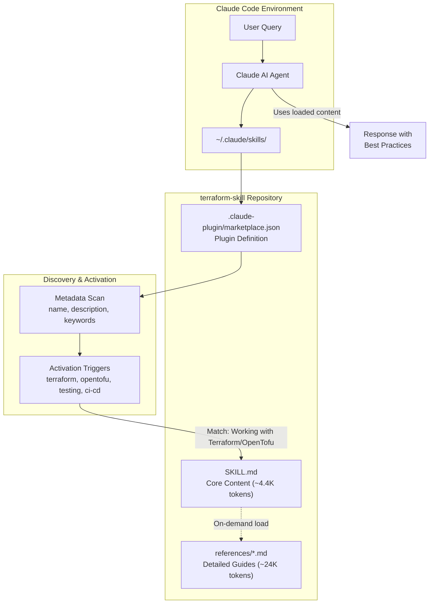
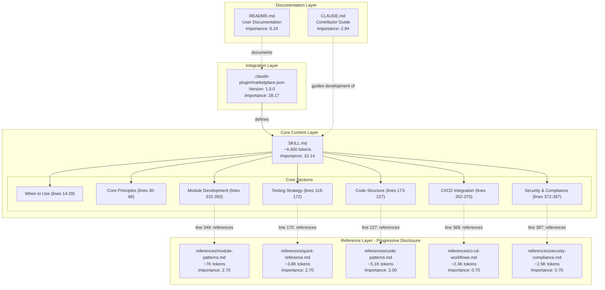
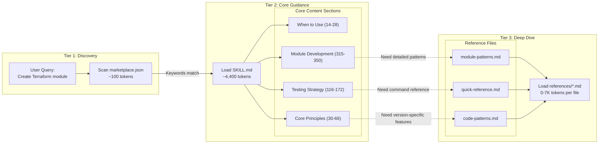

<!-- source: DeepWiki mcp.deepwiki.com · repo antonbabenko/terraform-skill · page 1 Overview · fetched 2026-10-26 -->

# Overview

Relevant source files

The following files were used as context for generating this wiki page:

- [.claude-plugin/marketplace.json](.claude-plugin/marketplace.json)
- [README.md](README.md)
- [SKILL.md](SKILL.md)

This document provides a high-level introduction to **terraform-skill**, a Claude skill that delivers Terraform and OpenTofu best practices guidance directly within Claude Code. It explains the system's purpose, architecture, and how it provides progressive, context-aware infrastructure-as-code expertise.

**Scope:** This overview covers the system's purpose, integration model, and architectural approach. For detailed information on specific topics, see:
- Installation and usage instructions: [Getting Started](#2)
- Technical architecture details: [Core Architecture](#3)
- Content organization and knowledge base: [Knowledge Base](#4)
- Development and contribution process: [Development Guide](#5)

---

## System Purpose

terraform-skill is a **skill plugin for Claude Code** that provides comprehensive Terraform and OpenTofu guidance. It delivers:

- **Context-aware expertise** - Automatically activated when working with Terraform/OpenTofu code
- **Progressive disclosure** - Loads detailed information only when needed to optimize token usage
- **Production-tested patterns** - Based on terraform-best-practices.com and enterprise experience
- **Version-specific guidance** - Covers Terraform 1.0+ and OpenTofu 1.6+ features

The system operates as a **knowledge base with intelligent routing**, using a three-tier progressive disclosure pattern to provide 56-70% token reduction compared to loading all content upfront.

**Sources:** [.claude-plugin/marketplace.json:1-29](), [SKILL.md:1-17](), [README.md:1-8]()

---

## Integration Model

### Claude Code Skill System

The following diagram shows how terraform-skill integrates into the Claude Code environment:

**Discovery Process:**

1. **Plugin Definition** - [.claude-plugin/marketplace.json:12-28]() defines the skill metadata:
   - `name`: "terraform-skill"
   - `description`: Activation criteria for Claude
   - `keywords`: ["terraform", "opentofu", "infrastructure-as-code", "testing", "ci-cd", "modules"]
   - `source`: "./" - Points to repository root

2. **Activation Triggers** - [SKILL.md:14-28]() specifies when to activate:
   - Creating Terraform/OpenTofu configurations or modules
   - Setting up testing infrastructure
   - Implementing CI/CD for IaC
   - Reviewing or refactoring Terraform projects

3. **Content Loading** - Progressive three-stage loading:
   - Stage 1: Metadata (~100 tokens)
   - Stage 2: Core SKILL.md (~4,400 tokens)
   - Stage 3: References on-demand (0-7K tokens per file)

**Sources:** [.claude-plugin/marketplace.json:1-29](), [SKILL.md:1-17](), [README.md:40-72]()

---

## System Architecture

### Component Overview

The following diagram maps the system's file structure to functional components:

**Component Responsibilities:**

| Component | Purpose | Token Budget | When Loaded |
|-----------|---------|--------------|-------------|
| `marketplace.json` | Plugin discovery & metadata | ~100 | Always (by Claude) |
| `SKILL.md` | Core patterns & decision frameworks | ~4,400 | On skill activation |
| `module-patterns.md` | Detailed module guidance | ~7,000 | Complex module questions |
| `quick-reference.md` | Command cheat sheets | ~3,800 | Command lookup |
| `code-patterns.md` | Version-specific features | ~5,100 | Modern Terraform features |
| `ci-cd-workflows.md` | Pipeline templates | ~2,300 | Pipeline setup |
| `security-compliance.md` | Security hardening | ~2,500 | Security scanning |

**Sources:** [.claude-plugin/marketplace.json:1-29](), [SKILL.md:1-517](), [README.md:1-212]()

---

## Progressive Disclosure Architecture

The system implements a **three-tier progressive disclosure pattern** to optimize token usage:

**Token Efficiency:**

- **Total available content:** ~30,400 tokens (all files)
- **Typical query usage:** 4,500-12,000 tokens (15-40% of total)
- **Token savings:** 56-70% vs loading all content upfront

**Reference Mechanism:**

[SKILL.md:499-510]() provides explicit links to reference files:
- Line 505: "Testing Frameworks" → `references/testing-frameworks.md`
- Line 506: "Module Patterns" → `references/module-patterns.md`
- Line 507: "CI/CD Workflows" → `references/ci-cd-workflows.md`
- Line 508: "Security & Compliance" → `references/security-compliance.md`
- Line 509: "Quick Reference" → `references/quick-reference.md`

**Sources:** [SKILL.md:499-510](), [.claude-plugin/marketplace.json:1-29]()

---

## Content Distribution

The following table shows how the ~30.4K tokens of content are distributed across files:

| File | Primary Topic | Token Count | Importance Score | Load Trigger |
|------|---------------|-------------|------------------|--------------|
| `SKILL.md` | Core patterns & frameworks | ~4,400 | 10.14 | Skill activation |
| `module-patterns.md` | Module architecture | ~7,000 | 2.70 | Module questions |
| `code-patterns.md` | Modern features & refactoring | ~5,100 | 2.00 | Version-specific queries |
| `quick-reference.md` | Commands & troubleshooting | ~3,800 | 2.70 | Command lookup |
| `ci-cd-workflows.md` | Pipeline templates | ~2,300 | 0.70 | CI/CD setup |
| `security-compliance.md` | Security scanning | ~2,500 | 0.70 | Security questions |

**Content Structure in SKILL.md:**

[SKILL.md:1-517]() organizes core content into:
1. **Lines 14-28:** Activation criteria and use cases
2. **Lines 30-313:** Core principles (module hierarchy, naming, locals)
3. **Lines 116-172:** Testing strategy framework
4. **Lines 173-227:** Code structure standards
5. **Lines 229-313:** Count vs for_each patterns
6. **Lines 315-350:** Module development practices
7. **Lines 352-370:** CI/CD integration overview
8. **Lines 372-397:** Security & compliance essentials
9. **Lines 399-431:** Version management
10. **Lines 433-476:** Modern Terraform features by version

**Sources:** [SKILL.md:1-517](), High-level system diagrams

---

## Key Capabilities Summary

terraform-skill provides comprehensive guidance across five major areas. For detailed coverage, see [Key Capabilities](#1.2).

### Testing Frameworks

- **Decision matrices:** When to use native tests vs Terratest
- **Testing pyramid:** Static → Integration → E2E
- **Version-specific guidance:** Terraform 1.6+ native testing, 1.7+ mock providers

[SKILL.md:116-172]() provides the testing strategy framework with cost optimization patterns.

### Module Development

- **Hierarchy patterns:** Resource → Resource Module → Infrastructure Module → Composition
- **Naming conventions:** Use of "this" for singletons, descriptive names for multiples
- **Best practices:** Variable design, output patterns, documentation standards

[SKILL.md:315-350]() covers core module practices with links to [references/module-patterns.md]().

### CI/CD Integration

- **Workflow stages:** Validate → Test → Plan → Apply
- **Cost optimization:** Mocking for PRs, integration tests on main branch
- **Tool integration:** GitHub Actions, GitLab CI, Atlantis

[SKILL.md:352-370]() provides overview with detailed templates in [references/ci-cd-workflows.md]().

### Security & Compliance

- **Static scanning:** Trivy, Checkov integration
- **Secrets management:** AWS Secrets Manager patterns
- **State security:** Encryption at rest, access control

[SKILL.md:372-397]() covers essentials with comprehensive guidance in [references/security-compliance.md]().

### Code Patterns & Modern Features

- **Block ordering:** Strict standards for consistency
- **Count vs for_each:** Decision guide with migration patterns
- **Modern features:** Version-specific features from Terraform 1.0-1.11

[SKILL.md:173-476]() provides core patterns with detailed examples in [references/code-patterns.md]().

**Sources:** [SKILL.md:10-517](), [README.md:10-37]()

---

## Version Information

**Current Version:** 1.5.0

Version synchronization across three locations:
- [.claude-plugin/marketplace.json:6](): `"version": "1.5.0"` (root level)
- [.claude-plugin/marketplace.json:26](): `"version": "1.5.0"` (plugin level)
- [SKILL.md:7](): `version: 1.5.0` (metadata)

Version management is automated through GitHub Actions workflows. See [Automation Systems](#6) for details on release automation.

**Sources:** [.claude-plugin/marketplace.json:6,26](), [SKILL.md:7]()

---

## Next Steps

- **Installation:** See [Getting Started](#2) for installation methods
- **Architecture details:** See [Core Architecture](#3) for technical implementation
- **Content exploration:** See [Knowledge Base](#4) for detailed topic coverage
- **Contributing:** See [Development Guide](#5) for contribution guidelines

**Sources:** Document structure from table of contents

---

