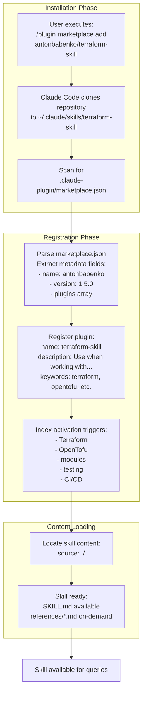
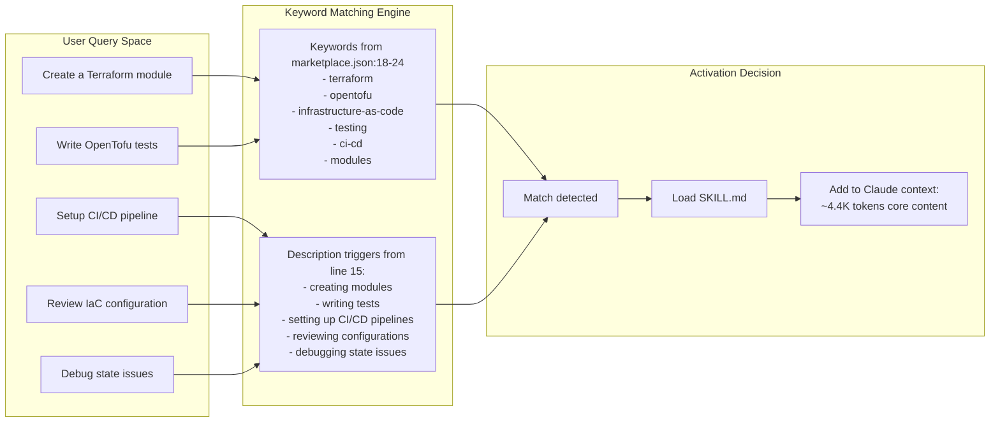
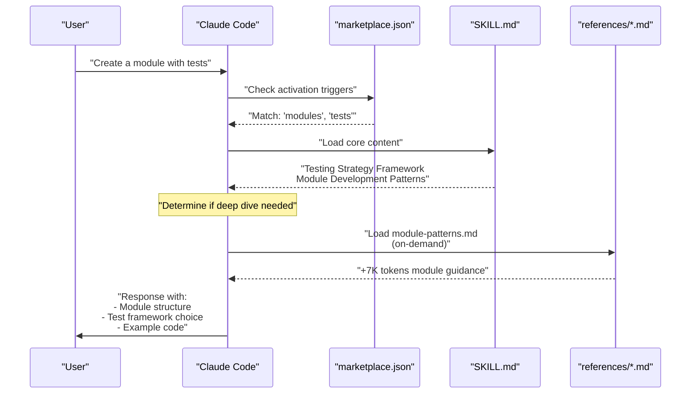
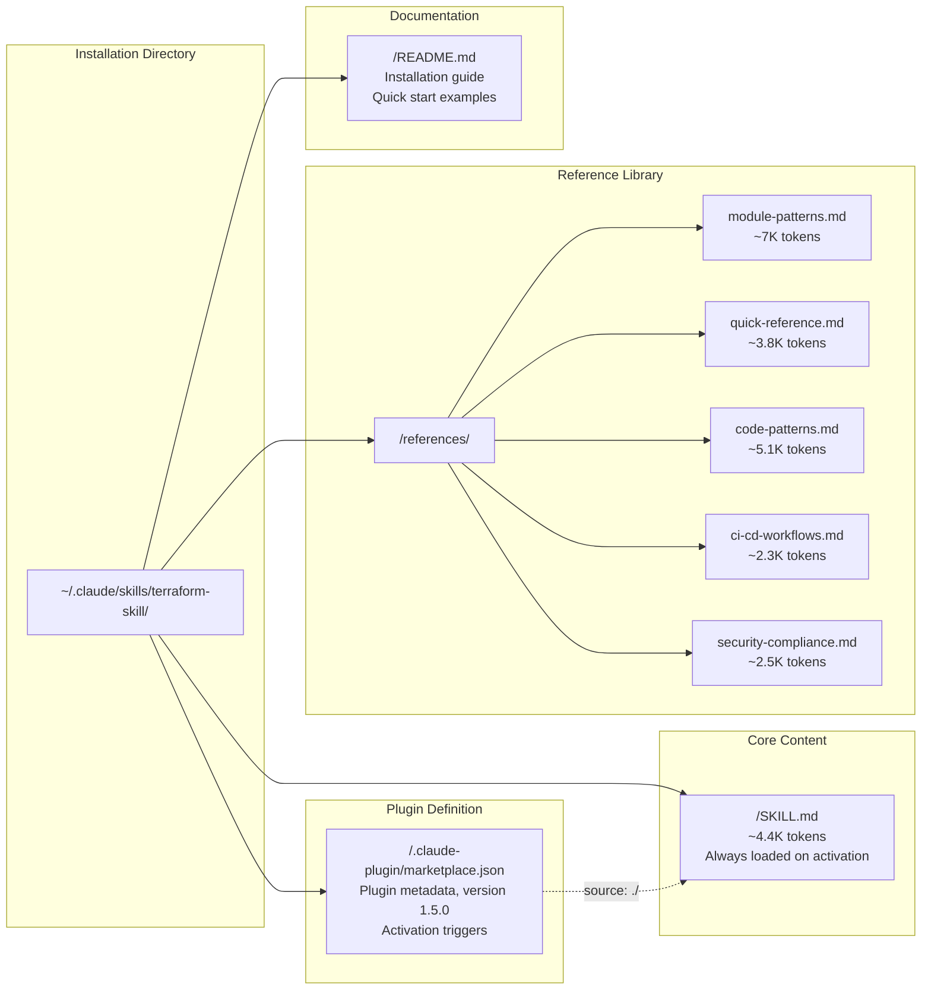

<!-- source: DeepWiki mcp.deepwiki.com · repo antonbabenko/terraform-skill · page 2 Getting Started · fetched 2026-10-26 -->

# Getting Started

<details>
<summary>Relevant source files</summary>

The following files were used as context for generating this wiki page:

- [.claude-plugin/marketplace.json](.claude-plugin/marketplace.json)
- [README.md](README.md)

</details>


## Purpose and Scope

This document provides an overview of how to install and begin using the terraform-skill in Claude Code. It covers the initial setup process, verification steps, and your first interactions with the skill. For detailed installation procedures, see [Installation](#2.1). For comprehensive usage patterns and activation triggers, see [Using the Skill](#2.2).

---

## Installation Overview

The terraform-skill is distributed through the Claude Code marketplace and can be installed using either the marketplace command or manual installation methods. The skill uses [.claude-plugin/marketplace.json:1-29]() as its plugin definition file, which Claude Code reads to discover and activate the skill.

### Installation Methods

There are three primary installation methods, listed in order of recommendation:

| Method | Command | Use Case |
|--------|---------|----------|
| **Marketplace Install** | `/plugin marketplace add antonbabenko/terraform-skill` | Production use, automatic updates |
| **Direct Install** | `/plugin install terraform-skill@antonbabenko` | After marketplace add |
| **Manual Clone** | `git clone https://github.com/antonbabenko/terraform-skill ~/.claude/skills/terraform-skill` | Development, testing, offline use |

The marketplace installation method automatically handles version updates and ensures the skill is properly registered with Claude Code. Manual installation requires placing the repository in Claude's skills directory (`~/.claude/skills/`).

**Sources:** [README.md:38-63]()

---

## Installation Workflow

The following diagram illustrates how the skill is discovered and loaded by Claude Code during installation:



**Sources:** [.claude-plugin/marketplace.json:1-29](), [README.md:38-54]()

---

## Skill Discovery and Activation

Once installed, Claude Code uses the plugin metadata to determine when to activate the skill. The activation logic is defined in [.claude-plugin/marketplace.json:14-16]():



**Sources:** [.claude-plugin/marketplace.json:14-25]()

---

## Verification Steps

After installation, verify that the skill is properly configured and accessible:

### 1. Check Installation Status

```bash
# List installed skills
/plugin list
```

Expected output should include `terraform-skill@antonbabenko` with version `1.5.0` or later.

### 2. Test Skill Activation

Use one of the recommended test queries from [README.md:66-70]():

```
"Create a Terraform module with testing for an S3 bucket"
```

Claude should respond using Terraform best practices and module structure patterns from the skill content.

### 3. Verify Content Loading

The skill uses a progressive disclosure pattern (see [Progressive Disclosure Pattern](#3.2)). On first activation, Claude loads:

| Content Layer | Size | Source File |
|--------------|------|-------------|
| **Metadata** | ~100 tokens | `.claude-plugin/marketplace.json` |
| **Core Skill** | ~4.4K tokens | `SKILL.md` |
| **References** (on-demand) | 0-7K tokens | `references/*.md` |

**Sources:** [README.md:65-72]()

---

## First Interactions

### Example Query Patterns

The skill is designed to respond to various Terraform/OpenTofu development tasks. Here are common interaction patterns from [README.md:74-86]():

| Task Category | Example Query | Expected Skill Behavior |
|--------------|---------------|------------------------|
| **Module Creation** | "Create a Terraform module for AWS VPC with native tests" | Provides module structure, naming conventions, test framework setup |
| **Code Review** | "Review this Terraform configuration following best practices" | Analyzes against patterns from `SKILL.md` and `references/code-patterns.md` |
| **CI/CD Setup** | "Create a GitHub Actions workflow for Terraform with cost estimation" | Generates workflow from `references/ci-cd-workflows.md` templates |
| **Testing Strategy** | "Help me choose between native tests and Terratest for my modules" | Provides decision matrix from testing strategy framework |

### Response Flow



**Sources:** [README.md:74-86](), [.claude-plugin/marketplace.json:14-16]()

---

## File Structure Mapping

Understanding where the skill content resides helps with troubleshooting and local development:



**Sources:** [.claude-plugin/marketplace.json:16](), [README.md:1-212]()

---

## Troubleshooting Initial Setup

### Skill Not Found

If Claude doesn't recognize the skill after installation:

1. Verify the installation directory exists: `ls -la ~/.claude/skills/terraform-skill/`
2. Check that `.claude-plugin/marketplace.json` is present
3. Restart Claude Code to refresh the skill index

### Skill Not Activating

If queries don't trigger the skill:

1. Use explicit keyword triggers from [.claude-plugin/marketplace.json:18-24]()
2. Try queries that match the description pattern in [.claude-plugin/marketplace.json:15]()
3. Check Claude Code logs for activation errors

### Outdated Content

The skill version is defined in [.claude-plugin/marketplace.json:6]() and [.claude-plugin/marketplace.json:26](). If you need the latest version:

```bash
# For marketplace installations
/plugin update terraform-skill@antonbabenko

# For manual installations
cd ~/.claude/skills/terraform-skill
git pull origin master
```

**Sources:** [.claude-plugin/marketplace.json:6](), [.claude-plugin/marketplace.json:18-26]()

---

## Next Steps

After successful installation and verification:

- **Learn Usage Patterns**: See [Using the Skill](#2.2) for detailed interaction examples and activation triggers
- **Explore Content**: Review [Core Skill Content](#4.1) to understand available guidance topics
- **Integration**: See [CI/CD Workflows](#4.5) for pipeline integration examples
- **Advanced Topics**: Explore [Module Development Patterns](#4.2) and [Security & Compliance](#4.6)

For local development and contributions, see [Development Guide](#5).

**Sources:** [README.md:1-212]()

---

