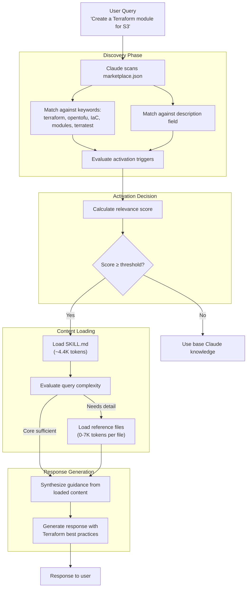
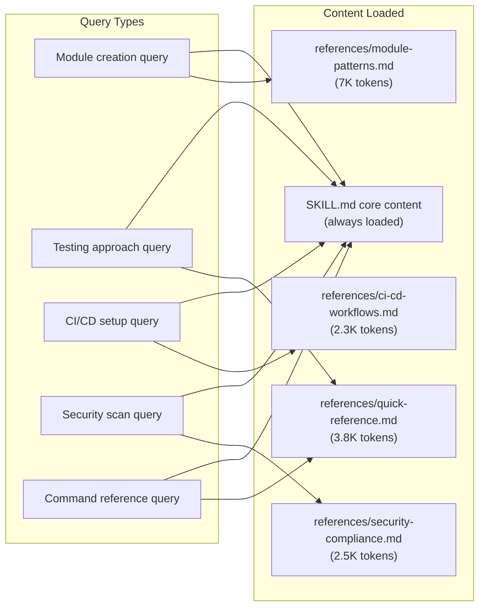
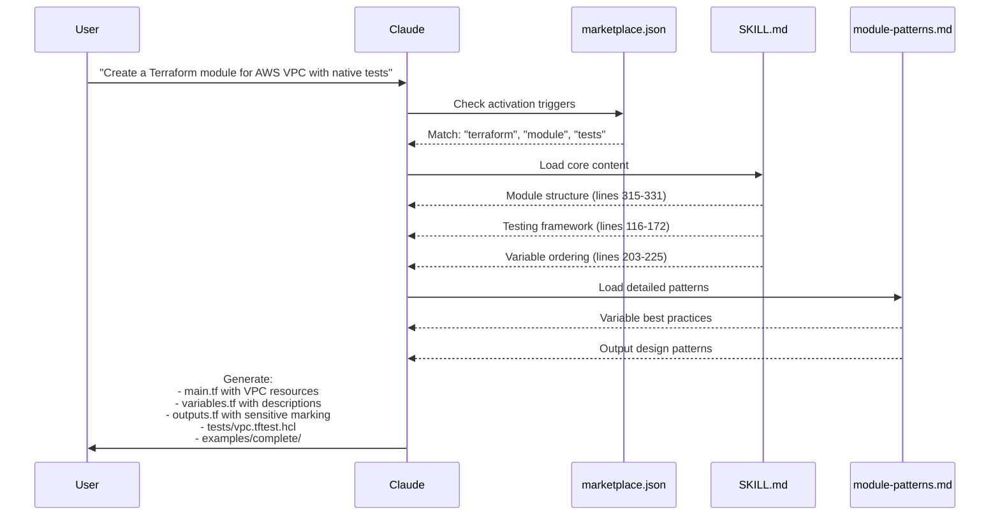
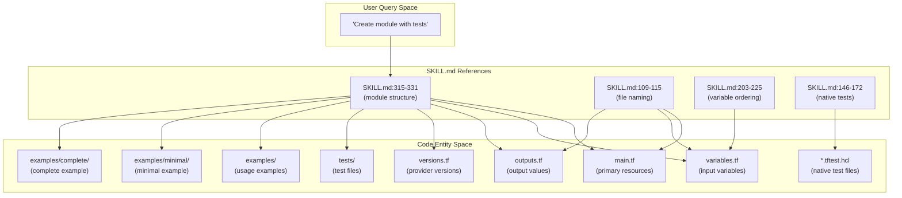
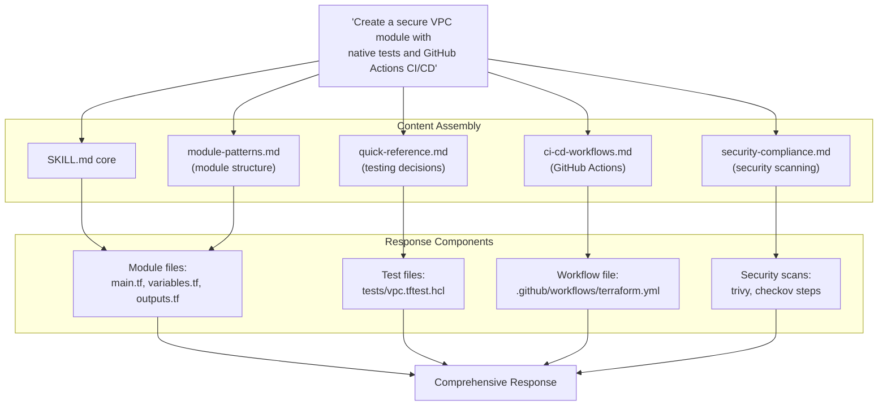

<!-- source: DeepWiki mcp.deepwiki.com · repo antonbabenko/terraform-skill · page 2.2 Using the Skill · fetched 2026-10-26 -->

# Using the Skill

<details>
<summary>Relevant source files</summary>

The following files were used as context for generating this wiki page:

- [README.md](README.md)
- [SKILL.md](SKILL.md)

</details>


This page describes how to interact with the terraform-skill in Claude Code, including activation triggers, query patterns, and response mechanisms. For installation instructions, see [Installation](#2.1). For details on the skill's content architecture, see [Progressive Disclosure Pattern](#3.2).

## Skill Activation Mechanism

The skill activates automatically when Claude detects Terraform or OpenTofu-related queries through keyword matching in `marketplace.json` and contextual analysis.

### Discovery and Activation Flow



**Sources:** [SKILL.md:1-8](), [SKILL.md:14-28](), [README.md:66-72]()

### Activation Triggers

The skill activates when queries involve the following scenarios, as defined in [SKILL.md:14-24]():

| Trigger Category | Example Keywords | Activates Skill |
|-----------------|------------------|-----------------|
| **Module creation** | "create module", "new terraform module" | ✅ Yes |
| **Testing infrastructure** | "test framework", "terratest", "native tests" | ✅ Yes |
| **Testing decisions** | "which testing approach", "validate vs plan" | ✅ Yes |
| **Multi-environment** | "staging", "production", "environment structure" | ✅ Yes |
| **CI/CD setup** | "github actions", "pipeline", "atlantis" | ✅ Yes |
| **Code review** | "review terraform", "refactor", "best practices" | ✅ Yes |
| **Pattern selection** | "module patterns", "state management" | ✅ Yes |
| **Basic syntax** | "how to write resource block" | ❌ No (Claude's base knowledge) |
| **Provider API** | "aws_instance parameters" | ❌ No (link to docs) |
| **Cloud platform** | "how S3 works" | ❌ No (not Terraform-specific) |

**Sources:** [SKILL.md:14-28]()

### Query-to-Content Mapping



**Sources:** [SKILL.md:499-510](), Diagram 2 from context

## Example Query Patterns

### High-Quality Queries

These queries trigger the skill and receive comprehensive responses:

| Query Pattern | Content Loaded | Example Response |
|--------------|----------------|------------------|
| **"Create a Terraform module for [resource] with testing"** | SKILL.md + module-patterns.md | Full module structure with variables, outputs, tests |
| **"Help me choose between native tests and Terratest"** | SKILL.md + quick-reference.md | Decision matrix with cost/complexity tradeoffs |
| **"Review this Terraform code for best practices"** | SKILL.md + code-patterns.md | Line-by-line review with ✅ DO / ❌ DON'T examples |
| **"Create GitHub Actions workflow for Terraform"** | SKILL.md + ci-cd-workflows.md | Complete workflow YAML with cost optimization |
| **"How do I secure Terraform state files?"** | SKILL.md + security-compliance.md | State backend configuration + encryption patterns |
| **"What's the difference between count and for_each?"** | SKILL.md (core only) | Decision guide + migration examples |

**Sources:** [README.md:74-87](), [SKILL.md:229-271]()

### Interactive Example: Module Creation



**Sources:** [SKILL.md:315-350](), [SKILL.md:116-172](), [README.md:76-78]()

## Query Patterns by Use Case

### Module Development Queries

These queries focus on creating and structuring Terraform modules:

```
✅ Effective queries:
- "Create a module for [AWS resource] following best practices"
- "Structure a multi-resource module for [infrastructure pattern]"
- "Add input validation to this module"
- "Design outputs for this module"

📚 Content loaded:
- SKILL.md lines 315-350 (module structure)
- SKILL.md lines 203-225 (variable ordering)
- SKILL.md lines 333-347 (best practices summary)
- references/module-patterns.md (on-demand)
```

**Sources:** [SKILL.md:315-350](), [SKILL.md:333-350]()

### Testing Strategy Queries

These queries help choose and implement testing approaches:

```
✅ Effective queries:
- "Which testing approach for Terraform 1.9?"
- "Help me write native tests for this module"
- "Convert these Terratest tests to native format"
- "Set up testing workflow with cost optimization"

📚 Content loaded:
- SKILL.md lines 116-172 (testing strategy framework)
- SKILL.md lines 130-144 (testing pyramid)
- SKILL.md lines 146-172 (native test best practices)
- references/quick-reference.md (decision flowchart)
```

**Sources:** [SKILL.md:116-172](), [README.md:84-86]()

### CI/CD Integration Queries

These queries configure continuous integration workflows:

```
✅ Effective queries:
- "Create GitHub Actions workflow for Terraform with security scanning"
- "Set up GitLab CI for multi-environment Terraform"
- "Add cost estimation to my Terraform pipeline"
- "Configure Atlantis for pull request automation"

📚 Content loaded:
- SKILL.md lines 352-370 (CI/CD integration)
- SKILL.md lines 360-367 (cost optimization strategy)
- references/ci-cd-workflows.md (detailed templates)
```

**Sources:** [SKILL.md:352-370](), [README.md:82-84]()

### Code Review Queries

These queries analyze existing Terraform code:

```
✅ Effective queries:
- "Review this Terraform configuration for best practices"
- "Refactor this module to use for_each instead of count"
- "Update this code to use Terraform 1.9 features"
- "Identify security issues in this configuration"

📚 Content loaded:
- SKILL.md lines 173-228 (code structure standards)
- SKILL.md lines 229-271 (count vs for_each)
- SKILL.md lines 433-476 (modern features)
- references/code-patterns.md (detailed patterns)
```

**Sources:** [SKILL.md:173-271](), [README.md:79-80]()

## Response Patterns

### Token Budget Awareness

The skill uses progressive disclosure to optimize token usage:

| Query Complexity | Tokens Loaded | Content Sources |
|-----------------|---------------|-----------------|
| **Simple** (syntax check) | ~4,400 | SKILL.md only |
| **Moderate** (module creation) | ~11,400 | SKILL.md + 1 reference file |
| **Complex** (full architecture) | ~18,900 | SKILL.md + 2-3 reference files |
| **Maximum** | ~30,400 | SKILL.md + all references |

Typical queries use **4,500-12,000 tokens** (56-70% reduction vs loading all content).

**Sources:** Diagram 2 from context, [SKILL.md:500-510]()

### Code Entity References in Responses

When the skill generates responses, it references specific code patterns and file structures:



**Sources:** [SKILL.md:315-331](), [SKILL.md:109-115](), [SKILL.md:203-225](), [SKILL.md:146-172]()

## Verification and Debugging

### Verifying Skill Activation

After installation (see [Installation](#2.1)), verify the skill is working:

```bash
# Method 1: Simple activation test
# Ask Claude: "Create a Terraform module with testing for an S3 bucket"
# Expected: Skill activates, references SKILL.md patterns

# Method 2: Check for specific guidance
# Ask Claude: "Should I use count or for_each for multiple subnets?"
# Expected: Decision guide from SKILL.md:229-271

# Method 3: Request citation
# Ask Claude: "Where does this recommendation come from?"
# Expected: References to SKILL.md line numbers or reference files
```

**Sources:** [README.md:66-72]()

### Signs the Skill is Active

When the skill is properly activated, Claude's responses will:

| Indicator | What to Look For |
|-----------|------------------|
| **Structure references** | Mentions "resource module", "infrastructure module", "composition" hierarchy |
| **File organization** | Suggests `main.tf`, `variables.tf`, `outputs.tf`, `versions.tf` layout |
| **Testing guidance** | Provides decision matrix for test framework selection |
| **Version-specific** | Mentions Terraform 1.6+, 1.7+, or 1.9+ features explicitly |
| **Code patterns** | Shows ✅ DO vs ❌ DON'T examples |
| **Token efficiency** | References progressive disclosure or reference files |

**Sources:** [SKILL.md:34-65](), [SKILL.md:315-331](), [SKILL.md:116-129]()

### Common Issues

| Problem | Cause | Solution |
|---------|-------|----------|
| Skill not activating | Query too generic | Make query Terraform-specific: add "module", "testing", "CI/CD" |
| Missing detailed patterns | Only core loaded | Ask follow-up: "Show me detailed examples" |
| Outdated recommendations | Skill not updated | Check version in SKILL.md:7 |
| No reference file content | Progressive loading | Ask explicitly: "Show me the CI/CD workflow patterns" |

**Sources:** [SKILL.md:14-28](), [SKILL.md:499-510]()

## Advanced Usage Patterns

### Requesting Specific Reference Content

You can explicitly request content from reference files:

```
Query patterns that load specific references:

"Show me detailed module patterns" 
→ Loads references/module-patterns.md

"Give me command cheat sheets"
→ Loads references/quick-reference.md

"Show CI/CD workflow templates"
→ Loads references/ci-cd-workflows.md

"Explain security scanning integration"
→ Loads references/security-compliance.md

"Show me modern Terraform features"
→ Loads references/code-patterns.md
```

**Sources:** [SKILL.md:499-510]()

### Combining Multiple Query Types

Complex queries can combine multiple aspects:



**Sources:** [SKILL.md:499-510](), Diagram 2 from context

### Version-Specific Queries

The skill provides different guidance based on Terraform version:

```
"I'm using Terraform 1.5, how should I test?"
→ Response focuses on Terratest (native tests not available)

"I'm using Terraform 1.7, what testing options do I have?"
→ Response includes mock providers for cost-free unit testing

"Show me Terraform 1.9 cross-variable validation"
→ Response uses features from SKILL.md:465-474
```

**Sources:** [SKILL.md:478-497](), [SKILL.md:433-476]()

## Query Templates

### By Skill Level

**Beginner:**
```
- "What's the standard structure for a Terraform module?"
- "How do I organize variables in variables.tf?"
- "What files should a module have?"
```

**Intermediate:**
```
- "Should I use count or for_each for multiple security groups?"
- "Create a GitHub Actions workflow with terraform validate"
- "How do I test this module without deploying infrastructure?"
```

**Advanced:**
```
- "Refactor this module to use Terraform 1.9 features"
- "Design a multi-region module composition"
- "Implement policy-as-code for compliance scanning"
```

**Sources:** [SKILL.md:229-271](), [SKILL.md:352-370](), [SKILL.md:433-476]()

### By Deliverable Type

**Documentation:**
```
- "Generate README.md for this module"
- "Document the input variables with examples"
- "Create usage examples for this module"
```

**Testing:**
```
- "Write native tests for this S3 module"
- "Create integration tests using Terratest"
- "Add validation blocks to these variables"
```

**Automation:**
```
- "Create pre-commit hooks for Terraform"
- "Set up Atlantis for pull request automation"
- "Add automated cost estimation to CI/CD"
```

**Sources:** [SKILL.md:146-172](), [SKILL.md:352-370]()

---

