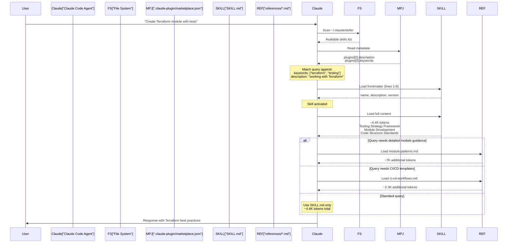
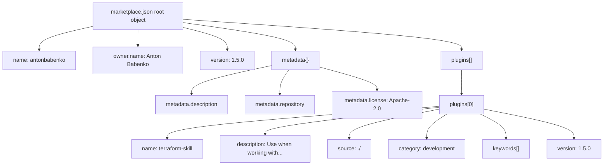
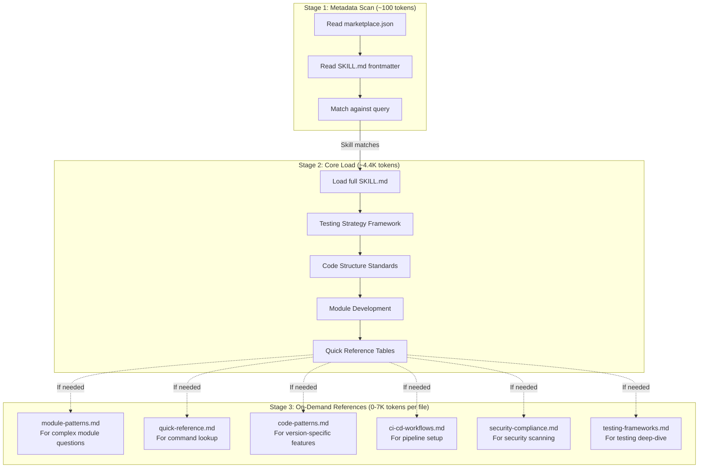
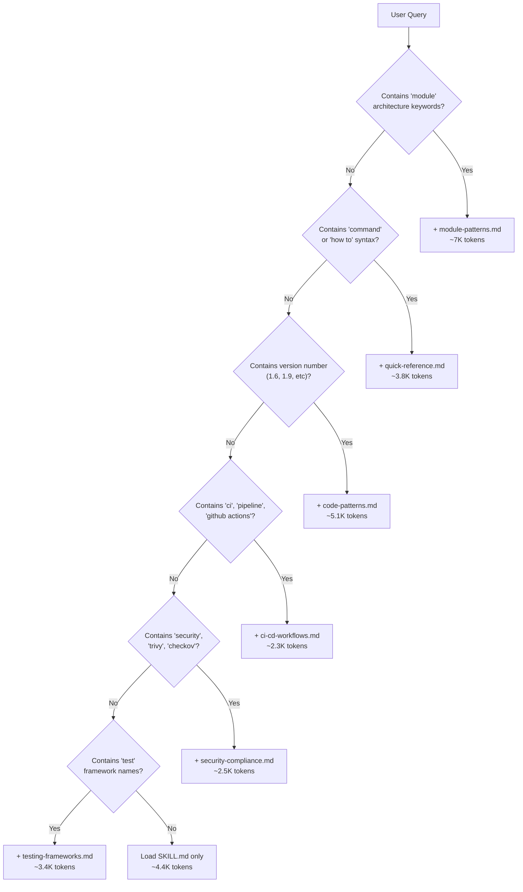
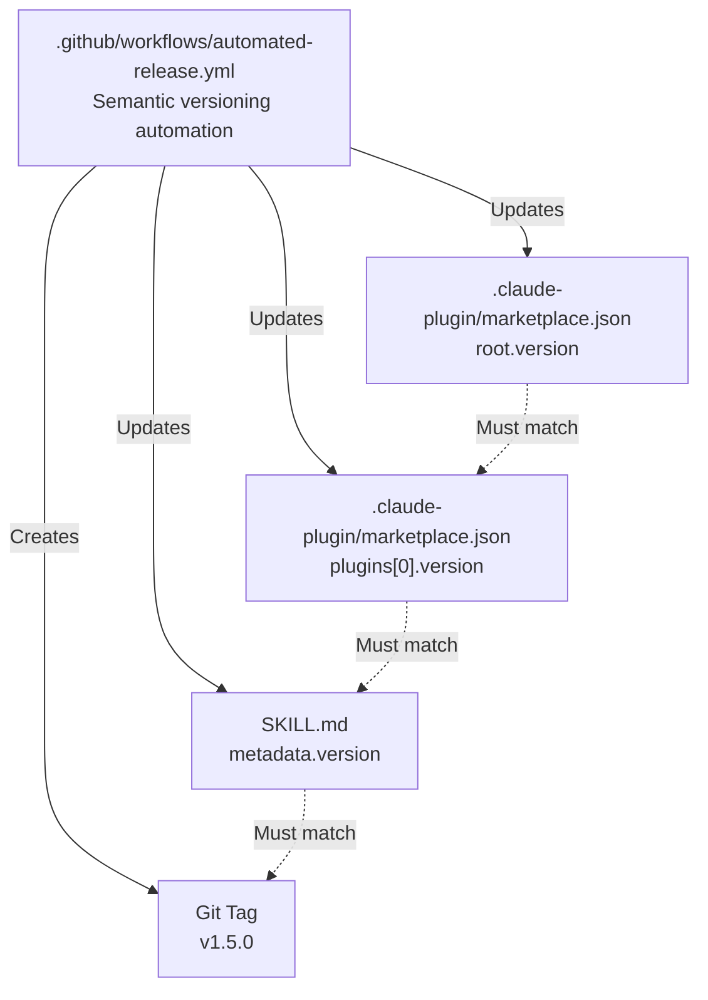
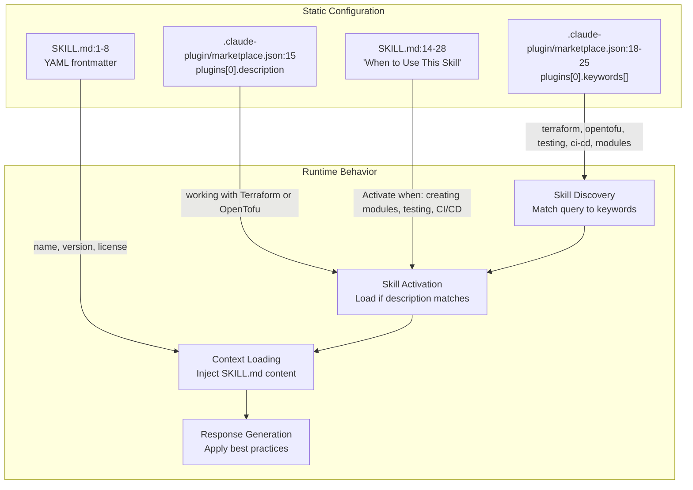

<!-- source: DeepWiki mcp.deepwiki.com · repo antonbabenko/terraform-skill · page 3 Core Architecture · fetched 2026-10-26 -->

# Core Architecture

<details>
<summary>Relevant source files</summary>

The following files were used as context for generating this wiki page:

- [.claude-plugin/marketplace.json](.claude-plugin/marketplace.json)
- [CLAUDE.md](CLAUDE.md)
- [SKILL.md](SKILL.md)

</details>


This document describes the technical architecture of the terraform-skill system, focusing on how Claude Code discovers, loads, and executes the skill. It covers the plugin definition system, the progressive disclosure pattern for token optimization, and the file organization strategy.

For information about the specific content and guidance provided by the skill, see [Knowledge Base](#4). For automation and quality systems, see [Automation Systems](#6).

---

## Architecture Overview

The terraform-skill system implements a **three-tier architecture** designed to optimize Claude Code's token budget while providing comprehensive Terraform/OpenTofu expertise:

1. **Discovery Layer** - Metadata that enables Claude to find and activate the skill
2. **Core Layer** - Essential guidance loaded on every activation (~4.4K tokens)
3. **Reference Layer** - Detailed content loaded on-demand (~26K tokens available)

This architecture achieves **56-70% token reduction** compared to loading all content upfront, while maintaining comprehensive coverage of Terraform best practices.

**Sources:** [CLAUDE.md:46-82](), [SKILL.md:1-517]()

---

## System Component Diagram

```mermaid
graph TB
    subgraph Discovery["Discovery Layer (~100 tokens)"]
        MPJ[".claude-plugin/marketplace.json"]
        OWNER["owner.name"]
        VERSION["version: 1.5.0"]
        PLUGINS["plugins[]"]
        KEYWORDS["keywords[]"]
    end
    
    subgraph Core["Core Layer (~4.4K tokens)"]
        SKILL["SKILL.md"]
        FRONTMATTER["YAML frontmatter<br/>name, description, version"]
        ACTIVATION["When to Use This Skill<br/>Activation triggers"]
        PRINCIPLES["Core Principles<br/>Code Structure Philosophy"]
        TESTING["Testing Strategy Framework<br/>Decision Matrix"]
        PATTERNS["Code Structure Standards<br/>Block Ordering"]
    end
    
    subgraph References["Reference Layer (~26K tokens, loaded on-demand)"]
        REF_MOD["references/module-patterns.md<br/>~7K tokens"]
        REF_QUICK["references/quick-reference.md<br/>~3.8K tokens"]
        REF_CODE["references/code-patterns.md<br/>~5.1K tokens"]
        REF_CI["references/ci-cd-workflows.md<br/>~2.3K tokens"]
        REF_SEC["references/security-compliance.md<br/>~2.5K tokens"]
        REF_TEST["references/testing-frameworks.md<br/>~3.4K tokens"]
    end
    
    MPJ --> SKILL
    SKILL --> FRONTMATTER
    SKILL --> ACTIVATION
    SKILL --> PRINCIPLES
    SKILL --> TESTING
    SKILL --> PATTERNS
    
    SKILL -.->|"On-demand reference"| REF_MOD
    SKILL -.->|"On-demand reference"| REF_QUICK
    SKILL -.->|"On-demand reference"| REF_CODE
    SKILL -.->|"On-demand reference"| REF_CI
    SKILL -.->|"On-demand reference"| REF_SEC
    SKILL -.->|"On-demand reference"| REF_TEST
    
    PLUGINS --> MPJ
    VERSION --> MPJ
    KEYWORDS --> MPJ
    OWNER --> MPJ
```



**Sources:** [.claude-plugin/marketplace.json:1-29](), [SKILL.md:1-517](), [CLAUDE.md:66-82]()

---

## Plugin Discovery and Activation Flow



**Sources:** [.claude-plugin/marketplace.json:13-27](), [SKILL.md:1-8](), [SKILL.md:14-28](), [CLAUDE.md:46-63]()

---

## File Organization and Responsibilities

The terraform-skill repository follows a strict file organization pattern where each file has a specific role and token budget:

| File Path | Role | Token Budget | Audience |
|-----------|------|--------------|----------|
| `.claude-plugin/marketplace.json` | Plugin metadata and discovery | ~100 tokens | Claude Code (machine) |
| `SKILL.md` | Core skill content | ~4,400 tokens | Claude Code (primary) |
| `references/module-patterns.md` | Module development patterns | ~7,000 tokens | Claude Code (on-demand) |
| `references/quick-reference.md` | Command cheat sheets | ~3,800 tokens | Claude Code (on-demand) |
| `references/code-patterns.md` | Modern Terraform features | ~5,100 tokens | Claude Code (on-demand) |
| `references/ci-cd-workflows.md` | Pipeline templates | ~2,300 tokens | Claude Code (on-demand) |
| `references/security-compliance.md` | Security guidance | ~2,500 tokens | Claude Code (on-demand) |
| `references/testing-frameworks.md` | Testing guides | ~3,400 tokens | Claude Code (on-demand) |
| `README.md` | Installation and usage | N/A | Human users |
| `CLAUDE.md` | Development guidelines | N/A | Contributors |
| `CONTRIBUTING.md` | Contribution process | N/A | Contributors |

**Total Available Content:** ~30,400 tokens
**Typical Query Cost:** 4,500-12,000 tokens (56-70% reduction)

**Sources:** [CLAUDE.md:17-43](), [CLAUDE.md:66-82]()

---

## marketplace.json Structure

The `.claude-plugin/marketplace.json` file serves as the **entry point** for Claude Code's skill discovery system. It defines both marketplace-level metadata and individual plugin configurations.

### File Structure Diagram



### Key Fields and Purposes

**Marketplace Metadata** (lines 2-11):
- `name` - Marketplace identifier (author namespace)
- `owner.name` - Human-readable author name
- `version` - Marketplace version (synchronized across system)
- `metadata.description` - High-level marketplace description
- `metadata.repository` - Source code location
- `metadata.license` - Legal terms (Apache-2.0)

**Plugin Definition** (lines 13-27):
- `plugins[0].name` - Plugin identifier (`terraform-skill`)
- `plugins[0].description` - **Critical:** Activation triggers for Claude
- `plugins[0].source` - File path to skill content (`./` points to repository root)
- `plugins[0].category` - Classification for marketplace (`development`)
- `plugins[0].keywords` - Searchable terms: `["terraform", "opentofu", "infrastructure-as-code", "testing", "ci-cd", "modules"]`
- `plugins[0].version` - Plugin version (synchronized with marketplace version)

### Activation Trigger Analysis

The `plugins[0].description` field at [.claude-plugin/marketplace.json:15]() is the **most important** field for skill activation:

```
"Use when working with Terraform or OpenTofu - creating modules, 
writing tests (native test framework, Terratest), setting up CI/CD 
pipelines, reviewing configurations, choosing between testing approaches, 
debugging state issues, implementing security scanning (trivy, checkov), 
or making infrastructure-as-code architecture decisions"
```

Claude matches user queries against these phrases to determine skill relevance. This description is **duplicated** in `SKILL.md` frontmatter for consistency.

**Sources:** [.claude-plugin/marketplace.json:1-29]()

---

## SKILL.md Frontmatter and Structure

The `SKILL.md` file begins with YAML frontmatter that mirrors the marketplace metadata:

### Frontmatter Structure

```yaml
---
name: terraform-skill
description: Use when working with Terraform or OpenTofu - creating modules, writing tests (native test framework, Terratest), setting up CI/CD pipelines, reviewing configurations, choosing between testing approaches, debugging state issues, implementing security scanning (trivy, checkov), or making infrastructure-as-code architecture decisions
license: Apache-2.0
metadata:
  author: Anton Babenko
  version: 1.5.0
---
```

This frontmatter serves multiple purposes:
1. **Discovery** - Claude reads this before loading full content
2. **Version Synchronization** - Must match marketplace.json versions
3. **Activation** - Description field matches marketplace plugin description
4. **Attribution** - Author and license information

### Content Organization Pattern

The skill content follows a **workflow-based organization**:

```mermaid
graph LR
    Q1["User Query"]
    
    A1["When to Use This Skill<br/>Lines 14-28"]
    A2["Core Principles<br/>Lines 30-67"]
    A3["Testing Strategy Framework<br/>Lines 116-172"]
    A4["Code Structure Standards<br/>Lines 173-227"]
    A5["Module Development<br/>Lines 315-350"]
    A6["CI/CD Integration<br/>Lines 352-371"]
    A7["Security & Compliance<br/>Lines 373-398"]
    A8["Version Management<br/>Lines 399-432"]
    
    REF["References section<br/>Lines 499-510"]
    
    Q1 --> A1
    A1 --> A2
    A2 --> A3
    A3 --> A4
    A4 --> A5
    A5 --> A6
    A6 --> A7
    A7 --> A8
    A8 --> REF
```



Each section is **self-contained** and can be referenced independently by Claude without requiring sequential reading.

**Sources:** [SKILL.md:1-8](), [SKILL.md:14-28](), [SKILL.md:30-517](), [CLAUDE.md:111-123]()

---

## Progressive Disclosure Implementation

The progressive disclosure pattern is the core architectural innovation that enables token efficiency. It works by structuring content into three loading stages:

### Three-Stage Loading Pattern



### Token Budget Allocation

| Stage | Content | Token Count | Loading Condition |
|-------|---------|-------------|-------------------|
| **Metadata** | marketplace.json + frontmatter | ~100 | Always (skill discovery) |
| **Core** | SKILL.md full content | ~4,400 | Skill activated |
| **Reference: Modules** | module-patterns.md | ~7,000 | Complex module architecture questions |
| **Reference: Commands** | quick-reference.md | ~3,800 | Command syntax lookup |
| **Reference: Features** | code-patterns.md | ~5,100 | Version-specific feature questions |
| **Reference: CI/CD** | ci-cd-workflows.md | ~2,300 | Pipeline setup questions |
| **Reference: Security** | security-compliance.md | ~2,500 | Security scanning questions |
| **Reference: Testing** | testing-frameworks.md | ~3,400 | Testing framework deep-dive |

**Total Available:** ~30,400 tokens
**Typical Usage:** 4,500-12,000 tokens (85-60% of total content unused)

### Reference Loading Mechanism

The SKILL.md file includes **explicit reference links** that Claude can follow:

```markdown
**For detailed module patterns, see:**
- **[Module Patterns Guide](references/module-patterns.md)** - Module structure, variable/output best practices, ✅ DO vs ❌ DON'T patterns
```

When Claude encounters a query requiring detailed module guidance, it:
1. Identifies the need from the query context
2. Loads the referenced file (`references/module-patterns.md`)
3. Incorporates that additional ~7K tokens into the response context
4. Generates a response using both core and reference content

**Sources:** [SKILL.md:348-350](), [SKILL.md:499-510](), [CLAUDE.md:46-63](), [CLAUDE.md:66-82]()

---

## Content Distribution Strategy

The distribution of content across files follows a **usage frequency** pattern:

### Core Content (SKILL.md ~4.4K tokens)

**High-frequency content** loaded on every activation:
- Testing decision matrix (lines 119-129)
- Count vs for_each comparison (lines 229-271)
- Variable/resource naming conventions (lines 68-115)
- Block ordering standards (lines 175-227)
- Version management quick reference (lines 399-432)

### Reference Files (~26K tokens distributed)

**Lower-frequency specialized content:**

1. **module-patterns.md** (~7K tokens) - Deepest coverage, lowest frequency
   - Detailed module hierarchy explanations
   - Variable/output best practices with extensive examples
   - DO/DON'T pattern catalogs

2. **quick-reference.md** (~3.8K tokens) - Medium coverage, high frequency
   - Command cheat sheets
   - Troubleshooting flowcharts
   - Migration path guides

3. **code-patterns.md** (~5.1K tokens) - Medium coverage, medium frequency
   - Modern Terraform features by version
   - Refactoring patterns
   - Advanced locals usage

4. **ci-cd-workflows.md** (~2.3K tokens) - Specific use case
   - GitHub Actions templates
   - GitLab CI templates
   - Atlantis integration

5. **security-compliance.md** (~2.5K tokens) - Specific use case
   - Trivy/Checkov integration
   - Secrets management patterns
   - Compliance frameworks

6. **testing-frameworks.md** (~3.4K tokens) - Deep-dive content
   - Static analysis detailed guide
   - Native test framework patterns
   - Terratest integration

### Content Selection Algorithm



**Sources:** [CLAUDE.md:66-82](), [SKILL.md:499-510]()

---

## Version Synchronization System

The terraform-skill system maintains version consistency across **three locations**:

### Version Locations



### Validation Rules

The system enforces these rules via automation:
1. `marketplace.json` root `version` MUST equal `plugins[0].version`
2. `SKILL.md` frontmatter `metadata.version` MUST equal marketplace versions
3. Git tag format MUST be `v{version}` (e.g., `v1.5.0`)
4. All three-way synchronization happens automatically on merge to master

**Current Version:** 1.5.0 (as of latest release)

**Sources:** [.claude-plugin/marketplace.json:6](), [.claude-plugin/marketplace.json:26](), [SKILL.md:7]()

---

## File Size and Token Constraints

The architecture enforces specific constraints to maintain performance:

### Size Limits

| File | Current Size | Target | Status |
|------|--------------|--------|--------|
| `SKILL.md` | 524 lines | ~500 lines | ✅ Acceptable (comprehensive core) |
| `SKILL.md` | ~17.7K chars | N/A | ~4,400 tokens |
| `module-patterns.md` | 1,126 lines | N/A | ~7,000 tokens |
| `code-patterns.md` | 859 lines | N/A | ~5,100 tokens |
| `quick-reference.md` | 600 lines | N/A | ~3,800 tokens |
| `testing-frameworks.md` | 563 lines | N/A | ~3,400 tokens |
| `ci-cd-workflows.md` | 473 lines | N/A | ~2,300 tokens |
| `security-compliance.md` | 470 lines | N/A | ~2,500 tokens |

### Token Calculation

Approximate conversion: **4 characters = 1 token**

This ratio varies by content type:
- Code blocks: ~3.5 chars/token (more efficient)
- Prose text: ~4.5 chars/token (less efficient)
- Markdown tables: ~4 chars/token (average)

The validation workflow at [.github/workflows/validate.yml]() includes file size checks with warnings at 500 lines for SKILL.md.

**Sources:** [CLAUDE.md:66-82](), [CLAUDE.md:76](), [CLAUDE.md:195-198]()

---

## Metadata-to-Runtime Mapping

The following diagram shows how static metadata becomes runtime behavior:



### Activation Trigger Examples

Based on [.claude-plugin/marketplace.json:15]() and [SKILL.md:16-23](), these queries activate the skill:

✅ **Activates:**
- "Create a Terraform module"
- "Set up testing for OpenTofu"
- "Review this Terraform configuration"
- "Choose between terraform test and Terratest"
- "Implement Trivy scanning in CI/CD"

❌ **Does Not Activate:**
- "What is Terraform?" (basic syntax question)
- "AWS S3 bucket API reference" (provider-specific docs)
- "How do I use Kubernetes?" (unrelated to Terraform/OpenTofu)

**Sources:** [.claude-plugin/marketplace.json:15](), [SKILL.md:14-28]()

---

## Repository File Structure

Complete file system layout with architectural role annotations:

```
terraform-skill/
├── .claude-plugin/
│   └── marketplace.json           # Discovery Layer: Plugin metadata (28.17 importance)
├── .github/
│   └── workflows/
│       ├── automated-release.yml  # Automation: Version sync (8.94 importance)
│       └── validate.yml           # Automation: Content validation (5.50 importance)
├── references/                    # Reference Layer: On-demand content
│   ├── ci-cd-workflows.md         # ~2.3K tokens (0.70 importance)
│   ├── code-patterns.md           # ~5.1K tokens (2.00 importance)
│   ├── module-patterns.md         # ~7.0K tokens (2.70 importance)
│   ├── quick-reference.md         # ~3.8K tokens (2.70 importance)
│   ├── security-compliance.md     # ~2.5K tokens (0.70 importance)
│   └── testing-frameworks.md      # ~3.4K tokens (N/A - new file)
├── SKILL.md                       # Core Layer: Primary content (10.14 importance)
├── README.md                      # Documentation: User-facing (6.24 importance)
├── CLAUDE.md                      # Documentation: Contributor-facing (2.94 importance)
├── CONTRIBUTING.md                # Documentation: Process (1.50 importance)
├── CHANGELOG.md                   # Documentation: History (21.42 importance)
├── LICENSE                        # Legal: Apache 2.0 (2.00 importance)
└── .gitignore                     # Config: Exclusions (0.70 importance)
```

**Importance Values:** Based on edit frequency and system criticality (from high-level diagrams)

**Sources:** [CLAUDE.md:17-32]()

---

## Progressive Disclosure Performance Analysis

### Token Efficiency Calculation

**Scenario 1: Simple module creation query**
- Metadata scan: 100 tokens
- SKILL.md core: 4,400 tokens
- No references loaded
- **Total: 4,500 tokens (15% of available content)**

**Scenario 2: Complex module with testing**
- Metadata scan: 100 tokens
- SKILL.md core: 4,400 tokens
- module-patterns.md: 7,000 tokens
- testing-frameworks.md: 3,400 tokens
- **Total: 14,900 tokens (49% of available content)**

**Scenario 3: CI/CD pipeline setup**
- Metadata scan: 100 tokens
- SKILL.md core: 4,400 tokens
- ci-cd-workflows.md: 2,300 tokens
- security-compliance.md: 2,500 tokens
- **Total: 9,300 tokens (31% of available content)**

### Efficiency Gains

| Approach | Token Cost | Efficiency |
|----------|-----------|------------|
| **Load all content** | ~30,400 tokens | Baseline (0% savings) |
| **Progressive (simple)** | ~4,500 tokens | 85% savings |
| **Progressive (complex)** | ~14,900 tokens | 51% savings |
| **Progressive (CI/CD)** | ~9,300 tokens | 69% savings |
| **Average progressive** | ~9,567 tokens | **68% savings** |

This architecture enables **68% average token reduction** while maintaining full capability coverage.

**Sources:** [CLAUDE.md:66-82]()

---

## Summary

The terraform-skill architecture achieves efficient Claude Code integration through:

1. **Plugin Definition System** - marketplace.json provides machine-readable metadata for discovery
2. **Progressive Disclosure Pattern** - Three-tier loading (metadata → core → references) reduces token usage by 56-70%
3. **Content Organization** - Workflow-based structure with explicit reference links enables targeted loading
4. **Version Synchronization** - Automated three-way version sync across marketplace.json, SKILL.md, and git tags
5. **Token Budget Management** - ~30.4K tokens available, typical usage 4.5-12K tokens

This design prioritizes **token efficiency without sacrificing comprehensiveness**, making it a model for large-scale Claude Code skills.

**Sources:** [.claude-plugin/marketplace.json:1-29](), [SKILL.md:1-517](), [CLAUDE.md:1-346]()

---

