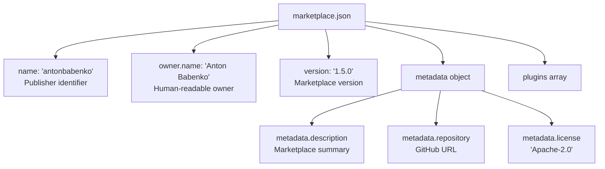
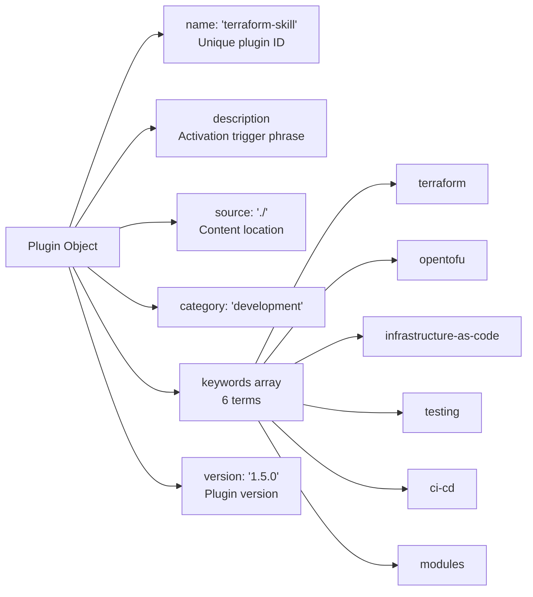
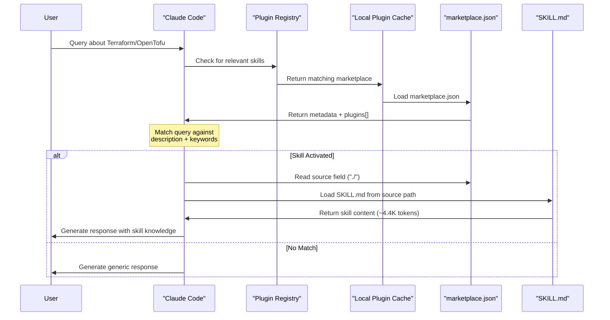
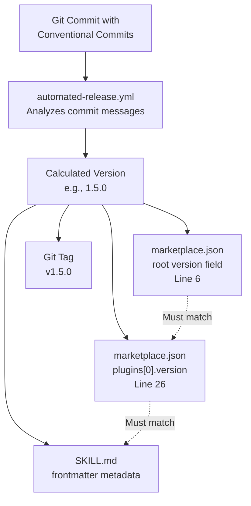
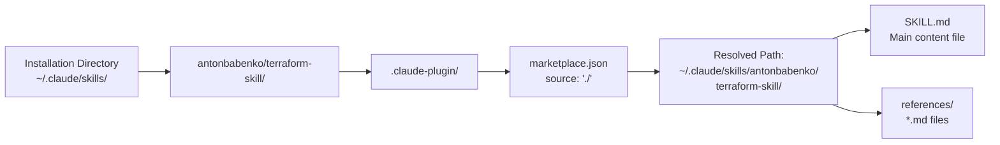
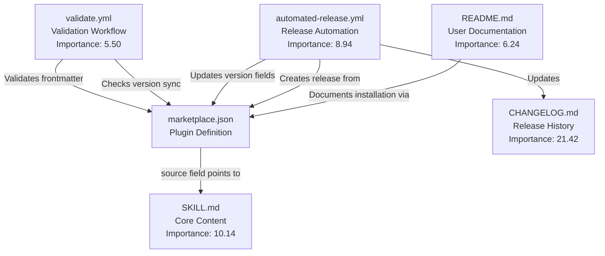
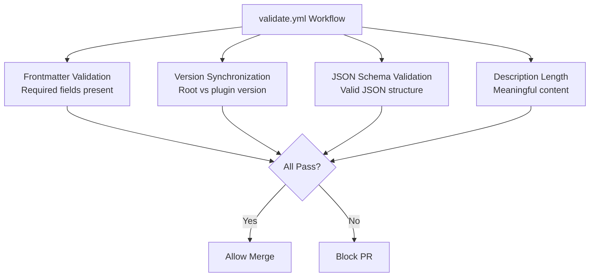
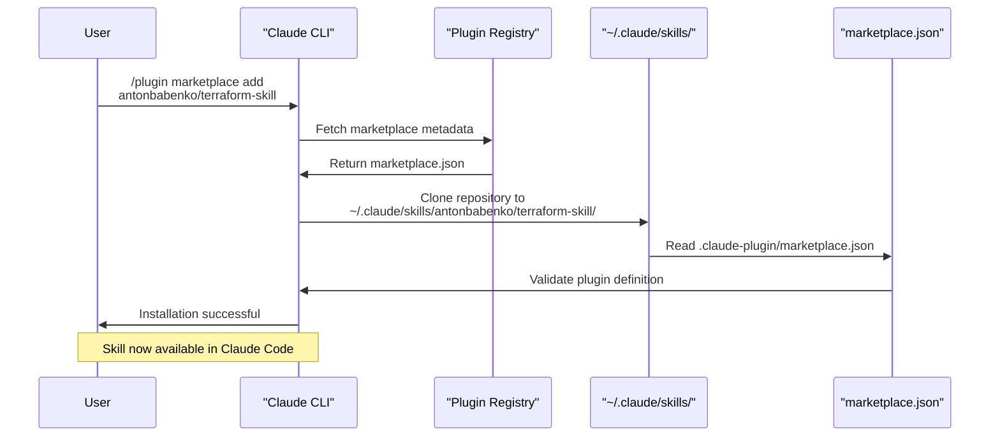

<!-- source: DeepWiki mcp.deepwiki.com · repo antonbabenko/terraform-skill · page 3.1 Plugin Definition System · fetched 2026-10-26 -->

# Plugin Definition System

<details>
<summary>Relevant source files</summary>

The following files were used as context for generating this wiki page:

- [.claude-plugin/marketplace.json](.claude-plugin/marketplace.json)

</details>


## Purpose and Scope

The Plugin Definition System is the foundational integration layer that enables Claude Code to discover, activate, and utilize the terraform-skill. This system is implemented through the `marketplace.json` file, which serves as the machine-readable contract between the skill and Claude's plugin ecosystem.

This document covers the structure, metadata fields, discovery mechanism, and integration points of the plugin definition. For information about the skill content itself, see [Core Skill Content](#4.1). For the progressive loading architecture, see [Progressive Disclosure Pattern](#3.2).

**Sources:** [.claude-plugin/marketplace.json:1-29]()

---

## File Location and Structure

The plugin definition resides at `.claude-plugin/marketplace.json` and follows a two-tier structure:

| Level | Purpose | Key Fields |
|-------|---------|------------|
| **Marketplace** | Root-level metadata about the skill publisher | `name`, `owner`, `version`, `metadata` |
| **Plugin** | Individual skill definitions within the marketplace | `name`, `description`, `source`, `category`, `keywords`, `version` |

This dual-level structure allows a single marketplace to contain multiple related skills, though the terraform-skill marketplace currently contains a single plugin.

**Sources:** [.claude-plugin/marketplace.json:1-29]()

---

## Marketplace Root Metadata

### marketplace.json Root Structure



**Sources:** [.claude-plugin/marketplace.json:2-11]()

### Field Specifications

| Field | Type | Purpose | Example Value |
|-------|------|---------|---------------|
| `name` | string | Marketplace identifier (kebab-case) | `"antonbabenko"` |
| `owner.name` | string | Publisher display name | `"Anton Babenko"` |
| `version` | string | Semantic version of marketplace | `"1.5.0"` |
| `metadata.description` | string | Human-readable marketplace summary | See line 8 |
| `metadata.repository` | string | Source code URL | `"https://github.com/antonbabenko/terraform-skill"` |
| `metadata.license` | string | SPDX license identifier | `"Apache-2.0"` |

**Sources:** [.claude-plugin/marketplace.json:2-11]()

---

## Plugin Definition Schema

### terraform-skill Plugin Object

The `plugins` array contains the actual skill definitions. Each plugin object defines how Claude discovers and activates the skill:



**Sources:** [.claude-plugin/marketplace.json:13-27]()

### Critical Fields Breakdown

#### name
- **Location:** [.claude-plugin/marketplace.json:14]()
- **Value:** `"terraform-skill"`
- **Purpose:** Unique identifier for the plugin within the marketplace
- **Usage:** Referenced in CLI commands and skill activation logs

#### description
- **Location:** [.claude-plugin/marketplace.json:15]()
- **Value:** 207-character activation trigger specification
- **Purpose:** Defines when Claude should activate this skill
- **Key Phrases:**
  - "working with Terraform or OpenTofu"
  - "creating modules"
  - "writing tests (native test framework, Terratest)"
  - "setting up CI/CD pipelines"
  - "reviewing configurations"
  - "choosing between testing approaches"
  - "debugging state issues"
  - "implementing security scanning (trivy, checkov)"
  - "infrastructure-as-code architecture decisions"

This description acts as the primary matching logic for skill activation.

**Sources:** [.claude-plugin/marketplace.json:15]()

#### source
- **Location:** [.claude-plugin/marketplace.json:16]()
- **Value:** `"./"`
- **Purpose:** Relative path to skill content directory
- **Behavior:** Points to the directory containing `SKILL.md`
- **Resolution:** Claude resolves this relative to `.claude-plugin/` directory

**Sources:** [.claude-plugin/marketplace.json:16]()

#### category
- **Location:** [.claude-plugin/marketplace.json:17]()
- **Value:** `"development"`
- **Purpose:** Categorization for marketplace browsing and filtering
- **Standard Categories:** development, productivity, communication, etc.

**Sources:** [.claude-plugin/marketplace.json:17]()

#### keywords
- **Location:** [.claude-plugin/marketplace.json:18-25]()
- **Count:** 6 terms
- **Values:** `terraform`, `opentofu`, `infrastructure-as-code`, `testing`, `ci-cd`, `modules`
- **Purpose:** Search indexing and discovery
- **Matching:** Used in conjunction with description for activation decisions

**Sources:** [.claude-plugin/marketplace.json:18-25]()

#### version
- **Location:** [.claude-plugin/marketplace.json:26]()
- **Value:** `"1.5.0"`
- **Format:** Semantic versioning (MAJOR.MINOR.PATCH)
- **Synchronization:** Must match marketplace root version [.claude-plugin/marketplace.json:6]() and `SKILL.md` metadata
- **Management:** Automatically updated by automated-release workflow (see [Release Automation](#6.2))

**Sources:** [.claude-plugin/marketplace.json:6,26]()

---

## Claude Discovery and Activation Process

### Discovery Flow



**Sources:** [.claude-plugin/marketplace.json:14-16]()

### Activation Trigger Matching

Claude performs a multi-factor match to determine skill activation:

| Factor | Source | Weight | Example |
|--------|--------|--------|---------|
| **Keyword Match** | `keywords[]` | High | User mentions "terraform", "opentofu" |
| **Description Phrases** | `description` | Very High | User asks about "module testing" or "CI/CD pipelines" |
| **Context Analysis** | Query semantics | Medium | User working in `.tf` files or mentioning infrastructure |
| **Category Relevance** | `category` | Low | Development-related queries |

The `description` field at [.claude-plugin/marketplace.json:15]() is the primary activation trigger due to its specificity.

**Sources:** [.claude-plugin/marketplace.json:15,18-25]()

---

## Version Synchronization System

### Three-Way Version Sync

The plugin definition participates in a critical version synchronization system:



**Sources:** [.claude-plugin/marketplace.json:6,26]()

### Version Field Locations

| Location | Line | Field Path | Current Value |
|----------|------|------------|---------------|
| Marketplace root | 6 | `version` | `"1.5.0"` |
| Plugin definition | 26 | `plugins[0].version` | `"1.5.0"` |
| Skill metadata | N/A | See SKILL.md | `1.5.0` |
| Git tag | N/A | Repository tag | `v1.5.0` |

The automated-release workflow ensures all four locations remain synchronized. See [Version Synchronization](#6.3) for details.

**Sources:** [.claude-plugin/marketplace.json:6,26]()

---

## Source Resolution and Content Loading

### Path Resolution



**Sources:** [.claude-plugin/marketplace.json:16]()

### Source Field Behavior

The `source` field at [.claude-plugin/marketplace.json:16]() uses relative path resolution:

1. **Base Path:** `.claude-plugin/` directory containing `marketplace.json`
2. **Source Value:** `"./"`
3. **Resolution:** One directory up from `.claude-plugin/`, pointing to repository root
4. **Expected Content:** `SKILL.md` at resolved path
5. **Additional Content:** `references/` directory with extended documentation

This design allows the skill content to coexist with the plugin definition while maintaining clean separation.

**Sources:** [.claude-plugin/marketplace.json:16]()

---

## Relationship to Other System Components

### Component Dependencies



**Sources:** [.claude-plugin/marketplace.json:1-29]()

### Integration Points

| Component | Interaction | Direction |
|-----------|-------------|-----------|
| **SKILL.md** | Content loading via `source` | marketplace.json → SKILL.md |
| **validate.yml** | Version validation | validate.yml → marketplace.json |
| **automated-release.yml** | Version updates | automated-release.yml → marketplace.json |
| **README.md** | Installation documentation | README.md → marketplace.json |
| **Claude Code** | Skill discovery and activation | Claude → marketplace.json |

**Sources:** [.claude-plugin/marketplace.json:6,16,26]()

---

## Metadata Best Practices

### Description Field Guidelines

The `description` field at [.claude-plugin/marketplace.json:15]() follows specific patterns for optimal activation:

1. **Action-Oriented Phrases:** "Use when working with..."
2. **Explicit Tools:** Name specific tools (Terratest, trivy, checkov)
3. **Activity Coverage:** List distinct activities (creating, writing, setting up, reviewing)
4. **Framework Variants:** Include both Terraform and OpenTofu
5. **Decision-Making Context:** "choosing between testing approaches", "architecture decisions"

**Anti-patterns to avoid:**
- Generic descriptions ("Helps with Terraform")
- Missing tool names (rely on brand names, not descriptions)
- Vague activities ("helps improve code")

**Sources:** [.claude-plugin/marketplace.json:15]()

### Keyword Selection

The `keywords` array at [.claude-plugin/marketplace.json:18-25]() balances breadth and specificity:

| Type | Examples | Purpose |
|------|----------|---------|
| **Brand Terms** | `terraform`, `opentofu` | Direct tool matching |
| **Category Terms** | `infrastructure-as-code` | Domain identification |
| **Activity Terms** | `testing`, `ci-cd`, `modules` | Task matching |

**Keyword count:** 6 (optimal for Claude's matching algorithm)

**Sources:** [.claude-plugin/marketplace.json:18-25]()

---

## Validation and Quality Assurance

### Automated Validation Checks

The validate workflow performs several checks on `marketplace.json`:



**Sources:** [.claude-plugin/marketplace.json:1-29]()

### Version Validation Rules

| Rule | Check | Enforcement |
|------|-------|-------------|
| **Root-Plugin Match** | `version` == `plugins[0].version` | Automated (validate.yml) |
| **Semantic Versioning** | Format: `MAJOR.MINOR.PATCH` | Automated (automated-release.yml) |
| **No Manual Bumps** | Changed only by automation | PR review |
| **SKILL.md Sync** | Matches frontmatter version | Automated (validate.yml) |

**Sources:** [.claude-plugin/marketplace.json:6,26]()

---

## Usage in Installation Flow

### Marketplace Installation Command



**Installation command referenced in README.md:**
```
/plugin marketplace add antonbabenko/terraform-skill
```

The `marketplace.json` is the first file Claude reads after cloning the repository to determine available plugins and their configuration.

**Sources:** [.claude-plugin/marketplace.json:1-29]()

---

## Schema Reference

### Complete JSON Schema

```json
{
  "type": "object",
  "required": ["name", "owner", "version", "plugins"],
  "properties": {
    "name": {
      "type": "string",
      "description": "Marketplace identifier"
    },
    "owner": {
      "type": "object",
      "properties": {
        "name": {"type": "string"}
      }
    },
    "version": {
      "type": "string",
      "pattern": "^[0-9]+\\.[0-9]+\\.[0-9]+$"
    },
    "metadata": {
      "type": "object",
      "properties": {
        "description": {"type": "string"},
        "repository": {"type": "string"},
        "license": {"type": "string"}
      }
    },
    "plugins": {
      "type": "array",
      "items": {
        "type": "object",
        "required": ["name", "description", "source", "version"],
        "properties": {
          "name": {"type": "string"},
          "description": {"type": "string"},
          "source": {"type": "string"},
          "category": {"type": "string"},
          "keywords": {
            "type": "array",
            "items": {"type": "string"}
          },
          "version": {"type": "string"}
        }
      }
    }
  }
}
```

**Sources:** [.claude-plugin/marketplace.json:1-29]()

---

## Summary

The Plugin Definition System (`marketplace.json`) serves as the critical integration point between Claude Code and the terraform-skill. With an importance score of 28.17, it is the single most important file in the codebase, responsible for:

1. **Discovery:** Enabling Claude to find and identify the skill
2. **Activation:** Defining when the skill should be loaded based on user queries
3. **Routing:** Pointing to skill content via the `source` field
4. **Versioning:** Participating in three-way version synchronization
5. **Metadata:** Providing human-readable information for marketplace display

The dual-structure design (marketplace root + plugin array) allows for extensibility while maintaining a clean, focused definition for the terraform-skill plugin.

**Sources:** [.claude-plugin/marketplace.json:1-29]()

---

