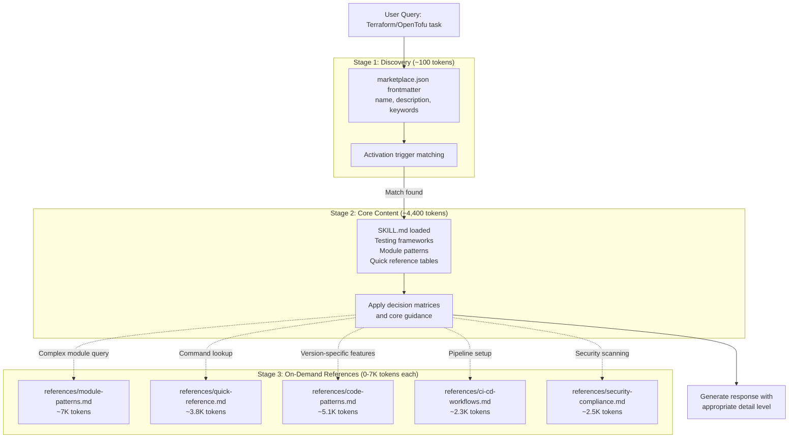
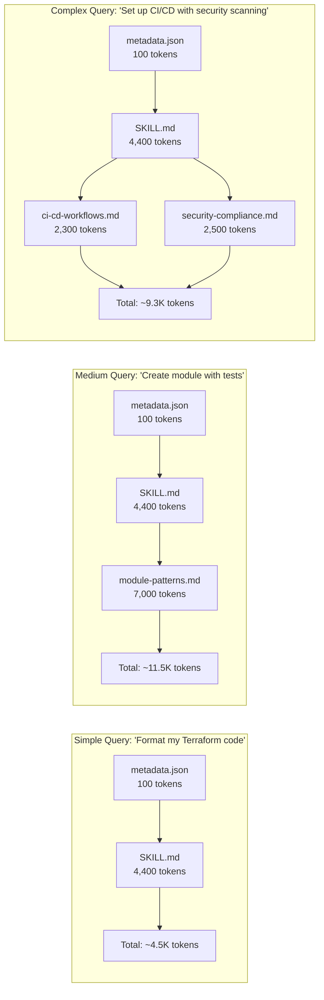
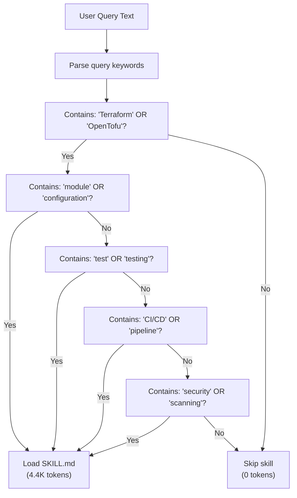

<!-- source: DeepWiki mcp.deepwiki.com · repo antonbabenko/terraform-skill · page 3.2 Progressive Disclosure Pattern · fetched 2026-10-26 -->

# Progressive Disclosure Pattern

<details>
<summary>Relevant source files</summary>

The following files were used as context for generating this wiki page:

- [CLAUDE.md](CLAUDE.md)
- [SKILL.md](SKILL.md)

</details>


## Purpose and Scope

The progressive disclosure pattern is the core architectural strategy used by terraform-skill to minimize token consumption while maintaining comprehensive Terraform/OpenTofu guidance. This pattern organizes content into three tiers—metadata, core content, and reference files—that Claude Code loads incrementally based on query requirements. This document explains the three-stage loading architecture, token budget distribution, file organization strategy, and implementation mechanisms.

For information about the overall content architecture and file responsibilities, see [Content Organization](#3.3). For details on how the plugin discovery system works, see [Plugin Definition System](#3.1).

---

## Three-Stage Loading Architecture

The progressive disclosure pattern implements a three-tier loading system that optimizes token usage by deferring content loading until needed.

### Loading Sequence Diagram



Sources: [SKILL.md:500-511](), [CLAUDE.md:46-64]()

### Stage Responsibilities

| Stage | Files | Token Cost | Always Loaded | Purpose |
|-------|-------|-----------|---------------|---------|
| **Discovery** | `.claude-plugin/marketplace.json` | ~100 tokens | Yes | Skill activation trigger matching |
| **Core** | `SKILL.md` | ~4,400 tokens | On activation | Essential patterns, decision matrices, quick reference |
| **References** | `references/*.md` (6 files) | 2.3K-7K per file | On demand only | Deep-dive guidance for specific topics |

**Total Available Content:** ~30.4K tokens  
**Typical Query Usage:** 4.5K-12K tokens (56-70% reduction vs. loading all content)

Sources: [CLAUDE.md:66-82](), [SKILL.md:1-8]()

---

## Token Budget Optimization

### Token Distribution

The skill's total content is strategically distributed across files to minimize default load while maintaining comprehensive coverage.

| File | Lines | Tokens | Load Trigger |
|------|-------|--------|--------------|
| `marketplace.json` | ~30 | ~100 | Always (skill discovery) |
| `SKILL.md` | 524 | ~4,400 | Skill activated |
| `references/module-patterns.md` | 1,126 | ~7,000 | Module development questions |
| `references/code-patterns.md` | 859 | ~5,100 | Modern features, version-specific guidance |
| `references/quick-reference.md` | 600 | ~3,800 | Command lookups, troubleshooting |
| `references/ci-cd-workflows.md` | 473 | ~2,300 | Pipeline setup, automation |
| `references/security-compliance.md` | 470 | ~2,500 | Security scanning, compliance |
| `references/testing-frameworks.md` | 563 | ~3,400 | Testing framework deep-dives |

**Total:** 4,645 lines, ~30,400 tokens across 8 files

Sources: [CLAUDE.md:69-82](), [CLAUDE.md:22-28]()

### Query Type Token Usage



Sources: [CLAUDE.md:78-82]()

**Key Optimization:** Claude never loads all 30.4K tokens. The architecture ensures:
- Minimum load: 4.5K tokens (discovery + core)
- Typical load: 8-12K tokens (core + 1-2 references)
- Maximum theoretical load: 30.4K tokens (all references, rare)

---

## File Organization Strategy

### Core vs. Reference Content Split

The content split between `SKILL.md` and `references/*.md` follows specific architectural principles.

**SKILL.md Content (Core - Always Loaded on Activation):**
- Testing strategy decision matrices [SKILL.md:116-144]()
- Module development best practices summary [SKILL.md:315-350]()
- Count vs. for_each decision guide [SKILL.md:229-271]()
- Block ordering standards [SKILL.md:173-225]()
- Version constraint quick reference [SKILL.md:399-431]()
- CI/CD workflow stages overview [SKILL.md:352-371]()

**references/*.md Content (Deep-Dive - Loaded on Demand):**
- Detailed module architecture patterns
- Complete testing framework guides
- Full CI/CD pipeline templates
- Comprehensive security checklists
- Extended command reference tables

Sources: [CLAUDE.md:85-110](), [SKILL.md:500-511]()

### Directory Structure

```
terraform-skill/
├── .claude-plugin/
│   └── marketplace.json         # Stage 1: Discovery metadata
├── SKILL.md                      # Stage 2: Core content (~4.4K tokens)
└── references/                   # Stage 3: On-demand references
    ├── ci-cd-workflows.md        # 2.3K tokens
    ├── code-patterns.md          # 5.1K tokens
    ├── module-patterns.md        # 7K tokens
    ├── quick-reference.md        # 3.8K tokens
    ├── security-compliance.md    # 2.5K tokens
    └── testing-frameworks.md     # 3.4K tokens
```

Sources: [CLAUDE.md:16-32]()

### Content Categorization Principles

Content placement follows these rules:

| Content Type | Location | Example |
|--------------|----------|---------|
| **Decision frameworks** | `SKILL.md` | "Which testing approach?" table [SKILL.md:118-128]() |
| **Quick reference tables** | `SKILL.md` | Module type comparison [SKILL.md:36-42]() |
| **DO/DON'T examples** | `SKILL.md` | Singleton naming patterns [SKILL.md:85-100]() |
| **Detailed guides** | `references/` | Complete Terratest walkthrough |
| **Command templates** | `references/` | Full GitHub Actions workflow |
| **Extended checklists** | `references/` | Comprehensive security scanning setup |

Sources: [CLAUDE.md:85-110]()

---

## Content Loading Mechanism

### Metadata-Driven Discovery

The discovery phase uses YAML frontmatter in `.claude-plugin/marketplace.json` and `SKILL.md` to determine skill activation.

**marketplace.json Structure:**
```json
{
  "name": "terraform-skill",
  "description": "Use when working with Terraform or OpenTofu...",
  "source": "./"
}
```

**SKILL.md Frontmatter:**
```yaml
---
name: terraform-skill
description: Use when working with Terraform or OpenTofu - creating modules, 
  writing tests (native test framework, Terratest), setting up CI/CD pipelines...
license: Apache-2.0
metadata:
  author: Anton Babenko
  version: 1.5.0
---
```

Sources: [SKILL.md:1-8]()

### Activation Triggers

Claude Code evaluates activation based on explicit trigger conditions defined in `SKILL.md`.



**Explicit Activation Conditions** [SKILL.md:14-28]():
- Creating new Terraform or OpenTofu configurations
- Setting up testing infrastructure
- Deciding between testing approaches
- Structuring multi-environment deployments
- Implementing CI/CD for IaC
- Reviewing or refactoring existing projects
- Choosing between module patterns

Sources: [SKILL.md:14-28](), [CLAUDE.md:46-64]()

### Reference File Loading

Reference files are loaded when `SKILL.md` explicitly mentions them or when Claude determines additional detail is needed.

**Explicit Reference Pattern in SKILL.md:**

```markdown
**For detailed module architecture, see:** 
[Code Patterns: Module Types & Hierarchy](references/code-patterns.md)
```
[SKILL.md:66]()

```markdown
**For complete CI/CD templates, see:**
- **[CI/CD Workflows Guide](references/ci-cd-workflows.md)** - GitHub Actions, 
  GitLab CI templates, cost optimization, automated cleanup
```
[SKILL.md:368-369]()

**Reference Link Format:**
- Markdown links to `references/*.md` files
- Descriptive anchor text indicating when to load
- Section-specific links when appropriate

Sources: [SKILL.md:66](), [SKILL.md:169-171](), [SKILL.md:227](), [SKILL.md:271](), [SKILL.md:313](), [SKILL.md:348-350](), [SKILL.md:368-370](), [SKILL.md:396-397](), [SKILL.md:431](), [SKILL.md:476](), [SKILL.md:503-509]()

---

## Implementation Details

### Frontmatter Metadata Requirements

Both `marketplace.json` and `SKILL.md` require specific metadata fields for proper discovery and loading.

**Required Fields:**

| Field | Location | Purpose | Example |
|-------|----------|---------|---------|
| `name` | Both | Skill identifier | `"terraform-skill"` |
| `description` | Both | Activation trigger keywords | `"Use when working with Terraform or OpenTofu..."` |
| `license` | `SKILL.md` | Legal terms | `"Apache-2.0"` |
| `metadata.version` | `SKILL.md` | Version tracking | `"1.5.0"` |
| `source` | `marketplace.json` | Content location | `"./"` |

Sources: [SKILL.md:1-8]()

### File Size Constraints

The architecture enforces soft limits to maintain token efficiency:

| File Type | Target Size | Current Size | Rationale |
|-----------|-------------|--------------|-----------|
| `SKILL.md` | < 500 lines | 524 lines | Core content should be scannable [CLAUDE.md:76-77]() |
| Reference files | No hard limit | 470-1,126 lines | Loaded on-demand, size less critical |

**Current Status:** `SKILL.md` slightly exceeds target by 24 lines, justified by comprehensive decision matrices and version-specific guidance. Future content growth should prioritize reference file expansion. [CLAUDE.md:319-328]()

Sources: [CLAUDE.md:76-82](), [CLAUDE.md:319-328]()

### Progressive Disclosure Section Pattern

`SKILL.md` implements a consistent pattern for deferring to reference files:

```markdown
## [Topic] Summary

[Essential information: decision tables, key patterns, quick reference]

**For detailed [topic] guidance, see:**
- **[Reference File Name](references/file.md)** - What the file contains
```

**Example Implementation:**

```markdown
## Testing Strategy Framework

[Decision Matrix: Which Testing Approach? - Table with 8 rows]

**For detailed testing guides, see:**
- **[Testing Frameworks Guide](references/testing-frameworks.md)** - In-depth 
  guide to static analysis, native tests, and Terratest
```
[SKILL.md:116-172]()

This pattern appears in sections:
- Testing Strategy [SKILL.md:169-172]()
- Module Development [SKILL.md:348-350]()
- Code Structure Standards [SKILL.md:227]()
- Count vs. For_Each [SKILL.md:271]()
- Locals for Dependencies [SKILL.md:313]()
- CI/CD Integration [SKILL.md:368-370]()
- Security & Compliance [SKILL.md:396-397]()
- Version Management [SKILL.md:431]()
- Modern Terraform Features [SKILL.md:476]()

Sources: [SKILL.md:169-172](), [SKILL.md:227](), [SKILL.md:271](), [SKILL.md:313](), [SKILL.md:348-350](), [SKILL.md:368-370](), [SKILL.md:396-397](), [SKILL.md:431](), [SKILL.md:476](), [SKILL.md:500-511]()

### Token Efficiency Validation

The development process includes explicit token budget tracking:

```bash
# Token estimation (CLAUDE.md:196-199)
wc -c SKILL.md  # Currently ~17,700 chars ≈ 4,400 tokens
```

**Validation Rules:**
- Aim for < 1,500 words in new content additions
- Use tables over prose paragraphs
- Prefer bullet lists to explanatory text
- Remove filler words and adjectives

Sources: [CLAUDE.md:196-199](), [CONTRIBUTING.md reference in CLAUDE.md]()

---

## Benefits and Trade-offs

### Achieved Optimization

**Token Savings:**
- **56-70% reduction** in typical query token usage vs. loading all content
- Baseline load: 4.5K tokens (metadata + core) instead of 30.4K tokens (all content)
- Most queries satisfied with 8-12K tokens (core + 1-2 references)

**User Experience:**
- Faster response times (less content to process)
- More context window available for user's code
- Scalable: can add reference files without impacting core performance

Sources: [CLAUDE.md:78-82]()

### Architectural Trade-offs

**Complexity:**
- Requires careful content categorization (core vs. reference)
- Must maintain explicit links between `SKILL.md` and reference files
- Contributors must understand where new content belongs

**Maintenance:**
- Content duplication risk (same concept in core + reference)
- Link maintenance burden (keeping references accurate)
- Version sync across files (ensure consistent guidance)

**User Impact:**
- Users must trust Claude to load appropriate references
- No guarantee all relevant content loads for every query
- Advanced users may not realize additional detail exists

Sources: [CLAUDE.md:312-328]()

### Design Rationale

The progressive disclosure pattern directly addresses Claude Code's context window constraints:

> "Skills only load when relevant, minimizing token usage."  
> [CLAUDE.md:63]()

> "Architecture optimizes for Claude's context window constraints"  
> [High-Level Diagram 2 Key Insights]

By splitting content into tiers, the skill provides comprehensive Terraform guidance (30.4K tokens) while maintaining practical usability (4.5K-12K token typical load). This enables the skill to cover enterprise-grade patterns, testing frameworks, CI/CD templates, and security compliance without overwhelming Claude's context or forcing users to manage multiple separate skills.

Sources: [CLAUDE.md:46-82](), [SKILL.md:500-511]()

---

