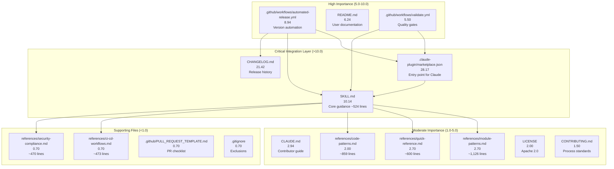
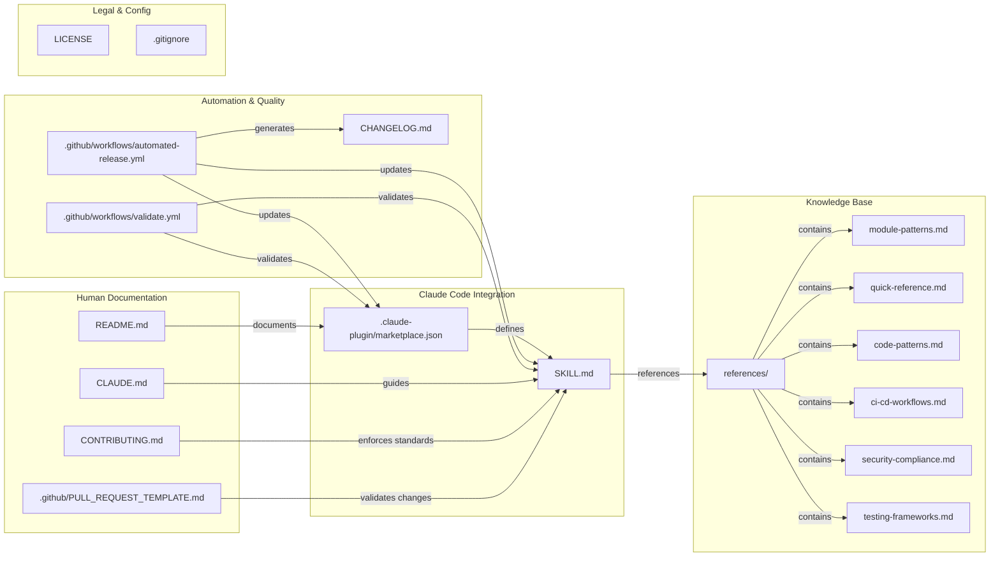
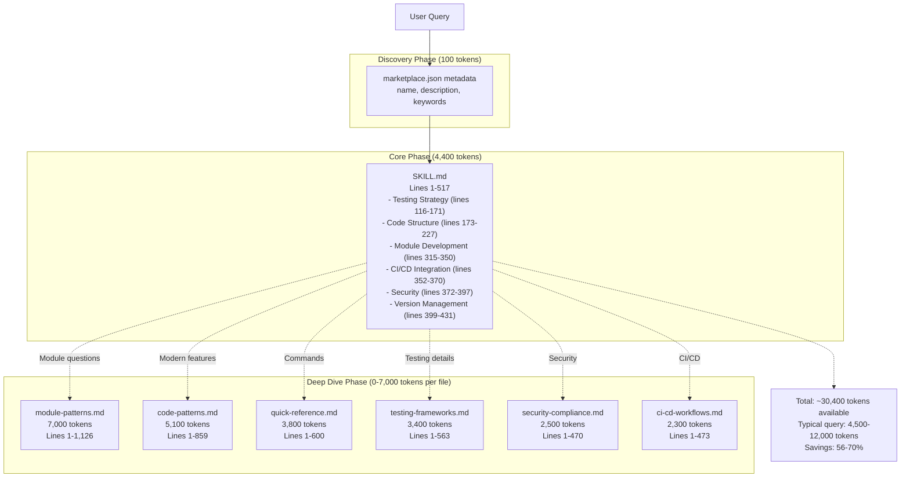

<!-- source: DeepWiki mcp.deepwiki.com · repo antonbabenko/terraform-skill · page 3.3 Content Organization · fetched 2026-10-26 -->

# Content Organization

<details>
<summary>Relevant source files</summary>

The following files were used as context for generating this wiki page:

- [CLAUDE.md](CLAUDE.md)
- [SKILL.md](SKILL.md)

</details>


**Purpose and Scope**: This page documents the physical file structure of the terraform-skill repository, the responsibilities of each file type, and the ~30.4K token distribution strategy across files. It explains how content is organized to serve both Claude Code (machine-readable skill content) and human contributors (documentation and development guides).

For information about how Claude loads these files at runtime, see [Progressive Disclosure Pattern](#3.2). For the structure of marketplace.json specifically, see [Plugin Definition System](#3.1). For development workflows and contribution process, see [Development Guide](#5).

---

## Repository File Structure

The repository follows a clear separation between integration files, skill content, automation, and contributor documentation:

```
terraform-skill/
├── .claude-plugin/
│   └── marketplace.json              # Plugin metadata (28.17 importance)
├── SKILL.md                          # Core skill content (10.14 importance)
├── references/                       # Progressive disclosure content
│   ├── ci-cd-workflows.md            # ~473 lines, ~2.3K tokens
│   ├── code-patterns.md              # ~859 lines, ~5.1K tokens
│   ├── module-patterns.md            # ~1,126 lines, ~7.0K tokens
│   ├── quick-reference.md            # ~600 lines, ~3.8K tokens
│   ├── security-compliance.md        # ~470 lines, ~2.5K tokens
│   └── testing-frameworks.md         # ~563 lines, ~3.4K tokens
├── .github/
│   ├── workflows/
│   │   ├── automated-release.yml     # Release automation (8.94 importance)
│   │   └── validate.yml              # Content validation (5.50 importance)
│   └── PULL_REQUEST_TEMPLATE.md      # PR standards (0.70 importance)
├── README.md                         # End-user documentation (6.24 importance)
├── CLAUDE.md                         # Contributor guide (2.94 importance)
├── CONTRIBUTING.md                   # Contribution standards (1.50 importance)
├── CHANGELOG.md                      # Release history (21.42 importance)
├── LICENSE                           # Apache 2.0 (2.00 importance)
└── .gitignore                        # Git exclusions (0.70 importance)
```

Sources: [CLAUDE.md:15-32](), [SKILL.md:1-517]()

---

## File Hierarchy by Importance

### Diagram: File Organization by Importance Score



The importance scores indicate how central each file is to the system's operation. Files above 10.0 are critical to the skill's functionality, while files below 1.0 provide supporting infrastructure.

Sources: High-level diagrams (Diagram 1, Diagram 6), [CLAUDE.md:34-43]()

---

## File Type Responsibilities

### Diagram: Responsibility Matrix



Sources: [CLAUDE.md:34-43](), High-level diagrams (Diagram 1, Diagram 6)

### Machine-Readable Files (Claude Code)

| File | Audience | Lines | Tokens | Purpose |
|------|----------|-------|--------|---------|
| `.claude-plugin/marketplace.json` | Claude Code | ~50 | ~100 | Plugin discovery, activation triggers, metadata |
| `SKILL.md` | Claude Code | 524 | ~4,400 | Core Terraform/OpenTofu guidance, decision matrices |
| `references/module-patterns.md` | Claude Code | 1,126 | ~7,000 | Detailed module architecture, variable/output patterns |
| `references/quick-reference.md` | Claude Code | 600 | ~3,800 | Command cheat sheets, troubleshooting guide |
| `references/code-patterns.md` | Claude Code | 859 | ~5,100 | Modern Terraform features, block ordering, refactoring |
| `references/ci-cd-workflows.md` | Claude Code | 473 | ~2,300 | Pipeline templates, cost optimization |
| `references/security-compliance.md` | Claude Code | 470 | ~2,500 | Security scanning, secrets management |
| `references/testing-frameworks.md` | Claude Code | 563 | ~3,400 | Static analysis, native tests, Terratest |

Total machine-readable content: **~4,615 lines**, **~30,400 tokens**

Sources: [CLAUDE.md:66-82](), [SKILL.md:1-517]()

### Human-Readable Files (Contributors)

| File | Audience | Purpose |
|------|----------|---------|
| `README.md` | End users | Installation instructions, usage examples, feature overview |
| `CLAUDE.md` | Contributors | Development philosophy, content standards, architecture decisions |
| `CONTRIBUTING.md` | Contributors | Contribution process, PR requirements, testing methodology |
| `.github/PULL_REQUEST_TEMPLATE.md` | Contributors | PR checklist, evidence requirements |
| `CHANGELOG.md` | All | Version history, feature additions, breaking changes |
| `LICENSE` | All | Apache 2.0 legal terms |

Sources: [CLAUDE.md:34-43](), [README.md:1-50]()

### Automation Files (CI/CD)

| File | Trigger | Actions | Targets |
|------|---------|---------|---------|
| `.github/workflows/validate.yml` | Pull request | Frontmatter validation, file size checks, link detection, markdown linting | `SKILL.md`, `marketplace.json` |
| `.github/workflows/automated-release.yml` | Merge to master | Conventional commit analysis, version bumping, changelog generation, GitHub release | `marketplace.json`, `SKILL.md`, `CHANGELOG.md` |

Sources: [.github/workflows/validate.yml:1-50](), [.github/workflows/automated-release.yml:1-100]()

---

## Token Distribution Strategy

### Diagram: Token Budget Allocation



**Token Efficiency Calculation:**
- **Worst case (load everything):** 100 + 4,400 + 24,000 = 28,500 tokens
- **Typical case (core + 1 reference):** 100 + 4,400 + 3,000 = 7,500 tokens
- **Best case (core only):** 100 + 4,400 = 4,500 tokens
- **Savings:** 4,500-7,500 vs 28,500 = **56-70% reduction**

Sources: [CLAUDE.md:66-82](), High-level diagrams (Diagram 2)

### Content Distribution by Topic

| Topic | Location | Lines | Tokens | Load Frequency |
|-------|----------|-------|--------|----------------|
| Testing Strategy Framework | `SKILL.md:116-171` | 56 | ~450 | Every query |
| Code Structure Standards | `SKILL.md:173-227` | 55 | ~550 | Every query |
| Count vs For_Each | `SKILL.md:229-271` | 43 | ~400 | High |
| Module Development | `SKILL.md:315-350` | 36 | ~350 | High |
| CI/CD Integration | `SKILL.md:352-370` | 19 | ~200 | Medium |
| Security & Compliance | `SKILL.md:372-397` | 26 | ~250 | Medium |
| Module Patterns (detailed) | `references/module-patterns.md` | 1,126 | ~7,000 | On-demand |
| Code Patterns (detailed) | `references/code-patterns.md` | 859 | ~5,100 | On-demand |
| Quick Reference | `references/quick-reference.md` | 600 | ~3,800 | On-demand |
| Testing Frameworks | `references/testing-frameworks.md` | 563 | ~3,400 | On-demand |
| Security Details | `references/security-compliance.md` | 470 | ~2,500 | On-demand |
| CI/CD Templates | `references/ci-cd-workflows.md` | 473 | ~2,300 | On-demand |

Sources: [SKILL.md:116-517](), [CLAUDE.md:66-82]()

---

## Content Flow Architecture

### Diagram: Reference Link Architecture

```mermaid
graph TB
    SKILL_TOP["SKILL.md Lines 1-114<br/>Frontmatter & Activation Triggers"]
    
    SKILL_TEST["SKILL.md Lines 116-171<br/>Testing Strategy Framework"]
    SKILL_STRUCT["SKILL.md Lines 173-313<br/>Code Structure Standards"]
    SKILL_MODULE["SKILL.md Lines 315-350<br/>Module Development"]
    SKILL_CICD["SKILL.md Lines 352-370<br/>CI/CD Integration"]
    SKILL_SEC["SKILL.md Lines 372-397<br/>Security & Compliance"]
    SKILL_VERSION["SKILL.md Lines 399-431<br/>Version Management"]
    SKILL_MODERN["SKILL.md Lines 433-476<br/>Modern Features"]
    SKILL_REFS["SKILL.md Lines 499-510<br/>Reference Links"]
    
    REF_TEST["references/testing-frameworks.md<br/>Deep dive: Static, Native, Terratest"]
    REF_MOD["references/module-patterns.md<br/>Variable/output patterns, ✅/❌ examples"]
    REF_CICD["references/ci-cd-workflows.md<br/>GitHub Actions, GitLab CI templates"]
    REF_SEC["references/security-compliance.md<br/>Trivy/Checkov, secrets management"]
    REF_QUICK["references/quick-reference.md<br/>Commands, troubleshooting, migration"]
    REF_CODE["references/code-patterns.md<br/>Block ordering, modern features detail"]
    
    SKILL_TOP --> SKILL_TEST
    SKILL_TOP --> SKILL_STRUCT
    SKILL_TOP --> SKILL_MODULE
    SKILL_TOP --> SKILL_CICD
    SKILL_TOP --> SKILL_SEC
    SKILL_TOP --> SKILL_VERSION
    SKILL_TOP --> SKILL_MODERN
    SKILL_TOP --> SKILL_REFS
    
    SKILL_TEST -.->|"Line 170: [Testing Frameworks Guide]"| REF_TEST
    SKILL_TEST -.->|"Line 171: [Quick Reference]"| REF_QUICK
    
    SKILL_STRUCT -.->|"Line 227: [Block Ordering & Structure]"| REF_CODE
    SKILL_STRUCT -.->|"Line 271: [Count vs For_Each]"| REF_CODE
    SKILL_STRUCT -.->|"Line 313: [Locals for Dependency]"| REF_CODE
    
    SKILL_MODULE -.->|"Line 349: [Module Patterns Guide]"| REF_MOD
    SKILL_MODULE -.->|"Line 350: [Quick Reference]"| REF_QUICK
    
    SKILL_CICD -.->|"Line 369: [CI/CD Workflows Guide]"| REF_CICD
    SKILL_CICD -.->|"Line 370: [Quick Reference]"| REF_QUICK
    
    SKILL_SEC -.->|"Line 397: [Security & Compliance]"| REF_SEC
    
    SKILL_VERSION -.->|"Line 431: [Version Management]"| REF_CODE
    
    SKILL_MODERN -.->|"Line 476: [Modern Terraform Features]"| REF_CODE
    
    SKILL_REFS --> REF_TEST
    SKILL_REFS --> REF_MOD
    SKILL_REFS --> REF_CICD
    SKILL_REFS --> REF_SEC
    SKILL_REFS --> REF_QUICK
```



Sources: [SKILL.md:1-517](), [SKILL.md:499-510]()

### Cross-Reference Pattern

The skill uses inline cross-references to guide Claude to deeper content:

| Pattern | Example Location | Target |
|---------|-----------------|--------|
| Testing details | [SKILL.md:170-171]() | `references/testing-frameworks.md` |
| Module patterns | [SKILL.md:349-350]() | `references/module-patterns.md` |
| Code patterns | [SKILL.md:227](), [SKILL.md:271](), [SKILL.md:313]() | `references/code-patterns.md` |
| CI/CD templates | [SKILL.md:369-370]() | `references/ci-cd-workflows.md` |
| Security scanning | [SKILL.md:397]() | `references/security-compliance.md` |
| Quick reference | [SKILL.md:171](), [SKILL.md:350](), [SKILL.md:370]() | `references/quick-reference.md` |

All reference links follow the pattern:
```markdown
**For [topic], see:** [Link Text](references/filename.md)
```

Sources: [SKILL.md:169-171](), [SKILL.md:227](), [SKILL.md:271](), [SKILL.md:313](), [SKILL.md:349-350](), [SKILL.md:369-370](), [SKILL.md:397]()

---

## File Organization Conventions

### Naming Standards

| File Type | Pattern | Examples |
|-----------|---------|----------|
| Core skill | `SKILL.md` | Single file, uppercase |
| Reference docs | `kebab-case.md` | `module-patterns.md`, `ci-cd-workflows.md` |
| Contributor docs | `UPPERCASE.md` | `README.md`, `CLAUDE.md`, `CONTRIBUTING.md` |
| Automation | `kebab-case.yml` | `automated-release.yml`, `validate.yml` |
| Generated | `UPPERCASE.md` | `CHANGELOG.md` |

Sources: [CLAUDE.md:15-32]()

### Directory Structure Rules

1. **`.claude-plugin/`** - Contains only `marketplace.json`
   - Single file directory for plugin metadata
   - Sources: [.claude-plugin/marketplace.json:1-50]()

2. **`references/`** - Contains all progressive disclosure content
   - All files must be `.md` format
   - No subdirectories (flat structure)
   - Filenames describe content domain (e.g., `module-patterns`, not `modules`)
   - Sources: [CLAUDE.md:22-28]()

3. **`.github/workflows/`** - Contains automation workflows
   - All files must be `.yml` format
   - Filenames describe action (e.g., `automated-release`, not `release`)
   - Sources: [.github/workflows/]()

4. **Root directory** - Contains integration and documentation
   - Core skill (`SKILL.md`)
   - Human documentation (`README.md`, `CLAUDE.md`, `CONTRIBUTING.md`)
   - Legal (`LICENSE`)
   - Configuration (`.gitignore`)
   - Generated (`CHANGELOG.md`)
   - Sources: [CLAUDE.md:15-32]()

### Line Length Standards

| File | Current Lines | Target | Status |
|------|--------------|--------|--------|
| `SKILL.md` | 524 | ~500 | Acceptable (comprehensive core) |
| `references/module-patterns.md` | 1,126 | No limit | As needed |
| `references/code-patterns.md` | 859 | No limit | As needed |
| `references/quick-reference.md` | 600 | No limit | As needed |
| `references/testing-frameworks.md` | 563 | No limit | As needed |
| `references/ci-cd-workflows.md` | 473 | No limit | As needed |
| `references/security-compliance.md` | 470 | No limit | As needed |

**Rationale for SKILL.md being 524 lines:**
- Comprehensive decision matrices require space
- Essential quick reference tables included
- Version-specific guidance covers multiple Terraform versions
- Progressive disclosure minimizes actual token cost
- Extra 24 lines provide significant value while maintaining scannability

Sources: [CLAUDE.md:76-82](), [CLAUDE.md:319-328]()

---

## Content Location Decision Matrix

| Content Type | Location | Reasoning |
|-------------|----------|-----------|
| Activation triggers | `SKILL.md:14-28` | Must be in core for Claude to load skill |
| Decision matrices | `SKILL.md` | High-value, frequently needed |
| Quick reference tables | `SKILL.md` | Efficient token use for common queries |
| ✅/❌ patterns (core) | `SKILL.md` | Essential for code generation |
| Module architecture | `references/module-patterns.md` | Deep dive, loaded on-demand |
| Pipeline templates | `references/ci-cd-workflows.md` | Detailed, large code blocks |
| Command cheat sheets | `references/quick-reference.md` | Comprehensive, rarely all needed |
| Security tool configs | `references/security-compliance.md` | Specialized, loaded when needed |
| Testing frameworks | `references/testing-frameworks.md` | Detailed comparisons, loaded on-demand |
| Modern features | `references/code-patterns.md` | Version-specific, loaded on-demand |

**Decision Rule**: If content is needed in >50% of queries, it belongs in `SKILL.md`. If it's specialized or detailed, it belongs in `references/`.

Sources: [CLAUDE.md:85-109](), [SKILL.md:499-510]()

---

## Frontmatter Structure

### SKILL.md Frontmatter

```yaml
---
name: terraform-skill
description: [Activation triggers and keywords]
license: Apache-2.0
metadata:
  author: Anton Babenko
  version: 1.5.0
---
```

Location: [SKILL.md:1-8]()

**Fields:**
- `name`: Must match directory name and marketplace.json
- `description`: Defines when Claude should activate the skill
- `license`: Legal terms
- `metadata.version`: Synced with marketplace.json by automated-release.yml

Sources: [SKILL.md:1-8]()

### Reference File Frontmatter

Reference files do not require frontmatter. They are loaded as plain markdown when referenced from `SKILL.md`.

Sources: [references/module-patterns.md:1-10](), [references/code-patterns.md:1-10]()

---

## Total Content Inventory

| Category | Files | Lines | Tokens | Purpose |
|----------|-------|-------|--------|---------|
| **Integration** | 2 | ~574 | ~4,500 | Claude skill loading |
| **Knowledge Base** | 6 | 4,091 | ~24,000 | Progressive disclosure content |
| **Automation** | 2 | ~300 | N/A | Quality and release automation |
| **Documentation** | 4 | ~1,000 | N/A | Human-readable guides |
| **Legal/Config** | 2 | ~50 | N/A | License and git config |
| **Generated** | 1 | Variable | N/A | Release history |
| **Total** | 17 | ~6,015 | ~30,400 | Complete system |

Sources: [CLAUDE.md:66-82](), High-level diagrams (Diagram 2, Diagram 6)

---

