<!-- source: DeepWiki mcp.deepwiki.com · repo antonbabenko/terraform-skill · page 4.1 Core Skill Content (SKILL.md) · fetched 2026-10-26 -->

# Core Skill Content (SKILL.md)

<details>
<summary>Relevant source files</summary>

The following files were used as context for generating this wiki page:

- [SKILL.md](SKILL.md)

</details>


This page documents the structure, organization, and content of `SKILL.md`, the primary skill content file that Claude loads when the terraform-skill is activated. This ~4,400 token file serves as the entry point in the progressive disclosure architecture, providing essential Terraform/OpenTofu guidance while linking to detailed reference files when needed.

For information about the reference files that SKILL.md links to, see [Module Development Patterns](#4.2), [Code Patterns & Modern Features](#4.3), [Quick Reference & Commands](#4.4), [CI/CD Workflows](#4.5), and [Security & Compliance](#4.6). For the plugin definition that makes this content discoverable, see [Plugin Definition System](#3.1). For the overall architecture pattern, see [Progressive Disclosure Pattern](#3.2).

---

## File Metadata and Frontmatter

SKILL.md begins with YAML frontmatter that defines the skill's identity and activation conditions for Claude Code.

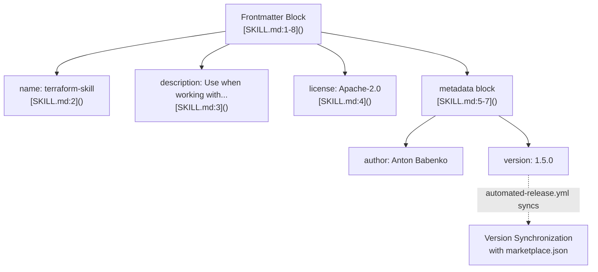

**Frontmatter Structure:**

| Field | Purpose | Line Reference |
|-------|---------|---------------|
| `name` | Skill identifier matching marketplace.json | [SKILL.md:2]() |
| `description` | Activation trigger keywords for Claude | [SKILL.md:3]() |
| `license` | Apache-2.0 license identifier | [SKILL.md:4]() |
| `metadata.author` | Skill maintainer | [SKILL.md:6]() |
| `metadata.version` | Semantic version (synced with releases) | [SKILL.md:7]() |

The `description` field contains activation keywords that Claude uses to determine when to load this skill: "Terraform", "OpenTofu", "modules", "tests", "CI/CD", "security scanning", etc.

**Sources:** [SKILL.md:1-8]()

---

## Content Architecture Overview

The file is organized into distinct sections that provide progressively detailed guidance, with explicit links to reference files for deep dives.

```mermaid
graph TB
    subgraph "SKILL.md Structure"
        INTRO["Introduction & Scope<br/>[SKILL.md:10-28]()"]
        CORE["Core Principles<br/>[SKILL.md:30-67]()"]
        TEST["Testing Strategy Framework<br/>[SKILL.md:117-172]()"]
        CODE["Code Structure Standards<br/>[SKILL.md:173-227]()"]
        COUNTFOR["Count vs For_Each<br/>[SKILL.md:229-271]()"]
        LOCALS["Locals for Dependencies<br/>[SKILL.md:273-313]()"]
        MOD["Module Development<br/>[SKILL.md:315-350]()"]
        CI["CI/CD Integration<br/>[SKILL.md:352-370]()"]
        SEC["Security & Compliance<br/>[SKILL.md:372-397]()"]
        VER["Version Management<br/>[SKILL.md:399-431]()"]
        MODERN["Modern Features 1.0+<br/>[SKILL.md:433-476]()"]
        VERSGUIDE["Version-Specific Guidance<br/>[SKILL.md:478-497]()"]
        REFS["Detailed Guides Links<br/>[SKILL.md:499-510]()"]
    end
    
    subgraph "Progressive Disclosure Links"
        REF_TEST["references/testing-frameworks.md"]
        REF_MOD["references/module-patterns.md"]
        REF_CODE["references/code-patterns.md"]
        REF_CI["references/ci-cd-workflows.md"]
        REF_SEC["references/security-compliance.md"]
        REF_QUICK["references/quick-reference.md"]
    end
    
    TEST -.->|"[SKILL.md:170-171]()"| REF_TEST
    TEST -.->|"[SKILL.md:171]()"| REF_QUICK
    CODE -.->|"[SKILL.md:227]()"| REF_CODE
    COUNTFOR -.->|"[SKILL.md:271]()"| REF_CODE
    LOCALS -.->|"[SKILL.md:313]()"| REF_CODE
    MOD -.->|"[SKILL.md:349]()"| REF_MOD
    MOD -.->|"[SKILL.md:350]()"| REF_QUICK
    CI -.->|"[SKILL.md:369-370]()"| REF_CI
    CI -.->|"[SKILL.md:370]()"| REF_QUICK
    SEC -.->|"[SKILL.md:397]()"| REF_SEC
    VER -.->|"[SKILL.md:431]()"| REF_CODE
    MODERN -.->|"[SKILL.md:476]()"| REF_CODE
    VERSGUIDE -.->|"[SKILL.md:497]()"| REF_QUICK
    REFS --> REF_TEST
    REFS --> REF_MOD
    REFS --> REF_CI
    REFS --> REF_SEC
    REFS --> REF_QUICK
```

**Token Distribution Strategy:**

The file maintains ~4,400 tokens in the core content with explicit links to ~24,000 tokens in reference files. This allows Claude to load only the content needed for a specific query.

**Sources:** [SKILL.md:1-516]()

---

## Activation Conditions Section

The "When to Use This Skill" section [SKILL.md:14-28]() defines explicit triggers for skill activation and exclusions to avoid inappropriate activation.

**Activation Triggers** [SKILL.md:16-23]():

```
- Creating new Terraform or OpenTofu configurations or modules
- Setting up testing infrastructure for IaC code
- Deciding between testing approaches (validate, plan, frameworks)
- Structuring multi-environment deployments
- Implementing CI/CD for infrastructure-as-code
- Reviewing or refactoring existing Terraform/OpenTofu projects
- Choosing between module patterns or state management approaches
```

**Exclusion Conditions** [SKILL.md:25-28]():

```
- Basic Terraform/OpenTofu syntax questions (Claude knows this)
- Provider-specific API reference (link to docs instead)
- Cloud platform questions unrelated to Terraform/OpenTofu
```

This dual approach ensures the skill activates for architectural and testing decisions while avoiding activation for basic syntax queries that Claude's base knowledge can handle.

**Sources:** [SKILL.md:14-28]()

---

## Core Principles Section

The Core Principles section [SKILL.md:30-67]() establishes the foundational architecture patterns, primarily focusing on module hierarchy and directory structure.

### Module Hierarchy Table

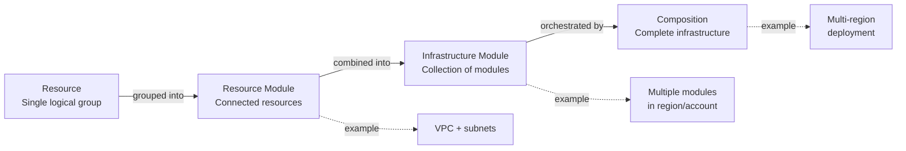

The module hierarchy table [SKILL.md:36-42]() defines four levels:

| Type | When to Use | Scope |
|------|-------------|-------|
| Resource Module | Single logical group of connected resources | VPC + subnets, Security group + rules |
| Infrastructure Module | Collection of resource modules for a purpose | Multiple resource modules in one region/account |
| Composition | Complete infrastructure | Spans multiple regions/accounts |

### Standard Directory Structure

The recommended directory structure [SKILL.md:44-59]() follows the terraform-best-practices.com pattern:

```
environments/        # Environment-specific configurations
├── prod/
├── staging/
└── dev/

modules/            # Reusable modules
├── networking/
├── compute/
└── data/

examples/           # Module usage examples (also serve as tests)
├── complete/
└── minimal/
```

**Key principle** [SKILL.md:61-65](): Separation of environments from modules, with `examples/` serving dual purpose as documentation and test fixtures.

**Sources:** [SKILL.md:30-67]()

---

## Testing Strategy Framework

The Testing Strategy Framework [SKILL.md:117-172]() provides a decision matrix and testing pyramid for choosing appropriate testing approaches.

### Testing Decision Matrix

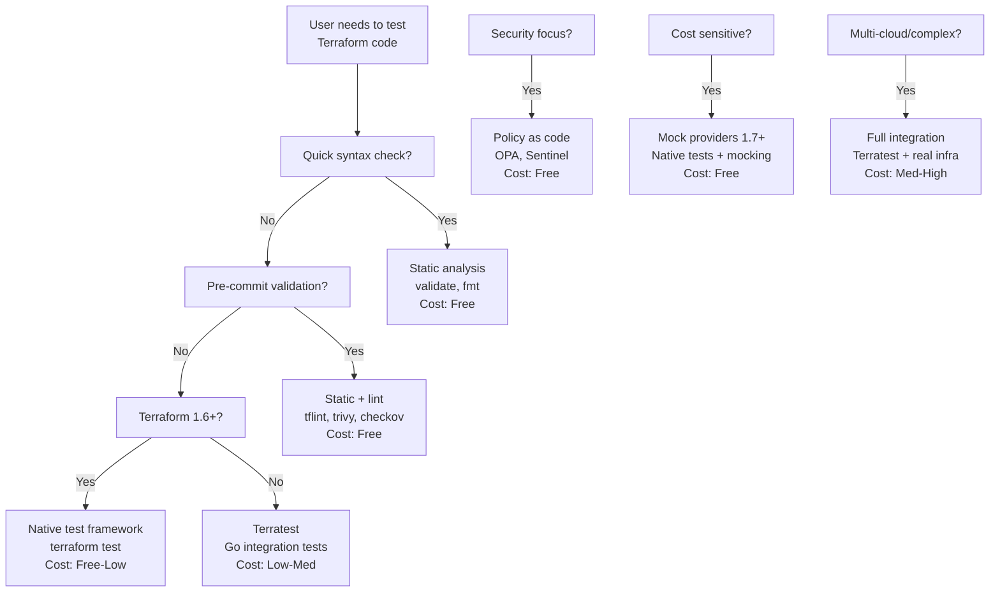

The decision matrix [SKILL.md:120-128]() maps user situations to recommended tools:

| Your Situation | Recommended Approach | Tools | Cost |
|----------------|---------------------|-------|------|
| Quick syntax check | Static analysis | `terraform validate`, `fmt` | Free |
| Pre-commit validation | Static + lint | `validate`, `tflint`, `trivy`, `checkov` | Free |
| Terraform 1.6+, simple logic | Native test framework | Built-in `terraform test` | Free-Low |
| Pre-1.6, or Go expertise | Integration testing | Terratest | Low-Med |
| Security/compliance focus | Policy as code | OPA, Sentinel | Free |
| Cost-sensitive workflow | Mock providers (1.7+) | Native tests + mocking | Free |
| Multi-cloud, complex | Full integration | Terratest + real infra | Med-High |

### Testing Pyramid

The testing pyramid [SKILL.md:130-144]() establishes cost/coverage tradeoffs:

```
        /\
       /  \          End-to-End Tests (Expensive)
      /____\         - Full environment deployment
     /      \        - Production-like setup
    /________\
   /          \      Integration Tests (Moderate)
  /____________\     - Module testing in isolation
 /              \    - Real resources in test account
/________________\   Static Analysis (Cheap)
                     - validate, fmt, lint
                     - Security scanning
```

### Native Test Best Practices

The Native Test Best Practices section [SKILL.md:146-168]() addresses schema validation and set-type block handling:

**Pre-test validation steps** [SKILL.md:150-162]():
1. Validate schemas with Terraform MCP
2. Choose correct command mode (`plan` vs `apply`)
3. Handle set-type blocks correctly (cannot index with `[0]`)

**Common set-type patterns** [SKILL.md:164-167]():
- S3 encryption rules: **set** (use for expressions)
- Lifecycle transitions: **set** (use for expressions)
- IAM policy statements: **set** (use for expressions)

**Progressive disclosure links** [SKILL.md:169-171]():
- `references/testing-frameworks.md` for deep dive
- `references/quick-reference.md` for decision flowchart

**Sources:** [SKILL.md:117-172]()

---

## Code Structure Standards

The Code Structure Standards section [SKILL.md:173-227]() defines strict ordering rules for resource and variable blocks.

### Resource Block Ordering

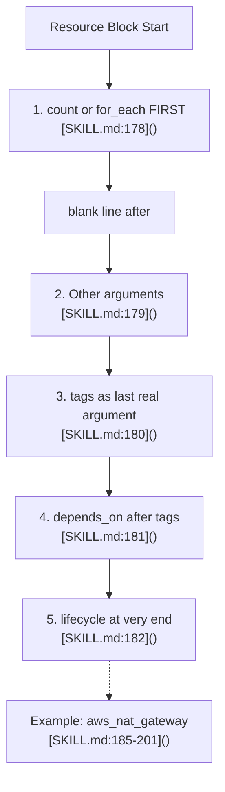

**Strict ordering** [SKILL.md:178-182]():
1. `count` or `for_each` FIRST (blank line after)
2. Other arguments
3. `tags` as last real argument
4. `depends_on` after tags (if needed)
5. `lifecycle` at the very end (if needed)

**Example implementation** [SKILL.md:185-201]():

```hcl
resource "aws_nat_gateway" "this" {
  count = var.create_nat_gateway ? 1 : 0

  allocation_id = aws_eip.this[0].id
  subnet_id     = aws_subnet.public[0].id

  tags = {
    Name = "${var.name}-nat"
  }

  depends_on = [aws_internet_gateway.this]

  lifecycle {
    create_before_destroy = true
  }
}
```

### Variable Block Ordering

**Ordering specification** [SKILL.md:206-210]():
1. `description` (ALWAYS required)
2. `type`
3. `default`
4. `validation`
5. `nullable` (when setting to false)

**Example implementation** [SKILL.md:213-224]():

```hcl
variable "environment" {
  description = "Environment name for resource tagging"
  type        = string
  default     = "dev"

  validation {
    condition     = contains(["dev", "staging", "prod"], var.environment)
    error_message = "Environment must be one of: dev, staging, prod."
  }

  nullable = false
}
```

**Sources:** [SKILL.md:173-227]()

---

## Naming Conventions

The Naming Conventions section [SKILL.md:68-115]() establishes patterns for resources, variables, and files.

### Resource Naming Pattern

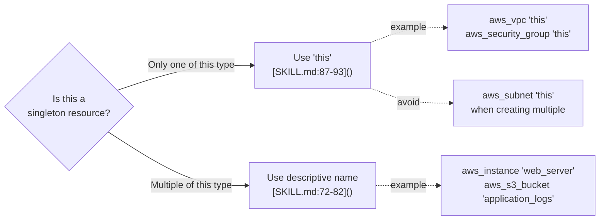

**Singleton rule** [SKILL.md:86-100](): Use `"this"` when module creates only one resource of that type:

✅ DO:
```hcl
resource "aws_vpc" "this" {}           # Module creates one VPC
resource "aws_security_group" "this" {}  # Module creates one SG
```

❌ DON'T:
```hcl
resource "aws_subnet" "this" {}  # If creating multiple subnets
```

**Descriptive naming** [SKILL.md:72-82]() for non-singletons:

✅ Good:
```hcl
resource "aws_instance" "web_server" { }
resource "aws_s3_bucket" "application_logs" { }
```

❌ Avoid:
```hcl
resource "aws_instance" "main" { }
resource "aws_s3_bucket" "bucket" { }
```

### Variable and File Naming

**Variable naming** [SKILL.md:103-107]():
```hcl
var.vpc_cidr_block          # Not just "cidr"
var.database_instance_class # Not just "instance_class"
```

**File organization** [SKILL.md:109-114]():
- `main.tf` - Primary resources
- `variables.tf` - Input variables
- `outputs.tf` - Output values
- `versions.tf` - Provider versions
- `data.tf` - Data sources (optional)

**Sources:** [SKILL.md:68-115]()

---

## Count vs For_Each Guidance

The Count vs For_Each section [SKILL.md:229-271]() provides a decision guide and migration patterns.

### Decision Guide

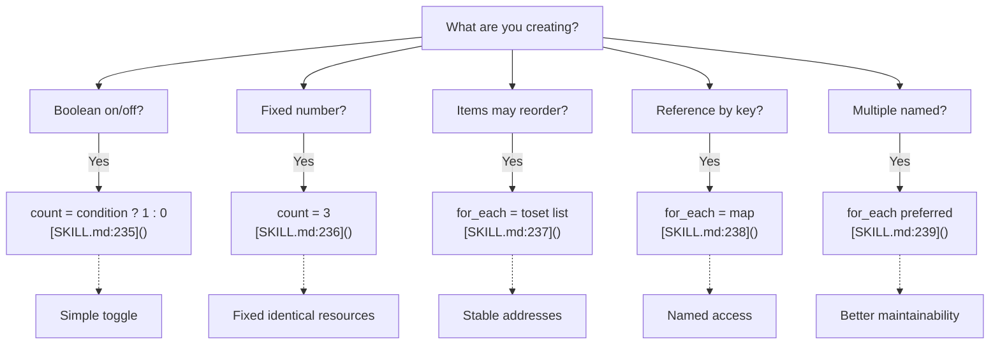

**Decision table** [SKILL.md:233-239]():

| Scenario | Use | Why |
|----------|-----|-----|
| Boolean condition (create or don't) | `count = condition ? 1 : 0` | Simple on/off toggle |
| Simple numeric replication | `count = 3` | Fixed number of identical resources |
| Items may be reordered/removed | `for_each = toset(list)` | Stable resource addresses |
| Reference by key | `for_each = map` | Named access to resources |
| Multiple named resources | `for_each` | Better maintainability |

### Stable Addressing Example

**Good: for_each with stable addresses** [SKILL.md:253-260]():
```hcl
resource "aws_subnet" "private" {
  for_each = toset(var.availability_zones)

  availability_zone = each.key
  # ...
}
# Removing "us-east-1b" only affects that subnet
```

**Bad: count with index-based addressing** [SKILL.md:262-268]():
```hcl
resource "aws_subnet" "private" {
  count = length(var.availability_zones)

  availability_zone = var.availability_zones[count.index]
  # ...
}
# Removing middle AZ recreates all subsequent subnets
```

**Sources:** [SKILL.md:229-271]()

---

## Locals for Dependency Management

The Locals for Dependency Management section [SKILL.md:273-313]() demonstrates using `try()` in locals to control resource deletion order.

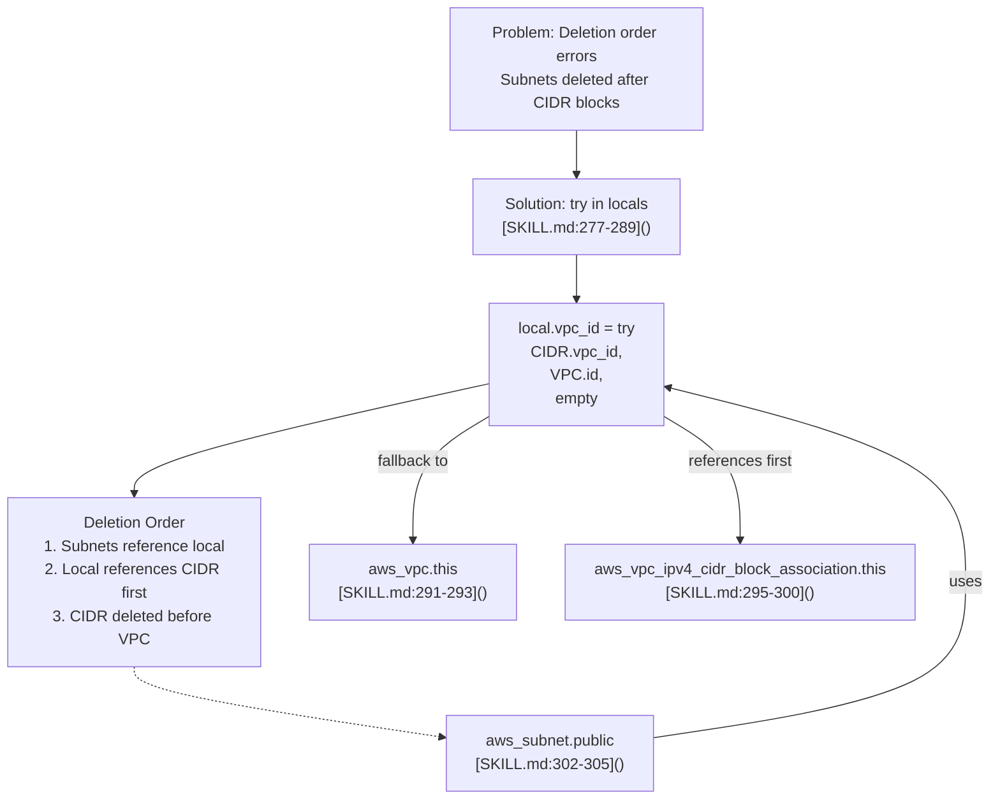

**Implementation pattern** [SKILL.md:281-305]():

```hcl
locals {
  # References secondary CIDR first, falling back to VPC
  # Forces Terraform to delete subnets before CIDR association
  vpc_id = try(
    aws_vpc_ipv4_cidr_block_association.this[0].vpc_id,
    aws_vpc.this.id,
    ""
  )
}

resource "aws_vpc" "this" {
  cidr_block = "10.0.0.0/16"
}

resource "aws_vpc_ipv4_cidr_block_association" "this" {
  count = var.add_secondary_cidr ? 1 : 0

  vpc_id     = aws_vpc.this.id
  cidr_block = "10.1.0.0/16"
}

resource "aws_subnet" "public" {
  vpc_id     = local.vpc_id  # Uses local, not direct reference
  cidr_block = "10.1.0.0/24"
}
```

**Why this matters** [SKILL.md:308-311]():
- Prevents deletion errors when destroying infrastructure
- Ensures correct dependency order without explicit `depends_on`
- Particularly useful for VPC configurations with secondary CIDR blocks

**Sources:** [SKILL.md:273-313]()

---

## Module Development Section

The Module Development section [SKILL.md:315-350]() defines standard module structure and best practices.

### Standard Module Structure

**Directory layout** [SKILL.md:319-330]():

```
my-module/
├── README.md           # Usage documentation
├── main.tf             # Primary resources
├── variables.tf        # Input variables with descriptions
├── outputs.tf          # Output values
├── versions.tf         # Provider version constraints
├── examples/
│   ├── minimal/        # Minimal working example
│   └── complete/       # Full-featured example
└── tests/              # Test files
    └── module_test.tftest.hcl  # Or .go
```

### Best Practices Checklist

**Variables best practices** [SKILL.md:335-340]():
- ✅ Always include `description`
- ✅ Use explicit `type` constraints
- ✅ Provide sensible `default` values where appropriate
- ✅ Add `validation` blocks for complex constraints
- ✅ Use `sensitive = true` for secrets

**Outputs best practices** [SKILL.md:342-346]():
- ✅ Always include `description`
- ✅ Mark sensitive outputs with `sensitive = true`
- ✅ Consider returning objects for related values
- ✅ Document what consumers should do with each output

**Progressive disclosure links** [SKILL.md:348-350]():
- `references/module-patterns.md` for detailed patterns
- `references/quick-reference.md` for common patterns

**Sources:** [SKILL.md:315-350]()

---

## CI/CD Integration Section

The CI/CD Integration section [SKILL.md:352-370]() defines workflow stages and cost optimization strategies.

### Workflow Stages

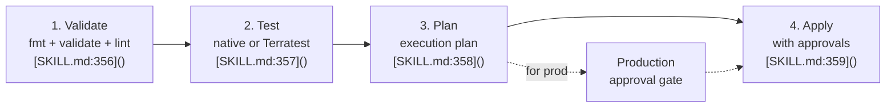

**Recommended stages** [SKILL.md:356-359]():
1. **Validate** - Format check + syntax validation + linting
2. **Test** - Run automated tests (native or Terratest)
3. **Plan** - Generate and review execution plan
4. **Apply** - Execute changes (with approvals for production)

### Cost Optimization Strategy

**Optimization steps** [SKILL.md:362-366]():

1. **Use mocking for PR validation** (free)
2. **Run integration tests only on main branch** (controlled cost)
3. **Implement auto-cleanup** (prevent orphaned resources)
4. **Tag all test resources** (track spending)

**Progressive disclosure links** [SKILL.md:368-370]():
- `references/ci-cd-workflows.md` for complete templates
- `references/quick-reference.md` for troubleshooting

**Sources:** [SKILL.md:352-370]()

---

## Security & Compliance Section

The Security & Compliance section [SKILL.md:372-397]() provides essential security checks and avoidance patterns.

### Essential Security Checks

**Static scanning commands** [SKILL.md:376-379]():

```bash
# Static security scanning
trivy config .
checkov -d .
```

### Security Patterns

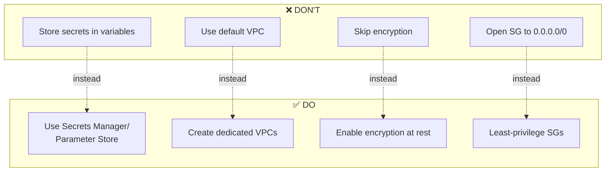

**Anti-patterns** [SKILL.md:384-388]():
- ❌ Store secrets in variables
- ❌ Use default VPC
- ❌ Skip encryption
- ❌ Open security groups to 0.0.0.0/0

**Recommended practices** [SKILL.md:390-394]():
- ✅ Use AWS Secrets Manager / Parameter Store
- ✅ Create dedicated VPCs
- ✅ Enable encryption at rest
- ✅ Use least-privilege security groups

**Progressive disclosure link** [SKILL.md:396-397]():
- `references/security-compliance.md` for detailed guidance

**Sources:** [SKILL.md:372-397]()

---

## Version Management Section

The Version Management section [SKILL.md:399-431]() defines version constraint syntax and update workflows.

### Version Constraint Syntax

**Constraint patterns** [SKILL.md:403-407]():

```hcl
version = "5.0.0"      # Exact (avoid - inflexible)
version = "~> 5.0"     # Recommended: 5.0.x only
version = ">= 5.0"     # Minimum (risky - breaking changes)
```

### Strategy by Component

**Component-specific strategies** [SKILL.md:411-416]():

| Component | Strategy | Example |
|-----------|----------|---------|
| **Terraform** | Pin minor version | `required_version = "~> 1.9"` |
| **Providers** | Pin major version | `version = "~> 5.0"` |
| **Modules (prod)** | Pin exact version | `version = "5.1.2"` |
| **Modules (dev)** | Allow patch updates | `version = "~> 5.1"` |

### Update Workflow

**Update process** [SKILL.md:420-428]():

```bash
# Lock versions initially
terraform init              # Creates .terraform.lock.hcl

# Update to latest within constraints
terraform init -upgrade     # Updates providers

# Review and test
terraform plan
```

**Sources:** [SKILL.md:399-431]()

---

## Modern Terraform Features Section

The Modern Terraform Features section [SKILL.md:433-476]() documents version-specific capabilities and migration patterns.

### Feature Availability Timeline

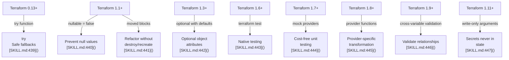

**Feature table** [SKILL.md:437-447]():

| Feature | Version | Use Case |
|---------|---------|----------|
| `try()` function | 0.13+ | Safe fallbacks, replaces `element(concat())` |
| `nullable = false` | 1.1+ | Prevent null values in variables |
| `moved` blocks | 1.1+ | Refactor without destroy/recreate |
| `optional()` with defaults | 1.3+ | Optional object attributes |
| Native testing | 1.6+ | Built-in test framework |
| Mock providers | 1.7+ | Cost-free unit testing |
| Provider functions | 1.8+ | Provider-specific data transformation |
| Cross-variable validation | 1.9+ | Validate relationships between variables |
| Write-only arguments | 1.11+ | Secrets never stored in state |

### Quick Examples

**try() example** [SKILL.md:452-455]():
```hcl
output "sg_id" {
  value = try(aws_security_group.this[0].id, "")
}
```

**optional() example** [SKILL.md:457-463]():
```hcl
variable "config" {
  type = object({
    name    = string
    timeout = optional(number, 300)  # Default: 300
  })
}
```

**Cross-variable validation** [SKILL.md:465-473]():
```hcl
variable "environment" { type = string }
variable "backup_days" {
  type = number
  validation {
    condition     = var.environment == "prod" ? var.backup_days >= 7 : true
    error_message = "Production requires backup_days >= 7"
  }
}
```

**Sources:** [SKILL.md:433-476]()

---

## Version-Specific Guidance Section

The Version-Specific Guidance section [SKILL.md:478-497]() provides recommendations by Terraform/OpenTofu version.

### Version-Based Recommendations

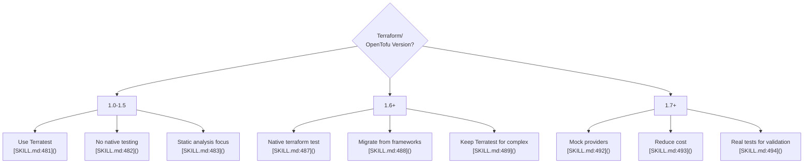

**Terraform 1.0-1.5** [SKILL.md:480-483]():
- Use Terratest for testing
- No native testing framework available
- Focus on static analysis and plan validation

**Terraform 1.6+ / OpenTofu 1.6+** [SKILL.md:485-489]():
- **New:** Native `terraform test` / `tofu test` command
- Consider migrating from external frameworks for simple tests
- Keep Terratest only for complex integration tests

**Terraform 1.7+ / OpenTofu 1.7+** [SKILL.md:491-494]():
- **New:** Mock providers for unit testing
- Reduce cost by mocking external dependencies
- Use real integration tests for final validation

### Terraform vs OpenTofu

**Comparison reference** [SKILL.md:496-497](): Both are fully supported. For licensing, governance, and feature comparison, see `references/quick-reference.md`.

**Sources:** [SKILL.md:478-497]()

---

## Progressive Disclosure Links Section

The Detailed Guides section [SKILL.md:499-510]() lists all reference files and their purposes.

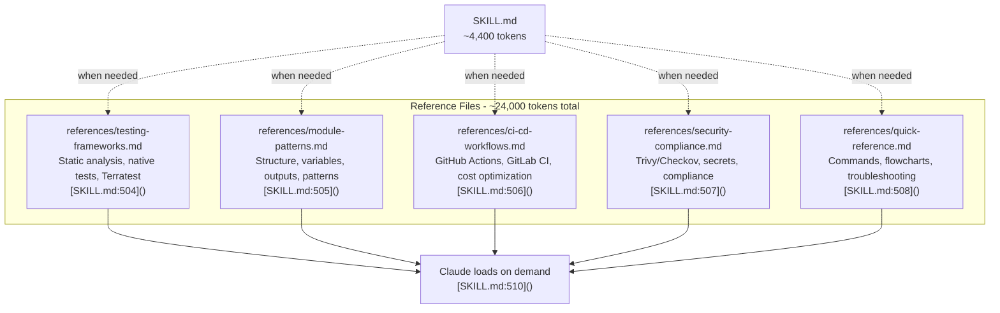

**Reference files inventory** [SKILL.md:503-508]():

| File | Purpose |
|------|---------|
| `references/testing-frameworks.md` | In-depth guide to static analysis, native tests, and Terratest |
| `references/module-patterns.md` | Module structure, variable/output best practices, ✅ DO vs ❌ DON'T patterns |
| `references/ci-cd-workflows.md` | GitHub Actions, GitLab CI templates, cost optimization, automated cleanup |
| `references/security-compliance.md` | Trivy/Checkov integration, secrets management, compliance testing |
| `references/quick-reference.md` | Command cheat sheets, decision flowcharts, troubleshooting guide |

**Loading strategy** [SKILL.md:510](): "When you need detailed information on a topic, reference the appropriate guide. Claude will load it on demand to provide comprehensive guidance."

**Sources:** [SKILL.md:499-510]()

---

## License Section

The License section [SKILL.md:512-516]() documents the Apache 2.0 license and copyright.

**License declaration** [SKILL.md:513]():
```
This skill is licensed under the **Apache License 2.0**. See the LICENSE file for full terms.
```

**Copyright notice** [SKILL.md:515]():
```
**Copyright © 2026 Anton Babenko**
```

**Sources:** [SKILL.md:512-516]()

---

## File Size and Token Management

SKILL.md maintains strict size constraints to optimize Claude's context window usage.

**Current metrics**:
- File size: ~4,400 tokens
- Line count: 516 lines
- Validation warning threshold: 500 lines [validate.yml references this file]

**Progressive disclosure benefits**:
- Total available content: ~30,400 tokens (SKILL.md + all references)
- Typical query usage: 4,500-12,000 tokens (56-70% token reduction)
- Loading strategy: Metadata (100 tokens) → Core (4,400 tokens) → References (0-7,000 tokens per file)

This architecture allows the skill to provide comprehensive guidance while respecting Claude's context limitations.

**Sources:** [SKILL.md:1-516](), See [Progressive Disclosure Pattern](#3.2) for architectural details.

---

