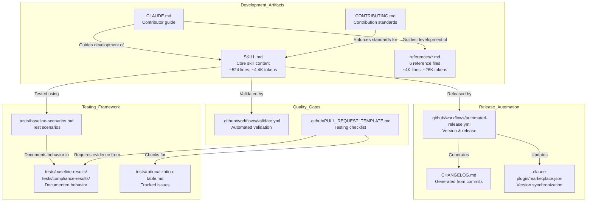
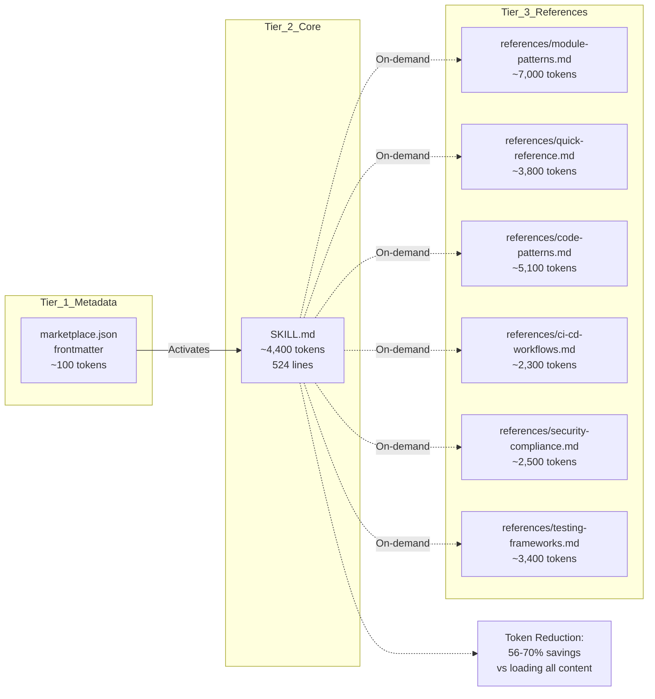
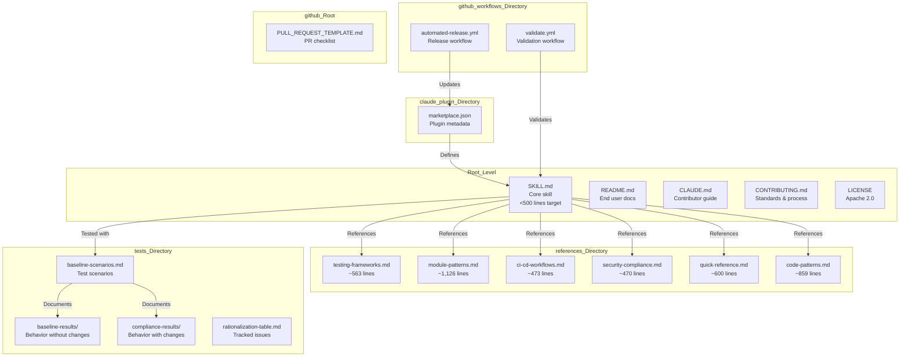
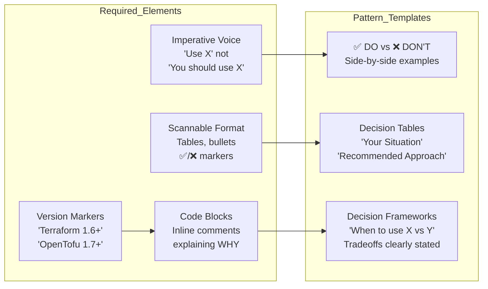
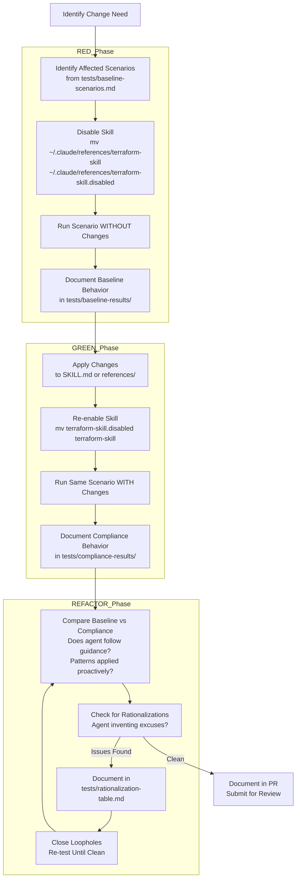
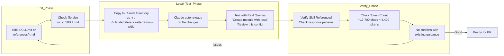
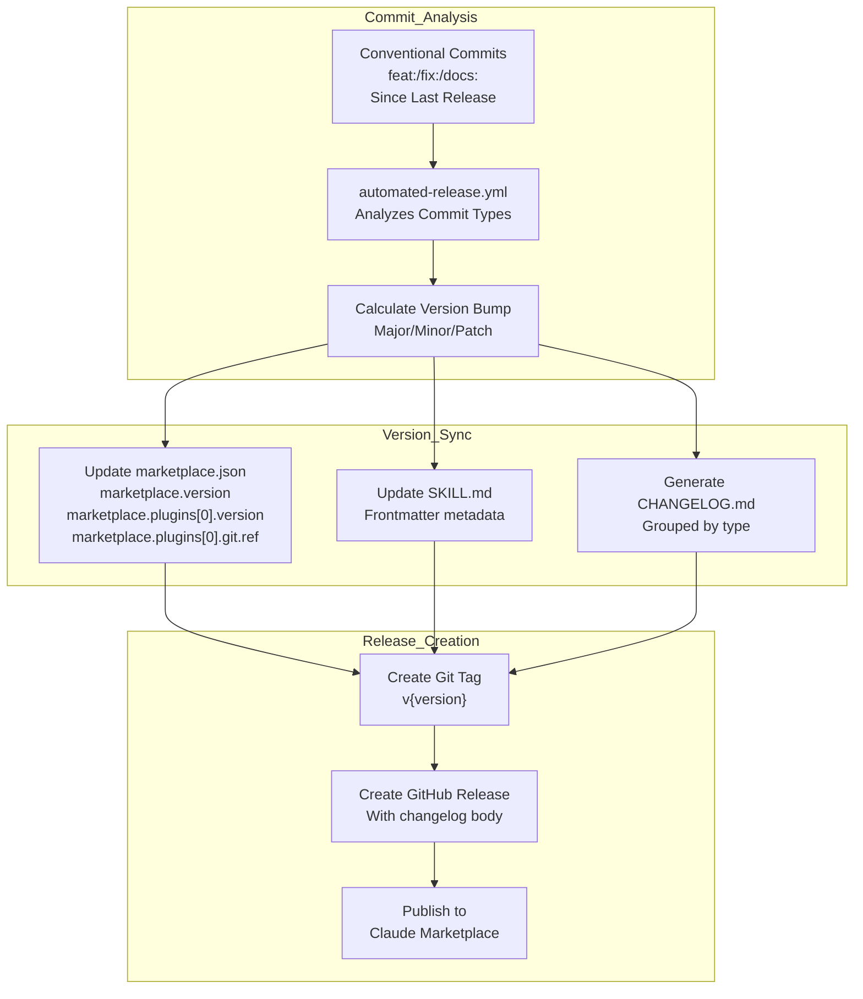
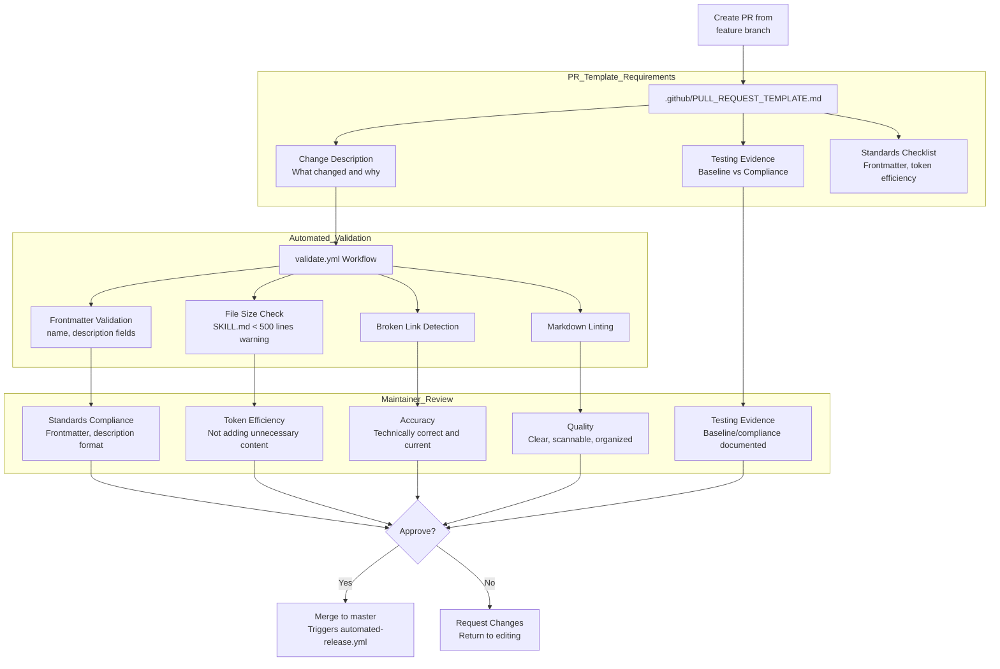
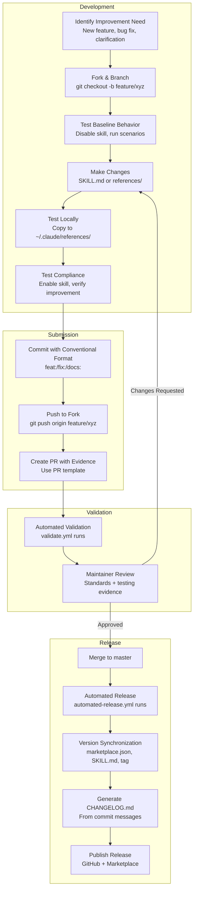

<!-- source: DeepWiki mcp.deepwiki.com · repo antonbabenko/terraform-skill · page 5 Development Guide · fetched 2026-10-26 -->

# Development Guide

<details>
<summary>Relevant source files</summary>

The following files were used as context for generating this wiki page:

- [CLAUDE.md](CLAUDE.md)
- [CONTRIBUTING.md](CONTRIBUTING.md)

</details>


This document provides comprehensive guidance for contributors developing and maintaining the terraform-skill codebase. It covers the unique development philosophy of "prompt engineering as infrastructure", content quality standards, the mandatory testing methodology, and the complete contribution workflow from initial changes through automated release.

For installation and usage information, see [Getting Started](#2). For details on the automation systems that validate and release changes, see [Automation Systems](#6).

---

## Overview

The terraform-skill repository is fundamentally different from traditional software projects. It contains **executable documentation** that Claude loads to provide Terraform/OpenTofu expertise. This creates unique development requirements where content changes must be validated through agent behavior testing rather than traditional unit tests.

**Development Context Diagram**



**Sources:** [CLAUDE.md:1-346](), [CONTRIBUTING.md:1-384]()

---

## Development Philosophy

### Prompt Engineering as Infrastructure

The repository implements "prompt engineering as infrastructure" - version-controlled AI instructions that encode domain knowledge into Claude's context. This approach treats documentation as:

- **Executable artifacts**: Content directly affects Claude's behavior
- **Domain knowledge encoding**: Distills terraform-best-practices.com into reusable guidance
- **Meta-project**: Building instructions for an AI assistant rather than traditional software

**Sources:** [CLAUDE.md:7-14]()

### Content Philosophy

Content decisions follow a strict framework defining what belongs in the skill versus what should be excluded:

| Category | Include | Exclude |
|----------|---------|---------|
| **Patterns** | Terraform-specific idioms, version features | Generic programming advice |
| **Guidance** | Decision frameworks (when X vs Y) | Terraform syntax basics |
| **Examples** | ✅ DO vs ❌ DON'T side-by-side | Provider resource details (use MCP) |
| **Reference** | Quick reference tables, decision matrices | Obvious practices ("use version control") |
| **Format** | Scannable tables, headers, bullets | Long prose explanations |

**Key Principles:**

- **Imperative voice**: "Use underscores" not "You should consider underscores"
- **Scannable format**: Tables over paragraphs, visual hierarchy with ✅/❌
- **Version markers**: Always indicate version requirements (e.g., "Terraform 1.6+")
- **Concrete examples**: Real scenarios with inline comments explaining WHY

**Sources:** [CLAUDE.md:83-109](), [CLAUDE.md:125-159](), [CONTRIBUTING.md:193-242]()

### Progressive Disclosure Architecture

The skill uses a three-tier loading strategy to optimize token usage:



This architecture keeps `SKILL.md` under 500 lines (currently 524) while providing ~30.4K tokens of total content through progressive disclosure.

**Sources:** [CLAUDE.md:45-82](), [CLAUDE.md:313-327]()

---

## Content Standards

### File Organization Structure



**Sources:** [CLAUDE.md:16-32](), [CONTRIBUTING.md:92-110]()

### Frontmatter Requirements

The `SKILL.md` frontmatter is strictly limited to two fields per official Claude skill standards:

```yaml
---
name: terraform-skill
description: Use when working with Terraform or OpenTofu - creating modules,
  writing tests...
---
```

**Critical Rules:**

| Field | Required | Format |
|-------|----------|--------|
| `name` | ✅ Yes | Letters, numbers, hyphens only |
| `description` | ✅ Yes | Start with "Use when..." and list triggers |
| `author` | ❌ No | Put in README.md instead |
| `version` | ❌ No | Managed by [.github/workflows/automated-release.yml]() |
| `license` | ❌ No | Put in README.md and LICENSE |

**Description Best Practices:**

The description must focus on **WHEN to use** (activation triggers), not **WHAT it does** (feature summary):

✅ **Good:** "Use when working with Terraform or OpenTofu - creating modules, writing tests (native test framework, Terratest), setting up CI/CD pipelines, reviewing configurations..."

❌ **Bad:** "Comprehensive skill for Terraform development covering testing, modules, CI/CD, and production patterns"

**Sources:** [CONTRIBUTING.md:34-78]()

### Token Efficiency Guidelines

**Target Metrics:**

| File | Line Limit | Token Budget | Current Status |
|------|------------|--------------|----------------|
| `SKILL.md` | <500 lines | ~4,400 tokens | 524 lines (justified) |
| Total core | <1,500 words | - | ~1,400 words |
| Reference files | No limit | ~26K tokens | 4,091 lines across 6 files |

**Optimization Techniques:**

1. **Progressive disclosure**: Move detailed content to [references/*.md]()
2. **Table compression**: Use tables instead of prose for comparisons
3. **Link sections**: Pipe-separated lists instead of verbose formatting
4. **Reference over repeat**: Link to other files instead of duplicating content

The current 524 lines in `SKILL.md` (24 lines over guideline) is justified by:
- Comprehensive decision matrices for testing strategy and `count` vs `for_each`
- Essential quick reference tables used in every session
- Version-specific guidance across multiple Terraform versions
- Progressive disclosure architecture minimizes actual token cost

**Sources:** [CONTRIBUTING.md:80-91](), [CLAUDE.md:65-82](), [CLAUDE.md:313-327]()

### Writing Style Requirements

**Code Example Standards:**

One excellent example beats many mediocre ones. Every code example must be:

- **Complete and runnable**: Not pseudo-code or fill-in-the-blank templates
- **Well-commented**: Explain WHY, not just what
- **Real scenario**: From actual use cases, not contrived
- **Pattern clarity**: Shows the pattern clearly for adaptation

**Formatting Standards:**



**Sources:** [CLAUDE.md:125-159](), [CONTRIBUTING.md:195-242]()

---

## Testing Methodology

### The Iron Law: No Changes Without Testing First

**Absolute Rule:** NO CHANGES WITHOUT TESTING FIRST

This applies to:
- ✅ New content additions
- ✅ Edits to existing content  
- ✅ Reorganization or refactoring
- ✅ "Simple" documentation updates

**No exceptions.**

**Sources:** [CONTRIBUTING.md:112-125]()

### TDD for Documentation

This project implements Test-Driven Development for documentation content. Per official Claude skill standards (writing-skills reference), the workflow follows red-green-refactor:

**Testing Workflow Diagram**



**Sources:** [CONTRIBUTING.md:126-192]()

### Baseline vs Compliance Testing

**Testing Process:**

1. **Identify Scenarios**: Review [tests/baseline-scenarios.md]() for affected scenarios
2. **Run Baseline**: Execute scenarios WITHOUT changes, document agent behavior
3. **Apply Changes**: Make edits to `SKILL.md` or [references/*.md]()
4. **Run Compliance**: Execute same scenarios WITH changes
5. **Verify Improvement**: Compare baseline vs compliance behavior
6. **Document**: Include evidence in PR description

**Verification Criteria:**

| Check | Question | Required Evidence |
|-------|----------|-------------------|
| **Follows Guidance** | Does agent apply new patterns? | Compliance output shows pattern usage |
| **Proactive Application** | Agent suggests patterns unprompted? | Compliance shows unprompted recommendations |
| **No Rationalizations** | Agent inventing excuses for non-compliance? | None found or documented in [tests/rationalization-table.md]() |
| **Behavior Improvement** | Clear improvement over baseline? | Side-by-side comparison in PR |

**Testing Checklist for PRs:**

Every pull request must include:

- [ ] Identified affected scenarios from [tests/baseline-scenarios.md]()
- [ ] Ran baseline WITHOUT changes (documented in [tests/baseline-results/]())
- [ ] Applied changes to [SKILL.md]() or [references/*.md]()
- [ ] Ran compliance WITH changes (documented in [tests/compliance-results/]())
- [ ] Verified behavior improvement (evidence in PR description)
- [ ] No new rationalizations discovered (or documented in [tests/rationalization-table.md]())
- [ ] Re-tested if rationalizations found (closed loopholes)

**Sources:** [CONTRIBUTING.md:136-192]()

### Why Testing Matters

Without testing, content changes are unvalidated assumptions. Testing proves that:

1. Changes actually improve agent behavior (not just theory)
2. Patterns are applied correctly by Claude
3. No unintended behavior regressions introduced
4. Agent doesn't rationalize non-compliance

This is fundamentally different from traditional documentation because **the content directly controls an AI agent's behavior**. Changes that seem clear to humans may not translate to agent understanding.

**Sources:** [CONTRIBUTING.md:126-135]()

---

## Contribution Workflow

### Fork and Branch Strategy

**Initial Setup:**

```bash
# Fork repository on GitHub
# Clone your fork
git clone https://github.com/YOUR_USERNAME/terraform-skill
cd terraform-skill

# Create feature branch
git checkout -b feature/improve-testing-guidance
```

**Branch Naming:**
- `feature/*` - New features or content
- `fix/*` - Bug fixes or corrections
- `docs/*` - Documentation improvements
- `refactor/*` - Reorganization without content changes

**Sources:** [CLAUDE.md:268-274](), [CONTRIBUTING.md:310-315]()

### Local Development and Testing

**Development Loop:**



**Local Testing Commands:**

```bash
# Copy to Claude skills directory
cp -r . ~/.claude/references/terraform-skill/

# Claude Code auto-reloads on file changes
# Test with real queries in Claude Code interface

# Check token count
wc -c SKILL.md  # Currently ~17,700 chars ≈ 4,400 tokens
```

**Sources:** [CLAUDE.md:176-198](), [CLAUDE.md:282-287]()

### Conventional Commits for Automated Versioning

This project uses [Conventional Commits](https://www.conventionalcommits.org/) to drive automated versioning and changelog generation.

**Commit Format:**

```
<type>: <description>

[optional body]

[optional footer]
```

**Type Definitions:**

| Type | Version Bump | Use For | Example |
|------|--------------|---------|---------|
| `feat!:` or `BREAKING CHANGE:` | Major (1.x → 2.0) | Breaking changes | `feat!: remove deprecated test framework guidance` |
| `feat:` | Minor (1.2.x → 1.3.0) | New features | `feat: add OpenTofu 1.8 support` |
| `fix:` | Patch (1.2.3 → 1.2.4) | Bug fixes | `fix: correct module output syntax` |
| `docs:` | Patch | Documentation only | `docs: improve testing strategy docs` |
| `chore:` | Patch | Maintenance, tooling | `chore: update workflow dependencies` |
| `test:` | Patch | Test improvements | `test: add security scanning scenarios` |
| `refactor:` | Patch | Code refactoring | `refactor: reorganize reference files` |

**Conventional Commit Examples:**

```bash
# Feature (minor version bump)
git commit -m "feat: add OpenTofu 1.8 support"

# Bug fix (patch version bump)
git commit -m "fix: correct module output syntax in examples"

# Breaking change (major version bump)
git commit -m "feat!: remove deprecated test framework guidance"

# With detailed description
git commit -m "feat: add native testing examples

- Add examples for Terraform 1.6+ native tests
- Include decision matrix for test framework selection
- Document best practices for test organization"

# Documentation only
git commit -m "docs: improve testing strategy documentation"
```

**Sources:** [CONTRIBUTING.md:243-308]()

### Automated Version Synchronization

**Conventional commits enable:**



Contributors don't manage versions manually. The [.github/workflows/automated-release.yml]() workflow:

1. Analyzes commits since last release
2. Determines version bump from commit types
3. Updates version in three locations:
   - [.claude-plugin/marketplace.json]() (marketplace, plugin, git ref)
   - [SKILL.md]() (frontmatter metadata if present)
   - Git tag
4. Generates [CHANGELOG.md]() from commit messages
5. Creates GitHub Release with changelog

**Sources:** [CONTRIBUTING.md:293-362]()

### Pull Request Process

**PR Submission Flow:**



**Review Criteria:**

| Criterion | Validation | Required Evidence |
|-----------|------------|-------------------|
| **Standards Compliance** | [.github/workflows/validate.yml]() | Frontmatter correct, description format proper |
| **Testing Evidence** | Manual review | Baseline vs compliance documented in PR |
| **Token Efficiency** | Manual review | Changes don't add unnecessary content |
| **Technical Accuracy** | Manual review | Content is correct and current |
| **Content Quality** | Manual review | Clear, scannable, well-organized |

**Sources:** [CONTRIBUTING.md:309-362](), [.github/PULL_REQUEST_TEMPLATE.md]()

### Complete Contribution Lifecycle

**End-to-End Workflow:**



**Timeline:**

1. **Development**: Local testing and iteration (1-2 hours to days depending on scope)
2. **Submission**: Create PR with complete testing evidence (15-30 minutes)
3. **Validation**: Automated checks run immediately, manual review within 1-3 days
4. **Release**: Fully automated on merge, completes in ~2 minutes

**Sources:** [CLAUDE.md:160-310](), [CONTRIBUTING.md:1-384]()

---

## Quality Standards Checklist

Before submitting a pull request, verify all standards are met:

### Content Quality

- [ ] Decision frameworks are clear and actionable
- [ ] Examples are accurate and tested in real scenarios
- [ ] No outdated information (verify current Terraform/OpenTofu versions)
- [ ] Version-specific guidance clearly marked (e.g., "Terraform 1.6+")
- [ ] Common pitfalls documented with explanations
- [ ] ✅ DO vs ❌ DON'T examples for non-obvious patterns

### Technical Quality

- [ ] Code examples are syntactically correct
- [ ] Commands follow current best practices
- [ ] Links to official documentation work
- [ ] Tools referenced are current (not deprecated)
- [ ] No breaking changes without justification

### Testing Quality

- [ ] Baseline behavior documented in [tests/baseline-results/]()
- [ ] Compliance behavior documented in [tests/compliance-results/]()
- [ ] Evidence of improvement included in PR description
- [ ] No rationalizations discovered (or tracked in [tests/rationalization-table.md]())
- [ ] Re-tested if loopholes closed

### Usability

- [ ] Clear activation triggers in description
- [ ] Quick reference sections are scannable
- [ ] Logical organization maintained
- [ ] Consistent markdown formatting
- [ ] Headers provide clear navigation

### Legal

- [ ] License clearly stated (Apache 2.0)
- [ ] Sources attributed where applicable
- [ ] Copyright notice current
- [ ] No copyrighted content without permission

**Sources:** [CLAUDE.md:233-264](), [CONTRIBUTING.md:181-192](), [CONTRIBUTING.md:338-346]()

---

## When to Update vs When Not to Update

**Update the skill when:**

| Condition | Example | Action |
|-----------|---------|--------|
| **Major/minor version features** | Terraform 1.10 adds new testing syntax | Add version-specific guidance |
| **Community consensus emerges** | New module pattern becomes standard | Document pattern with decision framework |
| **Real-world gaps discovered** | Users consistently hit undocumented issue | Add troubleshooting guidance |
| **Anti-patterns identified** | Common mistake causing problems | Add ❌ DON'T example with explanation |

**Don't update for:**

| Condition | Reason | Alternative |
|-----------|--------|-------------|
| **Provider resource changes** | Use Terraform MCP tools for registry docs | Reference MCP tool in skill |
| **Patch versions without features** | No behavioral changes to document | Wait for feature releases |
| **Personal preferences** | Not community consensus | Discuss in GitHub Discussions first |
| **Duplicate Claude knowledge** | Claude already knows generic concepts | Focus on Terraform-specific content |

**Sources:** [CLAUDE.md:200-212]()

---

## Development Environment Setup

**Prerequisites:**

- Git installed and configured
- GitHub account with fork of [antonbabenko/terraform-skill]()
- Claude Code installed with skills support
- Text editor (VS Code, vim, etc.)
- Basic familiarity with Terraform/OpenTofu

**Setup Steps:**

```bash
# 1. Fork repository on GitHub
# 2. Clone your fork
git clone https://github.com/YOUR_USERNAME/terraform-skill
cd terraform-skill

# 3. Link to upstream for updates
git remote add upstream https://github.com/antonbabenko/terraform-skill

# 4. Create development directory in Claude
mkdir -p ~/.claude/references/terraform-skill

# 5. Link or copy for testing
ln -s $(pwd) ~/.claude/references/terraform-skill-dev
# OR
cp -r . ~/.claude/references/terraform-skill/

# 6. Create feature branch
git checkout -b feature/your-improvement
```

**Testing Setup:**

- Claude Code will auto-reload skills on file changes
- Test queries: "Create Terraform module with tests", "Review this config"
- Observe if Claude references the skill in responses
- Verify patterns are applied correctly

**Sources:** [CLAUDE.md:176-198](), [CLAUDE.md:282-287]()

---

## Additional Resources

**For Contributors:**
- [CLAUDE.md]() - Detailed development guidelines and architecture decisions
- [CONTRIBUTING.md]() - Contribution standards and process
- [tests/baseline-scenarios.md]() - Testing scenarios for validation
- [.github/PULL_REQUEST_TEMPLATE.md]() - PR checklist and requirements

**External Standards:**
- [Claude Code Skills Documentation](https://docs.claude.ai/docs/agent-skills)
- writing-skills (reference skill for skill development)
- [Conventional Commits Specification](https://www.conventionalcommits.org/)

**Community:**
- [GitHub Issues](https://github.com/antonbabenko/terraform-skill/issues) - Bug reports and feature requests
- [GitHub Discussions](https://github.com/antonbabenko/terraform-skill/discussions) - Questions and discussions
- Maintainer: [@antonbabenko](https://github.com/antonbabenko)

**Sources:** [CLAUDE.md:337-341](), [CONTRIBUTING.md:363-378]()

---

