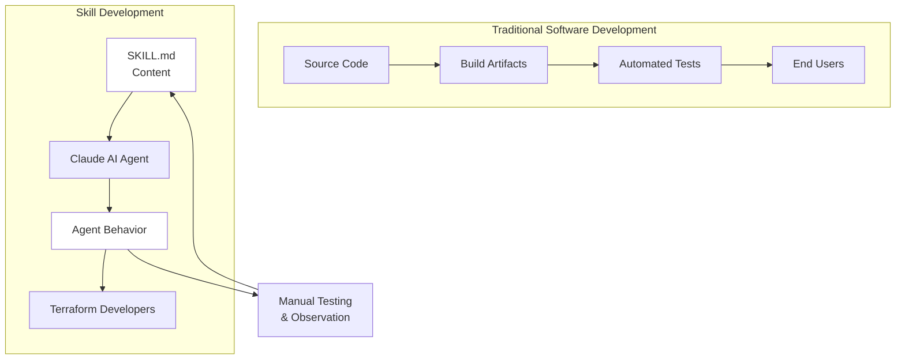
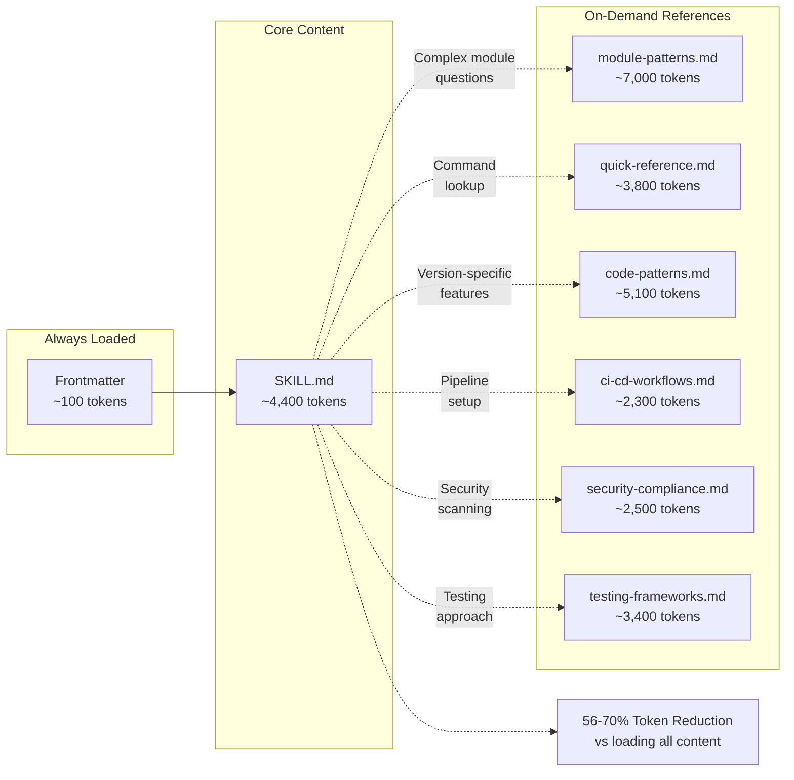
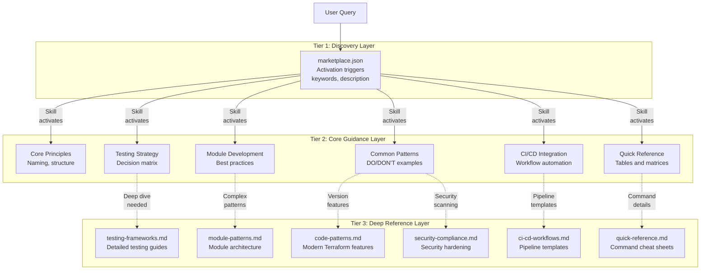
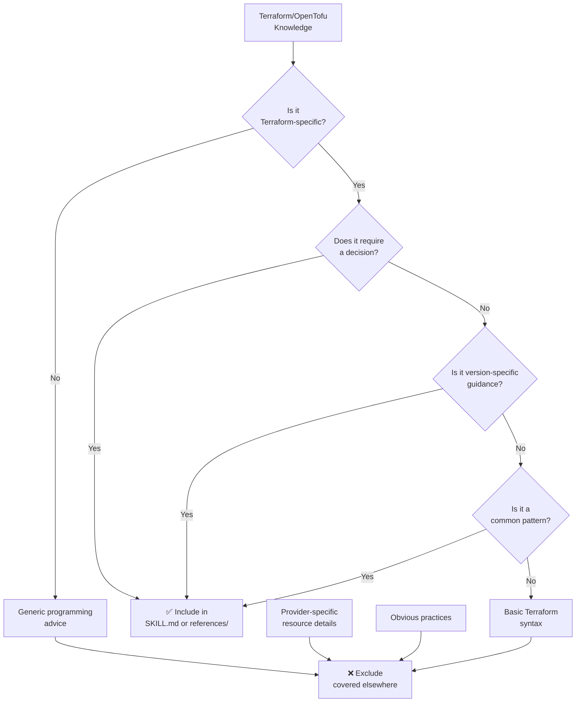
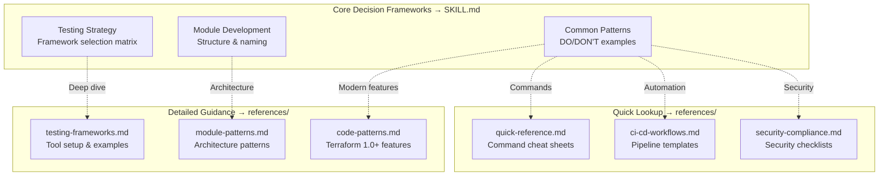
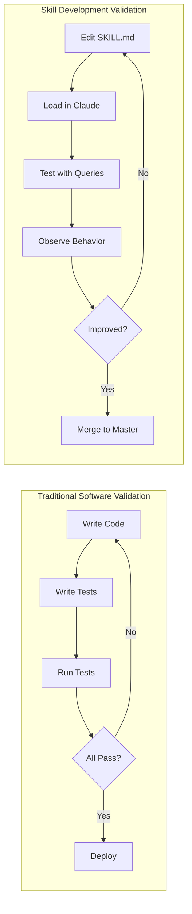

<!-- source: DeepWiki mcp.deepwiki.com · repo antonbabenko/terraform-skill · page 5.1 Development Philosophy · fetched 2026-10-26 -->

# Development Philosophy

Relevant source files

The following files were used as context for generating this wiki page:

- [CLAUDE.md](CLAUDE.md)
- [CONTRIBUTING.md](CONTRIBUTING.md)

## Purpose and Scope

This page explains the foundational philosophy behind developing terraform-skill, focusing on how prompt engineering principles guide architecture decisions, content organization, and development practices. For specific content requirements and standards, see [Content Standards](#5.2). For testing procedures, see [Testing Methodology](#5.3). For the contribution process, see [Contribution Workflow](#5.4).

## Core Concept: Prompt Engineering as Infrastructure

The terraform-skill repository embodies a paradigm shift from traditional software development to **executable documentation**. This is not a software library or framework—it is version-controlled AI instructions that shape how Claude understands and applies Terraform/OpenTofu best practices.

### The Meta-Project Nature

**Sources:** [CLAUDE.md:7-14](), [CLAUDE.md:162-174]()

As stated in [CLAUDE.md:9-13](), this represents three key concepts:

- **Prompt engineering as infrastructure**: Version-controlled AI instructions that persist across sessions
- **Domain knowledge artifact**: Encoding terraform-best-practices.com expertise into Claude's context window
- **Meta-project**: Building instructions for an AI assistant, not building software itself

This fundamental distinction drives every architectural and content decision.

### What This Means in Practice

| Traditional Software | Terraform Skill |
|---------------------|-----------------|
| Write code → Compile → Test | Write content → Load in Claude → Observe behavior |
| Unit tests verify behavior | Manual scenarios verify Claude's responses |
| Build artifacts are deployed | Content is loaded into context window |
| Users call functions | Claude reads and applies patterns |
| Versioning based on API compatibility | Versioning based on Terraform feature support |

The development workflow reflects this [CLAUDE.md:162-174]():

1. Update `SKILL.md` or reference files
2. Load in Claude Code (reload skills)
3. Test on real Terraform projects
4. Observe if Claude applies patterns correctly
5. Iterate based on results

**Sources:** [CLAUDE.md:162-174](), [CONTRIBUTING.md:115-125]()

## Token Efficiency as First Principle

Token efficiency is not a performance optimization—it is the **fundamental constraint** that drives the entire architecture. Every design decision flows from the need to maximize expertise delivery within Claude's context window limits.

### Token Budget Architecture

**Token Budget Breakdown** from [CLAUDE.md:65-81]():

| Content Layer | Token Count | Loading Strategy |
|--------------|-------------|------------------|
| Frontmatter (YAML) | ~100 tokens | Always loaded (activation trigger) |
| SKILL.md core | ~4,400 tokens | Loaded when skill activates |
| module-patterns.md | ~7,000 tokens | On-demand only |
| quick-reference.md | ~3,800 tokens | On-demand only |
| code-patterns.md | ~5,100 tokens | On-demand only |
| ci-cd-workflows.md | ~2,300 tokens | On-demand only |
| security-compliance.md | ~2,500 tokens | On-demand only |
| testing-frameworks.md | ~3,400 tokens | On-demand only |
| **Total Available** | ~30,400 tokens | Progressive disclosure |
| **Typical Query** | 4,500-12,000 tokens | 56-70% savings |

**Sources:** [CLAUDE.md:65-81]()

### The 500-Line Guideline

The target of keeping `SKILL.md` under 500 lines [CLAUDE.md:76]() is not arbitrary—it represents a balance point where:

- Core decision frameworks remain comprehensive
- Quick reference tables stay accessible
- Version-specific guidance is included
- Progressive disclosure remains effective

The current implementation at 524 lines [CLAUDE.md:319-325]() is justified because the extra 24 lines provide:
- Comprehensive testing decision matrices
- Essential quick reference tables
- Multi-version Terraform support

As noted in [CLAUDE.md:324-325](): "Future updates should prioritize reference file expansion over core skill growth."

**Sources:** [CLAUDE.md:76](), [CLAUDE.md:319-328]()

## Progressive Disclosure Architecture

Progressive disclosure is the architectural pattern that makes token efficiency practical. Content is organized in layers of increasing detail, loaded only when Claude needs it.

### Three-Tier Content Architecture

**Sources:** [CLAUDE.md:45-63](), [CLAUDE.md:111-123]()

### Content Distribution Strategy

The organization in [CLAUDE.md:111-123]() defines clear boundaries for each tier:

**Tier 1 - Always Loaded:**
- Activation triggers define when Claude should use this skill
- Keywords enable skill discovery
- ~100 tokens, negligible cost

**Tier 2 - Core SKILL.md (Loaded on Activation):**
- Testing Strategy Framework - decision matrices for choosing approaches
- Module Development - essential patterns and structure
- Common Patterns - ✅ DO vs ❌ DON'T side-by-side examples
- CI/CD Integration - workflow automation overview
- Quick Reference - rapid consultation tables

**Tier 3 - References Directory (Loaded on Demand):**
- Deep-dive content for specific topics
- Detailed examples and templates
- Version-specific feature documentation
- Tool-specific integration guides

**Sources:** [CLAUDE.md:111-123]()

## Content Philosophy: What Belongs Where

The content philosophy directly implements token efficiency through strict inclusion criteria. Not all Terraform knowledge belongs in this skill.

### Inclusion Criteria

**Sources:** [CLAUDE.md:86-109]()

### What Belongs in SKILL.md

From [CLAUDE.md:86-100](), content must meet these criteria:

**✅ Include:**
- Terraform-specific patterns and idioms (not generic programming advice)
- Decision frameworks (when to use X vs Y, with clear criteria)
- Version-specific features (Terraform 1.6+, 1.9+, etc. with markers)
- Testing strategy workflows (framework selection matrices)
- ✅ DO vs ❌ DON'T examples (for non-obvious patterns)
- Quick reference tables and decision matrices (scannable format)

**Format Requirements:**
- Scannable format (tables, headers, visual hierarchy)
- Imperative voice ("Use X", not "You should consider X")
- Concrete examples with inline comments explaining WHY
- Version requirements clearly marked (e.g., "Terraform 1.6+")

### What Doesn't Belong

From [CLAUDE.md:101-109](), these are explicitly excluded:

**❌ Exclude:**
- Generic programming advice (covered by Claude's base knowledge)
- Terraform syntax basics (covered in official documentation)
- Provider-specific resource details (use MCP tools for registry docs)
- Obvious practices (e.g., "use version control")
- Long prose explanations (use tables instead for scannability)

**Sources:** [CLAUDE.md:86-109]()

### File Organization Mapping

**Sources:** [CLAUDE.md:16-43](), [CONTRIBUTING.md:92-110]()

## Development Mindset Shift

Developing a Claude skill requires abandoning traditional software development mental models and adopting a documentation-centric, observation-based approach.

### Traditional Software vs Skill Development

| Aspect | Traditional Software | Skill Development |
|--------|---------------------|-------------------|
| **Artifact Type** | Executable code | Instructional content |
| **Quality Assurance** | Automated unit tests | Manual behavioral observation |
| **Validation** | Test suite passes | Claude applies patterns correctly |
| **Deployment** | Build → Deploy pipeline | Load into context window |
| **Versioning** | Semantic versioning based on API | Semantic versioning based on content |
| **Dependencies** | Code libraries | Terraform/OpenTofu version features |
| **Failure Mode** | Runtime errors, exceptions | Claude misunderstands or ignores guidance |
| **Debugging** | Stack traces, logs | Re-test scenarios, observe responses |
| **Performance** | Execution speed, memory | Token efficiency, context window usage |

**Sources:** [CLAUDE.md:162-174]()

### The Testing-First Philosophy

From [CONTRIBUTING.md:115-125](), the development philosophy enforces an "Iron Law":

**NO CHANGES WITHOUT TESTING FIRST**

This applies to all changes:
- ✅ New content additions
- ✅ Edits to existing content
- ✅ Reorganization or refactoring
- ✅ "Simple" documentation updates

This is **TDD for documentation** [CONTRIBUTING.md:128-133]():

1. **RED:** Run scenarios WITHOUT your changes (document baseline behavior)
2. **GREEN:** Add changes, verify behavior improves (document compliance behavior)
3. **REFACTOR:** Close loopholes, re-test if rationalizations found

For detailed testing procedures, see [Testing Methodology](#5.3).

**Sources:** [CONTRIBUTING.md:115-133]()

### Observation-Based Validation

From [CLAUDE.md:178-194](), the validation workflow is:

1. **Load the updated skill** (Claude Code auto-reloads on file changes)
2. **Test with real queries** (e.g., "Create a Terraform module with tests")
3. **Verify Claude references the skill** (check if new patterns appear in responses)
4. **Check token count** (`wc -c SKILL.md` should be ~17,700 chars ≈ 4,400 tokens)

**Sources:** [CLAUDE.md:178-198](), [CONTRIBUTING.md:162-175]()

## Update Triggers and Evolution

The philosophy for when to update the skill reflects its nature as a knowledge artifact that must stay current with ecosystem changes.

### When to Update

From [CLAUDE.md:200-211](), update triggers are strictly defined:

**✅ Update the skill when:**
- New Terraform/OpenTofu major or minor versions introduce features
- Community consensus emerges on patterns (documented in terraform-best-practices.com)
- Real-world usage reveals gaps or ambiguities in guidance
- Anti-patterns discovered that should be warned against

**❌ Don't update for:**
- Provider-specific resource changes (use Terraform MCP tools instead)
- Minor version patches without feature changes
- Personal preferences without community consensus

This ensures the skill remains authoritative while avoiding opinion-based content.

**Sources:** [CLAUDE.md:200-211](), [CONTRIBUTING.md:14-30]()

### Maintaining Balance

From [CLAUDE.md:313-328](), the evolution strategy balances competing concerns:

**Tension Areas:**
- **Completeness** vs **Token efficiency** (more content vs context window limits)
- **Detail** vs **Scannability** (comprehensive vs quickly readable)
- **Examples** vs **Reference** (concrete vs concise)

**Current Sweet Spot:**
- `SKILL.md`: 524 lines, ~4.4K tokens (comprehensive core guidance)
- Reference files: 6 files, ~26K tokens (deep-dive content)
- Progressive disclosure: 56-70% token reduction vs loading all content
- Total coverage: ~30.4K tokens structured for progressive loading

**Long-term Vision** [CLAUDE.md:329-335]():
- Stay current with Terraform/OpenTofu releases
- Remain the definitive Claude resource for Terraform
- Evolve with community consensus
- Maintain production-grade quality standards

**Sources:** [CLAUDE.md:313-335]()

## Integration with MCP Tools

The skill philosophy explicitly defines complementary boundaries with Terraform MCP (Model Context Protocol) tools, avoiding duplication while enabling synergy.

### Division of Responsibilities

From [CLAUDE.md:213-225]():

| Capability | Skill | MCP Tools |
|------------|-------|-----------|
| Best practices | ✅ | ❌ |
| Code patterns | ✅ | ❌ |
| Testing workflows | ✅ | ❌ |
| Latest versions | ❌ | ✅ |
| Registry documentation | ❌ | ✅ |
| Module search | ❌ | ✅ |

**Together they enable** [CLAUDE.md:226-230]():
- Code generation following best practices (skill provides patterns)
- Up-to-date version constraints (MCP provides current data)
- Framework selection guidance (skill provides decision matrices)
- Proactive anti-pattern detection (skill provides warnings)

This philosophical separation keeps the skill focused on **timeless principles and patterns** while MCP tools handle **current data and registry lookups**.

**Sources:** [CLAUDE.md:213-230]()

## Summary

The development philosophy for terraform-skill fundamentally rests on these principles:

1. **Prompt Engineering as Infrastructure** - Version-controlled AI instructions, not traditional software
2. **Token Efficiency First** - Every architectural decision flows from context window constraints
3. **Progressive Disclosure** - Three-tier content architecture (metadata → core → references)
4. **Strict Inclusion Criteria** - Only Terraform-specific patterns and decision frameworks
5. **Testing-First Mindset** - No changes without baseline vs compliance evidence
6. **Observation-Based Validation** - Manual testing with real queries replaces automated tests
7. **Ecosystem Awareness** - Clear boundaries with MCP tools to avoid duplication

These principles guide all specific standards, testing methodologies, and contribution workflows detailed in subsequent sections.

**Sources:** [CLAUDE.md:1-346](), [CONTRIBUTING.md:1-384]()

---

