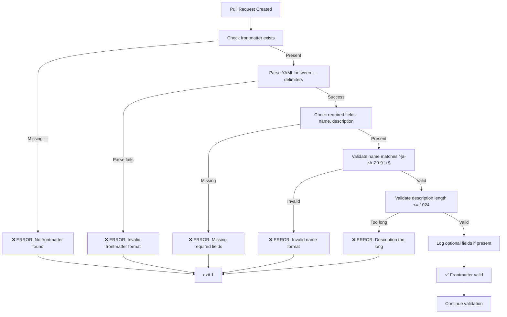
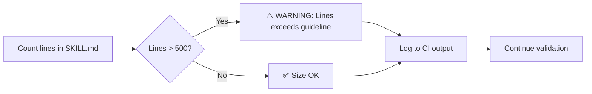
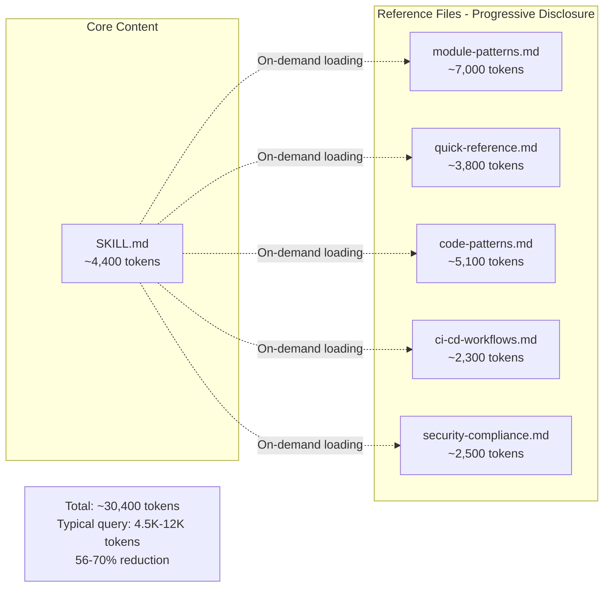
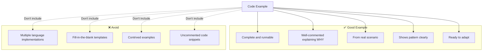
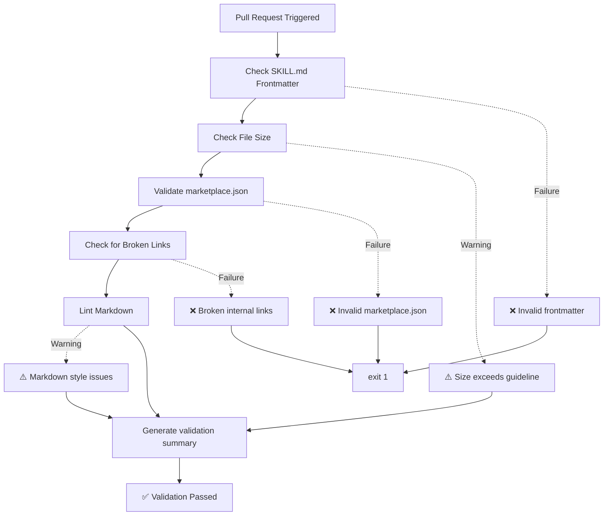
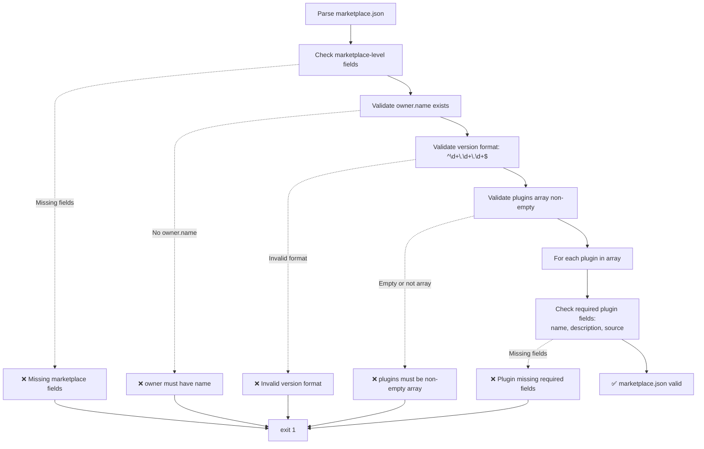
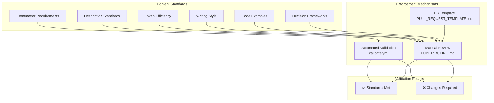

<!-- source: DeepWiki mcp.deepwiki.com · repo antonbabenko/terraform-skill · page 5.2 Content Standards · fetched 2026-10-26 -->

# Content Standards

<details>
<summary>Relevant source files</summary>

The following files were used as context for generating this wiki page:

- [.github/workflows/validate.yml](.github/workflows/validate.yml)
- [CONTRIBUTING.md](CONTRIBUTING.md)

</details>


## Purpose and Scope

This document defines the technical standards for all content in the terraform-skill repository. These standards ensure that skill content is Claude-compatible, token-efficient, and maintains consistent quality. This page covers frontmatter requirements, description format, writing style, code examples, and automated validation rules.

For broader principles behind these standards, see [Development Philosophy](#5.1). For testing requirements before submitting changes, see [Testing Methodology](#5.3). For the step-by-step PR process, see [Contribution Workflow](#5.4).

---

## Frontmatter Requirements

### Required Fields

The `SKILL.md` frontmatter MUST contain exactly two fields. Additional fields are prohibited and will cause validation failures.

**Required Structure:**

```yaml
---
name: terraform-skill
description: Use when working with Terraform or OpenTofu - creating modules,
  writing tests...
---
```

| Field | Format | Validation | Max Length |
|-------|--------|------------|------------|
| `name` | `[a-zA-Z0-9-]+` | Regex pattern match | N/A |
| `description` | Plain text | Must start with "Use when..." | 1024 characters |

**Sources:** [CONTRIBUTING.md:34-56](), [.github/workflows/validate.yml:34-92]()

### Prohibited Fields

The following fields are explicitly prohibited in `SKILL.md` frontmatter:

| Prohibited Field | Reason | Correct Location |
|------------------|--------|------------------|
| `author` | Not Claude standard | `README.md` |
| `version` | Auto-managed by workflow | `.claude-plugin/marketplace.json` |
| `license` | Not Claude standard | `LICENSE` file |
| `metadata.*` | Wastes tokens | N/A |

**Rationale:** Per Claude Code skill standards, only `name` and `description` are supported fields. Extra fields consume tokens without providing value to Claude's skill activation logic.

**Sources:** [CONTRIBUTING.md:49-56]()

### Frontmatter Validation Flow



**Sources:** [.github/workflows/validate.yml:34-92]()

---

## Description Standards

### Format Requirements

The `description` field serves as the skill activation trigger for Claude. It must follow a specific pattern to maximize effectiveness.

**Required Pattern:**

```
Use when [specific triggers/scenarios]
```

**Good Example:**

```yaml
description: >-
  Use when working with Terraform or OpenTofu - creating modules, writing
  tests (native test framework, Terratest), setting up CI/CD pipelines,
  reviewing configurations, choosing between testing approaches, debugging
  state issues, implementing security scanning (trivy, checkov), or making
  infrastructure-as-code architecture decisions
```

**Bad Example:**

```yaml
description: Comprehensive skill for Terraform development covering testing, modules, CI/CD, and production patterns
```

**Sources:** [CONTRIBUTING.md:58-78]()

### Trigger-Based Approach

The description must focus on **WHEN** to use the skill (triggers/symptoms), not **WHAT** it does (workflow summary).

| Approach | Focus | Example |
|----------|-------|---------|
| ✅ Correct | User symptoms and triggers | "Use when debugging state issues" |
| ❌ Incorrect | Capability summary | "Provides state management guidance" |

**Rationale:** Claude's skill activation system looks for pattern matches between user queries and description content. Symptom-based triggers have higher activation accuracy than abstract capability descriptions.

**Sources:** [CONTRIBUTING.md:78]()

---

## Token Efficiency Guidelines

### Target Metrics

| File | Current | Target | Warning Threshold |
|------|---------|--------|-------------------|
| `SKILL.md` | ~1,400 words | <1,500 words | 500 lines |
| `SKILL.md` | ~280 lines | N/A | 500 lines |

**Sources:** [CONTRIBUTING.md:80-90](), [.github/workflows/validate.yml:94-103]()

### File Size Validation



**Note:** Line count exceeding 500 triggers a warning but does not fail validation. This serves as a guideline for contributors.

**Sources:** [.github/workflows/validate.yml:94-103]()

### Token Reduction Techniques

| Technique | Description | Example Location |
|-----------|-------------|------------------|
| Progressive disclosure | Move detailed content to `references/*.md` | `references/module-patterns.md` |
| Table formatting | Use tables instead of prose | Module comparison tables |
| Link compression | Pipe-separated reference links | Quick reference sections |
| Cross-referencing | Reference existing files instead of duplicating | Internal file links |

**Current Token Distribution:**



**Sources:** [CONTRIBUTING.md:80-90]()

---

## File Organization Standards

### Directory Structure

```
terraform-skill/
├── SKILL.md                       # Core skill (<500 lines guideline)
├── references/                    # Reference files (progressive disclosure)
│   ├── testing-frameworks.md
│   ├── module-patterns.md
│   ├── ci-cd-workflows.md
│   ├── security-compliance.md
│   └── quick-reference.md
├── tests/                         # TDD testing framework
│   ├── baseline-scenarios.md
│   ├── compliance-verification.md
│   └── rationalization-table.md
└── .github/workflows/             # Automation
    ├── release.yml
    └── validate.yml
```

**Sources:** [CONTRIBUTING.md:92-110]()

### File Responsibility Matrix

| File Type | Purpose | Token Budget | Validation |
|-----------|---------|--------------|------------|
| `SKILL.md` | Core skill content loaded by Claude | ~4,400 tokens | Frontmatter, size checks |
| `references/*.md` | Detailed guidance loaded on-demand | ~7,000 tokens max | Link validation |
| `tests/*.md` | Testing scenarios and evidence | N/A | Not validated |
| `.claude-plugin/marketplace.json` | Plugin definition and versioning | ~100 tokens | JSON schema, version format |

**Sources:** [CONTRIBUTING.md:92-110]()

---

## Writing Style Standards

### Voice and Tone

**Imperative voice is required:**

| Style | Example | Usage |
|-------|---------|-------|
| ✅ Correct | "Use underscores in variable names" | All guidance |
| ❌ Incorrect | "You should consider using underscores" | Never use |
| ❌ Incorrect | "It's recommended to use underscores" | Never use |

**Rationale:** Imperative voice is more concise (fewer tokens) and provides clearer direction to Claude.

**Sources:** [CONTRIBUTING.md:197-199]()

### Scannable Formatting

All content must be structured for rapid scanning by Claude's attention mechanism:

| Format | Use For | Example |
|--------|---------|---------|
| Tables | Comparisons, decision matrices | Testing framework selection |
| ✅ DO vs ❌ DON'T | Side-by-side correct/incorrect patterns | Module structure examples |
| Code blocks with comments | Implementation examples | Terraform configurations |
| Clear section headers | Hierarchical organization | `## Testing Strategy` |

**Sources:** [CONTRIBUTING.md:201-206]()

### Version-Specific Markers

All version-dependent content must include explicit version markers:

**Pattern:**

```markdown
**Native Tests** (Terraform 1.6+, OpenTofu 1.6+)
```

**Required Format:**

- Feature name in bold
- Parenthetical version requirement
- Both Terraform and OpenTofu versions when applicable

**Sources:** [CONTRIBUTING.md:207-210]()

---

## Code Example Standards

### Quality Requirements

**"One excellent example beats many mediocre ones"**

| Requirement | Description | Validation |
|-------------|-------------|------------|
| Complete | Runnable without modifications | Manual review |
| Commented | Explains WHY, not just WHAT | Manual review |
| Real-world | From actual scenarios, not contrived | Manual review |
| Pattern clarity | Demonstrates pattern unambiguously | Manual review |
| Adaptable | Easy to modify for user's context | Manual review |

**Sources:** [CONTRIBUTING.md:213-227]()

### Good vs Bad Examples



**Sources:** [CONTRIBUTING.md:213-227]()

---

## Decision Framework Standards

### WHEN Information Requirement

All decision guidance must include WHEN information, not just HOW information:

| Component | Required | Example |
|-----------|----------|---------|
| When to use approach A vs B | ✅ Yes | "Use native tests when Terraform 1.6+" |
| Factors influencing decision | ✅ Yes | "Team Go expertise, existing test suite" |
| Tradeoffs and considerations | ✅ Yes | "Native tests: simpler but less flexible" |
| Implementation steps | ❌ No | Belongs in reference files |

**Sources:** [CONTRIBUTING.md:229-242]()

### Table-Based Decision Guidance

**Required Format:**

```markdown
| Your Situation | Recommended Approach |
|----------------|---------------------|
| Terraform 1.6+, simple logic | Native tests |
| Pre-1.6, Go expertise | Terratest |
```

**Pattern:**

1. Left column: User's context/situation
2. Right column: Specific recommendation
3. Rows: Exhaustive coverage of common scenarios

**Sources:** [CONTRIBUTING.md:236-242]()

---

## Validation System

### Automated Validation Checks



**Sources:** [.github/workflows/validate.yml:1-183]()

### Validation Components

| Check | File | Failure Behavior | Lines |
|-------|------|------------------|-------|
| Frontmatter validation | `validate.yml` | Fails CI | [.github/workflows/validate.yml:34-92]() |
| File size check | `validate.yml` | Warning only | [.github/workflows/validate.yml:94-103]() |
| marketplace.json validation | `validate.yml` | Fails CI | [.github/workflows/validate.yml:105-151]() |
| Broken link detection | `validate.yml` | Fails CI | [.github/workflows/validate.yml:153-166]() |
| Markdown linting | `validate.yml` | Warning only | [.github/workflows/validate.yml:168-176]() |

**Sources:** [.github/workflows/validate.yml:1-183]()

### marketplace.json Validation



**Sources:** [.github/workflows/validate.yml:105-151]()

### Validation Trigger Configuration

| Trigger | Paths Monitored | Behavior |
|---------|----------------|----------|
| Pull Request | `SKILL.md`, `references/**/*.md`, `.claude-plugin/**` | Full validation |
| Push to master/main | `SKILL.md`, `references/**/*.md`, `.claude-plugin/**` | Full validation |
| Manual dispatch | All files | Full validation |

**Sources:** [.github/workflows/validate.yml:3-15]()

---

## Content Standards Compliance Matrix



**Sources:** [.github/workflows/validate.yml:1-183](), [CONTRIBUTING.md:32-242]()

---

