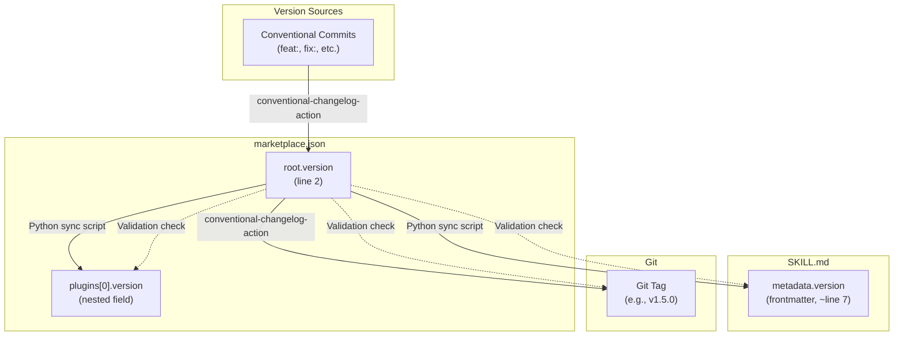
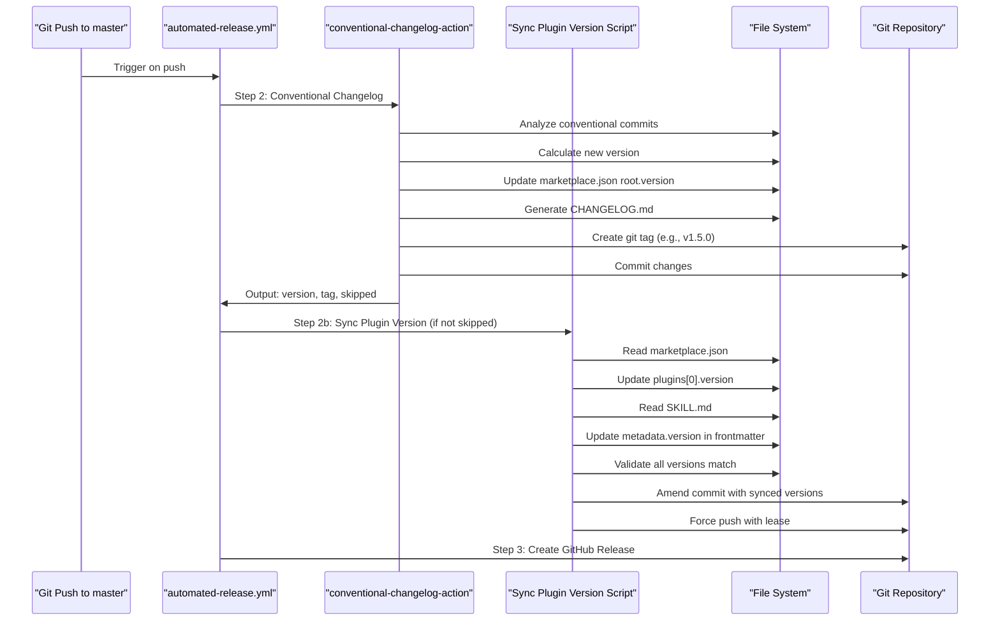
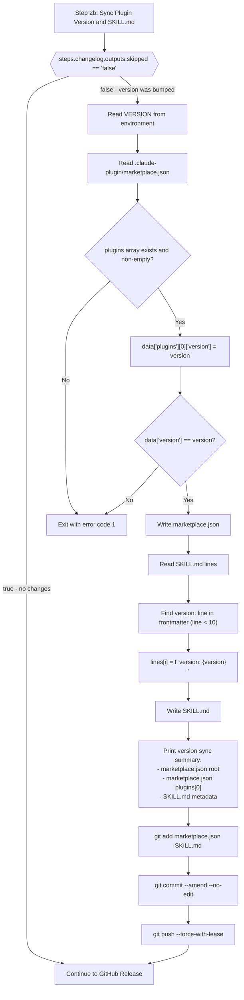
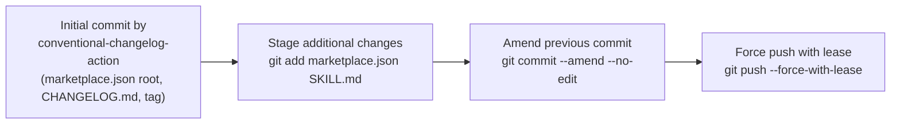

<!-- source: DeepWiki mcp.deepwiki.com · repo antonbabenko/terraform-skill · page 6.3 Version Synchronization · fetched 2026-10-26 -->

# Version Synchronization

<details>
<summary>Relevant source files</summary>

The following files were used as context for generating this wiki page:

- [.github/workflows/automated-release.yml](.github/workflows/automated-release.yml)
- [CHANGELOG.md](CHANGELOG.md)

</details>


## Purpose and Scope

This document describes the three-way version synchronization mechanism that keeps version identifiers consistent across `.claude-plugin/marketplace.json`, `SKILL.md` metadata, and Git tags. This synchronization is critical for ensuring Claude Code can properly resolve and load the skill at the correct version.

For information about the automated release workflow that triggers this synchronization, see [Release Automation](#6.2). For details on marketplace.json structure and validation, see [Plugin Definition System](#3.1).

---

## Version Synchronization Architecture

The terraform-skill repository maintains version consistency across three distinct locations, each serving a different purpose in the Claude Code plugin ecosystem.

### Version Location Diagram



**Sources:** [.github/workflows/automated-release.yml:34-50](), [.github/workflows/automated-release.yml:56-131]()

---

## Version Fields Reference

| Location | Field Path | Purpose | Updated By | Example |
|----------|-----------|---------|------------|---------|
| `.claude-plugin/marketplace.json` | `version` (root) | Primary version identifier for marketplace | `conventional-changelog-action` | `1.5.0` |
| `.claude-plugin/marketplace.json` | `plugins[0].version` | Plugin-specific version | Python sync script | `1.5.0` |
| `SKILL.md` | `metadata.version` (YAML frontmatter) | Skill content version | Python sync script | `1.5.0` |
| Git repository | Tag (e.g., `v1.5.0`) | Version control reference | `conventional-changelog-action` | `v1.5.0` |

**Sources:** [.github/workflows/automated-release.yml:45-46](), [.github/workflows/automated-release.yml:105](), [.github/workflows/automated-release.yml:118]()

---

## Synchronization Process

The version synchronization occurs automatically during the release workflow when changes are pushed to the `master` branch.

### Synchronization Sequence



**Sources:** [.github/workflows/automated-release.yml:22-50](), [.github/workflows/automated-release.yml:56-138]()

---

## Version Update Implementation

### Step 1: Primary Version Update

The `conventional-changelog-action` analyzes commit messages following the Angular preset and determines the version bump type:

- `feat:` commits → Minor version bump (1.4.0 → 1.5.0)
- `fix:` commits → Patch version bump (1.4.0 → 1.4.1)
- `BREAKING CHANGE:` footer or `!` → Major version bump (1.4.0 → 2.0.0)

The action updates the root `version` field in `.claude-plugin/marketplace.json`:

```yaml
version-file: './.claude-plugin/marketplace.json'
version-path: 'version'
```

**Sources:** [.github/workflows/automated-release.yml:45-46](), [.github/workflows/automated-release.yml:42]()

### Step 2: Plugin Version Synchronization

After the primary version is updated, a Python script synchronizes the remaining version fields:



**Sources:** [.github/workflows/automated-release.yml:56-138]()

### Update Logic Details

The Python synchronization script performs the following operations:

#### Marketplace.json Plugin Version Update

```python
# Read current marketplace.json
with open('.claude-plugin/marketplace.json', 'r') as f:
    data = json.load(f)

# Update plugins[0].version
data['plugins'][0]['version'] = version

# Validate root version matches (already updated by conventional-changelog-action)
if data['version'] != version:
    raise ValueError(f"Marketplace version {data['version']} != {version}")
```

**Sources:** [.github/workflows/automated-release.yml:96-113]()

#### SKILL.md Metadata Version Update

The script updates the YAML frontmatter version field (typically on line 7):

```python
# Find and update version line in frontmatter
for i, line in enumerate(lines):
    # Match "  version: X.Y.Z" pattern (2 spaces indent)
    if line.strip().startswith('version:') and i < 10:  # Within frontmatter
        lines[i] = f'  version: {version}\n'
        updated = True
        break
```

**Sources:** [.github/workflows/automated-release.yml:66-91]()

---

## Validation and Error Handling

The synchronization process includes multiple validation checkpoints to ensure data integrity.

### Validation Checkpoints

| Checkpoint | Location | Condition | Failure Action |
|------------|----------|-----------|----------------|
| Plugins array exists | Python script | `'plugins' in data and len(data['plugins']) > 0` | Raise ValueError, exit 1 |
| Root version matches | Python script | `data['version'] == version` | Raise ValueError, exit 1 |
| SKILL.md version field found | Python script | Version line found within first 10 lines | Raise ValueError, exit 1 |
| Git amend successful | Bash | `git commit --amend` exit code 0 | Workflow fails |
| Git push successful | Bash | `git push --force-with-lease` exit code 0 | Workflow fails |

**Sources:** [.github/workflows/automated-release.yml:100-102](), [.github/workflows/automated-release.yml:108-109](), [.github/workflows/automated-release.yml:85-86]()

### Error Messages

The script outputs structured error messages with contextual information:

```python
except Exception as e:
    print(f"❌ ERROR: Failed to sync versions: {e}")
    sys.exit(1)
```

**Sources:** [.github/workflows/automated-release.yml:128-130]()

---

## Git Commit Strategy

The synchronization uses an amend-and-force-push strategy to maintain a clean commit history.

### Commit Amendment Process



This approach ensures:
- Single commit per release (not two separate commits)
- All version changes are atomic
- Commit message remains unchanged (`chore(release): {version}`)
- Tag points to final commit with all synchronized versions

**Sources:** [.github/workflows/automated-release.yml:134-138]()

---

## Version Sync Summary Output

After successful synchronization, the workflow outputs a summary:

```
📋 Version Sync Summary:
   - marketplace.json root: 1.5.0
   - marketplace.json plugins[0]: 1.5.0
   - SKILL.md metadata: 1.5.0
   ✅ All versions synchronized to 1.5.0
```

**Sources:** [.github/workflows/automated-release.yml:122-126]()

---

## Release History Examples

The CHANGELOG.md demonstrates successful version synchronization across multiple releases:

### Version 1.5.0 Release

```markdown
# [1.5.0](https://github.com/antonbabenko/terraform-skill/compare/v1.0.0...v1.5.0) (2026-01-19)

### Bug Fixes
* Allow optional frontmatter fields in SKILL.md validation
* **changelog:** prevent regeneration from losing intermediate releases
* revert conventional-changelog-action to v5 due to tag detection bug

### Features
* Added plugin install command to docs
* Enhance skill with comprehensive best practices from original guide
```

**Sources:** [CHANGELOG.md:1-15]()

### Version 1.0.0 Release (Marketplace Migration)

The 1.0.0 release included a breaking change that established the current three-way synchronization architecture:

```markdown
### BREAKING CHANGES

* Removed plugin.json in favor of marketplace.json.

Changes:
- Migrate source type from 'local' to 'github'
- Add version synchronization (marketplace, plugin, git ref)
- Update workflows for marketplace.json validation and releases
- Update documentation references
```

**Sources:** [CHANGELOG.md:35-43]()

---

## Troubleshooting

### Version Mismatch Detection

If versions become desynchronized (e.g., due to manual edits), the validation workflow will detect the issue. See [Validation Workflow](#6.1) for details on automated validation checks.

### Manual Version Verification

To manually verify version consistency:

```bash
# Check marketplace.json root version
jq -r '.version' .claude-plugin/marketplace.json

# Check marketplace.json plugin version
jq -r '.plugins[0].version' .claude-plugin/marketplace.json

# Check SKILL.md metadata version
grep "version:" SKILL.md | head -n 1

# Check latest git tag
git describe --tags --abbrev=0
```

All four values should match (git tag includes `v` prefix).

### Recovery from Failed Synchronization

If the synchronization step fails during a release:

1. The workflow will fail and halt before creating the GitHub release
2. No tag will be created (or the tag will point to incomplete sync)
3. Investigate the error in the workflow logs at step "Sync Plugin Version and SKILL.md"
4. Fix the underlying issue (e.g., corrupted JSON, missing SKILL.md frontmatter)
5. Re-trigger the workflow via workflow_dispatch

**Sources:** [.github/workflows/automated-release.yml:7](), [.github/workflows/automated-release.yml:56-57]()

---

## Concurrency Control

The automated release workflow uses concurrency control to prevent simultaneous releases:

```yaml
concurrency:
  group: release
  cancel-in-progress: false
```

This ensures:
- Only one release workflow runs at a time
- Subsequent pushes wait for the current release to complete
- No race conditions in version synchronization

**Sources:** [.github/workflows/automated-release.yml:12-14]()

---

## Related Configuration

### Workflow Permissions

The workflow requires `contents: write` permission to:
- Amend commits with synchronized versions
- Push commits to the repository
- Create Git tags
- Create GitHub releases

**Sources:** [.github/workflows/automated-release.yml:10]()

### Conventional Changelog Configuration

The version synchronization relies on the Angular preset for conventional commits:

```yaml
preset: 'angular'
tag-prefix: 'v'
skip-version-file: 'false'
skip-commit: 'false'
```

**Sources:** [.github/workflows/automated-release.yml:42-49]()

---

