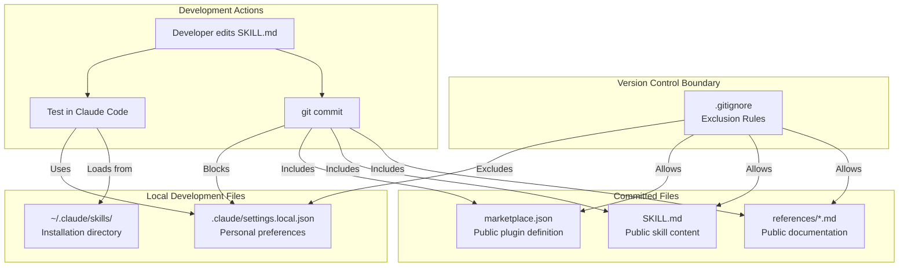
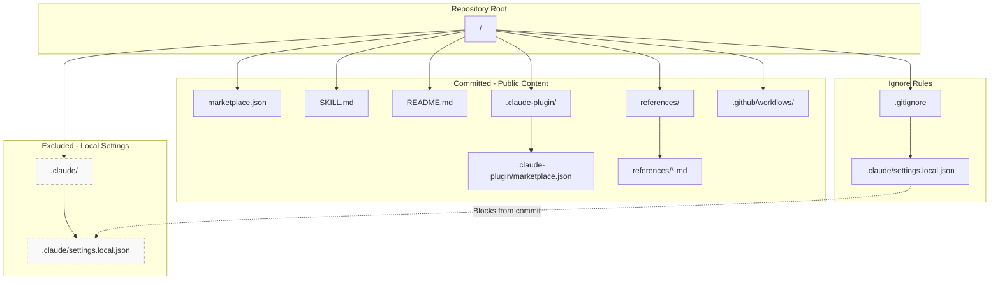
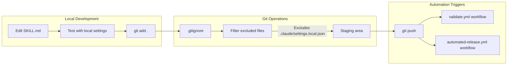
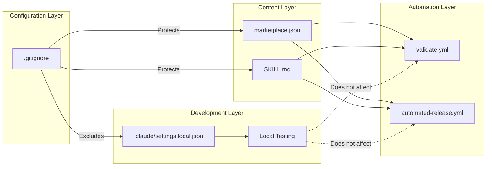

<!-- source: DeepWiki mcp.deepwiki.com · repo antonbabenko/terraform-skill · page 9 Configuration Files · fetched 2026-10-26 -->

# Configuration Files

<details>
<summary>Relevant source files</summary>

The following files were used as context for generating this wiki page:

- [.gitignore](.gitignore)

</details>


## Purpose and Scope

This document describes the supporting configuration files used in the terraform-skill repository. These files control which artifacts are excluded from version control and manage local development settings. For information about the core plugin configuration, see [Plugin Definition System](#3.1). For information about workflow automation configuration, see [Automation Systems](#6).

The configuration layer in terraform-skill is intentionally minimal, consisting primarily of version control exclusions. Unlike typical software projects with extensive build configurations, this repository focuses on content delivery to Claude Code, requiring only basic repository hygiene.

---

## Overview

The repository contains a single configuration file that defines version control exclusion patterns:

| File | Purpose | Importance Score |
|------|---------|------------------|
| `.gitignore` | Excludes local Claude settings from version control | 0.70 |

This minimal configuration reflects the repository's architecture as a content-focused Claude skill rather than a traditional application codebase.

---

## Version Control Exclusions (.gitignore)

### File Structure

The [.gitignore:1-2]() file contains a single exclusion pattern:

```
.claude/settings.local.json
```

This pattern prevents local Claude Code configuration files from being committed to the repository.

### Excluded Artifacts

#### .claude/settings.local.json

The `.claude/settings.local.json` file is a local configuration file created by Claude Code for user-specific settings. This file:

- **Location**: `.claude/` directory in the repository root
- **Scope**: Local development environment only
- **Purpose**: Stores user-specific Claude Code preferences and settings
- **Why excluded**: Contains personal configuration that should not be shared across developers

**Characteristics**:
- Created automatically by Claude Code during local skill development
- May contain developer-specific preferences or API configurations
- Should never be committed to ensure consistent baseline behavior across all users
- Exclusion prevents accidental commits of personal settings

---

## Configuration File Integration

### Integration with Development Workflow



**Sources**: [.gitignore:1-2]()

### Relationship to Claude Plugin System

The `.gitignore` configuration supports the plugin development workflow by ensuring:

1. **Consistent Testing Environment**: All developers test against the same baseline without local configuration interference
2. **Clean Repository**: Only intentional, public-facing content gets committed
3. **Privacy Protection**: Personal Claude Code settings remain private
4. **Testing Methodology Compliance**: Aligns with the "Iron Law" of testing (see [Testing Methodology](#5.3)) by preventing configuration drift

---

## Configuration Patterns

### What Gets Committed vs. Excluded



**Sources**: [.gitignore:1-2]()

---

## Implementation Details

### Pattern Specificity

The `.gitignore` pattern is intentionally specific:

| Pattern | Scope | Rationale |
|---------|-------|-----------|
| `.claude/settings.local.json` | Exact file match | Only excludes the specific local settings file |
| Does NOT use `.claude/*` | - | Avoids accidentally excluding future committed `.claude/` content |
| Does NOT use `*.local.json` | - | Prevents overly broad exclusions in other directories |

This precision ensures that:
- Only intentional files are excluded
- Future `.claude/` directory content can be committed if needed
- The exclusion pattern is self-documenting

### Integration with Automation

The `.gitignore` configuration interacts with automated workflows:



**Key Integration Points**:
- **Validation Workflow** (see [Validation Workflow](#6.1)): Only validates committed files, unaffected by local settings
- **Release Automation** (see [Release Automation](#6.2)): Only processes committed content for release
- **Local Testing**: Developers can maintain personal settings without risk of accidental commits

**Sources**: [.gitignore:1-2]()

---

## Usage Patterns

### For Contributors

When contributing to terraform-skill, the `.gitignore` configuration automatically handles local development artifacts:

**Workflow Example**:
```bash
# 1. Clone repository
git clone https://github.com/antonbabenko/terraform-skill
cd terraform-skill

# 2. Install for local testing (creates .claude/settings.local.json)
plugin marketplace add ./

# 3. Edit content
vim SKILL.md

# 4. Test in Claude Code
# (Uses .claude/settings.local.json automatically)

# 5. Commit changes
git add .
# .gitignore automatically excludes .claude/settings.local.json
git commit -m "feat: improve testing guidance"

# 6. Push - only public content is committed
git push
```

The `.gitignore` ensures step 5 never commits personal settings, maintaining clean PR history.

### For Maintainers

Maintainers benefit from `.gitignore` by:

1. **Consistent PR Review**: All PRs contain only intentional content changes
2. **No Configuration Drift**: Local settings don't pollute the repository
3. **Clean Git History**: CHANGELOG generation (see [Release Automation](#6.2)) only reflects content changes

---

## Design Rationale

### Why Exclude .claude/settings.local.json?

| Reason | Impact |
|--------|--------|
| **Personal Preferences** | Different developers may have different Claude Code settings |
| **Testing Isolation** | Ensures skill behavior is tested independently of local configuration |
| **Privacy** | May contain API keys or personal workspace settings |
| **Repository Hygiene** | Prevents configuration file churn in commit history |

### Why Not Exclude More?

The repository deliberately avoids excluding:

- **`.claude-plugin/` directory**: Contains the committed plugin definition [.claude-plugin/marketplace.json]()
- **Temporary files**: No build artifacts exist in this content-focused repository
- **IDE settings**: Contributors use diverse editors; no standardized IDE configuration

This minimalist approach aligns with the repository's "prompt engineering as infrastructure" philosophy (see [Development Philosophy](#5.1)), where content is code and configuration is minimal.

---

## Relationship to Other Systems

### Integration Points

| System | Relationship | Reference |
|--------|--------------|-----------|
| **Plugin Definition** | `.gitignore` ensures only committed plugin files are distributed | [Plugin Definition System](#3.1) |
| **Validation Workflow** | Validates only committed files, unaffected by excluded settings | [Validation Workflow](#6.1) |
| **Release Automation** | Releases only include committed content | [Release Automation](#6.2) |
| **Local Testing** | Excluded settings enable personalized development environments | [Testing Methodology](#5.3) |



**Sources**: [.gitignore:1-2]()

---

## Summary

The terraform-skill repository maintains minimal configuration:

- **Single Configuration File**: `.gitignore` with one exclusion pattern
- **Purpose**: Exclude local Claude Code settings from version control
- **Design Philosophy**: Minimalist approach focusing on content over configuration
- **Integration**: Supports clean development workflow and automated release processes

This simple configuration layer enables developers to maintain personal settings while ensuring the repository contains only intentional, public-facing content that gets validated and released through automated workflows.

**Sources**: [.gitignore:1-2]()