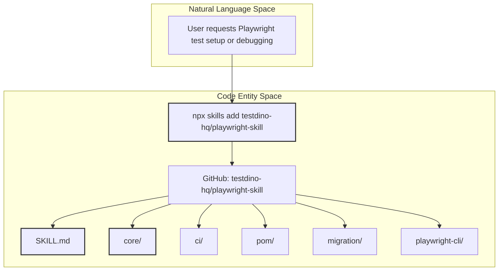
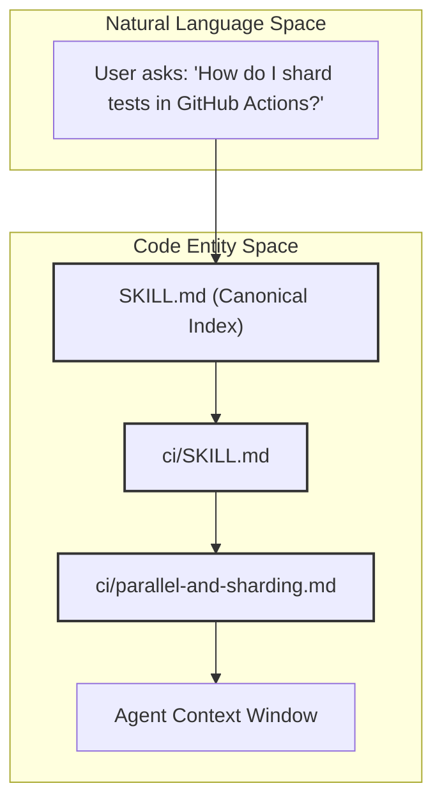

<!-- source: DeepWiki mcp.deepwiki.com · repo testdino-hq/playwright-skill · page 1.1 Installing and Using the Skill Packs · fetched 2026-10-26 -->

# Installing and Using the Skill Packs

<details>
<summary>Relevant source files</summary>

The following files were used as context for generating this wiki page:

- [README.md](README.md)
- [ci/SKILL.md](ci/SKILL.md)
- [migration/SKILL.md](migration/SKILL.md)
- [pom/SKILL.md](pom/SKILL.md)

</details>


## Purpose and Scope

This page covers the technical mechanisms for installing, structuring, and consuming the Playwright Agent Skill packs from `https://github.com/testdino-hq/playwright-skill`. It details the execution flow of the `npx skills add` CLI command, the modular pack selection strategy, and the runtime index-routing mechanism where AI coding agents parse `SKILL.md` files on demand to retrieve specialized technical guides [README.md:46-67]().

---

## Installation Architecture and `npx skills add`

The skill packs are distributed as modular Agent Skills—Markdown-based engineering guides designed to be ingested directly by AI coding assistants [README.md:46](). The distribution leverages the `skills` CLI runner via `npx`, allowing atomic installation of the entire repository or selective ingestion of isolated functional packs [README.md:50-66]().

When a developer executes an installation command, the CLI resolves the remote Git repository (`testdino-hq/playwright-skill`), downloads the specified directory subtree, and integrates the Markdown skill manifests into the local agent's working memory context.



*Sources: [README.md:46-67]*

---

## Modular Pack Selection and Directory Topology

The repository is partitioned into distinct functional domains. Projects can choose to install the comprehensive toolkit or select specific modules depending on whether they are scaling CI pipelines, migrating legacy test suites, or implementing Page Object Models [README.md:50-66]().

| Skill Pack Target | CLI Command Syntax | Target Technical Scope |
|-------------------|-------------------|------------------------|
| **Complete Suite** | `npx skills add testdino-hq/playwright-skill` | Full repository ingestion (70 guides across all domains) [README.md:42,55] |
| **Core Testing** | `npx skills add testdino-hq/playwright-skill/core` | Locators, assertions, fixtures, auth, network mocking, visual regression [README.md:61,75] |
| **CI/CD Infrastructure** | `npx skills add testdino-hq/playwright-skill/ci` | GitHub Actions, GitLab, sharding, Docker, reporting [README.md:62,76] |
| **Page Object Model** | `npx skills add testdino-hq/playwright-skill/pom` | POM structure, fixtures vs helpers decision framework [README.md:63,78] |
| **Migration Paths** | `npx skills add testdino-hq/playwright-skill/migration` | Cypress and Selenium to Playwright translation [README.md:64,79] |
| **Playwright CLI** | `npx skills add testdino-hq/playwright-skill/playwright-cli` | Terminal-first automation, session management, device emulation [README.md:65,77] |

*Sources: [README.md:50-80]*, `[ci/SKILL.md:1-4]`, `[pom/SKILL.md:1-4]`, `[migration/SKILL.md:1-4]`

---

## Agent-Native Index Routing via `SKILL.md`

AI agents do not load all 70 guides simultaneously into context. Instead, they operate via an on-demand index-routing pattern. The root `SKILL.md` and pack-level `SKILL.md` files (such as `ci/SKILL.md` [ci/SKILL.md:1-4](), `pom/SKILL.md` [pom/SKILL.md:1-4](), and `migration/SKILL.md` [migration/SKILL.md:1-4]()) act as semantic routers.

When a user prompts an agent with a natural language objective, the agent inspects the canonical `SKILL.md` index table, identifies the precise Markdown guide matching the requirement, and reads that file dynamically [README.md:46]().



*Sources: [README.md:46]*, `[ci/SKILL.md:1-48]`

### Frontmatter Manifest Structure

Each pack index file utilizes YAML frontmatter to declare its skill name and capabilities for agent parsing. For instance, the migration pack manifest is structured as follows:

```yaml
---
name: playwright-migration
description: Step-by-step migration guides for moving to Playwright from Cypress or Selenium/WebDriver — command mappings, architecture changes, and incremental adoption strategies.
---
```

*Sources: [migration/SKILL.md:1-4]*

Similarly, the CI pack manifest declares its module scope and operational boundaries:

```yaml
---
name: playwright-ci
description: Production-ready CI/CD configurations for Playwright — GitHub Actions, GitLab CI, CircleCI, Azure DevOps, Jenkins, Docker, parallel sharding, reporting, code coverage, and global setup/teardown.
---
```

*Sources: [ci/SKILL.md:1-4]*

---

