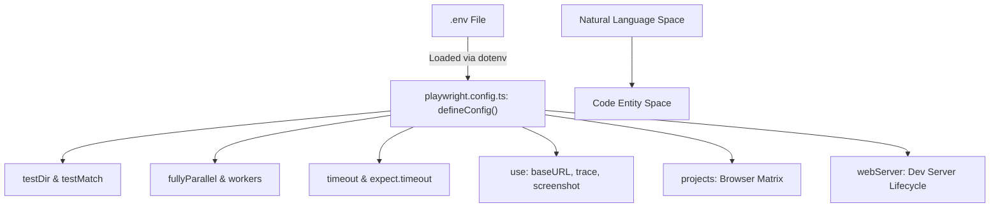
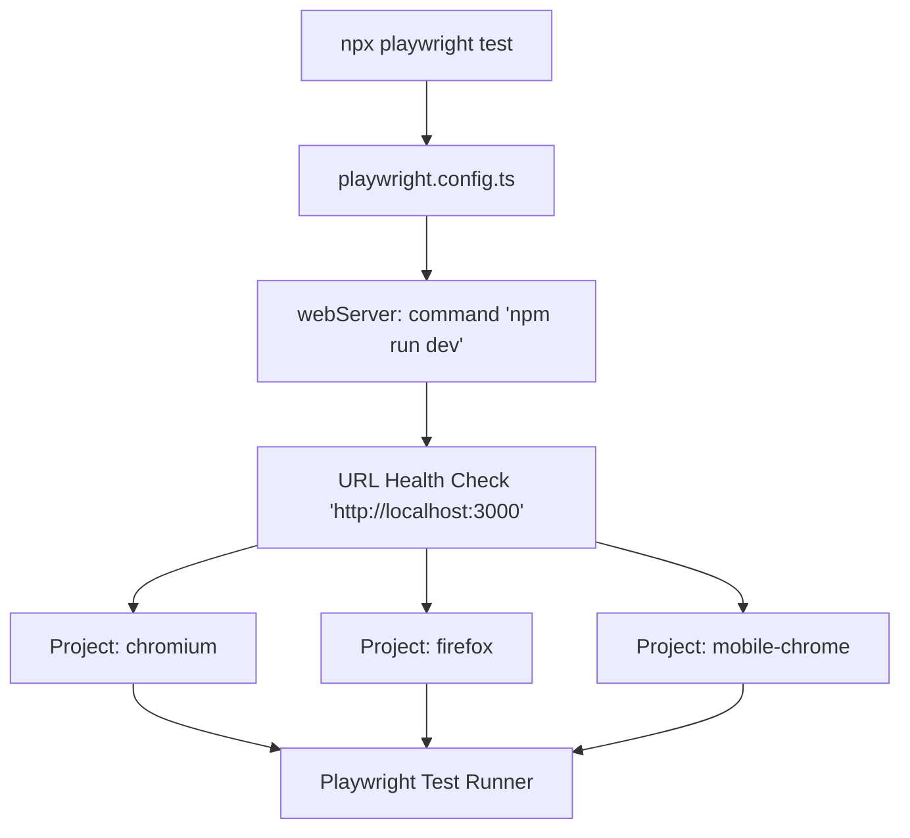
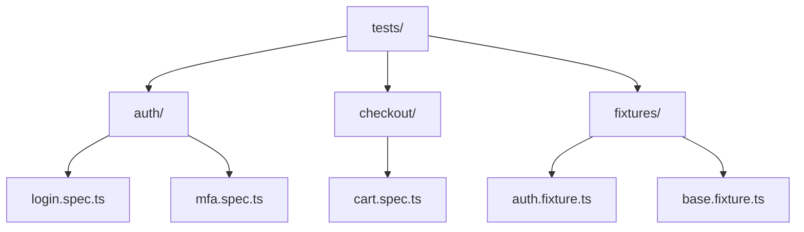

<!-- source: DeepWiki mcp.deepwiki.com · repo testdino-hq/playwright-skill · page 2.3 Test Organization, Architecture and Configuration · fetched 2026-10-26 -->

# Test Organization, Architecture and Configuration

Relevant source files

The following files were used as context for generating this wiki page:

- [core/auth-flows.md](core/auth-flows.md)
- [core/configuration.md](core/configuration.md)
- [core/test-architecture.md](core/test-architecture.md)
- [core/test-organization.md](core/test-organization.md)

## Purpose and Scope
This page defines the technical architecture, project configuration, directory topology, grouping practices, and testing tier strategy for Playwright test suites. It covers global configuration files (`playwright.config.ts`), test discovery paths (`testDir`), multi-project browser matrices, automated web server orchestration (`webServer`), feature-based file layouts, tagging conventions, and the Testing Trophy architectural model.

Sources: `core/configuration.md:1-4`, `core/test-organization.md:1-4`, `core/test-architecture.md:1-4`

---

## 1. Playwright Configuration Anatomy (`playwright.config.ts`)
The `playwright.config.ts` file acts as the central control plane for test execution. It establishes global defaults, timeout limits, reporting sinks, environment variable loaders, and browser context attributes.

Key configuration options include:
- **Environment Loading**: Integrates `dotenv` to parse environment-specific variables relative to the configuration file path [core/configuration.md:23-27].
- **Configuration Export**: Utilizes the `defineConfig()` helper function to enforce type safety across options [core/configuration.md:29].
- **Test Discovery**: Controls test location via `testDir` and pattern matching via `testMatch` [core/configuration.md:30-32].
- **Execution & Concurrency**: Manages parallelization (`fullyParallel: true`), safety checks (`forbidOnly`), CI-specific retry logic (`retries`), and worker allocations (`workers`) [core/configuration.md:35-38].
- **Reporting & Timeouts**: Configures reporters for local and CI environments alongside global test timeouts, assertion polling limits (`expect.timeout`), action timeouts (`actionTimeout`), and navigation timeouts (`navigationTimeout`) [core/configuration.md:41-55].
- **Artifact Retention**: Defines default behavior for traces (`trace`), screenshots (`screenshot`), and videos (`video`) under failure or retry conditions [core/configuration.md:57-62].

Title: Configuration and Execution Data Flow

Sources: `core/configuration.md:23-70`

---

## 2. Test Directory Layout, Projects, and Web Server Integration
Playwright handles test execution environments through project configurations and built-in process management.

- **Projects & Browser Targets**: The `projects` array defines isolated execution contexts across various browser engines and mobile viewports (e.g., `chromium`, `firefox`, `webkit`, `mobile-chrome`, `mobile-safari`) using device descriptors from `devices` [core/configuration.md:73-94].
- **Web Server Orchestration**: The `webServer` object automatically boots local development servers prior to test execution. It accepts a shell `command`, target `url`, server reuse flags (`reuseExistingServer`), cold-build timeouts, and output redirection handles (`stdout`, `stderr`) [core/configuration.md:96-104].

Title: Project and WebServer Architecture

Sources: `core/configuration.md:31-32, 73-104`

---

## 3. Feature-Based Layout and Naming Rules
Test suites must scale cleanly across small (< 20 tests), medium (20–200 tests), and large (200+ tests) codebases by adopting a feature-based directory structure rather than organizing by page classes or technical test types [core/test-organization.md:21-68].

- **Directory Layout**: Tests are grouped by business domains (e.g., `auth/`, `checkout/`, `admin/`, `inventory/`) alongside shared directories for `fixtures/`, `page-objects/`, `visual/`, and `helpers/` [core/test-organization.md:43-105].
- **Naming Conventions**: Strict naming rules govern file extensions, grouping blocks, and test identifiers:
  - File names use `kebab-case.spec.ts` [core/test-organization.md:10, 178].
  - `test.describe()` titles use Title Case representing the feature name [core/test-organization.md:179].
  - `test()` definitions use sentences starting with `should` or `user can` [core/test-organization.md:12, 180].
  - Page objects follow `PascalCase.page.ts` [core/test-organization.md:181].
  - Fixtures follow `kebab-case.fixture.ts` [core/test-organization.md:182].

Title: Feature-Based Directory Topology

Sources: `core/test-organization.md:10-17, 21-107, 176-183`

---

## 4. Grouping, Nesting, and Tagging
Structuring individual test files requires disciplined scoping and metadata tagging to support flexible execution filtering.

- **Grouping and Hooks**: Related tests within a file are wrapped in `test.describe()` blocks utilizing `test.beforeEach()` hooks for shared setup [core/test-organization.md:186-202]. Nesting is strictly capped at a maximum of two levels to preserve readability [core/test-organization.md:13, 217].
- **Execution Rules**: Tests run fully in parallel by default (`fullyParallel: true`), while serial execution via `test.describe.serial()` is discouraged to maintain test isolation [core/test-organization.md:14-16].
- **Tagging & Filtering**: Tests are categorized using metadata tags such as `@smoke`, `@regression`, and `@slow` to enable targeted execution via the CLI `--grep` flag [core/test-organization.md:17].

Sources: `core/test-organization.md:13-17, 186-218`

---

## 5. Testing Tiers & Architecture Decision Matrix
Before authoring tests, developers must evaluate features against the Testing Trophy model to ensure proper test placement and optimal execution cost [core/test-architecture.md:3-13].

- **The Testing Trophy Layers**:
  1. **Static Analysis**: TypeScript and ESLint for type safety and code style [core/test-architecture.md:29-36].
  2. **API Layer (`request` context)**: The thickest layer, focusing on business logic, data validation, permissions, and CRUD operations without UI overhead [core/test-architecture.md:9, 35, 46].
  3. **Component Layer (`@playwright/experimental-ct-*`)**: Focuses on isolated UI behavior, form validation, and interactive widgets [core/test-architecture.md:10, 34, 45].
  4. **E2E Layer (`@playwright/test` with browser)**: A thin top layer reserved exclusively for critical cross-page user journeys (login, checkout, onboarding) [core/test-architecture.md:11, 33, 60-68].

Sources: `core/test-architecture.md:1-77`

---

