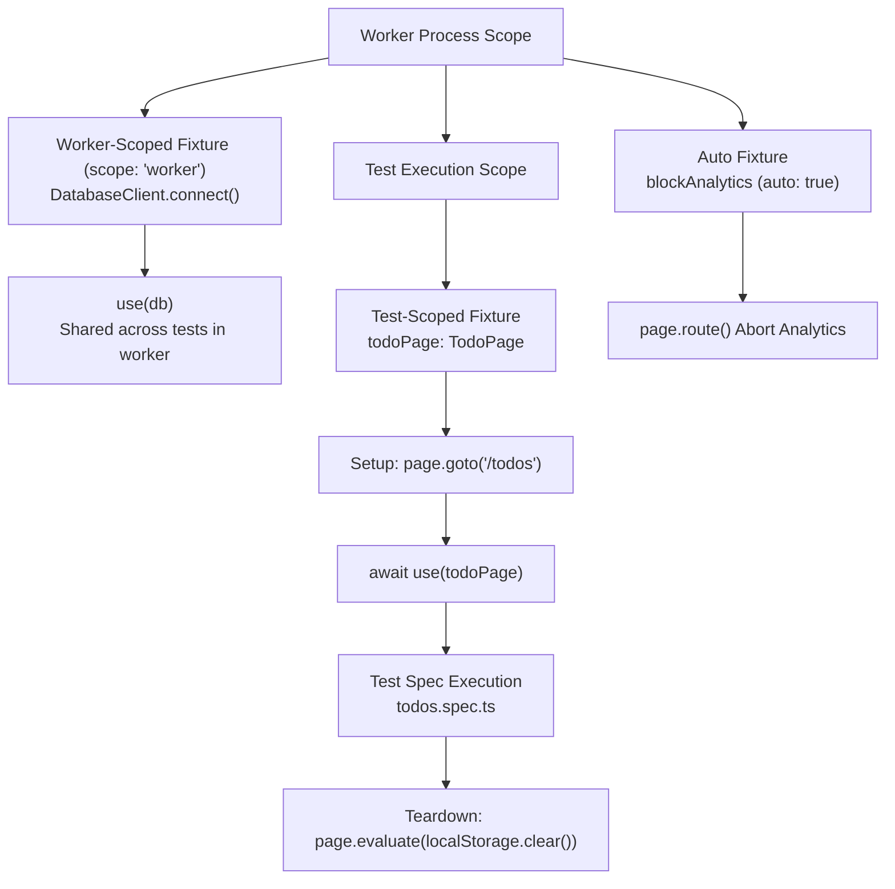
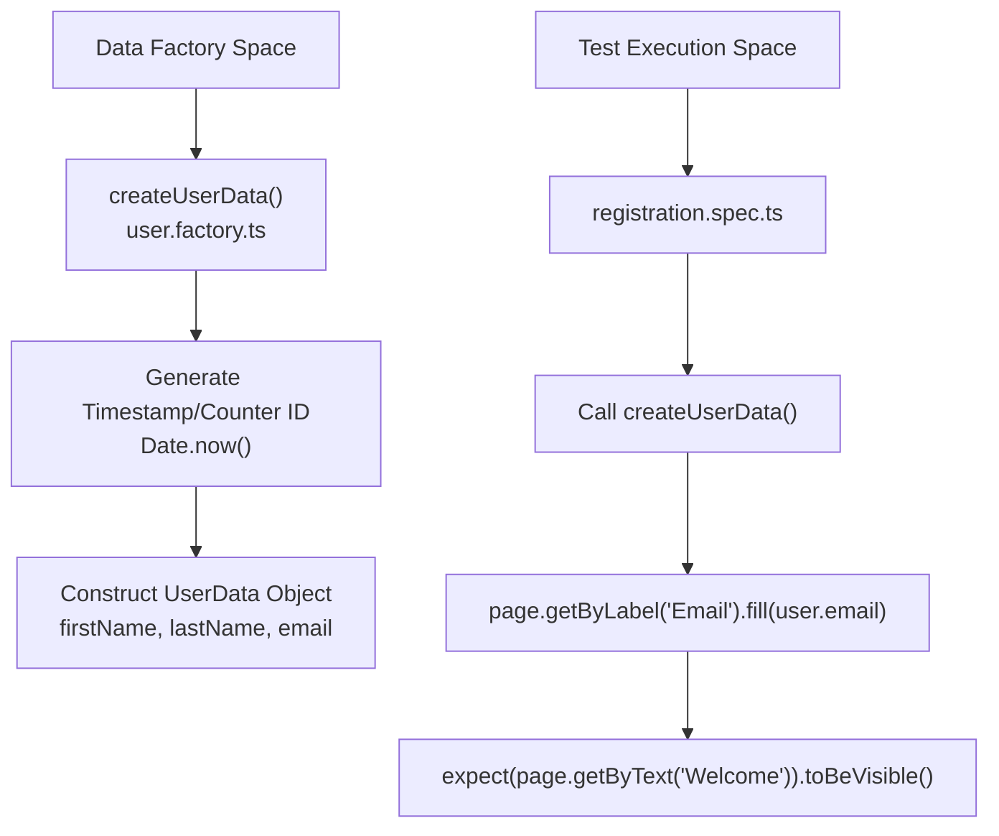

<!-- source: DeepWiki mcp.deepwiki.com · repo testdino-hq/playwright-skill · page 2.4 Fixtures, Hooks and Test Data · fetched 2026-10-26 -->

# Fixtures, Hooks and Test Data

<details>
<summary>Relevant source files</summary>

The following files were used as context for generating this wiki page:

- [core/drag-and-drop.md](core/drag-and-drop.md)
- [core/error-and-edge-cases.md](core/error-and-edge-cases.md)
- [core/file-upload-download.md](core/file-upload-download.md)
- [core/fixtures-and-hooks.md](core/fixtures-and-hooks.md)
- [core/locator-strategy.md](core/locator-strategy.md)
- [core/test-data-management.md](core/test-data-management.md)

</details>


## Purpose and Scope
This document covers Playwright's core mechanisms for dependency injection, test lifecycle management, and test data isolation. It details the architectural distinctions between `test.extend` fixtures, traditional testing hooks (`beforeEach`/`afterEach`, `beforeAll`/`afterAll`), worker-scoped execution, and robust test data generation patterns.

Sources: `core/fixtures-and-hooks.md:1-16`, `core/test-data-management.md:1-18`

---

## 1. Fixtures vs. Hooks vs. Globals Architectural Comparison

Playwright deprecates traditional global setup and loose hooks in favor of test fixtures. Fixtures provide automatic teardown, dependency graphs, and parallel execution safety.

### Quick Reference Matrix

| Mechanism | Scope | Cleanup guaranteed? | Parallelism-safe? | Use for |
|---|---|---|---|---|
| `test.extend()` fixture | per-test | Yes (via `use()` callback) | Yes | Most setup/teardown needs |
| Worker-scoped fixture | per-worker | Yes | Yes (isolated per worker) | Expensive resources: DB connections, auth state |
| Auto fixture | per-test or per-worker | Yes | Yes | Side effects that must always run: blocking analytics, logging |
| `beforeEach` / `afterEach` | per-test | No (`afterEach` skipped on crash) | Yes | Simple, one-off setup that doesn't need cleanup |
| `beforeAll` / `afterAll` | per-worker | No (`afterAll` skipped on crash) | Dangerous if mutating shared state | One-time worker setup with no cleanup needs |

Sources: `core/fixtures-and-hooks.md:5-16`

### Diagram: Fixture Scope and Lifecycle Architecture
This diagram maps abstract lifecycle concepts to actual codebase entities such as `test.extend`, worker processes, and teardown handlers.


Sources: `core/fixtures-and-hooks.md:31-144`

---

## 2. Implementing Test-Scoped, Worker-Scoped, and Auto Fixtures

### Custom Test Fixtures (`test.extend`)
Fixtures use a `use()` callback mechanism. Everything executed before `use()` acts as setup, while execution after `use()` serves as guaranteed teardown.

- **Definition site**: `core/fixtures-and-hooks.md:31-63`
- **Consumer site**: `core/fixtures-and-hooks.md:65-73`

Sources: `core/fixtures-and-hooks.md:19-73`

### Worker-Scoped Fixtures
Worker-scoped fixtures optimize performance by executing once per worker process rather than per test. They must be declared with `{ scope: 'worker' }` as seen in `core/fixtures-and-hooks.md:124-129` and cannot depend on test-scoped fixtures like `page` or `context`.

Sources: `core/fixtures-and-hooks.md:107-179`

### Auto Fixtures
Auto fixtures execute automatically for every test without requiring explicit parameter destructuring in the test signature. They are enabled via `{ auto: true }` (`core/fixtures-and-hooks.md:202`).

Sources: `core/fixtures-and-hooks.md:180-208`

---

## 3. Test Data Generation and Isolation Strategies

Every test must maintain data isolation. Reusing static records across parallel workers causes race conditions and flakiness.

### Quick Reference Matrix

| Strategy | Speed | Isolation | Complexity | Best For |
|---|---|---|---|---|
| Inline data | Instant | Perfect | None | Simple value checks, form inputs |
| Factory functions | Instant | Perfect | Low | Unique identifiers, consistent shapes |
| Faker/random data | Instant | Perfect | Low | Realistic fields, edge-case discovery |
| Builder pattern | Instant | Perfect | Medium | Complex objects with many optional fields |
| API seeding | Fast | Perfect | Medium | Creating entities the app depends on |
| Database seeding | Fast | Good | High | Complex relational data, bulk setup |
| Storage state | Fast | Good | Low | Reusing authenticated sessions |
| Fixture-based setup | Fast | Perfect | Medium | Encapsulating setup + guaranteed teardown |

Sources: `core/test-data-management.md:5-17`

### Diagram: Test Data Flow and Factory Architecture
This diagram illustrates how data factories and test specifications interact to generate isolated records.


Sources: `core/test-data-management.md:84-135`

---

## 4. Teardown and Cleanup Lifecycles

Fixtures guarantee execution of teardown logic even if the test fails or times out. This is superior to `afterEach` hooks which may be bypassed during uncaught test crashes.

```typescript
// Example pattern from core/fixtures-and-hooks.md
todoPage: async ({ page }, use) => {
  await page.goto('/todos');
  const todoPage = new TodoPage(page);
  await use(todoPage);
  // Teardown executes reliably regardless of test status
  await page.evaluate(() => localStorage.clear());
},
```

Sources: `core/fixtures-and-hooks.md:49-60`

---

