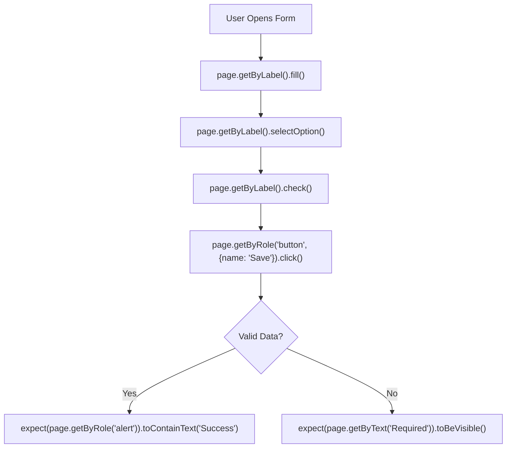
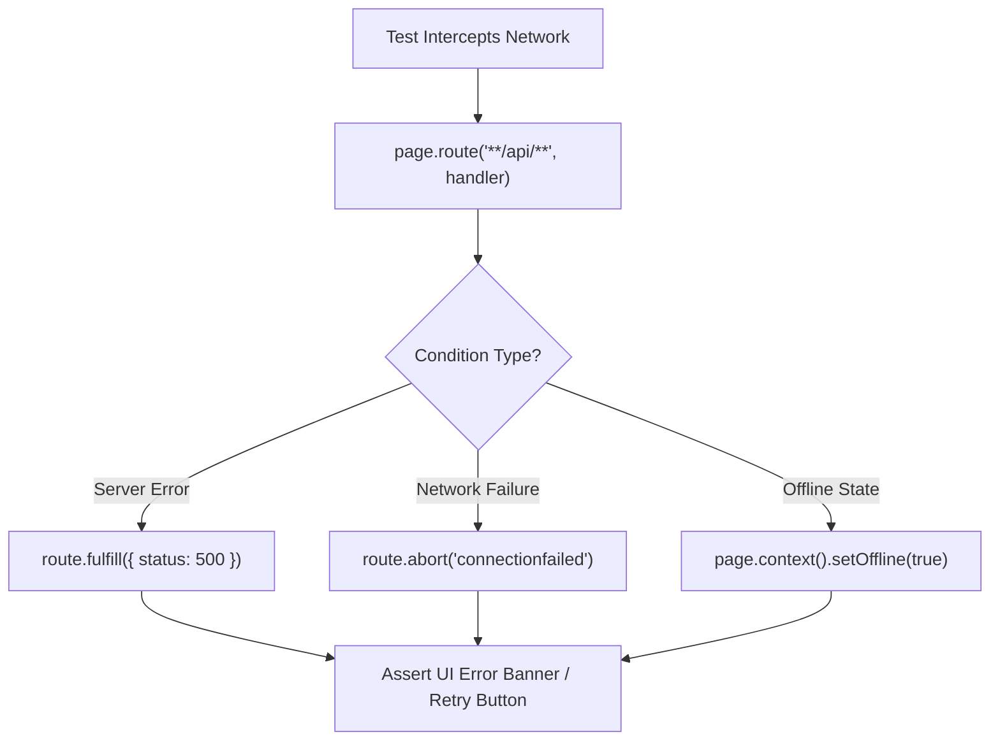

<!-- source: DeepWiki mcp.deepwiki.com · repo testdino-hq/playwright-skill · page 2.6 UI Interaction Recipes · fetched 2026-10-26 -->

# UI Interaction Recipes

<details>
<summary>Relevant source files</summary>

The following files were used as context for generating this wiki page:

- [core/crud-testing.md](core/crud-testing.md)
- [core/drag-and-drop.md](core/drag-and-drop.md)
- [core/error-and-edge-cases.md](core/error-and-edge-cases.md)
- [core/file-operations.md](core/file-operations.md)
- [core/file-upload-download.md](core/file-upload-download.md)
- [core/fixtures-and-hooks.md](core/fixtures-and-hooks.md)
- [core/forms-and-validation.md](core/forms-and-validation.md)
- [core/locator-strategy.md](core/locator-strategy.md)
- [core/search-and-filter.md](core/search-and-filter.md)

</details>


This leaf page covers comprehensive UI interaction patterns for Playwright testing, encompassing form input filling and validation, CRUD lifecycles, search and filtering with debounced actions, drag-and-drop interactions, file upload/download operations, and robust handling of network or application error states and edge cases.

---

## 1. Forms, Validation, and CRUD Flows

Forms and CRUD (Create, Read, Update, Delete) flows represent core interactive user journeys. Playwright provides specialized APIs to interact with standard and custom HTML controls, handle validation states, and verify multi-step persistence.

### Implementation Patterns
- **Text Inputs and Selections**: Use `fill()` instead of `type()` for text boxes to ensure reliable clearing and entry (`[core/forms-and-validation.md:47-48]()`). Use `check()` for checkboxes/radios (`[core/forms-and-validation.md:69-74]`) and `selectOption()` for native `<select>` elements (`[core/forms-and-validation.md:60-64]()`).
- **Validation Verification**: Combine assertions like `expect(...).toBeVisible()` with field-level error messages to validate required inputs, character minimums, and positive number constraints (`[core/crud-testing.md:42-61]()`).
- **Read and List Verification**: Query table headers, filter non-header rows, and assert pagination state using `getByRole('row')` and `getByRole('columnheader')` (`[core/crud-testing.md:114-129]()`, `[core/crud-testing.md:162-187]()`).

### Diagram: Form Interaction and CRUD State Flow

Sources: `[core/forms-and-validation.md:9-31]`, `[core/forms-and-validation.md:44-80]`, `[core/crud-testing.md:16-40]`, `[core/crud-testing.md:42-61]()`

---

## 2. Search, Filter, and Debounced Inputs

Testing search boxes, autocomplete controls, and filter panels requires managing asynchronous rendering, debounce thresholds, and URL query preservation.

### Implementation Patterns
- **Search Queries and Verification**: Fill search inputs via `getByRole('searchbox')`, submit with `press('Enter')`, and verify that result sets contain the expected query string and update the URL query parameters (`[core/search-and-filter.md:16-49]()`).
- **Debounce and Loading States**: Intercept API routes using `page.route()` to verify that rapid typing (`pressSequentially`) triggers debounced requests and displays progress indicators correctly (`[core/search-and-filter.md:135-187]()`).

Sources: `[core/search-and-filter.md:16-49]`, `[core/search-and-filter.md:135-187]()`

---

## 3. Drag-and-Drop and File Operations

Complex UI mechanics like Kanban boards, sortable lists, file uploads, and downloads require low-level pointer control or dedicated event handling.

### Implementation Patterns
- **Drag-and-Drop**: Use `sourceItem.dragTo(dropZone)` for native HTML5 interactions (`[core/drag-and-drop.md:16-31]()`). For advanced sortable lists (e.g., `dnd-kit` or `react-beautiful-dnd`), combine `hover()`, `mouse.down()`, step-wise `mouse.move()`, and `mouse.up()` (`[core/drag-and-drop.md:196-212]()`).
- **File Uploads**: Use `setInputFiles()` directly on `<input type="file">` elements with path resolution or in-memory buffers (`[core/file-upload-download.md:17-56]()`). For drop zones without visible file inputs, listen for the file chooser event using `page.waitForEvent('filechooser')` (`[core/file-operations.md:131-144]()`).
- **File Downloads**: Capture download handles via `page.waitForEvent('download')`, trigger the download action, and save the artifact permanently using `download.saveAs()` (`[core/file-operations.md:19-23]()`).

### Diagram: File Operation & Code Entity Mapping
```mermaid
graph TD
    UserAction["User Triggers File Action"] --> InputCheck{Has input[type=file]?}
    InputCheck -->|Yes| SetFiles["locator.setInputFiles(pathOrBuffer)"]
    InputCheck -->|No| WaitChooser["page.waitForEvent('filechooser')"]
    WaitChooser --> FileChooserAction["fileChooser.setFiles(path)"]
    
    DownloadAction["User Triggers Download"] --> WaitDownload["page.waitForEvent('download')"]
    WaitDownload --> SaveDownload["download.saveAs(targetPath)"]
```
Sources: `[core/file-upload-download.md:17-56]`, `[core/drag-and-drop.md:16-31]`, `[core/drag-and-drop.md:196-212]`, `[core/file-operations.md:19-23]`, `[core/file-operations.md:131-144]()`

---

## 4. Error States, Edge Cases, and Network Resilience

Testing application robustness involves intercepting network calls, injecting HTTP error codes, simulating offline conditions, and evaluating timeout handlers.

### Implementation Patterns
- **HTTP Error Codes**: Mock 4xx and 5xx responses using `route.fulfill({ status: 500, json: ... })` to verify graceful UI degradation, error boundaries, and retry buttons (`[core/error-and-edge-cases.md:39-89]()`).
- **Offline Mode and Connection Failures**: Toggle browser connectivity via `page.context().setOffline(true)` or abort requests using `route.abort('connectionfailed')` (`[core/error-and-edge-cases.md:12-25]`, `[core/error-and-edge-cases.md:152-181]()`).
- **Timeout and Rate Limiting**: Simulate custom `Retry-After` headers for `429 Too Many Requests` or delayed responses for timeout validations (`[core/error-and-edge-cases.md:74-88]`, `[core/error-and-edge-cases.md:183-196]()`).

### Diagram: Network Interception & Error Flow

Sources: `[core/error-and-edge-cases.md:8-26]`, `[core/error-and-edge-cases.md:39-89]`, `[core/error-and-edge-cases.md:152-196]()`

---

