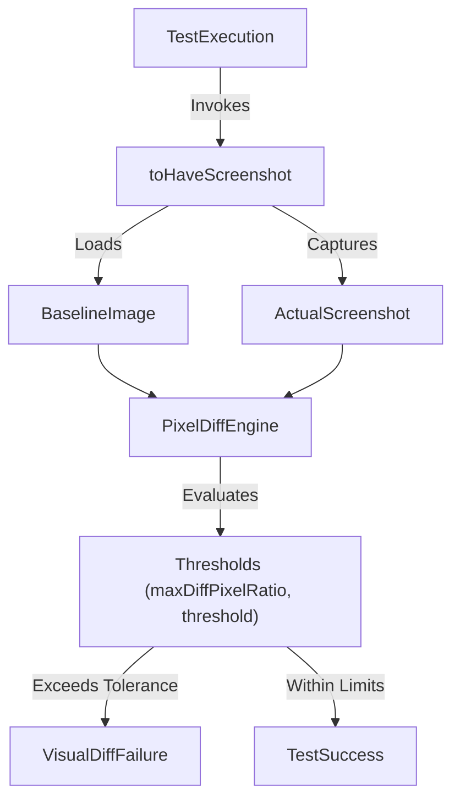
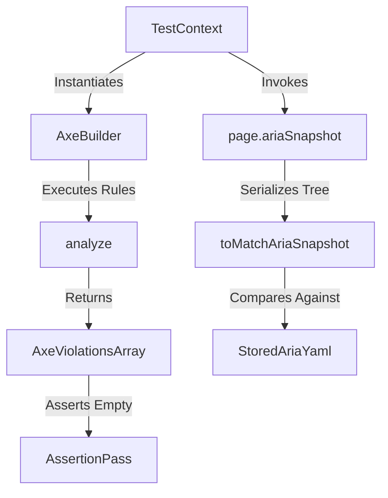

<!-- source: DeepWiki mcp.deepwiki.com · repo testdino-hq/playwright-skill · page 3.2 Visual, Accessibility and Component Testing · fetched 2026-10-26 -->

# Visual, Accessibility and Component Testing

<details>
<summary>Relevant source files</summary>

The following files were used as context for generating this wiki page:

- [core/accessibility.md](core/accessibility.md)
- [core/authentication.md](core/authentication.md)
- [core/component-testing.md](core/component-testing.md)
- [core/mobile-and-responsive.md](core/mobile-and-responsive.md)
- [core/visual-regression.md](core/visual-regression.md)

</details>


## Purpose and Scope

This page documents specialized UI validation guides within the `playwright-skill` core repository pack. It covers non-functional and component validation domains: capturing and comparing screenshot baselines (`core/visual-regression.md`), automated accessibility auditing via `axe-core` and structural ARIA tree snapshots (`core/accessibility.md`), isolated component testing models using Vite-bundled mounts and the Playwright 1.62 stories model (`core/component-testing.md`), and device/responsive emulation (`core/mobile-and-responsive.md`).

Sources: `core/visual-regression.md:1-4` `core/component-testing.md:1-5` `core/accessibility.md:1-4` `core/mobile-and-responsive.md:1-5`

---

## 1. Visual Regression Testing and Screenshot Baselines

Visual testing detects layout shifts, unintended style modifications, and responsive regressions by comparing live test screenshots against stored baseline ("golden") images. 

### Core Configuration and Options

Visual comparisons are driven by `expect(page).toHaveScreenshot()` or element-scoped locators. Comparison sensitivity is controlled through pixel variance thresholds and masking parameters.

| Option | Description | Recommended Default |
| :--- | :--- | :--- |
| `maxDiffPixels` | Maximum allowed number of differing pixels | `100` (full page), `10` (components) |
| `maxDiffPixelRatio` | Maximum fraction of differing pixels (`0` to `1`) | `0.01` (1% for full pages) |
| `threshold` | Per-pixel color difference tolerance (`0` to `1`) | `0.2` (standard UIs), `0.1` (design systems) |
| `mask` | Array of locators to mask out (timestamps, avatars) | `[page.getByTestId('timestamp')]` |
| `animations` | Control CSS transitions/animations | `'disabled'` |

Global thresholds can be configured at the project level in `playwright.config.ts`:

```typescript
// playwright.config.ts
import { defineConfig } from '@playwright/test';

export default defineConfig({
  expect: {
    toHaveScreenshot: {
      maxDiffPixelRatio: 0.01,
      threshold: 0.2,
      animations: 'disabled',
    },
  },
});
```

Sources: `core/visual-regression.md:8-31`, `core/visual-regression.md:95-102`, `core/visual-regression.md:171-183`

### Visual Regression Execution and Comparison Workflow



Sources: `core/visual-regression.md:8-31`, `core/visual-regression.md:95-102`

---

## 2. Accessibility Testing: axe-core and ARIA Snapshots

Accessibility testing combines automated WCAG compliance scanning with structural accessibility tree validations.

### Automated Scanning with AxeBuilder

Integration with `@axe-core/playwright` allows running automated scans across full pages or scoped locators, enforcing zero violations against WCAG standards.

```typescript
import { test, expect } from '@playwright/test';
import AxeBuilder from '@axe-core/playwright';

test('dashboard has no accessibility violations', async ({ page }) => {
  await page.goto('/dashboard');
  const results = await new AxeBuilder({ page })
    .withTags(['wcag2a', 'wcag2aa'])
    .analyze();
  expect(results.violations).toEqual([]);
});
```

Sources: `core/accessibility.md:8-34`, `core/accessibility.md:144-165`

### ARIA Snapshots and Tree Validation

Playwright provides ARIA snapshot assertions (`page.ariaSnapshot()` and `toMatchAriaSnapshot()`) to verify semantic structure independently of raw DOM hierarchy.

```typescript
// Scoped tree check
const menuTree = await page.getByRole('menu', { name: 'Account' }).ariaSnapshot({
  depth: 2,
});

// Page-level match against stored snapshot
await expect(page).toMatchAriaSnapshot();

// Capture with element bounding boxes
const treeWithBoxes = await page.ariaSnapshot({ boxes: true });
```

Sources: `core/accessibility.md:8-34`, `core/accessibility.md:67-74`, `core/accessibility.md:114-120`, `core/accessibility.md:144-165`

### Accessibility Scanning and ARIA Tree Analysis Pipeline



Sources: `core/accessibility.md:8-34`, `core/accessibility.md:144-165`

---

## 3. Component Testing Models

Component testing allows testing UI components in isolation within a real browser instance using Vite under the hood.

### Component Configuration and Mounting

Component suites require a dedicated configuration file (`playwright-ct.config.ts`) and entry point (`playwright/index.html`).

```typescript
// playwright-ct.config.ts
import { defineConfig, devices } from '@playwright/experimental-ct-react';

export default defineConfig({
  testDir: './src',
  testMatch: '**/*.ct.tsx',
  use: {
    ctPort: 3100,
    ctViteConfig: {
      resolve: {
        alias: {
          '@': '/src',
        },
      },
    },
  },
  projects: [
    {
      name: 'chromium',
      use: { ...devices['Desktop Chrome'] },
    },
  ],
});
```

Using the experimental `mount` fixture:

```typescript
import { test, expect } from '@playwright/experimental-ct-react';
import { Button } from './Button';

test('button renders and responds to click', async ({ mount }) => {
  let clicked = false;
  const component = await mount(
    <Button label="Save" onClick={() => { clicked = true; }} />
  );
  await expect(component).toContainText('Save');
  await component.click();
  expect(clicked).toBe(true);
});
```

Sources: `core/component-testing.md:10-27`, `core/component-testing.md:55-87`, `core/component-testing.md:162-189`

### Playwright 1.62 Architectural Shift

Playwright 1.62 replaced the experimental inline mounting packages (`@playwright/experimental-ct-react`, `@playwright/experimental-ct-vue`, etc.) with a **stories and galleries** model. In this model, `fixtures.mount()` navigates to a test gallery and mounts a story by ID, returning a scoped `Locator`. Existing suites on experimental packages continue running on pinned Playwright versions, but new component suites should adopt the stories architecture.

Sources: `core/component-testing.md:30-43`

---

## 4. Mobile and Responsive Testing

Mobile and responsive testing verifies UI adaptation across device profiles, custom viewports, touch interactions, and orientation modes.

### Device Emulation and Viewports

Playwright provides built-in device descriptors via `devices` from `@playwright/test` to emulate screen dimensions, pixel ratios, touch events, and user agents.

```typescript
import { test, expect, devices } from '@playwright/test';

// playwright.config.ts project setup
export default defineConfig({
  projects: [
    {
      name: 'Mobile Chrome',
      use: { ...devices['Pixel 7'] },
    },
    {
      name: 'Mobile Safari',
      use: { ...devices['iPhone 14'] },
    },
  ],
});
```

Testing responsive breakpoints dynamically within a test:

```typescript
test('layout adapts at specific width', async ({ page }) => {
  await page.setViewportSize({ width: 375, height: 667 });
  await page.goto('/');
  await expect(page.getByRole('button', { name: 'Menu' })).toBeVisible();
});
```

Sources: `core/mobile-and-responsive.md:9-23`, `core/mobile-and-responsive.md:47-70`, `core/mobile-and-responsive.md:166-172`

---

