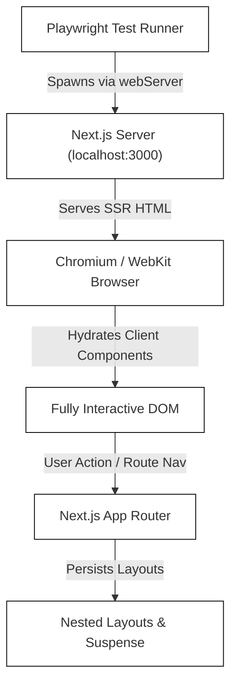
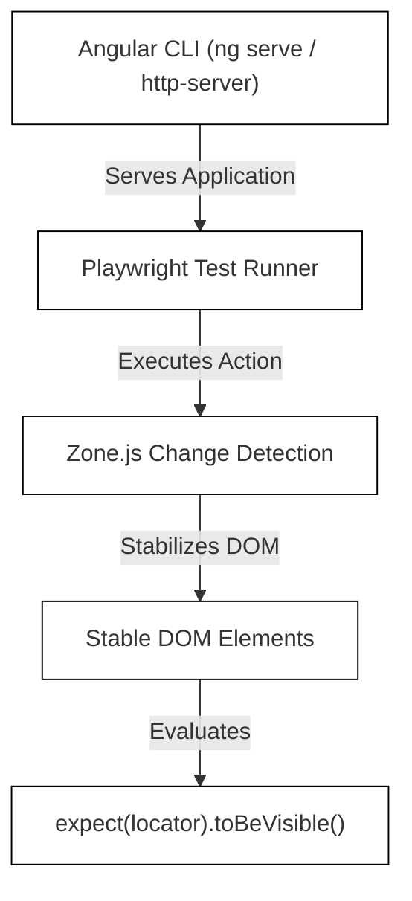

<!-- source: DeepWiki mcp.deepwiki.com · repo testdino-hq/playwright-skill · page 3.5 Framework Recipes: Next.js, React, Vue, Angular · fetched 2026-10-26 -->

# Framework Recipes: Next.js, React, Vue, Angular

<details>
<summary>Relevant source files</summary>

The following files were used as context for generating this wiki page:

- [core/angular.md](core/angular.md)
- [core/browser-extensions.md](core/browser-extensions.md)
- [core/canvas-and-webgl.md](core/canvas-and-webgl.md)
- [core/clock-and-time-mocking.md](core/clock-and-time-mocking.md)
- [core/common-pitfalls.md](core/common-pitfalls.md)
- [core/nextjs.md](core/nextjs.md)
- [core/react.md](core/react.md)
- [core/vue.md](core/vue.md)

</details>


## Purpose and Scope
This page provides comprehensive technical guidance for integrating Playwright with modern frontend frameworks: Next.js, React, Vue (including Nuxt.js), and Angular. It covers framework-specific configuration (such as `webServer` integration), handling server-side rendering (SSR), hydration synchronization, component isolation testing, and framework-specific selector strategies.

---

## 1. Next.js Integration and SSR/Hydration Concerns

Next.js applications combine Server Components (RSC), Client Components, streaming, and Suspense boundaries. Playwright interacts natively with fully hydrated pages because it operates at the browser layer, but testing server-side rendering, streaming states, and environment configurations requires specific configuration patterns.

### Dev Server and Build Configuration
Playwright manages the Next.js lifecycle via the `webServer` block in `playwright.config.ts`. This ensures tests run against either the development server (`npm run dev`) or a production build (`npm run build && npm run start`) [core/nextjs.md:67-78]().

```typescript
// playwright.config.ts (Excerpt)
export default defineConfig({
  webServer: {
    command: process.env.CI
      ? 'npm run build && npm run start'
      : 'npm run dev',
    url: 'http://localhost:3000',
    reuseExistingServer: !process.env.CI,
    timeout: 120_000,
    env: {
      NODE_ENV: process.env.CI ? 'production' : 'test',
    },
  },
});
```
*Sources: [core/nextjs.md:32-79]*

### Testing App Router, Streaming, and Suspense
Server-rendered content is present in the initial HTML payload. However, asynchronous data streams and Suspense boundaries require handling loading skeletons and fallbacks [core/nextjs.md:150-209]().

```typescript
test('loading state shows while data streams in', async ({ page }) => {
  // Intercept and delay API response to expose streaming state
  await page.route('**/api/dashboard/stats', async (route) => {
    await new Promise((resolve) => setTimeout(resolve, 2000));
    await route.continue();
  });

  await page.goto('/dashboard');
  await expect(page.getByRole('progressbar')).toBeVisible();
  await expect(page.getByRole('heading', { name: 'Dashboard' })).toBeVisible();
  await expect(page.getByRole('progressbar')).toBeHidden();
});
```
*Sources: [core/nextjs.md:169-184]*

Title: Next.js Test Execution and Routing Flow

*Sources: [core/nextjs.md:32-79], [core/nextjs.md:150-210]*

---

## 2. React Component and E2E Testing

React applications (built with Vite or Create React App) can be tested end-to-end or in isolation using experimental component testing libraries.

### Component Testing with `@playwright/experimental-ct-react`
Component testing mounts individual React components inside a real browser environment without spinning up a full application server [core/react.md:120-144]().

```typescript
// tests/components/Counter.ct.ts
import { test, expect } from '@playwright/experimental-ct-react';
import Counter from '../../src/components/Counter';

test('increments count on button click', async ({ mount }) => {
  const component = await mount(<Counter initialCount={0} />);

  await expect(component.getByText('Count: 0')).toBeVisible();
  await component.getByRole('button', { name: 'Increment' }).click();
  await expect(component.getByText('Count: 1')).toBeVisible();
});
```
*Sources: [core/react.md:178-190]*

Title: React Component Mounting Architecture
```mermaid
graph TD
    cttest["Counter.ct.ts"] -->|Calls mount()| ctadapter["@playwright/experimental-ct-react"]
    ctadapter -->|Bundles via Vite Engine| browserctx["Isolated Browser Context"]
    browserctx -->|Mounts JSX Element| domnode["DOM Node (<Counter />)"]
    domnode -->|Triggers User Events| assertions["Web-First Assertions (expect)"]

    classDef default stroke:#000,fill:#fff;
```
*Sources: [core/react.md:120-144], [core/react.md:178-190]*

*Sources for this section: [core/react.md:1-233]*

---

## 3. Vue 3 and Nuxt.js Integration

Vue 3 applications utilizing the Composition API, Pinia, Vue Router, and Nuxt.js integrate seamlessly with Playwright's `webServer` configuration and experimental component testing [core/vue.md:1-15].

### Vue Component Testing Configuration
Using `@playwright/experimental-ct-vue`, Vue single-file components (`.vue`) are mounted directly with custom props and event listeners [core/vue.md:123-141, 259-267]().

```typescript
// tests/components/Counter.ct.ts
import { test, expect } from '@playwright/experimental-ct-vue';
import Counter from '../../src/components/Counter.vue';

test('renders with initial count and increments', async ({ mount }) => {
  const component = await mount(Counter, {
    props: {
      initialCount: 0,
    },
  });

  await expect(component.getByText('Count: 0')).toBeVisible();
  await component.getByRole('button', { name: 'Increment' }).click();
  await expect(component.getByText('Count: 1')).toBeVisible();
});
```
*Sources: [core/vue.md:259-268]*

### Nuxt.js Dev Server Integration
Nuxt projects require specific build and preview steps for CI environments [core/vue.md:167-207]().

```typescript
// playwright.config.ts (Nuxt excerpt)
webServer: {
  command: process.env.CI
    ? 'npx nuxi build && npx nuxi preview'
    : 'npx nuxi dev',
  url: 'http://localhost:3000',
  reuseExistingServer: !process.env.CI,
  timeout: 120_000,
  env: {
    NUXT_PUBLIC_API_BASE: 'http://localhost:3000/api',
  },
},
```
*Sources: [core/vue.md:196-207]*

*Sources for this section: [core/vue.md:1-268]*

---

## 4. Angular CLI and Zone.js Integration

Angular applications depend on Zone.js for change detection and make extensive use of Angular Material and Reactive Forms. 

### Angular Locator Strategies and Internal Avoidance
Angular compiler output injects internal attributes such as `_ngcontent-*` and `ng-reflect-*`. Tests must never query these dynamic attributes [core/angular.md:173-200]().

```typescript
test('prefer role-based locators over Angular internals', async ({ page }) => {
  await page.goto('/dashboard');

  // GOOD: Semantic role and label locators
  await page.getByRole('button', { name: 'Create project' }).click();
  await page.getByLabel('Project name').fill('My Project');

  // BAD (Never do this):
  // page.locator('[_ngcontent-abc]') -- changes on every build
  // page.locator('[ng-reflect-model]') -- stripped in production
});
```
*Sources: [core/angular.md:183-200]*

Title: Angular Test Lifecycle and Zone.js Synchronization

*Sources: [core/angular.md:3-71], [core/angular.md:173-225]*

*Sources for this section: [core/angular.md:1-227]*

---

