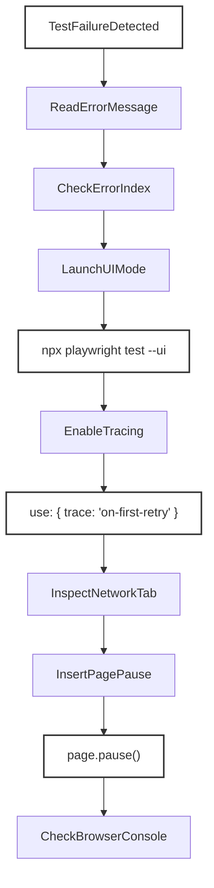
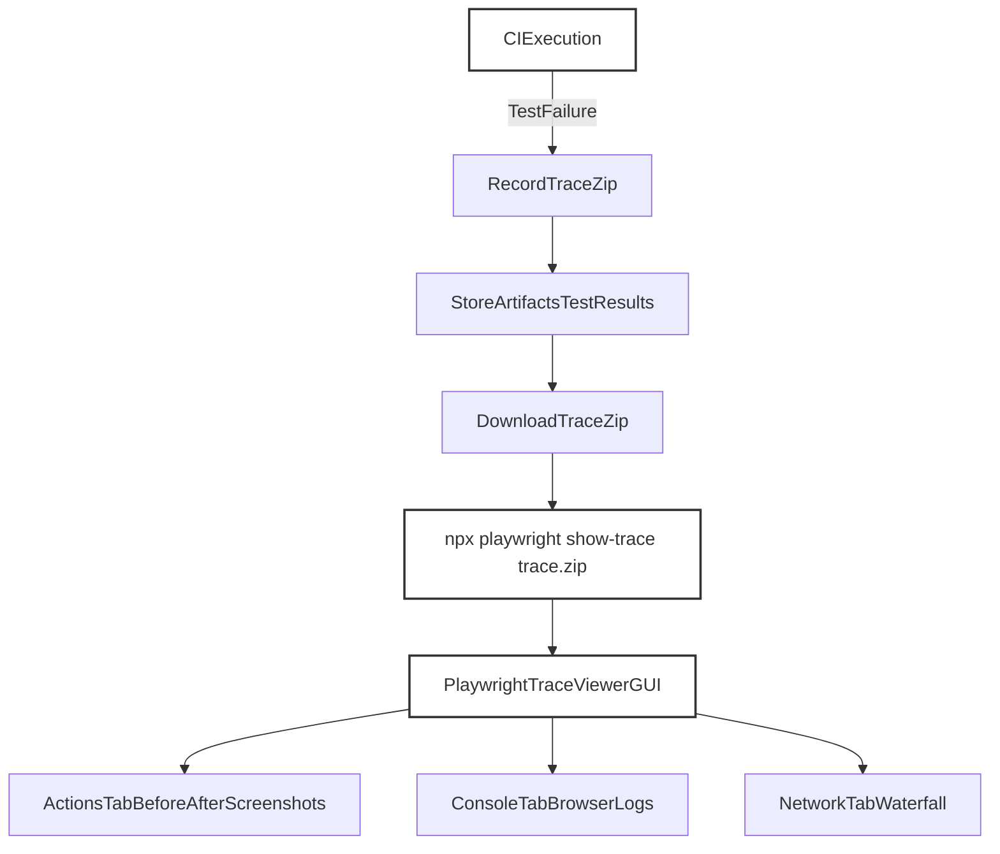

<!-- source: DeepWiki mcp.deepwiki.com · repo testdino-hq/playwright-skill · page 4.1 Debugging Workflows and Error Index · fetched 2026-10-26 -->

# Debugging Workflows and Error Index

<details>
<summary>Relevant source files</summary>

The following files were used as context for generating this wiki page:

- [core/angular.md](core/angular.md)
- [core/browser-extensions.md](core/browser-extensions.md)
- [core/canvas-and-webgl.md](core/canvas-and-webgl.md)
- [core/clock-and-time-mocking.md](core/clock-and-time-mocking.md)
- [core/common-pitfalls.md](core/common-pitfalls.md)
- [core/debugging.md](core/debugging.md)
- [core/error-index.md](core/error-index.md)

</details>


## Purpose and Scope

This page covers diagnostic strategies, debugging tools, runtime modes, and an index of common error messages encountered when running Playwright tests. It provides systematic playbooks for local interactive debugging, CI trace analysis, and failure resolution. 

Sources: `[core/debugging.md:1-38]()`, `[core/error-index.md:1-8]()`

---

## 1. Systematic Debugging Workflow and Tool Registry

When a test fails, diagnosing the root cause requires a structured approach. Jumping straight to code modifications or arbitrary waits introduces flakiness. Playwright provides a hierarchy of tools optimized for different triage stages.

| Tool | Command / API | Best For |
|---|---|---|
| UI Mode | `npx playwright test --ui` | Interactive exploration, visual timeline, re-running tests `[core/debugging.md:9-9]()` |
| Playwright Inspector | `PWDEBUG=1 npx playwright test` | Step-through debugging, selector playground `[core/debugging.md:10-10]()` |
| Trace Viewer | `npx playwright show-trace trace.zip` | Post-mortem CI failure analysis `[core/debugging.md:11-11]()` |
| CLI Debugger | `npx playwright test --debug=cli` | Agent workflows, SSH sessions, terminal-first debugging `[core/debugging.md:12-12]()` |
| Headed Mode | `npx playwright test --headed` | Watching the browser during test execution `[core/debugging.md:13-13]()` |
| Slow Motion | `npx playwright test --headed --slow-mo=500` | Visually following fast interactions `[core/debugging.md:14-14]()` |
| Programmatic Pause | `page.pause()` | Pausing at an exact point to inspect live state `[core/debugging.md:15-15]()` |
| Verbose API Logs | `DEBUG=pw:api npx playwright test` | Seeing every Playwright API call with timing `[core/debugging.md:16-16]()` |

### Systematic Diagnostic Pipeline

The following diagram maps diagnostic intents to specific Playwright execution commands and API hooks (`[core/debugging.md:23-36]()`).

Title: Systematic Debugging Decision Flow


Sources: `[core/debugging.md:5-37]()`

---

## 2. Interactive Debugging Modes: UI Mode and Inspector

### UI Mode (`--ui`)
UI Mode provides a visual timeline, DOM snapshots captured at each step, a network waterfall, and single-test re-running capabilities `[core/debugging.md:45-45]`. 

Configure `trace` in `playwright.config.ts` to ensure traces are available during UI Mode exploration and CI retries `[core/debugging.md:55-65]()`:

```typescript
import { defineConfig } from '@playwright/test';

export default defineConfig({
  use: {
    trace: 'on-first-retry',
  },
});
```
*For flaky tests on Playwright 1.59+, consider `trace: 'retain-on-failure-and-retries'`.* `[core/debugging.md:67-68]`

### Playwright Inspector (`PWDEBUG=1`)
When step-by-step execution is required, setting `PWDEBUG=1` launches the Playwright Inspector before each action `[core/debugging.md:87-113]()`.

```typescript
import { test, expect } from '@playwright/test';

test('debug login flow', async ({ page }) => {
  await page.goto('/login');
  await page.getByLabel('Email').fill('user@example.com');
  await page.getByLabel('Password').fill('password123');
  await page.getByRole('button', { name: 'Sign in' }).click();
  await expect(page.getByRole('heading', { name: 'Dashboard' })).toBeVisible();
});
```

Sources: `[core/debugging.md:40-138]()`

---

## 3. Post-Mortem Trace Analysis Workflow

When tests fail in headless CI environments without local reproduction capability, trace artifacts (`trace.zip`) capture the exact state, screenshots, and network logs `[core/debugging.md:141-167]()`.

### Trace Analysis Architecture

Title: Trace Viewer Artifact Processing Pipeline


Sources: `[core/debugging.md:145-188]()`

---

## 4. Error Message Index and Resolution Playbooks

This section indexes common error messages, root causes, and verified fixes.

### Locator and Element Errors

#### 1. "locator.click: Target closed"
* **Cause**: The page or frame navigated away or was closed before Playwright finished executing the action `[core/error-index.md:13-15]()`.
* **Common Triggers**: Clicking a link triggering navigation while another action is pending, form submission causing page reload before `click()` resolves, or race conditions with `page.close()` in `finally` blocks `[core/error-index.md:17-21]()`.
* **Fix**: Coordinate navigation and clicking using `Promise.all` `[core/error-index.md:23-31]()`:
```typescript
await Promise.all([
  page.waitForURL('**/dashboard'),
  page.getByRole('link', { name: 'Dashboard' }).click(),
]);
```

#### 2. "waiting for locator('...') to be visible"
* **Cause**: Playwright's auto-waiting timed out because the element never appeared in the DOM or remained hidden (`display: none`, `visibility: hidden`, or `opacity: 0`) `[core/error-index.md:66-68]()`.
* **Common Triggers**: Conditional rendering based on unarrived API responses, or typos in semantic roles and test IDs `[core/error-index.md:70-75]()`.
* **Fix**: Await the network response or condition explicitly before asserting visibility `[core/error-index.md:77-89]()`:
```typescript
await page.waitForResponse(resp =>
  resp.url().includes('/api/data') && resp.status() === 200
);
await expect(page.getByRole('button', { name: 'Submit' })).toBeVisible();
```

#### 3. "locator.click: Error: strict mode violation"
* **Cause**: The locator matched more than one element and Playwright's strict mode (enabled by default) rejected the ambiguous target `[core/error-index.md:105-107]()`.
* **Common Triggers**: Using broad selectors like `getByRole('button')` when multiple matching buttons exist `[core/error-index.md:109-113]()`.
* **Fix**: Refine the locator using `exact: true`, container scoping, or filters `[core/error-index.md:115-137]()`:
```typescript
await page.getByRole('button', { name: 'Save', exact: true }).click();

await page.getByRole('dialog')
  .getByRole('button', { name: 'Save' }).click();

await page.getByRole('listitem')
  .filter({ hasText: 'Project Alpha' })
  .getByRole('button', { name: 'Delete' }).click();
```

Sources: `[core/error-index.md:9-160]()`

---

