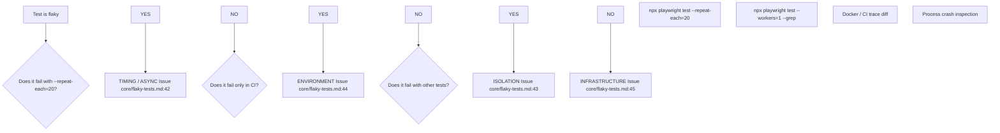
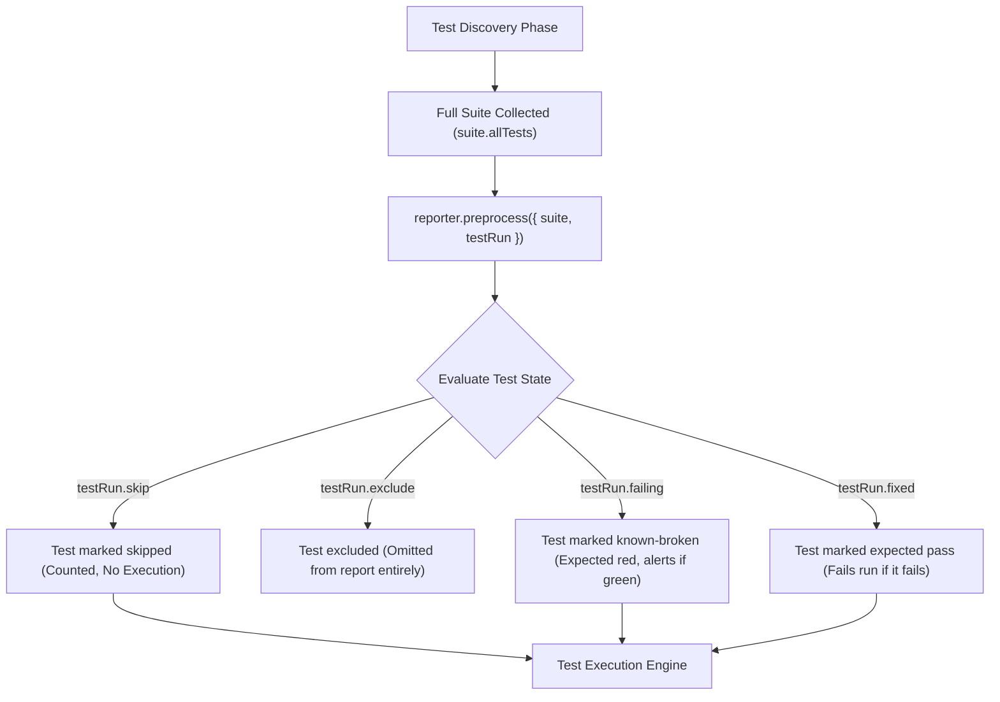

<!-- source: DeepWiki mcp.deepwiki.com · repo testdino-hq/playwright-skill · page 4.3 Flaky Tests and Dynamic Test Selection · fetched 2026-10-26 -->

# Flaky Tests and Dynamic Test Selection

<details>
<summary>Relevant source files</summary>

The following files were used as context for generating this wiki page:

- [ci/parallel-and-sharding.md](ci/parallel-and-sharding.md)
- [core/dynamic-test-selection.md](core/dynamic-test-selection.md)
- [core/flaky-tests.md](core/flaky-tests.md)

</details>


> **Purpose and Scope**: This page details the root causes of test flakiness, diagnostic workflows, Playwright trace retention strategies (`core/flaky-tests.md`), error context capture [core/flaky-tests.md:104-123](), and dynamic test selection via `reporter.preprocess()` [core/dynamic-test-selection.md:35-65]() combined with external APIs for automated quarantine management.

---

## 1. Flakiness Taxonomy and Diagnostic Workflows

Every flaky test fits into one of four distinct categories: timing/async issues, test isolation failures, environment discrepancies, or infrastructure failures [core/flaky-tests.md:36-46](). Identifying the category dictates the appropriate remediation strategy.

### Diagnosis Flowchart

The following diagram maps natural language diagnostic steps to concrete test runner commands, configuration properties, and execution options.


*Figure 1: Flaky Test Diagnosis Decision Tree mapping failure symptoms to root causes and debugging commands [core/flaky-tests.md:47-83]().*

Sources: [core/flaky-tests.md:34-83]()

---

## 2. Trace Retention and Error Context Capture

When debugging intermittent assertion failures, traditional trace configurations can either bloat storage or miss crucial timeline data. Playwright 1.59+ introduces `retain-on-failure-and-retries`, which preserves failing attempts alongside passing retries [core/flaky-tests.md:85-103](). Additionally, Playwright 1.60 attaches `errorContext` containing accessibility and aria snapshots to `testInfo.errors` [core/flaky-tests.md:104-126]().

```typescript
// Attachment pattern in afterEach hook
test.afterEach(async ({}, testInfo) => {
  if (testInfo.status !== testInfo.expectedStatus) {
    for (const err of testInfo.errors) {
      if (err.errorContext) {
        await testInfo.attach('failure-context', {
          body: err.errorContext,
          contentType: 'text/plain',
        });
      }
    }
  }
});
```

Sources: [core/flaky-tests.md:85-126]()

---

## 3. Dynamic Test Selection via `reporter.preprocess()`

Prior to Playwright 1.62, dynamic filtering required complex regex strings via `--grep` or manual file alterations [core/dynamic-test-selection.md:6-9](). Playwright 1.62 introduces `reporter.preprocess()`, allowing custom reporters to intercept the collected test suite post-discovery and pre-execution [core/dynamic-test-selection.md:8-37]().

### Data Flow and Execution Pipeline

The preprocess hook modifies test execution behavior by leveraging the `testRun` interface within a custom reporter class.


*Figure 2: Data flow showing how `reporter.preprocess()` classifies test cases via `testRun` methods prior to suite execution [core/dynamic-test-selection.md:35-62]().*

Sources: [core/dynamic-test-selection.md:1-65]()

---

## 4. External API Quarantine Integration

To prevent quarantine lists from becoming stagnant, tests can be dynamically flagged using telemetry data fetched from external services (such as the TestDino API) [core/dynamic-test-selection.md:66-72](). 

```typescript
// Integration pattern for dynamic quarantine lookup
async function fetchFlakyTitles(): Promise<Set<string>> {
  const { TESTDINO_PROJECT_ID, TESTDINO_API_TOKEN } = process.env;
  if (!TESTDINO_PROJECT_ID || !TESTDINO_API_TOKEN) return new Set();
  
  // Fetch logic with strict timeout and fallback
  try {
    const res = await fetch(`${API}/${TESTDINO_PROJECT_ID}/test-case-explorer?${params}`, {
      headers: { Authorization: `Bearer ${TESTDINO_API_TOKEN}` },
      signal: AbortSignal.timeout(10_000),
    });
    if (!res.ok) return new Set();
    const { success, data } = await res.json();
    if (!success) return new Set();
    return new Set(data.testCases.map((tc) => tc.title));
  } catch {
    return new Set(); // Never let telemetry break the test run
  }
}
```

By marking tests with `testRun.failing(test)`, the test suite runs the flaky test under an "expected failure" contract. If the test passes unexpectedly, Playwright flags a failure, ensuring resolution of flaky tests rather than indefinite suppression [core/dynamic-test-selection.md:60-62]().

Sources: [core/dynamic-test-selection.md:66-126]()

---

## 5. Isolated Retries and Concurrency Diagnostics

The default retry mechanism executes immediately within the same worker context, potentially inheriting tainted global or worker state [core/dynamic-test-selection.md:128-130](). Playwright 1.62+ provides `retryStrategy: 'isolated'` [core/dynamic-test-selection.md:131-137]().

```typescript
// playwright.config.ts configuration
export default defineConfig({
  retries: 2,
  retryStrategy: 'isolated',
});
```

When `retryStrategy` is set to `'isolated'`, all failing tests are deferred to the end of the test run and executed serially inside a single worker [core/dynamic-test-selection.md:139-142](). If a test fails in parallel execution but passes during the isolated retry phase, it indicates a concurrency or cross-test state leakage issue rather than an intrinsic test defect [core/dynamic-test-selection.md:140-141]().

Sources: [core/dynamic-test-selection.md:128-159](), [ci/parallel-and-sharding.md:151-206]()

---

