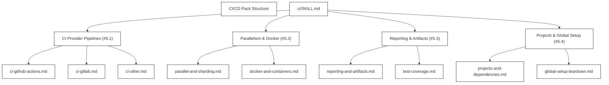

<!-- source: DeepWiki mcp.deepwiki.com · repo testdino-hq/playwright-skill · page 5 CI/CD and Infrastructure Pack · fetched 2026-10-26 -->

# CI/CD and Infrastructure Pack

<details>
<summary>Relevant source files</summary>

The following files were used as context for generating this wiki page:

- [ci/SKILL.md](ci/SKILL.md)
- [migration/SKILL.md](migration/SKILL.md)
- [pom/SKILL.md](pom/SKILL.md)

</details>


The `ci/` pack (`[ci/SKILL.md:1-47]()`) provides production-ready CI/CD configurations, scaling strategies, containerized environments, and reporting patterns for executing Playwright tests reliably in automated pipelines. This pack addresses the operational challenges of moving from local test authoring to robust, parallelized enterprise CI environments.


Sources: [ci/SKILL.md:1-47]()

---

## 5.1 CI Provider Pipelines

Continuous Integration pipelines require explicit configuration to handle headless browsers, caching of browser binaries, and environment variable isolation. The guides in this section cover major CI providers including GitHub Actions, GitLab CI, CircleCI, Azure DevOps, and Jenkins (`[ci/SKILL.md:25-32]()`).

Key pipeline considerations include caching `~/.cache/ms-playwright` keyed against the specific Playwright version, pinning external dependencies to prevent unexpected breakage, and configuring robust failure paths (`[ci/SKILL.md:14-21]()`). For detailed provider-specific configuration files, workflow templates, and environment hardening steps, see [CI Provider Pipelines](#5.1).

```mermaid
graph LR
    CodeCommit["Code Commit"] --> Trigger["Pipeline Trigger"]
    Trigger --> CacheCheck["Cache ms-playwright Binary"]
    CacheCheck --> InstallDeps["npm ci & install browsers"]
    InstallDeps --> ExecTests["Execute Playwright Test Suite"]
    
    Sources: [ci/SKILL.md:12-22]()
```
Sources: [ci/SKILL.md:12-22]()

---

## 5.2 Parallelism, Sharding and Docker

Scaling test suites horizontally across multiple runner instances is essential for maintaining fast feedback loops as test suites grow. Playwright supports native test sharding via the `--shard=N/M` flag, splitting test suites evenly across isolated runner nodes (`[ci/SKILL.md:16]()`). 

To guarantee execution parity between local machines and cloud build agents, containerized execution via official Microsoft Playwright Docker images (`mcr.microsoft.com/playwright:v*`) provides pre-installed OS-level dependencies (`[ci/SKILL.md:19]()`). For implementation details regarding blob reports, cross-runner result merging, and containerized strategies, see [Parallelism, Sharding and Docker](#5.2).

```mermaid
graph TD
    RunnerPool["CI Runner Pool"] --> Shard1["--shard=1/3"]
    RunnerPool --> Shard2["--shard=2/3"]
    RunnerPool --> Shard3["--shard=3/3"]
    
    Shard1 --> Blob1["Blob Report 1"]
    Shard2 --> Blob2["Blob Report 2"]
    Shard3 --> Blob3["Blob Report 3"]
    
    Blob1 --> Merge["merge-reports CLI"]
    Blob2 --> Merge
    Blob3 --> Merge
    
    Merge --> FinalReport["Unified HTML Report"]

    Sources: [ci/SKILL.md:16]()
```
Sources: [ci/SKILL.md:16]()

---

## 5.3 Reporting, Artifacts and Coverage

Effective debugging in headless CI environments relies on capturing rich artifacts only when failures occur, avoiding excessive disk I/O and log noise. Standard configurations apply `traces: 'on-first-retry'` to capture execution steps and DOM snapshots upon a test failure (`[ci/SKILL.md:15]()`).

Failing pipelines should automatically upload HTML reports, screenshots, and trace zips as workflow artifacts (`[ci/SKILL.md:18]()`). Additionally, code coverage collection must be integrated into the test lifecycle without skewing execution times. For custom reporter interfaces, trace retention policies, and coverage workflows, see [Reporting, Artifacts and Coverage](#5.3).

Sources: [ci/SKILL.md:14-21]()

---

## 5.4 Projects, Dependencies and Global Setup

Large-scale test suites often require complex multi-project configurations, such as running subsets of tests across multiple browsers, viewports, or authentication states (`[ci/SKILL.md:39]()`). Test dependency chains ensure that setup projects execute before dependent functional test suites.

To optimize authentication flows across multiple workers, global setup hooks execute once to perform login routines, serializing session state into `storageState` files that are safely shared across worker threads (`[ci/SKILL.md:20]()`). For detailed patterns regarding `globalSetup`, `globalTeardown`, and multi-project dependency graphs, see [Projects, Dependencies and Global Setup](#5.4).

Sources: [ci/SKILL.md:39-47]()

---

