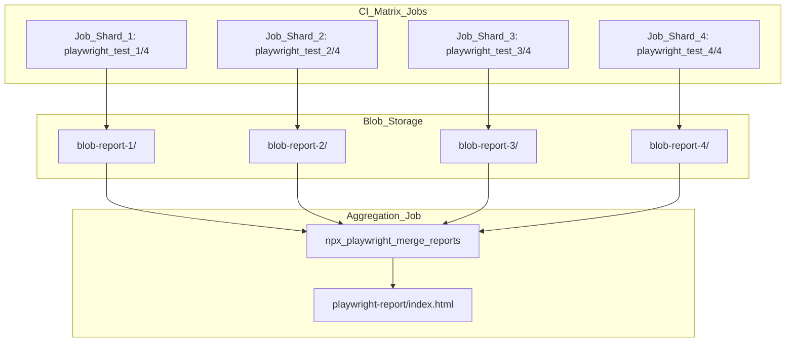
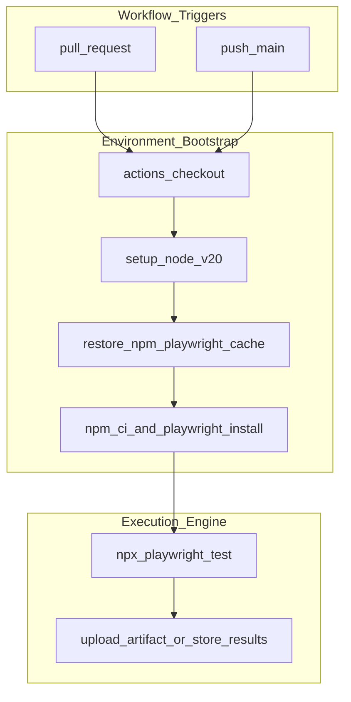

<!-- source: DeepWiki mcp.deepwiki.com · repo testdino-hq/playwright-skill · page 5.1 CI Provider Pipelines · fetched 2026-10-26 -->

# CI Provider Pipelines

<details>
<summary>Relevant source files</summary>

The following files were used as context for generating this wiki page:

- [ci/ci-github-actions.md](ci/ci-github-actions.md)
- [ci/ci-gitlab.md](ci/ci-gitlab.md)
- [ci/ci-other.md](ci/ci-other.md)

</details>


## Purpose and Scope

This page covers the implementation details of CI/CD provider pipelines for automated Playwright test execution, as documented in the `ci/` pack. The scope encompasses production-ready configuration blueprints for GitHub Actions (`ci/ci-github-actions.md`), GitLab CI/CD (`ci/ci-gitlab.md`), CircleCI, Azure DevOps, and Jenkins (`ci/ci-other.md`). It details environment setup, execution concurrency, parallel sharding strategies, report merging, caching mechanisms, and version pinning of external browser dependencies.

Sources: [ci/ci-github-actions.md:1-38](), [ci/ci-gitlab.md:1-33](), [ci/ci-other.md:1-15]()

---

## GitHub Actions Pipeline Patterns

GitHub Actions workflows are driven by YAML configurations under `.github/workflows/`. Standard production setups require dependency caching, OS-level browser installation, concurrency management, and artifact upload rules (`[ci/ci-github-actions.md:17-88]()`).

### Concurrency and Caching

To prevent redundant runs on pull requests and manage resource consumption, workflows incorporate concurrency cancellation groups (`[ci/ci-github-actions.md:32-34]()`):
```yaml
concurrency:
  group: playwright-${{ github.ref }}
  cancel-in-progress: true
```

Browser binaries (`~/.cache/ms-playwright`) are cached using package-lock hashes to accelerate runner bootstrap times (`[ci/ci-github-actions.md:55-61]()`):
```yaml
- name: Cache Playwright browsers
  id: playwright-cache
  uses: actions/cache@v4
  with:
    path: ~/.cache/ms-playwright
    key: playwright-${{ runner.os }}-${{ hashFiles('package-lock.json') }}
```

Sources: [ci/ci-github-actions.md:32-88]()

---

## GitLab CI/CD Pipelines

GitLab pipelines utilize Microsoft's official Playwright Docker images to guarantee system dependency parity (`[ci/ci-gitlab.md:23]()`):
```yaml
image: mcr.microsoft.com/playwright:v1.52.0-noble
```

### Parallel Sharding and Artifact Retention

For test suites exceeding 10 minutes, GitLab's `parallel` keyword natively partitions test workloads across runner nodes using `CI_NODE_INDEX` and `CI_NODE_TOTAL` variables (`[ci/ci-gitlab.md:103-117]()`). Shard outputs are collected as blob reports and merged via `npx playwright merge-reports` in a subsequent reporting stage (`[ci/ci-gitlab.md:118-129]()`).

```yaml
test:
  stage: test
  parallel: 4
  script:
    - npx playwright test --shard=$CI_NODE_INDEX/$CI_NODE_TOTAL
  artifacts:
    when: always
    paths:
      - blob-report/
    expire_in: 1 hour
```

Sources: [ci/ci-gitlab.md:21-129]()

---

## CircleCI and Azure DevOps Integration

Alternative CI providers rely on explicit executors, workspaces, or build tasks to handle node modules and test report harvesting (`[ci/ci-other.md:1-158]()`).

### CircleCI Configuration

CircleCI implementations define custom Docker executors using official Playwright base images (`[ci/ci-other.md:27-31]`). Parallelism is managed through built-in environment variables (`[ci/ci-other.md:53-61]()`):
```yaml
test:
  executor: playwright
  parallelism: 4
  steps:
    - checkout
    - attach_workspace:
        at: .
    - run:
        command: |
          npx playwright test --shard=$((CIRCLE_NODE_INDEX + 1))/$CIRCLE_NODE_TOTAL
```

### Azure DevOps Configuration

Azure DevOps configurations utilize job matrices for sharded pipelines, publishing JUnit test results and pipeline artifacts conditionally (`[ci/ci-other.md:217-270]()`).

Sources: [ci/ci-other.md:24-283]()

---

## Pinning External Dependencies and Browser Versions

To avoid breaking changes caused by rolling browser updates or underlying Linux system library discrepancies, CI environments must enforce strict version pinning:

1. **Docker Image Tagging**: Always pin to specific Playwright and OS release tags (e.g., `mcr.microsoft.com/playwright:v1.52.0-noble`) rather than `latest` (`[ci/ci-gitlab.md:23]()`, `[ci/ci-other.md:30]()`).
2. **Node Modules Caching**: Hash `package-lock.json` for cache keys to ensure node modules mirror local development environments (`[ci/ci-github-actions.md:55-60]`, `[ci/ci-gitlab.md:35-41]()`).
3. **OS Dependencies**: When not using official Playwright Docker containers, execute `npx playwright install --with-deps` during cache misses, or `npx playwright install-deps` during cache hits (`[ci/ci-github-actions.md:62-68]()`).

Sources: [ci/ci-github-actions.md:52-69](), [ci/ci-gitlab.md:21-41]()

---

## Diagram: CI Sharding and Report Merging Architecture


Sources: [ci/ci-github-actions.md:150-190](), [ci/ci-gitlab.md:103-129]()

---

## Diagram: Cross-Provider Pipeline Execution Flow


Sources: [ci/ci-github-actions.md:23-88](), [ci/ci-gitlab.md:21-66](), [ci/ci-other.md:24-78]()

---

