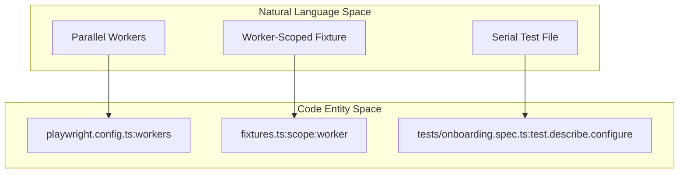
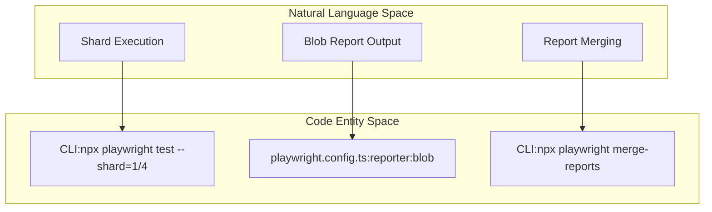

<!-- source: DeepWiki mcp.deepwiki.com · repo testdino-hq/playwright-skill · page 5.2 Parallelism, Sharding and Docker · fetched 2026-10-26 -->

# Parallelism, Sharding and Docker

<details>
<summary>Relevant source files</summary>

The following files were used as context for generating this wiki page:

- [ci/docker-and-containers.md](ci/docker-and-containers.md)
- [ci/parallel-and-sharding.md](ci/parallel-and-sharding.md)
- [core/dynamic-test-selection.md](core/dynamic-test-selection.md)

</details>


## Purpose and Scope
This page covers the technical mechanisms for scaling Playwright test execution through parallelism within a single machine, sharding across multiple CI nodes, merging binary blob reports, managing worker-scoped resources, and running tests within containerized Docker environments.

---

## 1. Parallel Execution and Worker Configuration

Playwright supports two levels of parallelism controlled via `playwright.config.ts`: parallel execution across test files, and fully parallel execution where individual tests within the same file run concurrently `[ci/parallel-and-sharding.md:31-46]`.

### Configuration Parameters
- `fullyParallel`: When set to `true`, tests within a single file also execute in parallel `[ci/parallel-and-sharding.md:36-38]`.
- `workers`: Controls the number of parallel worker processes. It accepts an absolute number, a string percentage of CPU cores (e.g., `'50%'`), or `undefined` for automatic detection (half CPU cores) `[ci/parallel-and-sharding.md:40-44]`.

To enforce serial execution for specific test files despite global configuration settings, use `test.describe.configure({ mode: 'serial' })` `[ci/parallel-and-sharding.md:55-72]`.

### Worker-Scoped Fixtures
To optimize resource usage (such as database handles or authorization tokens), fixtures can be scoped to the worker level rather than the test level using `{ scope: 'worker' }` `[ci/parallel-and-sharding.md:151-189]`.

### Diagram: Worker Configuration and Scoping Architecture



Sources: `[ci/parallel-and-sharding.md:31-46]`, `[ci/parallel-and-sharding.md:55-72]`, `[ci/parallel-and-sharding.md:151-189]`

---

## 2. Sharding and Blob Reports

When a test suite exceeds execution time thresholds on a single machine, sharding splits the test file list into $N$ equal groups executed across separate CI runner jobs `[ci/parallel-and-sharding.md:73-83]`.

### Shard Execution CLI
Shards are executed using the `--shard=index/total` flag:
```bash
npx playwright test --shard=1/4
```
`[ci/parallel-and-sharding.md:12-14]`

### Blob Reporter Integration
Sharded runs require the binary blob reporter to capture results without outputting fragmented HTML reports `[ci/parallel-and-sharding.md:85-101]`:
```ts
// playwright.config.ts
export default defineConfig({
  reporter: process.env.CI
    ? [['blob'], ['github']]
    : [['html', { open: 'on-failure' }]],
});
```
`[ci/parallel-and-sharding.md:88-100]`

### Merging Reports
Once all shards finish, their `.zip` output files are aggregated using `npx playwright merge-reports`:
```bash
npx playwright merge-reports --reporter=html ./all-blob-reports
```
`[ci/parallel-and-sharding.md:103-119]`

### Diagram: Sharding and Report Merging Pipeline



Sources: `[ci/parallel-and-sharding.md:12-19]`, `[ci/parallel-and-sharding.md:73-101]`, `[ci/parallel-and-sharding.md:103-149]`

---

## 3. Docker and Containerized Test Runs

Containerization ensures identical browser and OS binary dependencies across local development and CI pipelines `[ci/docker-and-containers.md:1-4]`.

### Official Images
Microsoft provides pre-packaged images containing all browser binaries and system libraries (`mcr.microsoft.com/playwright:v1.52.0-noble`) `[ci/docker-and-containers.md:8-10]`.

```bash
docker run --rm -v $(pwd):/app -w /app mcr.microsoft.com/playwright:v1.52.0-noble \
  npx playwright test
```
`[ci/docker-and-containers.md:12-14]`

### Docker Compose Application Stack
For full-stack integration testing, `docker-compose.yml` orchestrates the application server, database instance (using `tmpfs` RAM disks for performance), Redis cache, and the Playwright container runner `[ci/docker-and-containers.md:104-163]`. Execution is triggered via profiles:
```bash
docker compose --profile test up --abort-on-container-exit --exit-code-from e2e
```
`[ci/docker-and-containers.md:165-167]`

### Artifact Extraction
Test reports and traces generated inside containers can be persisted to the host machine via explicit volume mounts or `docker cp` commands `[ci/docker-and-containers.md:179-207]`.

Sources: `[ci/docker-and-containers.md:1-222]`

---

## 4. Test Isolation and Safe Parallelism

Running tests in parallel introduces state collision risks if test cases share records or global authentication tokens `[ci/parallel-and-sharding.md:191-206]`. 

To guarantee deterministic parallel execution:
- Each test must generate its own isolated resource state (e.g., unique user profiles or database entries).
- Tests must clean up after themselves via test hooks or fixtures.
- Hardcoded shared resources (such as static user accounts edited concurrently across workers) must be avoided `[ci/parallel-and-sharding.md:196-205]`.

Sources: `[ci/parallel-and-sharding.md:191-206]`

---

