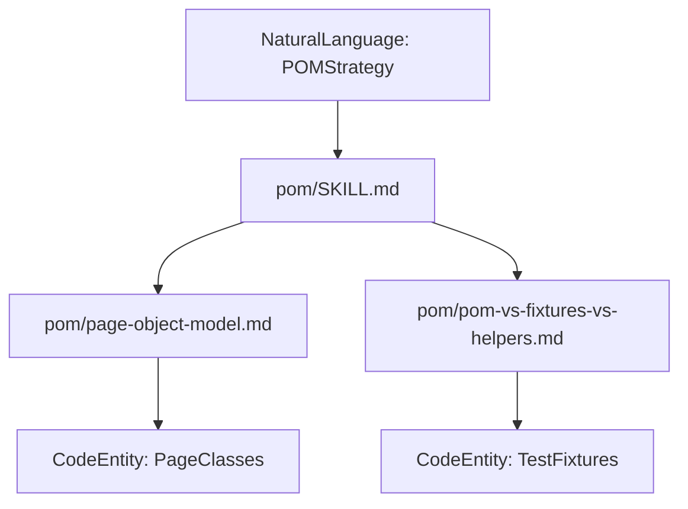
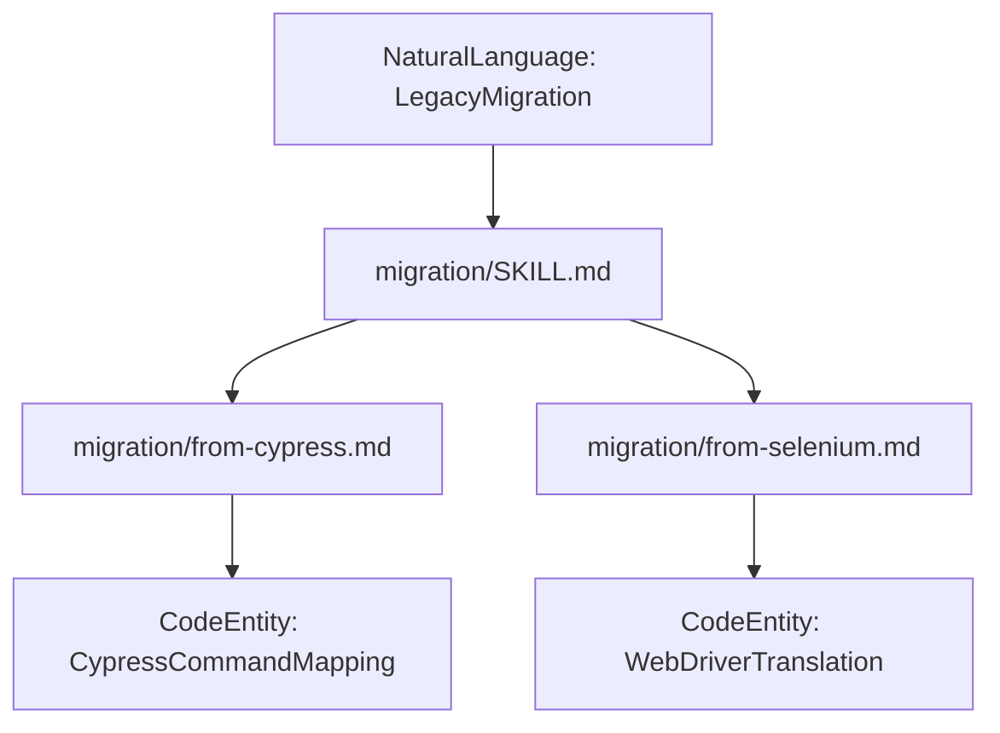

<!-- source: DeepWiki mcp.deepwiki.com · repo testdino-hq/playwright-skill · page 7 Page Objects and Migration Packs · fetched 2026-10-26 -->

# Page Objects and Migration Packs

Relevant source files

The following files were used as context for generating this wiki page:

- [ci/SKILL.md](ci/SKILL.md)
- [migration/SKILL.md](migration/SKILL.md)
- [pom/SKILL.md](pom/SKILL.md)

This page provides an overview of the `pom/` and `migration/` skill packs within the `playwright-skill` repository. These packs furnish structured patterns for test maintenance via the Page Object Model (POM) and provide systematic migration paths for teams transitioning from legacy testing frameworks. 

For full technical specifications, architecture decision trees, and code templates, see the child pages:
- [Page Object Model Patterns](#7.1)
- [Migrating from Cypress and Selenium](#7.2)

---

## 7.1 Page Object Model Patterns

The `pom/` pack defines architectural patterns for abstracting page interactions, encapsulated in `pom/SKILL.md` [pom/SKILL.md:1-17](). It addresses when to encapsulate UI locators and behaviors within dedicated page classes, and when alternative patterns like Playwright fixtures or simple helper functions offer better maintainability [pom/SKILL.md:1-4]().

The pack comprises two primary guides: `pom/page-object-model.md` for class structure and encapsulation, and `pom/pom-vs-fixtures-vs-helpers.md` for comparative evaluation of test organization strategies [pom/SKILL.md:14-17]().

*Sources: [pom/SKILL.md:1-17]()*

For details, see [Page Object Model Patterns](#7.1).

---

## 7.2 Migrating from Cypress and Selenium

The `migration/` pack facilitates moving existing test suites to Playwright, as outlined in `migration/SKILL.md` [migration/SKILL.md:1-17](). It provides side-by-side command mappings, architecture translations, and incremental adoption strategies [migration/SKILL.md:6-10]().

The pack contains specific guides for transitioning from major testing ecosystems: `migration/from-cypress.md` and `migration/from-selenium.md` [migration/SKILL.md:12-17]().

*Sources: [migration/SKILL.md:1-17]()*

For details, see [Migrating from Cypress and Selenium](#7.2).

---

