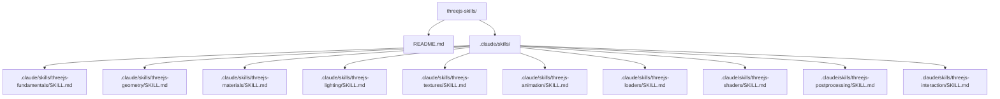
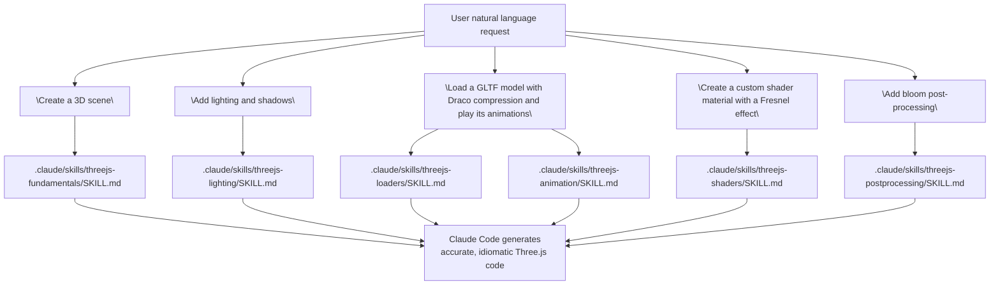
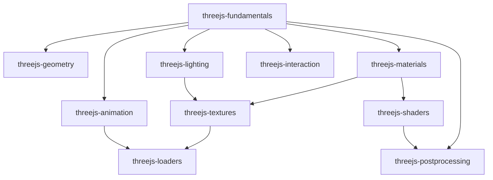

<!-- source: DeepWiki mcp.deepwiki.com · repo CloudAI-X/threejs-skills · page 1 Overview · fetched 2026-10-26 -->

# Overview

Relevant source files

The following files were used as context for generating this wiki page:

- [README.md](README.md)

This page describes the `threejs-skills` repository: its purpose, the problem it solves, the collection of skill files it contains, and how those files interact with Claude Code at runtime. For setup instructions, see [Getting Started](#1.1). For the routing mechanism that determines which files load, see [Skill Activation System](#1.2). For the internal structure each file must follow, see [Skill File Format](#1.3).

---

## What This Repository Is

`threejs-skills` is a collection of structured Markdown documents called *skill files*. Each file packages Three.js API references, constructor signatures, working code examples, and performance guidance into a format that Claude Code can load on demand.

Claude Code's general programming knowledge does not include the specifics of the Three.js API — accurate constructor signatures, valid property names, correct import paths from `three/addons/`, or current best practices as of r160+. Skill files fill that gap.

The repository contains:

- One entry point: `README.md`, which defines the integration contract and the index of skills.
- One directory: `.claude/skills/`, containing ten `SKILL.md` files, one per Three.js topic domain.

Sources: [README.md:1-12]()

---

## Repository Layout

**Diagram: Repository structure mapped to file paths**

Sources: [README.md:29-41]()

---

## The Ten Skill Files

Each skill file covers one topic domain of the Three.js library. The table below lists each file, the skill `name` field it declares in its front matter, and the scope of its content.

| File path | `name` field | Scope |
|---|---|---|
| `.claude/skills/threejs-fundamentals/SKILL.md` | `threejs-fundamentals` | `Scene`, `PerspectiveCamera`, `WebGLRenderer`, `Object3D`, `Group`, `Mesh`, `Vector3`, `Clock` |
| `.claude/skills/threejs-geometry/SKILL.md` | `threejs-geometry` | Built-in geometries, `BufferGeometry`, `BufferAttribute`, `InstancedMesh` |
| `.claude/skills/threejs-materials/SKILL.md` | `threejs-materials` | PBR materials, `ShaderMaterial`, `RawShaderMaterial`, blending, depth |
| `.claude/skills/threejs-lighting/SKILL.md` | `threejs-lighting` | Light types, shadow maps, IBL, `PMREMGenerator` |
| `.claude/skills/threejs-textures/SKILL.md` | `threejs-textures` | `TextureLoader`, `WebGLRenderTarget`, `CubeCamera`, UV config |
| `.claude/skills/threejs-animation/SKILL.md` | `threejs-animation` | `AnimationClip`, `AnimationMixer`, `AnimationAction`, `KeyframeTrack` |
| `.claude/skills/threejs-loaders/SKILL.md` | `threejs-loaders` | `GLTFLoader`, `DRACOLoader`, `KTX2Loader`, `LoadingManager`, `THREE.Cache` |
| `.claude/skills/threejs-shaders/SKILL.md` | `threejs-shaders` | GLSL, uniforms, `onBeforeCompile`, `ShaderChunk` |
| `.claude/skills/threejs-postprocessing/SKILL.md` | `threejs-postprocessing` | `EffectComposer`, `RenderPass`, `UnrealBloomPass`, `ShaderPass` |
| `.claude/skills/threejs-interaction/SKILL.md` | `threejs-interaction` | `Raycaster`, `OrbitControls`, `TransformControls`, `DragControls` |

Sources: [README.md:29-41]()

---

## How Skill Files Fit Into a Development Workflow

When a user makes a natural language request in Claude Code, Claude Code reads the `description` field from each skill file's YAML front matter and loads the files whose descriptions match the request context. Multiple files can be co-loaded in a single request.

**Diagram: Natural language request mapped to loaded SKILL.md files**

Sources: [README.md:44-68]()

---

## Skill Dependency Structure

The ten skill domains are not independent — they reflect natural layering within the Three.js runtime. The `threejs-fundamentals` skill is the foundation every other skill builds on. The diagram below shows how skills depend on each other, using the `name` field values from each file's front matter as node identifiers.

**Diagram: Dependency relationships between skill `name` identifiers**

A request that involves loading an animated GLTF model will cause Claude Code to co-load `threejs-loaders` and `threejs-animation`. A request for custom visual effects will co-load `threejs-shaders` and `threejs-postprocessing`. See [Skill Activation System](#1.2) for the full routing mechanics.

Sources: [README.md:44-50]()

---

## Quality Baseline

All skill files in this repository have been audited against the official Three.js documentation at version **r160+**. The verification checklist covers:

- Correct class names and constructor signatures
- Valid property and method names
- Accurate import paths using the `three/addons/` format
- Working code examples
- Current best practices

See [Contributing](#1.4) for the full requirements when adding or updating a skill file.

Sources: [README.md:112-119]()

---

