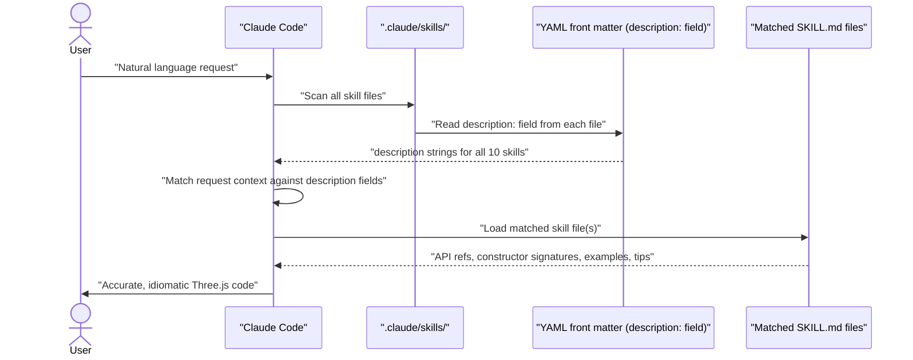
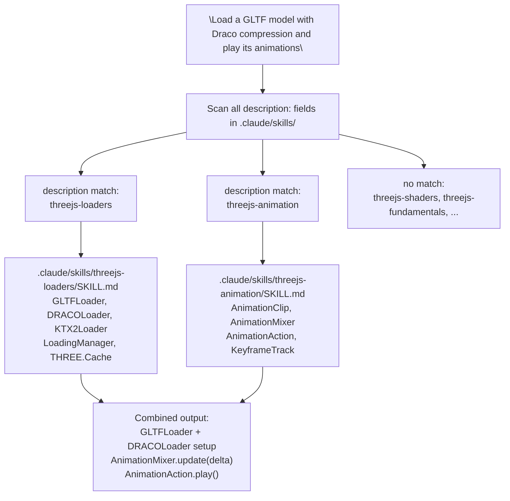
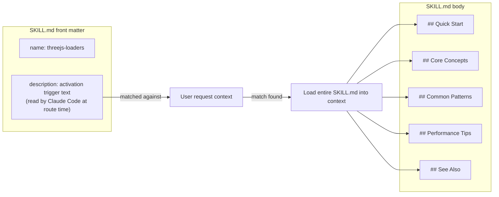

<!-- source: DeepWiki mcp.deepwiki.com · repo CloudAI-X/threejs-skills · page 1.2 Skill Activation System · fetched 2026-10-26 -->

# Skill Activation System

<details>
<summary>Relevant source files</summary>

The following files were used as context for generating this wiki page:

- [README.md](README.md)

</details>


This page describes the mechanism by which Claude Code selects and loads skill files from `.claude/skills/` in response to user requests. It covers the `description` front matter field (the routing key), how multiple skills can be co-loaded for a single request, and concrete request-to-skill mappings.

For details on the internal structure of each skill file (sections, YAML fields, content requirements), see [Skill File Format](#1.3). For setup and installation of the `.claude/skills/` directory, see [Getting Started](#1.1).

---

## How Routing Works

Claude Code does not require explicit configuration to select a skill. Instead, it reads the `description` field from the YAML front matter of every skill file in `.claude/skills/`, then matches that text against the semantic context of the user's natural language request.

The `description` field acts as a declarative trigger: it describes *when* the skill should be loaded, not *what* it contains. Claude Code performs this match automatically at request time.

**The routing front matter block** ([README.md:82-86]()):

```markdown
---
name: skill-name
description: When this skill should be activated
---
```

- `name` — unique identifier for the skill (e.g. `threejs-fundamentals`)
- `description` — the natural language trigger phrase that Claude Code evaluates against incoming requests

Sources: [README.md:43-51](), [README.md:82-86]()

---

## Activation Sequence

**Diagram: Skill Activation Sequence**



Sources: [README.md:43-51]()

---

## Request-to-Skill Mappings

The following table documents the example mappings defined in the README. These are illustrative — any phrasing that semantically matches a skill's `description` will trigger it.

| Example User Request | Skill(s) Activated | Skill File Path |
|---|---|---|
| "Create a 3D scene" | `threejs-fundamentals` | `.claude/skills/threejs-fundamentals/SKILL.md` |
| "Add lighting and shadows" | `threejs-lighting` | `.claude/skills/threejs-lighting/SKILL.md` |
| "Load a GLTF model" | `threejs-loaders` | `.claude/skills/threejs-loaders/SKILL.md` |
| "Load a GLTF model with Draco compression and play its animations" | `threejs-loaders` + `threejs-animation` | `.claude/skills/threejs-loaders/SKILL.md`, `.claude/skills/threejs-animation/SKILL.md` |
| "Create custom visual effects" | `threejs-shaders` + `threejs-postprocessing` | `.claude/skills/threejs-shaders/SKILL.md`, `.claude/skills/threejs-postprocessing/SKILL.md` |
| "Create a custom shader material with a fresnel effect" | `threejs-shaders` | `.claude/skills/threejs-shaders/SKILL.md` |

Sources: [README.md:46-50](), [README.md:53-76]()

---

## Multi-Skill Co-Loading

A single request can activate more than one skill simultaneously. Claude Code loads all skills whose `description` fields match the request context. The loaded skill files are treated as a combined reference corpus for that response.

**Diagram: Multi-Skill Co-Loading for a GLTF + Animation Request**



Sources: [README.md:63-68]()

---

## The `description` Field as a Routing Key

The `description` field is the sole routing mechanism. It is not a human-readable summary of the skill's content — it is a specification of *when to load* the skill. Writing effective `description` values is therefore important for correct activation behavior.

**Diagram: description Field Location and Its Role**



The body sections (`Quick Start`, `Core Concepts`, etc.) are only consumed *after* the `description` field has matched and triggered loading. The `description` field itself is never surfaced to the user — it is internal routing metadata.

For a full breakdown of each body section and what content belongs in it, see [Skill File Format](#1.3).

Sources: [README.md:80-109]()

---

## All Skills and Their Activation Scope

The following table lists all ten skill files in the repository, their `name` identifier, and the domain of requests expected to activate them.

| `name` | File | Activation Domain |
|---|---|---|
| `threejs-fundamentals` | `.claude/skills/threejs-fundamentals/SKILL.md` | Scene setup, cameras, renderer, Object3D hierarchy |
| `threejs-geometry` | `.claude/skills/threejs-geometry/SKILL.md` | Built-in shapes, BufferGeometry, instancing |
| `threejs-materials` | `.claude/skills/threejs-materials/SKILL.md` | PBR materials, ShaderMaterial, material properties |
| `threejs-lighting` | `.claude/skills/threejs-lighting/SKILL.md` | Light types, shadows, environment lighting |
| `threejs-textures` | `.claude/skills/threejs-textures/SKILL.md` | Texture loading, UV mapping, render targets |
| `threejs-animation` | `.claude/skills/threejs-animation/SKILL.md` | Keyframe animation, AnimationMixer, skeletal animation |
| `threejs-loaders` | `.claude/skills/threejs-loaders/SKILL.md` | GLTFLoader, DRACOLoader, async loading patterns |
| `threejs-shaders` | `.claude/skills/threejs-shaders/SKILL.md` | GLSL, uniforms, onBeforeCompile, custom effects |
| `threejs-postprocessing` | `.claude/skills/threejs-postprocessing/SKILL.md` | EffectComposer, bloom, DOF, custom passes |
| `threejs-interaction` | `.claude/skills/threejs-interaction/SKILL.md` | Raycasting, OrbitControls, mouse/touch input |

Sources: [README.md:30-42]()

---

