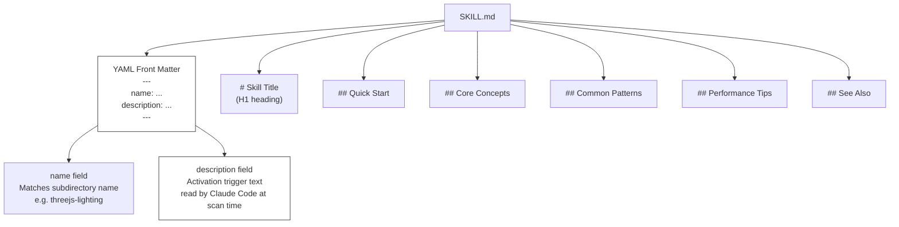
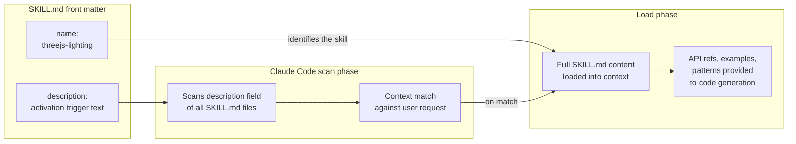
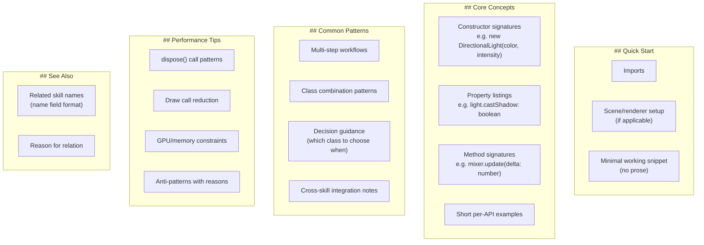

<!-- source: DeepWiki mcp.deepwiki.com · repo CloudAI-X/threejs-skills · page 1.3 Skill File Format · fetched 2026-10-26 -->

# Skill File Format

<details>
<summary>Relevant source files</summary>

The following files were used as context for generating this wiki page:

- [README.md](README.md)

</details>


This page documents the required internal structure of every skill file in the `.claude/skills/` directory. It covers the YAML front matter fields and the five mandatory sections that every `SKILL.md` must contain, along with what content belongs in each. For information on how Claude Code uses these files to answer requests, see [Skill Activation System](#1.2). For requirements when adding or updating files, see [Contributing](#1.4).

---

## Overview

Every skill is a single Markdown file named `SKILL.md`, stored in its own subdirectory under `.claude/skills/`. The file has two structural layers: a YAML front matter block at the top, followed by a fixed sequence of Markdown sections.

The front matter is machine-readable and drives skill selection. The sections are human- and LLM-readable and provide the actual Three.js knowledge payload.

Sources: [README.md:78-109]()

---

## File Location and Naming

Each skill occupies its own named subdirectory:

```
.claude/skills/
├── threejs-fundamentals/SKILL.md
├── threejs-geometry/SKILL.md
├── threejs-materials/SKILL.md
├── threejs-lighting/SKILL.md
├── threejs-textures/SKILL.md
├── threejs-animation/SKILL.md
├── threejs-loaders/SKILL.md
├── threejs-shaders/SKILL.md
├── threejs-postprocessing/SKILL.md
└── threejs-interaction/SKILL.md
```

The subdirectory name matches the `name` field in the front matter of the file it contains.

Sources: [README.md:30-41]()

---

## Complete File Structure

**Diagram: SKILL.md Top-Level Structure**



Sources: [README.md:82-109]()

---

## Front Matter

The front matter is a YAML block delimited by `---` at the very top of the file. It contains exactly two fields.

| Field | Type | Purpose |
|---|---|---|
| `name` | string | Unique identifier for the skill. Must match the subdirectory name (e.g. `threejs-lighting`). |
| `description` | string | Plain-language text that Claude Code reads to decide whether to load this file. Acts as the routing key. |

**Example front matter:**

```
---
name: threejs-lighting
description: When to activate this skill (matched against user request context)
---
```

The `description` field is the most consequential field in the entire file. It is the only part of the file that Claude Code reads during the initial scan phase, before deciding whether to load the rest. See [Skill Activation System](#1.2) for details on how `description` values are matched.

Sources: [README.md:82-86]()

**Diagram: Front Matter Fields Mapped to Runtime Behavior**



Sources: [README.md:43-51](), [README.md:82-86]()

---

## Section Reference

Each skill file must contain the following five sections in this order, as H2 headings.

### `## Quick Start`

**Purpose:** Provide a minimal, self-contained, copy-paste-ready code example. This is the first section a reader sees after the front matter. It should work with zero modification.

**What to include:**
- A single, complete working snippet
- All necessary imports
- The smallest amount of code that demonstrates the skill's primary use case
- No explanatory prose — just working code with inline comments if needed

---

### `## Core Concepts`

**Purpose:** Provide detailed API documentation covering the classes, constructors, properties, and methods central to this skill.

**What to include:**
- Constructor signatures with parameter types and default values
- Key property listings with types and descriptions
- Method signatures with return types
- Inline code examples for non-obvious usage
- Notes about deprecations or version-specific behavior (r160+ baseline)

This section is the primary reference layer — it should be authoritative enough that code generated from it does not require cross-referencing the official Three.js docs.

---

### `## Common Patterns`

**Purpose:** Document real-world usage patterns that go beyond the minimal Quick Start example.

**What to include:**
- Multi-step workflows (e.g., loader → mixer → action for animation)
- Typical combinations of classes from this skill
- Decision guidance (e.g., when to use `ShaderMaterial` vs `RawShaderMaterial`)
- Error-prone areas and how to avoid them
- Integration with other skills where relevant (reference the other skill by name)

---

### `## Performance Tips`

**Purpose:** Document optimization guidance specific to the systems covered by this skill.

**What to include:**
- Memory management and disposal patterns (`.dispose()` calls)
- Draw call reduction techniques
- GPU considerations (texture compression, buffer usage flags)
- Patterns to avoid with their reasoning
- Quantitative guidance where available (e.g., recommended texture size limits, shadow map sizes)

---

### `## See Also`

**Purpose:** Cross-reference related skill files to help Claude Code and human readers navigate to adjacent knowledge.

**What to include:**
- Names of related skills (using the `name` field format, e.g. `threejs-textures`)
- A one-line note on why the related skill is relevant
- Skills that are frequently co-loaded with this one (see [Skill Activation System](#1.2) for co-loading behavior)

---

## Section Summary Table

| Section | H-level | Primary Consumer | Key Constraint |
|---|---|---|---|
| Front matter | — | Claude Code (scan phase) | `description` must be accurate; it is the sole routing signal |
| `## Quick Start` | H2 | LLM / developer | Must be copy-paste ready with no edits |
| `## Core Concepts` | H2 | LLM code generation | Must use correct class names and signatures per r160+ |
| `## Common Patterns` | H2 | LLM code generation | Should reflect idiomatic Three.js, not workarounds |
| `## Performance Tips` | H2 | LLM code generation | Should be specific and actionable, not generic advice |
| `## See Also` | H2 | LLM / developer | Use `name` field values, not free-form references |

Sources: [README.md:78-136]()

---

## Format Constraints

The following constraints apply to all content within skill files:

- **Import paths** must use the `three/addons/` format (not the legacy `three/examples/jsm/` path).
- **Class names, property names, and method signatures** must be verified against Three.js r160 or later.
- **Code examples** must be complete enough to run — no ellipsis (`...`) standing in for required setup.
- **The `name` field** must match the subdirectory name exactly.
- **Section order** must be: Quick Start → Core Concepts → Common Patterns → Performance Tips → See Also.

Sources: [README.md:112-120](), [README.md:130-136]()

---

## Diagram: Section Content Types

**Diagram: What Belongs in Each Section**



Sources: [README.md:88-109](), [README.md:130-136]()

---

