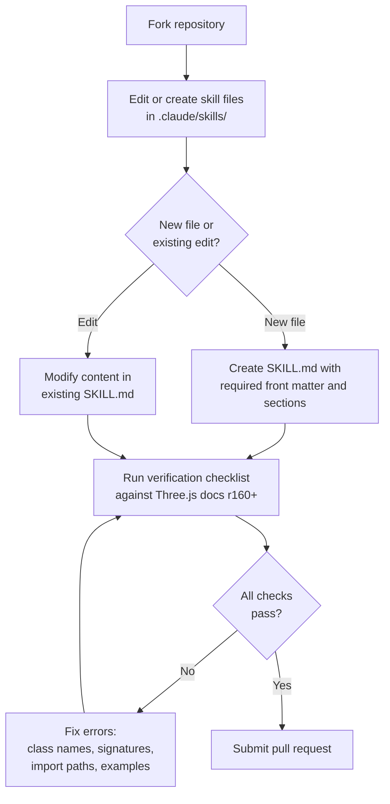
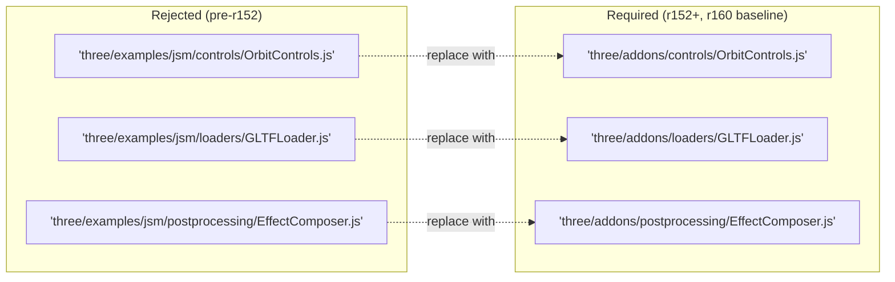
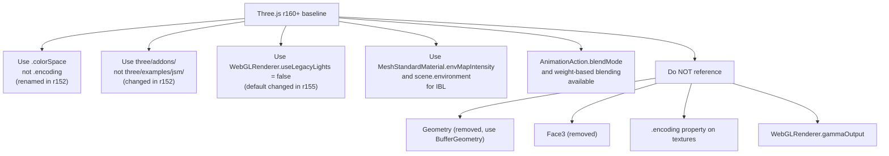
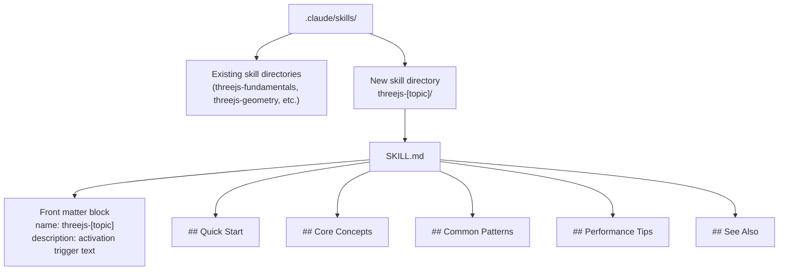

<!-- source: DeepWiki mcp.deepwiki.com · repo CloudAI-X/threejs-skills · page 1.4 Contributing · fetched 2026-10-26 -->

# Contributing

Relevant source files

The following files were used as context for generating this wiki page:

- [README.md](README.md)

This page describes the requirements and process for adding new skill files or modifying existing ones in the `threejs-skills` repository. It covers the quality verification checklist, Three.js version baseline, content guidelines, and the pull request workflow.

For documentation of the required internal format each skill file must follow, see [Skill File Format](#1.3). For an overview of how skills are activated and used, see [Skill Activation System](#1.2).

---

## Overview

The purpose of every skill file is to give Claude Code accurate, version-specific Three.js knowledge. A skill file with incorrect class names, wrong import paths, or broken code examples is worse than no skill file — it causes Claude Code to generate invalid output. All contributions must pass the verification checklist before being merged.

Sources: [README.md:111-136]()

---

## Contribution Workflow

**Contribution Process: Fork → Edit → Verify → Pull Request**

Sources: [README.md:121-128]()

The `.claude/skills/` directory is where all skill files live. Each file is named `SKILL.md` and placed inside a subdirectory named after the skill (e.g., `.claude/skills/threejs-lighting/SKILL.md`).

---

## Verification Checklist

All skill files — whether new or edited — must be audited against the official Three.js documentation at version **r160 or later**. The five verification areas are:

| # | Check | What to Verify |
|---|-------|----------------|
| 1 | **Class names** | Every class referenced (e.g., `WebGLRenderer`, `BufferGeometry`, `AnimationMixer`) must exist in Three.js r160+. |
| 2 | **Constructor signatures** | Parameter names, types, and order must match the current Three.js source. Deprecated overloads must not be used. |
| 3 | **Property and method signatures** | Property names (e.g., `.colorSpace` not `.encoding`) and method names must be current. Renamed or removed members fail this check. |
| 4 | **Import paths** | All addon imports must use the `three/addons/` format (e.g., `import { OrbitControls } from 'three/addons/controls/OrbitControls.js'`). The old `three/examples/jsm/` path is not acceptable. |
| 5 | **Working code examples** | Every code block must be syntactically valid and produce the described result. Examples must not rely on deprecated patterns. |

Sources: [README.md:112-119]()

---

## Import Path Format

The `three/addons/` import format is a hard requirement. The following diagram maps the two formats to the codebase structure so contributors can verify their paths:

**Import Path Mapping: Rejected vs. Required Format**

Sources: [README.md:117]()

---

## Content Guidelines

These guidelines apply to every section of a skill file. They complement the structural requirements defined in [Skill File Format](#1.3).

| Guideline | Detail |
|-----------|--------|
| **Accurate, tested examples** | Code must be copy-paste runnable. Do not include pseudocode in example blocks. |
| **Both simple and advanced patterns** | The Quick Start section targets minimal working code; Common Patterns covers real-world complexity. |
| **Performance implications documented** | Any pattern with a known cost (draw calls, texture memory, shader compilation) must have a note in Performance Tips. |
| **Cross-reference related skills** | The See Also section must link to other skills in `.claude/skills/` that a user would reasonably need together. |
| **Concise but complete** | Examples should not include unrelated boilerplate, but they must include all code required to make the shown feature work. |

Sources: [README.md:131-136]()

---

## Three.js Version Baseline

The repository targets **Three.js r160 and later**. This has concrete implications for what content is allowed:

**Version Baseline Constraints**

Sources: [README.md:113]()

---

## Skill File Location and Naming

The directory layout that a contribution must follow:

**Repository Layout for New Skill Files**

The `name` field in the front matter must match the directory name exactly. The `description` field is what Claude Code reads to decide whether to load the skill — it must accurately describe the Three.js topic covered so it activates for the right user requests. See [Skill Activation System](#1.2) for detail on how this field is used.

Sources: [README.md:79-109]()

---

## Summary: Pre-submission Checklist

Before opening a pull request, confirm all of the following:

- [ ] All class names verified against Three.js r160+ docs
- [ ] All constructor signatures match the current API
- [ ] All property and method names are current (not renamed/removed)
- [ ] All addon imports use `three/addons/` format
- [ ] All code examples are syntactically valid and runnable
- [ ] The `description` front matter field accurately reflects when the skill should activate
- [ ] The `name` field matches the containing directory name
- [ ] All five required sections are present (`Quick Start`, `Core Concepts`, `Common Patterns`, `Performance Tips`, `See Also`)
- [ ] Performance implications of documented patterns are noted
- [ ] Related skills are cross-referenced in `See Also`

Sources: [README.md:112-136]()

---

