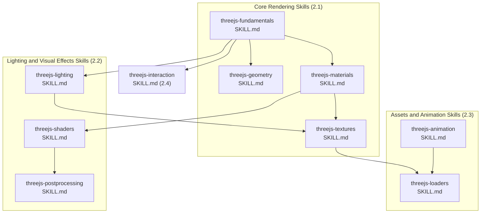
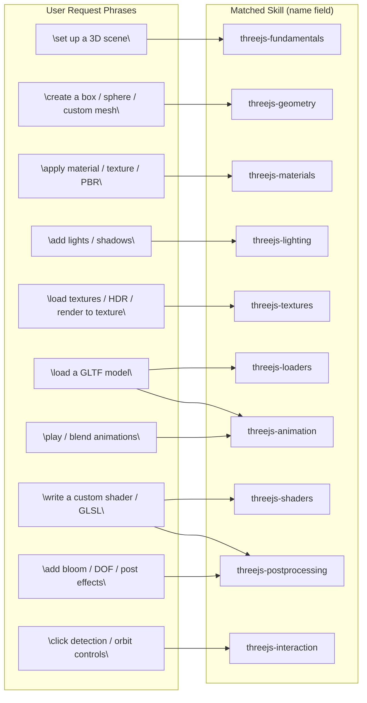
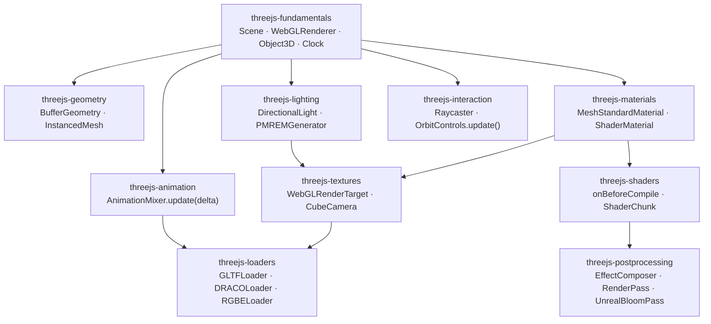

<!-- source: DeepWiki mcp.deepwiki.com · repo CloudAI-X/threejs-skills · page 2 Skills Reference · fetched 2026-10-26 -->

# Skills Reference

Relevant source files

The following files were used as context for generating this wiki page:

- [README.md](README.md)
- [skills/threejs-animation/SKILL.md](skills/threejs-animation/SKILL.md)
- [skills/threejs-fundamentals/SKILL.md](skills/threejs-fundamentals/SKILL.md)
- [skills/threejs-geometry/SKILL.md](skills/threejs-geometry/SKILL.md)
- [skills/threejs-interaction/SKILL.md](skills/threejs-interaction/SKILL.md)
- [skills/threejs-lighting/SKILL.md](skills/threejs-lighting/SKILL.md)
- [skills/threejs-loaders/SKILL.md](skills/threejs-loaders/SKILL.md)
- [skills/threejs-materials/SKILL.md](skills/threejs-materials/SKILL.md)
- [skills/threejs-postprocessing/SKILL.md](skills/threejs-postprocessing/SKILL.md)
- [skills/threejs-shaders/SKILL.md](skills/threejs-shaders/SKILL.md)
- [skills/threejs-textures/SKILL.md](skills/threejs-textures/SKILL.md)

This page is an index of all ten skill files in the `.claude/skills/` directory. Each entry lists the skill's `name` field (used as its identifier), the scope of Three.js APIs it covers, and the types of user requests that cause Claude Code to load it.

For background on how the skill activation system works, see [Skill Activation System](#1.2). For the internal structure every skill file follows, see [Skill File Format](#1.3). For setup instructions, see [Getting Started](#1.1).

---

## Skill Inventory

The table below maps each skill file to its activation trigger (from the `description` front matter field), the primary Three.js classes it documents, and the subdirectory it lives in.

| Skill Name | File Path | Activation Trigger Keywords | Primary API Coverage |
|---|---|---|---|
| `threejs-fundamentals` | `.claude/skills/threejs-fundamentals/SKILL.md` | scene setup, cameras, renderer, Object3D hierarchy, transforms | `Scene`, `PerspectiveCamera`, `OrthographicCamera`, `WebGLRenderer`, `Object3D`, `Group`, `Mesh`, `Clock`, `LoadingManager`, math utilities |
| `threejs-geometry` | `.claude/skills/threejs-geometry/SKILL.md` | 3D shapes, vertices, custom meshes, instanced rendering | `BoxGeometry`, `SphereGeometry`, `BufferGeometry`, `BufferAttribute`, `InstancedMesh`, `InstancedBufferGeometry`, `Points`, `Line` |
| `threejs-materials` | `.claude/skills/threejs-materials/SKILL.md` | styling meshes, textures, custom shaders, material performance | `MeshBasicMaterial`, `MeshStandardMaterial`, `MeshPhysicalMaterial`, `ShaderMaterial`, `RawShaderMaterial`, `PointsMaterial` |
| `threejs-lighting` | `.claude/skills/threejs-lighting/SKILL.md` | lights, shadows, IBL, environment lighting | `AmbientLight`, `DirectionalLight`, `PointLight`, `SpotLight`, `RectAreaLight`, `HemisphereLight`, `PMREMGenerator`, `LightProbe` |
| `threejs-textures` | `.claude/skills/threejs-textures/SKILL.md` | images, UV coordinates, cubemaps, HDR environments, texture optimization | `TextureLoader`, `DataTexture`, `CanvasTexture`, `VideoTexture`, `CubeTextureLoader`, `WebGLRenderTarget`, `CubeCamera`, `KTX2Loader` |
| `threejs-animation` | `.claude/skills/threejs-animation/SKILL.md` | animating objects, GLTF animations, procedural motion, blending | `AnimationClip`, `AnimationMixer`, `AnimationAction`, `KeyframeTrack` subtypes, `AnimationUtils`, `SkeletonHelper` |
| `threejs-loaders` | `.claude/skills/threejs-loaders/SKILL.md` | 3D models, loading progress, HDR environments, asset management | `GLTFLoader`, `DRACOLoader`, `KTX2Loader`, `RGBELoader`, `EXRLoader`, `OBJLoader`, `FBXLoader`, `STLLoader`, `PLYLoader`, `THREE.Cache` |
| `threejs-shaders` | `.claude/skills/threejs-shaders/SKILL.md` | custom visual effects, vertex modification, fragment shaders, extending materials | `ShaderMaterial`, `RawShaderMaterial`, GLSL uniforms/varyings/attributes, `onBeforeCompile`, `ShaderChunk` |
| `threejs-postprocessing` | `.claude/skills/threejs-postprocessing/SKILL.md` | visual effects, color grading, blur, glow, screen-space shaders | `EffectComposer`, `RenderPass`, `UnrealBloomPass`, `ShaderPass`, `SSAOPass`, `BokehPass`, `SMAAPass`, `OutlinePass` |
| `threejs-interaction` | `.claude/skills/threejs-interaction/SKILL.md` | user input, click detection, camera controls, interactive 3D | `Raycaster`, `OrbitControls`, `TransformControls`, `DragControls`, `PointerLockControls`, `SelectionBox` |

Sources: [README.md:30-41](), [skills/threejs-fundamentals/SKILL.md:1-4](), [skills/threejs-geometry/SKILL.md:1-4](), [skills/threejs-materials/SKILL.md:1-4](), [skills/threejs-lighting/SKILL.md:1-4](), [skills/threejs-textures/SKILL.md:1-4](), [skills/threejs-animation/SKILL.md:1-4](), [skills/threejs-loaders/SKILL.md:1-4](), [skills/threejs-shaders/SKILL.md:1-4](), [skills/threejs-postprocessing/SKILL.md:1-4](), [skills/threejs-interaction/SKILL.md:1-4]()

---

## Skill Groups

Skills are organized into three functional groups based on which layer of a Three.js application they address.

**Skill Group Map**

Sources: [README.md:43-51]()

---

## Activation Trigger Map

The `description` field of each skill's YAML front matter determines when Claude Code loads the skill. The diagram below maps natural language request phrases to the specific `name` and file that gets loaded.

**Request Phrase to Skill File Routing**

Sources: [README.md:43-51](), [skills/threejs-loaders/SKILL.md:1-4](), [skills/threejs-animation/SKILL.md:1-4](), [skills/threejs-shaders/SKILL.md:1-4](), [skills/threejs-postprocessing/SKILL.md:1-4]()

---

## Multi-Skill Co-Loading

Some requests activate more than one skill simultaneously. Claude Code reads all matching `description` fields and loads every relevant file.

| Request Example | Skills Loaded |
|---|---|
| `"Load a GLTF model with Draco compression and play its animations"` | `threejs-loaders` + `threejs-animation` |
| `"Create a custom shader material with a fresnel effect"` | `threejs-shaders` |
| `"Add bloom and custom screen-space effects"` | `threejs-shaders` + `threejs-postprocessing` |
| `"Click on a 3D object and animate it"` | `threejs-interaction` + `threejs-animation` |
| `"Set up PBR materials with an HDR environment"` | `threejs-materials` + `threejs-textures` + `threejs-lighting` |

Sources: [README.md:43-77]()

---

## Key Class-to-Skill Index

The table below maps commonly used Three.js classes to the skill file that documents them, for quick lookup.

| Class / Symbol | Skill File |
|---|---|
| `THREE.Scene`, `PerspectiveCamera`, `WebGLRenderer`, `Object3D`, `Clock` | `threejs-fundamentals` |
| `BoxGeometry`, `SphereGeometry`, `BufferGeometry`, `BufferAttribute`, `InstancedMesh` | `threejs-geometry` |
| `MeshStandardMaterial`, `MeshPhysicalMaterial`, `ShaderMaterial`, `RawShaderMaterial` | `threejs-materials` |
| `DirectionalLight`, `SpotLight`, `PointLight`, `RectAreaLight`, `PMREMGenerator` | `threejs-lighting` |
| `TextureLoader`, `DataTexture`, `CanvasTexture`, `WebGLRenderTarget`, `CubeCamera` | `threejs-textures` |
| `AnimationClip`, `AnimationMixer`, `AnimationAction`, `KeyframeTrack` | `threejs-animation` |
| `GLTFLoader`, `DRACOLoader`, `KTX2Loader`, `RGBELoader`, `THREE.Cache` | `threejs-loaders` |
| `onBeforeCompile`, `ShaderChunk`, GLSL uniforms/varyings | `threejs-shaders` |
| `EffectComposer`, `RenderPass`, `UnrealBloomPass`, `ShaderPass`, `SSAOPass` | `threejs-postprocessing` |
| `Raycaster`, `OrbitControls`, `TransformControls`, `DragControls`, `SelectionBox` | `threejs-interaction` |

Sources: [skills/threejs-fundamentals/SKILL.md:58-213](), [skills/threejs-geometry/SKILL.md:24-455](), [skills/threejs-materials/SKILL.md:25-421](), [skills/threejs-lighting/SKILL.md:22-297](), [skills/threejs-textures/SKILL.md:22-622](), [skills/threejs-animation/SKILL.md:29-435](), [skills/threejs-loaders/SKILL.md:26-617](), [skills/threejs-shaders/SKILL.md:36-638](), [skills/threejs-postprocessing/SKILL.md:39-596](), [skills/threejs-interaction/SKILL.md:37-634]()

---

## Skill Dependency Graph

This diagram shows the import relationships between skills as they manifest in actual Three.js code — following how classes from one skill are consumed as inputs to classes in another.

**Runtime Object Dependencies Across Skills**

Sources: [skills/threejs-fundamentals/SKILL.md:484-488](), [skills/threejs-geometry/SKILL.md:544-547](), [skills/threejs-materials/SKILL.md:515-519](), [skills/threejs-lighting/SKILL.md:476-481](), [skills/threejs-textures/SKILL.md:623-628](), [skills/threejs-animation/SKILL.md:548-552](), [skills/threejs-loaders/SKILL.md:619-623](), [skills/threejs-shaders/SKILL.md:639-642](), [skills/threejs-postprocessing/SKILL.md:599-602](), [skills/threejs-interaction/SKILL.md:657-660]()

---

## Per-Skill Summaries

### threejs-fundamentals

**Scope:** The entry point for any Three.js application. Documents the scene graph root (`THREE.Scene`), both camera types (`PerspectiveCamera`, `OrthographicCamera`), renderer configuration (`WebGLRenderer`), the `Object3D` base class and its transform/hierarchy API, `Group`, `Mesh`, mathematical types (`Vector3`, `Matrix4`, `Quaternion`, `Euler`, `Color`, `MathUtils`), `Clock`, and `LoadingManager`.

**Detailed documentation:** see [threejs-fundamentals](#2.1.1).

Sources: [skills/threejs-fundamentals/SKILL.md:1-488]()

---

### threejs-geometry

**Scope:** All built-in geometry constructors (`BoxGeometry`, `SphereGeometry`, `CylinderGeometry`, `TorusGeometry`, etc.), path-based geometries (`LatheGeometry`, `ExtrudeGeometry`, `TubeGeometry`), `TextGeometry`, the `BufferGeometry` + `BufferAttribute` API for custom meshes, `InstancedMesh` and `InstancedBufferGeometry` for batched rendering, line/point primitives, and `BufferGeometryUtils`.

**Detailed documentation:** see [threejs-geometry](#2.1.2).

Sources: [skills/threejs-geometry/SKILL.md:1-543]()

---

### threejs-materials

**Scope:** All material types from `MeshBasicMaterial` through `MeshPhysicalMaterial`, `ShaderMaterial` and `RawShaderMaterial`, base material properties (transparency, blending, depth, stencil, side), PBR concepts (roughness, metalness, emissive), environment map integration, and the `needsUpdate` flag.

**Detailed documentation:** see [threejs-materials](#2.1.3).

Sources: [skills/threejs-materials/SKILL.md:1-519]()

---

### threejs-lighting

**Scope:** All light types with constructors and properties, shadow map configuration (`shadowMap.type`, `mapSize`, camera frustum, bias), `castShadow`/`receiveShadow` on meshes and renderer, IBL via `RGBELoader` + `PMREMGenerator`, `CubeTextureLoader` for cube map environments, light helpers, and `LightProbe`.

**Detailed documentation:** see [threejs-lighting](#2.2.1).

Sources: [skills/threejs-lighting/SKILL.md:1-481]()

---

### threejs-textures

**Scope:** `TextureLoader`, `DataTexture`, `CanvasTexture`, `VideoTexture`, KTX2 compressed textures, `CubeTextureLoader`, `RGBELoader`, `EXRLoader`, all texture configuration properties (`colorSpace`, `wrapS`/`wrapT`, `repeat`, `offset`, `rotation`, filtering, anisotropy, mipmaps), `WebGLRenderTarget` and depth textures, `CubeCamera` for dynamic reflections, PBR texture map slots, and texture disposal patterns.

**Detailed documentation:** see [threejs-textures](#2.1.4).

Sources: [skills/threejs-textures/SKILL.md:1-628]()

---

### threejs-animation

**Scope:** `AnimationClip` as a container for `KeyframeTrack` arrays, all `KeyframeTrack` subtypes (`NumberKeyframeTrack`, `VectorKeyframeTrack`, `QuaternionKeyframeTrack`, `ColorKeyframeTrack`, `BooleanKeyframeTrack`, `StringKeyframeTrack`) and their property path syntax, interpolation modes, `AnimationMixer` and its `update(delta)` requirement, `AnimationAction` playback controls, loop modes, weight-based blending, `fadeIn`/`fadeOut`/`crossFadeTo`, mixer events, and `AnimationUtils`.

**Detailed documentation:** see [threejs-animation](#2.3.2).

Sources: [skills/threejs-animation/SKILL.md:1-552]()

---

### threejs-loaders

**Scope:** `GLTFLoader` with its full output object (`scene`, `animations`, `cameras`, `asset`), `DRACOLoader` and `KTX2Loader` as `GLTFLoader` plugins, `TextureLoader`, `CubeTextureLoader`, `RGBELoader`, `EXRLoader`, `OBJLoader` + `MTLLoader`, `FBXLoader`, `STLLoader`, `PLYLoader`, `LoadingManager` callback lifecycle, `PMREMGenerator` for HDR environment maps, Promise-based async loading patterns, `THREE.Cache`, and a custom `AssetManager` pattern.

**Detailed documentation:** see [threejs-loaders](#2.3.1).

Sources: [skills/threejs-loaders/SKILL.md:1-623]()

---

### threejs-shaders

**Scope:** `ShaderMaterial` vs `RawShaderMaterial`, defining and updating uniforms, attribute and varying declarations, vertex and fragment shader structure, the `onBeforeCompile` callback for extending built-in materials, `ShaderChunk` reuse, instanced shader attributes, and common GLSL patterns (texture sampling, vertex displacement, Fresnel, noise, rim lighting, dissolve).

**Detailed documentation:** see [threejs-shaders](#2.2.2).

Sources: [skills/threejs-shaders/SKILL.md:1-642]()

---

### threejs-postprocessing

**Scope:** `EffectComposer` setup and the `addPass`/`render`/`setSize` API, `RenderPass` as the required first pass, all built-in pass types (`UnrealBloomPass`, `ShaderPass`, `SMAAPass`, `SSAOPass`, `BokehPass`, `FilmPass`, `OutlinePass`, `GlitchPass`, `HalftonePass`, `RenderPixelatedPass`), selective bloom technique, custom `ShaderPass` definition, multi-pass rendering with `WebGLRenderTarget`, and the WebGPU node-based post-processing path.

**Detailed documentation:** see [threejs-postprocessing](#2.2.3).

Sources: [skills/threejs-postprocessing/SKILL.md:1-596]()

---

### threejs-interaction

**Scope:** `Raycaster` setup and `setFromCamera`/`intersectObjects` API, mouse and touch coordinate normalization, raycaster configuration (`near`, `far`, `params` thresholds, layers), `OrbitControls` with all configuration properties, `FlyControls`, `FirstPersonControls`, `PointerLockControls`, `TrackballControls`, `MapControls`, `TransformControls` `attach`/`detach` and mode/space/size settings, `DragControls` with its drag lifecycle events, and the `SelectionBox`/`SelectionHelper` box-selection system.

**Detailed documentation:** see [threejs-interaction](#2.4).

Sources: [skills/threejs-interaction/SKILL.md:1-660]()

---

