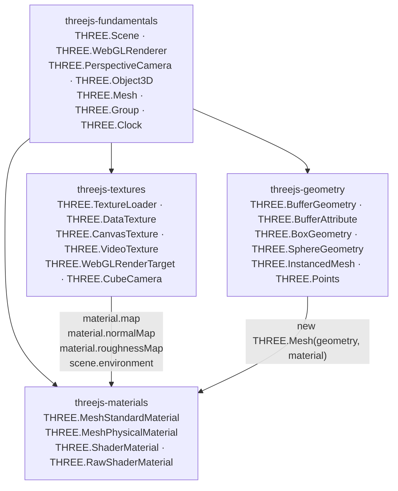
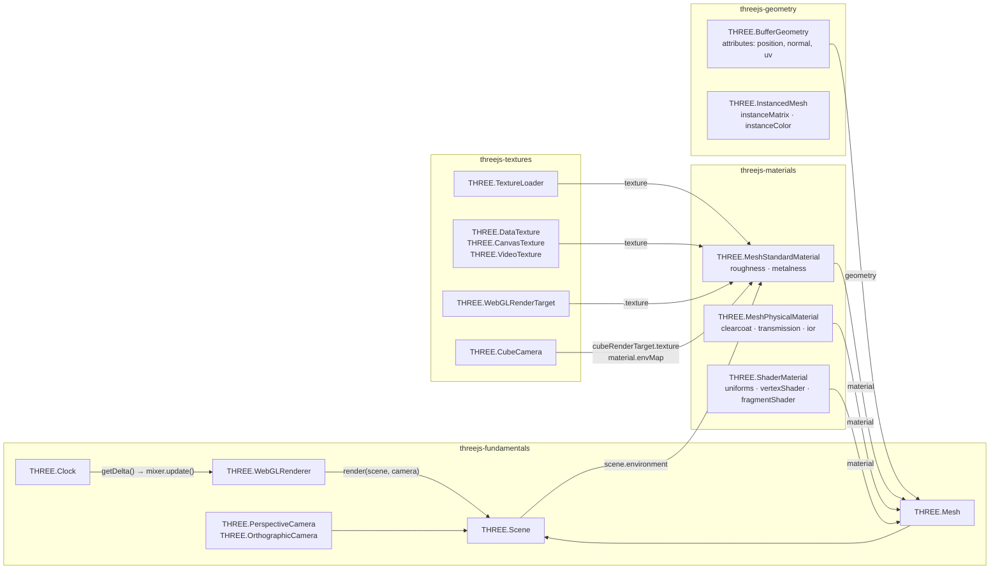
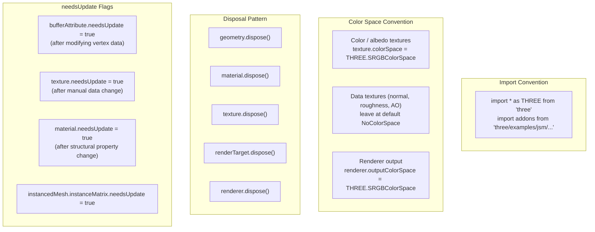

<!-- source: DeepWiki mcp.deepwiki.com · repo CloudAI-X/threejs-skills · page 2.1 Core Rendering Skills · fetched 2026-10-26 -->

# Core Rendering Skills

<details>
<summary>Relevant source files</summary>

The following files were used as context for generating this wiki page:

- [skills/threejs-fundamentals/SKILL.md](skills/threejs-fundamentals/SKILL.md)
- [skills/threejs-geometry/SKILL.md](skills/threejs-geometry/SKILL.md)
- [skills/threejs-materials/SKILL.md](skills/threejs-materials/SKILL.md)
- [skills/threejs-textures/SKILL.md](skills/threejs-textures/SKILL.md)

</details>


This page introduces the four skill files that form the foundational layer of any Three.js application: scene setup (`threejs-fundamentals`), geometry construction (`threejs-geometry`), material definition (`threejs-materials`), and texture management (`threejs-textures`). Together, these skills cover everything needed to put a visible, correctly-shaded, textured mesh on screen.

This page describes the scope and inter-relationships of these four skills. For lighting, shaders, and post-processing built on top of this layer, see [Lighting and Visual Effects Skills](#2.2). For asset loading and animation, see [Assets and Animation Skills](#2.3).

---

## The Four Core Skills

| Skill File | Skill Name | Primary Responsibility |
|---|---|---|
| [skills/threejs-fundamentals/SKILL.md]() | `threejs-fundamentals` | Scene graph, cameras, renderer, `Object3D` hierarchy, math utilities |
| [skills/threejs-geometry/SKILL.md]() | `threejs-geometry` | Geometry constructors, `BufferGeometry`, instancing, points and lines |
| [skills/threejs-materials/SKILL.md]() | `threejs-materials` | Material types from `MeshBasicMaterial` to `MeshPhysicalMaterial`, `ShaderMaterial` |
| [skills/threejs-textures/SKILL.md]() | `threejs-textures` | Texture loading, UV configuration, render targets, HDR environments |

Sources: [skills/threejs-fundamentals/SKILL.md:1-4](), [skills/threejs-geometry/SKILL.md:1-4](), [skills/threejs-materials/SKILL.md:1-4](), [skills/threejs-textures/SKILL.md:1-4]()

---

## Dependency Relationships

`threejs-fundamentals` is the root skill. The other three each build directly on it, and `threejs-textures` is consumed by `threejs-materials` to complete the PBR texture pipeline.

**Diagram: Core Rendering Skill Dependencies**



Sources: [skills/threejs-fundamentals/SKILL.md:484-488](), [skills/threejs-geometry/SKILL.md:544-548](), [skills/threejs-materials/SKILL.md:516-520](), [skills/threejs-textures/SKILL.md:624-628]()

---

## Skill Activation Triggers

Each skill file's `description` front matter field determines when Claude Code loads it. The following maps common request phrases to the skill(s) they activate.

| User Request Phrase | Activated Skill(s) |
|---|---|
| "set up a 3D scene", "create a camera", "configure the renderer" | `threejs-fundamentals` |
| "create a box / sphere / custom mesh", "use instanced rendering" | `threejs-geometry` |
| "make it look metallic / glassy", "use PBR material", "add transparency" | `threejs-materials` |
| "apply a texture", "use an HDR environment", "render to texture" | `threejs-textures` |
| "create a realistic 3D scene with textures" | all four skills |

Sources: [skills/threejs-fundamentals/SKILL.md:2-3](), [skills/threejs-geometry/SKILL.md:2-3](), [skills/threejs-materials/SKILL.md:2-3](), [skills/threejs-textures/SKILL.md:2-3]()

---

## Runtime Object Graph

The following diagram shows how the primary classes from all four skills combine at runtime to produce a renderable mesh.

**Diagram: Core Rendering Runtime Object Assembly**



Sources: [skills/threejs-fundamentals/SKILL.md:231-251](), [skills/threejs-geometry/SKILL.md:153-215](), [skills/threejs-materials/SKILL.md:99-134](), [skills/threejs-textures/SKILL.md:292-357]()

---

## How the Skills Compose

In practice the four skills are used together when building any non-trivial scene. The following describes the typical assembly order.

### 1. Scene and Renderer (`threejs-fundamentals`)

Every Three.js application starts with a `THREE.Scene`, a camera (`THREE.PerspectiveCamera` or `THREE.OrthographicCamera`), and a `THREE.WebGLRenderer`. The renderer's `outputColorSpace`, `toneMapping`, and `shadowMap` settings affect how all downstream materials and textures appear.

See [threejs-fundamentals](#2.1.1) for the full API.

### 2. Geometry (`threejs-geometry`)

Geometry provides the vertex data (`position`, `normal`, `uv`, optional `color`) consumed by the material. Built-in constructors like `THREE.BoxGeometry` or `THREE.SphereGeometry` are the fastest starting point. `THREE.BufferGeometry` with manual `THREE.BufferAttribute` arrays is used for custom shapes. `THREE.InstancedMesh` replaces many individual meshes with a single draw call when the same geometry is repeated.

The geometry is connected to a material via `new THREE.Mesh(geometry, material)`, which is then added to the scene.

See [threejs-geometry](#2.1.2) for the full API.

### 3. Materials (`threejs-materials`)

Materials control how the renderer shades each fragment. The hierarchy from least to most expensive is:

```
MeshBasicMaterial → MeshLambertMaterial → MeshPhongMaterial
  → MeshStandardMaterial → MeshPhysicalMaterial
```

`MeshStandardMaterial` is the recommended default for realistic results, using `roughness` and `metalness` to model PBR surfaces. `MeshPhysicalMaterial` extends it with clearcoat, transmission (glass), sheen (fabric), and iridescence. `ShaderMaterial` and `RawShaderMaterial` accept arbitrary GLSL.

After the material type is chosen, texture slots on the material (e.g., `material.map`, `material.normalMap`, `material.roughnessMap`) are filled by the textures skill.

See [threejs-materials](#2.1.3) for the full API.

### 4. Textures (`threejs-textures`)

Textures are loaded via `THREE.TextureLoader` and assigned to material slots. Correct configuration of `colorSpace`, `wrapS`/`wrapT`, `repeat`, and `anisotropy` is necessary for accurate rendering. HDR environment maps loaded via `RGBELoader` and processed through `THREE.PMREMGenerator` are assigned to `scene.environment` to drive PBR reflections across all materials. `THREE.WebGLRenderTarget` enables render-to-texture for mirrors, previews, and post-processing inputs.

See [threejs-textures](#2.1.4) for the full API.

---

## Shared Conventions Across All Four Skills

**Diagram: Cross-Skill Conventions**



Sources: [skills/threejs-fundamentals/SKILL.md:392-415](), [skills/threejs-geometry/SKILL.md:240-258](), [skills/threejs-materials/SKILL.md:476-491](), [skills/threejs-textures/SKILL.md:62-70]()

The three most important shared conventions are:

- **Imports**: All core classes come from the `three` package; addon loaders and utilities (e.g., `KTX2Loader`, `FontLoader`, `BufferGeometryUtils`) come from `three/examples/jsm/`.
- **Color space**: Color/albedo textures must have `colorSpace = THREE.SRGBColorSpace` set after loading; data textures (normal maps, roughness maps, AO maps) must not. The renderer itself should have `outputColorSpace = THREE.SRGBColorSpace`.
- **Disposal**: GPU resources (`BufferGeometry`, `Material`, `Texture`, `WebGLRenderTarget`, `WebGLRenderer`) all expose a `.dispose()` method that must be called when an object is removed to free VRAM.

---

## Skill Detail Pages

| Page | Skill | Key Classes |
|---|---|---|
| [threejs-fundamentals](#2.1.1) | `threejs-fundamentals` | `Scene`, `PerspectiveCamera`, `OrthographicCamera`, `WebGLRenderer`, `Object3D`, `Group`, `Mesh`, `Vector3`, `Matrix4`, `Quaternion`, `Euler`, `Color`, `MathUtils`, `Clock`, `LoadingManager` |
| [threejs-geometry](#2.1.2) | `threejs-geometry` | `BufferGeometry`, `BufferAttribute`, `BoxGeometry`, `SphereGeometry`, `PlaneGeometry`, `InstancedMesh`, `InstancedBufferGeometry`, `Points`, `Line`, `EdgesGeometry` |
| [threejs-materials](#2.1.3) | `threejs-materials` | `MeshBasicMaterial`, `MeshLambertMaterial`, `MeshPhongMaterial`, `MeshStandardMaterial`, `MeshPhysicalMaterial`, `MeshToonMaterial`, `ShaderMaterial`, `RawShaderMaterial` |
| [threejs-textures](#2.1.4) | `threejs-textures` | `TextureLoader`, `DataTexture`, `CanvasTexture`, `VideoTexture`, `KTX2Loader`, `CubeTextureLoader`, `RGBELoader`, `EXRLoader`, `WebGLRenderTarget`, `CubeCamera`, `PMREMGenerator` |

---

