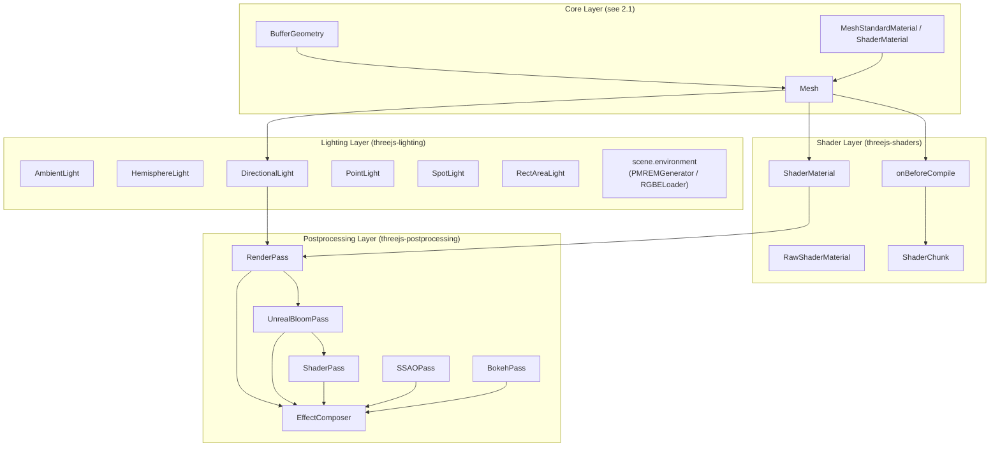
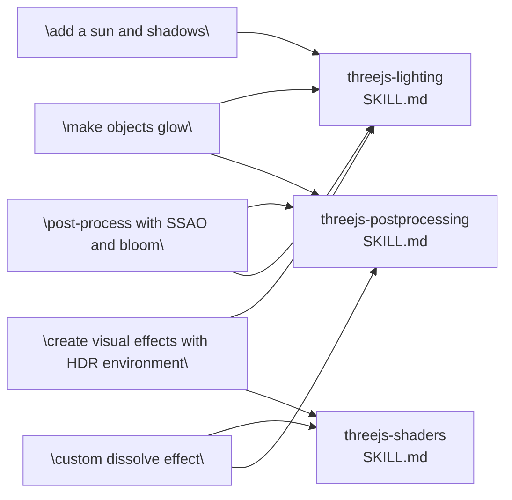
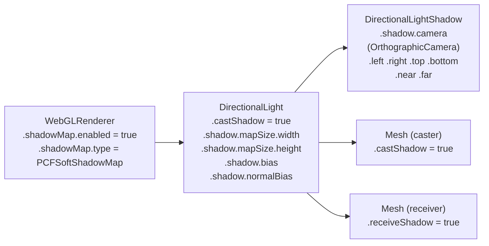
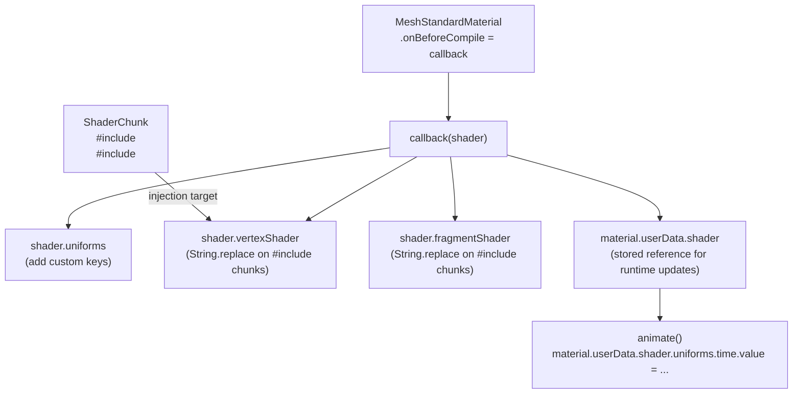
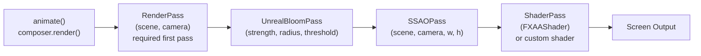
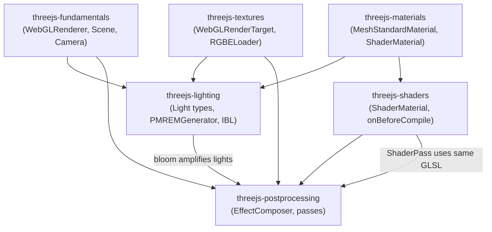

<!-- source: DeepWiki mcp.deepwiki.com · repo CloudAI-X/threejs-skills · page 2.2 Lighting and Visual Effects Skills · fetched 2026-10-26 -->

# Lighting and Visual Effects Skills

Relevant source files

The following files were used as context for generating this wiki page:

- [skills/threejs-lighting/SKILL.md](skills/threejs-lighting/SKILL.md)
- [skills/threejs-postprocessing/SKILL.md](skills/threejs-postprocessing/SKILL.md)
- [skills/threejs-shaders/SKILL.md](skills/threejs-shaders/SKILL.md)

This page introduces the three skill files that handle scene illumination and GPU-level visual effects: **threejs-lighting**, **threejs-shaders**, and **threejs-postprocessing**. Together they form the visual effects layer of a Three.js application, sitting above the core rendering primitives (geometry, materials, textures) and operating directly on the GPU pipeline.

For documentation of the foundational rendering layer these skills build on, see [Core Rendering Skills](#2.1). For asset loading and animation, see [Assets and Animation Skills](#2.3).

---

## How These Three Skills Layer

The lighting, shaders, and postprocessing skills each operate at a distinct stage of the render pipeline. Lighting affects how materials are shaded during the scene render. Shaders allow direct GLSL control of vertex and fragment stages. Postprocessing applies screen-space effects after the scene render is complete.

**Diagram: Visual Effects Layer in the Render Pipeline**

Sources: [skills/threejs-lighting/SKILL.md:1-482](), [skills/threejs-shaders/SKILL.md:1-643](), [skills/threejs-postprocessing/SKILL.md:1-603]()

---

## Skill File Summary

| Skill File | Activation Trigger | Key Classes / APIs |
|---|---|---|
| `threejs-lighting` | "add lights", "configure shadows", "set up IBL", "optimize lighting" | `AmbientLight`, `DirectionalLight`, `PointLight`, `SpotLight`, `RectAreaLight`, `HemisphereLight`, `PMREMGenerator`, `LightProbe` |
| `threejs-shaders` | "custom visual effects", "modify vertices", "write fragment shaders", "extend built-in materials" | `ShaderMaterial`, `RawShaderMaterial`, `onBeforeCompile`, `ShaderChunk`, `InstancedBufferAttribute` |
| `threejs-postprocessing` | "visual effects", "color grading", "blur", "glow", "screen-space shaders" | `EffectComposer`, `RenderPass`, `UnrealBloomPass`, `ShaderPass`, `SSAOPass`, `BokehPass`, `OutlinePass` |

Sources: [skills/threejs-lighting/SKILL.md:1-4](), [skills/threejs-shaders/SKILL.md:1-4](), [skills/threejs-postprocessing/SKILL.md:1-4]()

---

## Skill Co-Loading Behavior

These three skills are frequently activated together because the effects they enable are compositional. A request like *"add glowing lights to my scene"* would activate both `threejs-lighting` and `threejs-postprocessing`. A request like *"create a dissolve shader with edge glow"* would activate both `threejs-shaders` and `threejs-postprocessing`.

**Diagram: Skill Co-Loading by Request Context**

Sources: [skills/threejs-lighting/SKILL.md:477-481](), [skills/threejs-shaders/SKILL.md:638-642](), [skills/threejs-postprocessing/SKILL.md:598-602]()

---

## threejs-lighting Overview

Covers all light types, shadow map configuration, and Image-Based Lighting (IBL). See the full reference at [threejs-lighting](#2.2.1).

### Light Type Quick Reference

| Class | Shadow | Unique Properties | Typical Use |
|---|---|---|---|
| `AmbientLight` | No | `intensity` | Global fill light |
| `HemisphereLight` | No | `color` (sky), `groundColor` | Outdoor ambient |
| `DirectionalLight` | Yes (orthographic) | `target`, `shadow.camera` bounds | Sun / distant source |
| `PointLight` | Yes (cube map) | `distance`, `decay` | Bulb / lamp |
| `SpotLight` | Yes (perspective) | `angle`, `penumbra`, `target` | Flashlight / stage |
| `RectAreaLight` | No† | `width`, `height` | Window / softbox |

†`RectAreaLight` requires `RectAreaLightUniformsLib.init()` and only works with `MeshStandardMaterial` / `MeshPhysicalMaterial`. Shadow support requires custom solutions.

Sources: [skills/threejs-lighting/SKILL.md:22-33](), [skills/threejs-lighting/SKILL.md:179-202]()

### Shadow Pipeline

Enabling shadows requires configuration at three levels simultaneously: the renderer, the casting light, and each mesh.

**Diagram: Shadow Enablement Chain**

Sources: [skills/threejs-lighting/SKILL.md:206-229](), [skills/threejs-lighting/SKILL.md:81-108]()

### IBL (Image-Based Lighting)

IBL is set up by loading an HDR file with `RGBELoader`, processing it through `PMREMGenerator`, and assigning the result to `scene.environment`. This affects all `MeshStandardMaterial` and `MeshPhysicalMaterial` objects automatically.

[skills/threejs-lighting/SKILL.md:299-329]()

---

## threejs-shaders Overview

Covers `ShaderMaterial`, `RawShaderMaterial`, uniform management, varyings, the `onBeforeCompile` extension hook, and `ShaderChunk` reuse. See the full reference at [threejs-shaders](#2.2.2).

### ShaderMaterial vs RawShaderMaterial

| Feature | `ShaderMaterial` | `RawShaderMaterial` |
|---|---|---|
| Built-in uniforms | Provided automatically (`modelMatrix`, `projectionMatrix`, etc.) | Must be declared and bound manually |
| Built-in attributes | Provided (`position`, `normal`, `uv`) | Must be declared manually |
| Precision declarations | Injected automatically | Must be written explicitly |
| Use case | Extending Three.js materials | Full GPU control, minimal overhead |

Sources: [skills/threejs-shaders/SKILL.md:38-99]()

### Uniform Value Types

`ShaderMaterial.uniforms` accepts JavaScript objects with a `value` key. The mapping from JS types to GLSL types:

| JS Value | GLSL Type |
|---|---|
| `Number` | `float` / `int` |
| `THREE.Vector2` | `vec2` |
| `THREE.Vector3` | `vec3` |
| `THREE.Color` | `vec3` |
| `THREE.Vector4` | `vec4` |
| `THREE.Matrix3` | `mat3` |
| `THREE.Matrix4` | `mat4` |
| `THREE.Texture` | `sampler2D` |
| `THREE.CubeTexture` | `samplerCube` |
| `Array` of numbers | `float[n]` |

Sources: [skills/threejs-shaders/SKILL.md:105-153]()

### onBeforeCompile Extension Pattern

`onBeforeCompile` allows injecting GLSL code into an existing `MeshStandardMaterial` or similar without replacing it entirely. The callback receives the compiled `shader` object, whose `vertexShader` and `fragmentShader` strings can be modified via `String.replace`. Custom uniforms are added directly to `shader.uniforms`. A reference is stored in `material.userData.shader` for runtime updates.

[skills/threejs-shaders/SKILL.md:391-421]()

**Diagram: onBeforeCompile Data Flow**

Sources: [skills/threejs-shaders/SKILL.md:391-436]()

---

## threejs-postprocessing Overview

Covers the `EffectComposer` pass chain, all built-in pass types, the selective bloom technique, custom `ShaderPass` definition, and resize handling. See the full reference at [threejs-postprocessing](#2.2.3).

### EffectComposer Pass Chain

`EffectComposer` replaces the direct `renderer.render()` call in the animation loop. Passes are executed in order. `RenderPass` must always be first. The last pass renders to screen by default.

**Diagram: EffectComposer Pass Execution Order**

Sources: [skills/threejs-postprocessing/SKILL.md:39-67]()

### Built-in Pass Types

| Pass Class | Import Path | Primary Use |
|---|---|---|
| `RenderPass` | `three/addons/postprocessing/RenderPass.js` | Renders scene — always first |
| `UnrealBloomPass` | `three/addons/postprocessing/UnrealBloomPass.js` | Glow / bloom |
| `SSAOPass` | `three/addons/postprocessing/SSAOPass.js` | Screen-space ambient occlusion |
| `BokehPass` | `three/addons/postprocessing/BokehPass.js` | Depth of field |
| `OutlinePass` | `three/addons/postprocessing/OutlinePass.js` | Object outlines / selection highlight |
| `SMAAPass` | `three/addons/postprocessing/SMAAPass.js` | High-quality anti-aliasing |
| `ShaderPass` | `three/addons/postprocessing/ShaderPass.js` | Wraps any custom GLSL shader |
| `FilmPass` | `three/addons/postprocessing/FilmPass.js` | Film grain + scanlines |
| `GlitchPass` | `three/addons/postprocessing/GlitchPass.js` | Digital glitch effect |
| `HalftonePass` | `three/addons/postprocessing/HalftonePass.js` | Halftone dot pattern |
| `RenderPixelatedPass` | `three/addons/postprocessing/RenderPixelatedPass.js` | Pixel art style |

Sources: [skills/threejs-postprocessing/SKILL.md:72-306]()

### Custom ShaderPass Structure

A custom `ShaderPass` is a plain JavaScript object with three required keys: `uniforms`, `vertexShader`, and `fragmentShader`. The `tDiffuse` uniform is mandatory — it receives the previous pass's output texture. The object is passed directly to the `ShaderPass` constructor.

[skills/threejs-postprocessing/SKILL.md:336-376]()

### Resize Handling

Both `renderer.setSize()` and `composer.setSize()` must be called on resize. Some passes (e.g., `ShaderPass` wrapping `FXAAShader`) also require their own resolution uniforms to be updated manually.

[skills/threejs-postprocessing/SKILL.md:570-595]()

---

## Dependency Relationships

**Diagram: Skill Dependencies and Cross-References**

Sources: [skills/threejs-lighting/SKILL.md:477-481](), [skills/threejs-shaders/SKILL.md:638-642](), [skills/threejs-postprocessing/SKILL.md:598-602]()

---

