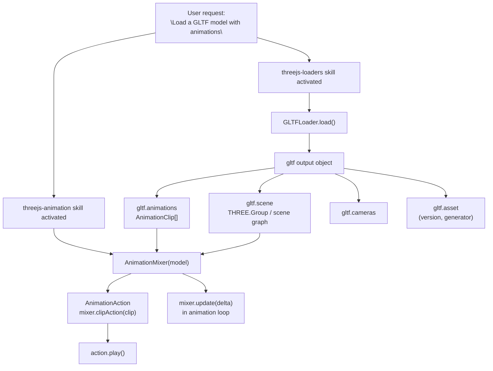
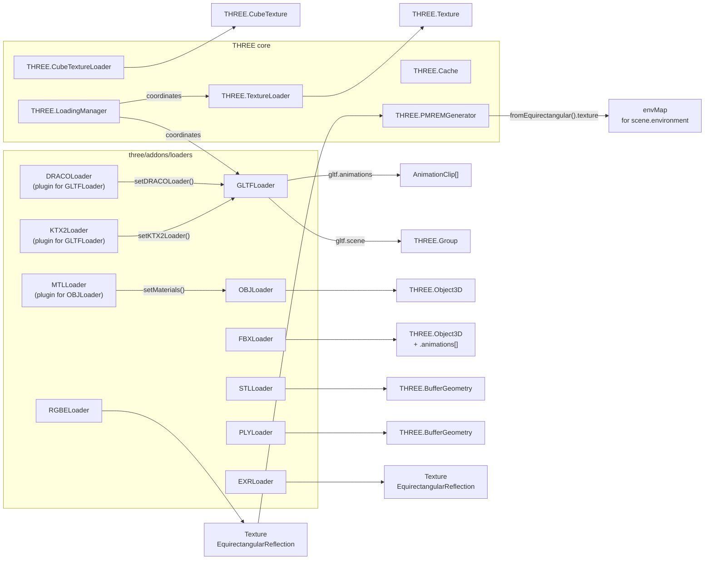
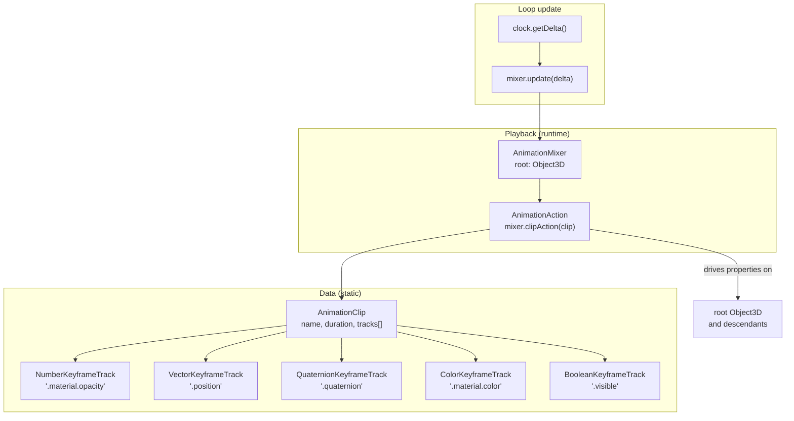
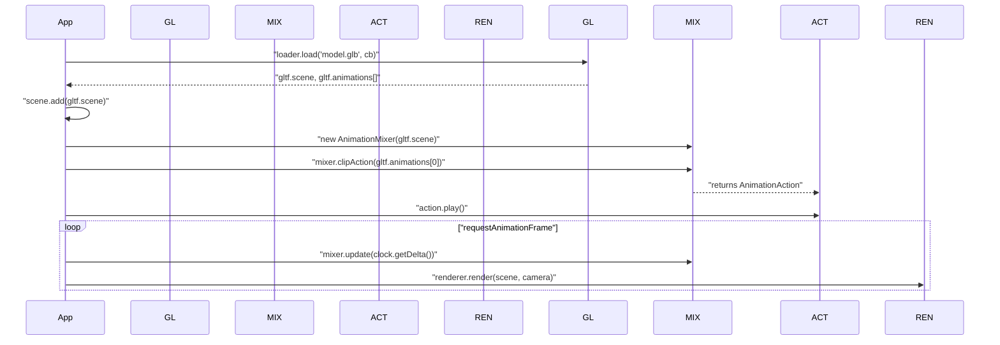

<!-- source: DeepWiki mcp.deepwiki.com · repo CloudAI-X/threejs-skills · page 2.3 Assets and Animation Skills · fetched 2026-10-26 -->

# Assets and Animation Skills

<details>
<summary>Relevant source files</summary>

The following files were used as context for generating this wiki page:

- [skills/threejs-animation/SKILL.md](skills/threejs-animation/SKILL.md)
- [skills/threejs-loaders/SKILL.md](skills/threejs-loaders/SKILL.md)

</details>


This section covers two skill files that work together to bring external 3D content into a running Three.js scene: **threejs-loaders** for reading asset files from disk or network, and **threejs-animation** for driving object transforms and skeletal rigs over time. Both skills operate downstream of the core rendering pipeline — they produce and animate the objects that the renderer displays.

For configuration of textures loaded from files, see [threejs-textures (2.1.4)](#2.1.4). For how materials on loaded models behave, see [threejs-materials (2.1.3)](#2.1.3). For the scene graph fundamentals that loaded models are added to, see [threejs-fundamentals (2.1.1)](#2.1.1).

---

## Skill Overview

| Skill file | Activation triggers | Primary classes |
|---|---|---|
| `skills/threejs-loaders/SKILL.md` | "load a GLTF model", "load textures", "HDR environment", "manage loading progress" | `GLTFLoader`, `DRACOLoader`, `KTX2Loader`, `LoadingManager`, `PMREMGenerator` |
| `skills/threejs-animation/SKILL.md` | "animate objects", "play GLTF animations", "blend animations", "skeletal animation", "morph targets" | `AnimationMixer`, `AnimationAction`, `AnimationClip`, `KeyframeTrack` |

Both skills are **co-loaded** whenever a request involves loading and playing a GLTF model with embedded animations. This is the most common real-world workflow: `GLTFLoader` returns the `gltf.animations` array of `AnimationClip` objects, which are then fed directly into `AnimationMixer`.

Sources: [skills/threejs-loaders/SKILL.md:1-23](), [skills/threejs-animation/SKILL.md:1-35]()

---

## How the Two Skills Relate

**Diagram: Co-loading workflow for an animated GLTF model**



Sources: [skills/threejs-loaders/SKILL.md:194-258](), [skills/threejs-animation/SKILL.md:212-258]()

---

## threejs-loaders

### Scope

The loaders skill covers every mechanism for reading assets into Three.js: 3D model formats, image textures, HDR environments, and binary buffers. It also covers `LoadingManager` for coordinating progress across multiple concurrent loads, `THREE.Cache` for deduplication, and `PMREMGenerator` for converting equirectangular HDR textures into PBR-ready environment maps.

### Loader Class Map

**Diagram: Loader classes and what they produce**



Sources: [skills/threejs-loaders/SKILL.md:130-192](), [skills/threejs-loaders/SKILL.md:229-266](), [skills/threejs-loaders/SKILL.md:305-370]()

### LoadingManager Lifecycle

`LoadingManager` fires four callbacks in a defined sequence. All loaders that share the same `manager` instance contribute to the same progress counter.

| Callback | Fires when | Arguments |
|---|---|---|
| `onStart` | First item begins loading | `url, loaded, total` |
| `onProgress` | Each item finishes | `url, loaded, total` |
| `onLoad` | All tracked items complete | — |
| `onError` | Any item fails | `url` |

Sources: [skills/threejs-loaders/SKILL.md:27-61]()

### GLTFLoader Output Object

When `GLTFLoader.load()` succeeds, the callback receives a single `gltf` object:

| Property | Type | Description |
|---|---|---|
| `gltf.scene` | `THREE.Group` | Root of the loaded scene graph |
| `gltf.animations` | `AnimationClip[]` | All embedded animation clips |
| `gltf.cameras` | `THREE.Camera[]` | Cameras defined in the file |
| `gltf.asset` | `object` | File metadata (version, generator) |
| `gltf.userData` | `object` | Custom data from authoring tool |

Sources: [skills/threejs-loaders/SKILL.md:194-226]()

### GLTF Compression Plugins

Both `DRACOLoader` and `KTX2Loader` are plugins that must be attached to a `GLTFLoader` instance before calling `.load()`. They are not standalone loaders.

```
DRACOLoader  →  dracoLoader.setDecoderPath(...)  →  gltfLoader.setDRACOLoader(dracoLoader)
KTX2Loader   →  ktx2Loader.detectSupport(renderer) →  gltfLoader.setKTX2Loader(ktx2Loader)
```

Sources: [skills/threejs-loaders/SKILL.md:229-266]()

### Async Loading Patterns

The skill file documents two async strategies:

- **Promise wrapper**: Wrapping `loader.load()` in a `new Promise` so it can be `await`-ed. See [skills/threejs-loaders/SKILL.md:376-434]().
- **`Promise.all` parallelism**: Loading multiple assets concurrently. See [skills/threejs-loaders/SKILL.md:397-408]().

`THREE.Cache.enabled = true` enables the built-in file cache keyed by URL, preventing duplicate network requests for the same asset. See [skills/threejs-loaders/SKILL.md:442-452]().

The skill also documents a `AssetManager` pattern (class at [skills/threejs-loaders/SKILL.md:457-502]()) that wraps both loaders, deduplicates by key, and exposes a `dispose()` method for cleanup.

---

## threejs-animation

### Scope

The animation skill covers the three-class system (`AnimationClip`, `AnimationMixer`, `AnimationAction`) that drives all keyframe and skeletal animation in Three.js. It also covers morph target animation, procedural motion patterns, and animation blending. For loading animated models that supply the `AnimationClip` data, see the loaders skill above.

### The Three-Class System

**Diagram: AnimationClip, AnimationMixer, and AnimationAction relationships**



Sources: [skills/threejs-animation/SKILL.md:29-53](), [skills/threejs-animation/SKILL.md:119-150]()

### KeyframeTrack Property Path Syntax

Each `KeyframeTrack` targets a specific property via a dot-notation path string. The root of the path is resolved relative to the `AnimationMixer`'s root object.

| Track class | Example path | Value format |
|---|---|---|
| `NumberKeyframeTrack` | `".material.opacity"` | Single float per keyframe |
| `VectorKeyframeTrack` | `".position"`, `".scale"` | 3 floats (x, y, z) per keyframe |
| `QuaternionKeyframeTrack` | `".quaternion"` | 4 floats (x, y, z, w) per keyframe |
| `ColorKeyframeTrack` | `".material.color"` | 3 floats (r, g, b) per keyframe |
| `BooleanKeyframeTrack` | `".visible"` | `true`/`false` per keyframe |
| `StringKeyframeTrack` | `".morphTargetInfluences[smile]"` | String value per keyframe |

Sources: [skills/threejs-animation/SKILL.md:55-106]()

### Interpolation Modes

Three constants control how values are computed between keyframes. Set via `track.setInterpolation(mode)`.

| Constant | Behavior |
|---|---|
| `THREE.InterpolateLinear` | Straight-line interpolation (default) |
| `THREE.InterpolateSmooth` | Cubic spline — smooth curves |
| `THREE.InterpolateDiscrete` | Instant step at each keyframe |

Sources: [skills/threejs-animation/SKILL.md:109-117]()

### AnimationAction Control Surface

`AnimationAction` is the main interface for runtime playback control. It is obtained via `mixer.clipAction(clip)` — never constructed directly.

| Property / Method | Effect |
|---|---|
| `action.play()` | Start playback |
| `action.stop()` | Stop and reset |
| `action.reset()` | Reset to time 0 |
| `action.halt(fadeDuration)` | Decelerate to a stop |
| `action.time` | Current playback time in seconds |
| `action.timeScale` | Speed multiplier; negative = reverse |
| `action.paused` | Freeze without stopping |
| `action.weight` | Blend contribution (0–1) |
| `action.setEffectiveWeight(n)` | Set weight with interpolation |
| `action.loop` | `LoopRepeat` / `LoopOnce` / `LoopPingPong` |
| `action.repetitions` | How many loops before stopping |
| `action.clampWhenFinished` | Hold final frame after `LoopOnce` |
| `action.blendMode` | `NormalAnimationBlendMode` or `AdditiveAnimationBlendMode` |
| `action.fadeIn(dur)` | Ramp weight from 0 to 1 |
| `action.fadeOut(dur)` | Ramp weight from 1 to 0 |
| `action.crossFadeTo(other, dur, warp)` | Fade out this, fade in other |

Sources: [skills/threejs-animation/SKILL.md:154-210]()

### Mixer Events

`AnimationMixer` emits two events via `addEventListener`:

| Event | Fires when | `event.action` |
|---|---|---|
| `"finished"` | A `LoopOnce` action reaches end | The completed action |
| `"loop"` | Any action completes one cycle | The looping action |

Sources: [skills/threejs-animation/SKILL.md:140-150]()

### AnimationUtils

`THREE.AnimationUtils` provides clip manipulation helpers:

| Method | Description |
|---|---|
| `AnimationClip.findByName(clips, name)` | Search an array by clip name |
| `AnimationUtils.subclip(clip, name, start, end, fps)` | Extract a time range as a new clip |
| `AnimationUtils.makeClipAdditive(clip)` | Convert clip for additive blending |
| `clip.optimize()` | Remove redundant keyframes |
| `clip.clone()` | Deep copy a clip |
| `clip.duration` | Total duration in seconds |

Sources: [skills/threejs-animation/SKILL.md:409-435]()

---

## Combined GLTF Animation Workflow

The standard pattern that co-activates both skills:

**Diagram: Full runtime flow from file to animated frame**



Sources: [skills/threejs-animation/SKILL.md:212-258](), [skills/threejs-loaders/SKILL.md:194-226]()

---

## Performance Considerations

### Loaders

| Tip | Mechanism |
|---|---|
| Compress geometry | Use `DRACOLoader` plugin with `GLTFLoader` |
| Compress textures | Use `KTX2Loader` plugin with `GLTFLoader` |
| Avoid duplicate fetches | `THREE.Cache.enabled = true` |
| Parallel loading | `Promise.all([...])` |
| Custom deduplication | `AssetManager` pattern with `Map` cache |

Sources: [skills/threejs-loaders/SKILL.md:597-617]()

### Animation

| Tip | Mechanism |
|---|---|
| Share clips across instances | One `AnimationClip` → multiple `AnimationMixer`s |
| Remove redundant keyframes | `clip.optimize()` |
| Pause off-screen animations | `action.paused = true` when outside frustum |
| Limit active mixers | Each `mixer.update()` traverses the object graph |
| Simpler rigs at distance | LOD combined with lighter `SkinnedMesh` rigs |

Sources: [skills/threejs-animation/SKILL.md:517-546]()

---

## See Also

- [threejs-fundamentals (2.1.1)](#2.1.1) — `Clock`, `requestAnimationFrame` loop, `Object3D` hierarchy that `AnimationMixer` operates on
- [threejs-textures (2.1.4)](#2.1.4) — Texture configuration applied after loading
- [threejs-materials (2.1.3)](#2.1.3) — Material properties visible on loaded model meshes
- [threejs-lighting (2.2.1)](#2.2.1) — IBL setup using `RGBELoader` + `PMREMGenerator` (also documented in the loaders skill)
- [threejs-interaction (2.4)](#2.4) — `Raycaster` picking against loaded model meshes

---

