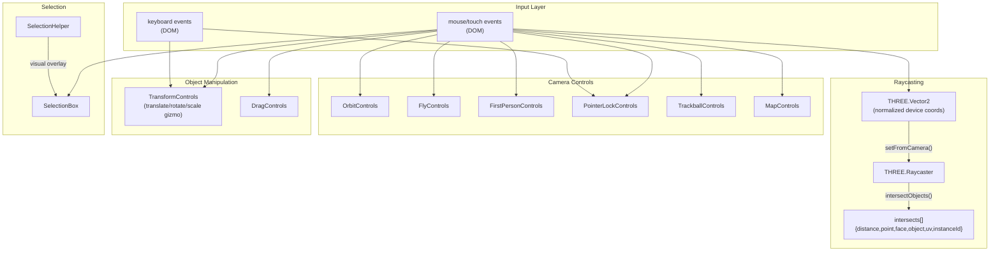
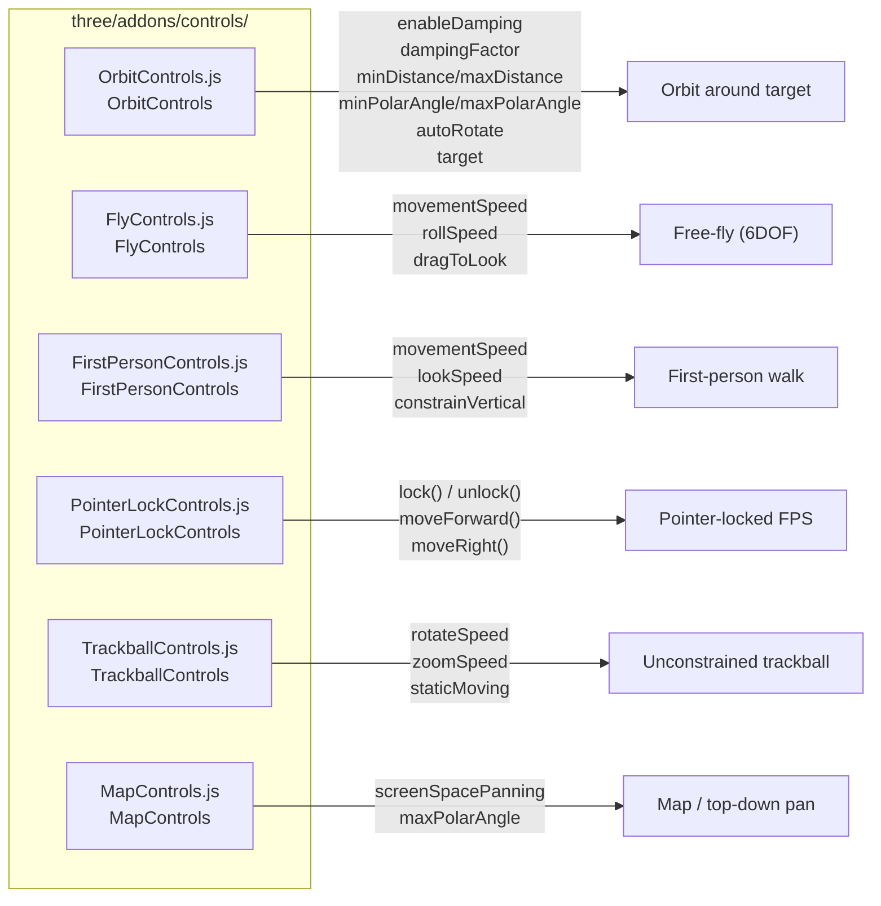
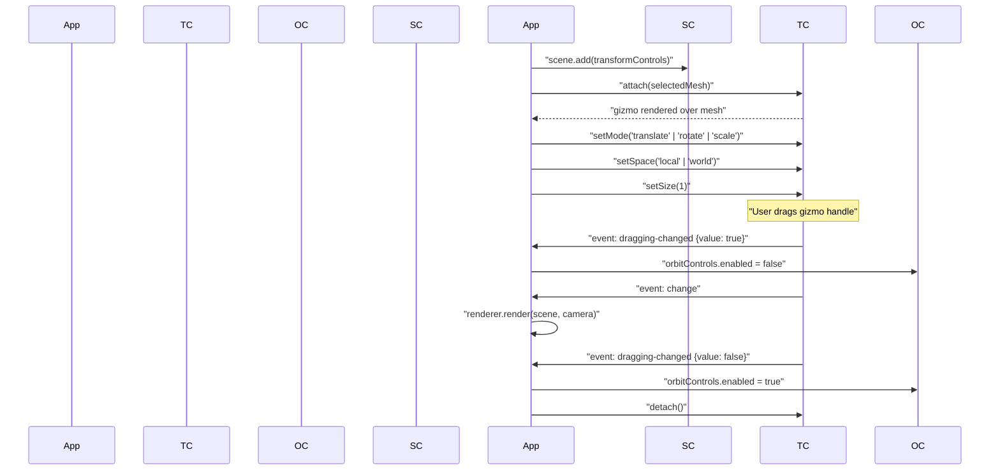
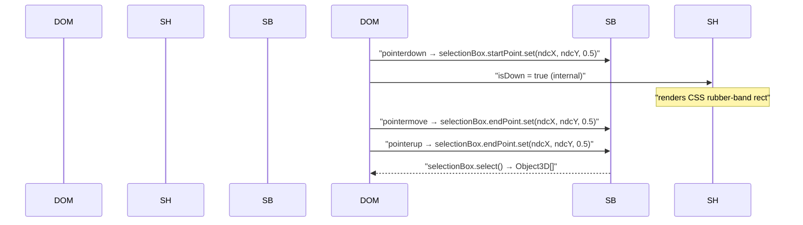

<!-- source: DeepWiki mcp.deepwiki.com · repo CloudAI-X/threejs-skills · page 2.4 threejs-interaction · fetched 2026-10-26 -->

# threejs-interaction

Relevant source files

The following files were used as context for generating this wiki page:

- [skills/threejs-interaction/SKILL.md](skills/threejs-interaction/SKILL.md)

This page documents the `threejs-interaction` skill file, which covers all user-input and interaction systems in Three.js: raycasting for object picking, camera control add-ons, object manipulation gizmos, drag interaction, and box selection. For scene setup and the underlying `Object3D` hierarchy these systems operate on, see [threejs-fundamentals](#2.1.1). For animating objects after they have been selected or transformed, see [threejs-animation](#2.3.2).

**Skill file:** [skills/threejs-interaction/SKILL.md]()

---

## Activation

The skill is loaded by Claude Code when the request description matches interaction-related vocabulary. The front-matter trigger is:

> *"Three.js interaction – raycasting, controls, mouse/touch input, object selection. Use when handling user input, implementing click detection, adding camera controls, or creating interactive 3D experiences."*

[skills/threejs-interaction/SKILL.md:1-4]()

---

## System Overview

**Diagram: Interaction subsystems and their primary classes**

Sources: [skills/threejs-interaction/SKILL.md:37-146]()

---

## Raycaster

`THREE.Raycaster` casts a ray from a point in a given direction and returns a sorted list of all `Object3D` instances it intersects. The most common use is mouse picking: converting a 2D screen position to a 3D ray through `setFromCamera()`.

### Coordinate Normalization

Before calling `setFromCamera()`, the raw pixel event coordinates must be converted to **Normalized Device Coordinates (NDC)**, where `(-1, -1)` is the bottom-left and `(1, 1)` is the top-right of the viewport.

| Coordinate | NDC formula |
|---|---|
| `mouse.x` | `(event.clientX / window.innerWidth) * 2 - 1` |
| `mouse.y` | `-(event.clientY / window.innerHeight) * 2 + 1` |

For a canvas that does not fill the full window, subtract the canvas bounding box offset first:

[skills/threejs-interaction/SKILL.md:79-83]()

Touch input follows the same pattern using `event.touches[0].clientX` and `.clientY`:

[skills/threejs-interaction/SKILL.md:89-107]()

### Raycaster API

[skills/threejs-interaction/SKILL.md:42-65]()

| Member | Type | Description |
|---|---|---|
| `raycaster.near` | `number` | Minimum intersection distance (default `0`) |
| `raycaster.far` | `number` | Maximum intersection distance (default `Infinity`) |
| `raycaster.params.Line.threshold` | `number` | Hit tolerance for `Line` objects |
| `raycaster.params.Points.threshold` | `number` | Hit tolerance for `Points` objects |
| `raycaster.layers` | `THREE.Layers` | Filters which objects are tested |
| `raycaster.setFromCamera(coords, camera)` | method | Builds ray from NDC `Vector2` + camera |
| `raycaster.set(origin, direction)` | method | Builds ray from arbitrary world-space vectors |
| `raycaster.intersectObjects(objects, recursive)` | method | Returns sorted `intersects[]` array |

Each element of `intersects[]` contains:

| Field | Type | Notes |
|---|---|---|
| `distance` | `number` | Distance from ray origin |
| `point` | `Vector3` | World-space intersection point |
| `face` | `Face3` | Intersected triangle |
| `faceIndex` | `number` | Index into geometry face array |
| `object` | `Object3D` | The intersected mesh/line/etc. |
| `uv` | `Vector2` | UV at intersection |
| `instanceId` | `number` | Set when intersecting `InstancedMesh` |

[skills/threejs-interaction/SKILL.md:52-65]()

### Efficiency

- Pass a targeted array of objects rather than `scene.children` to limit work.
- Use `raycaster.layers` to partition the scene and filter raycast targets declaratively.
- Throttle `mousemove` handlers (e.g. 20 fps cap) so hover raycasts don't run every frame.
- For complex models, add an invisible `BoxGeometry` proxy mesh and raycast against that instead.

[skills/threejs-interaction/SKILL.md:126-146](), [skills/threejs-interaction/SKILL.md:646-654]()

---

## Camera Controls

All camera control classes are add-ons imported from `three/addons/controls/`. Each requires the target `camera` and `renderer.domElement` as constructor arguments (except `PointerLockControls`, which accepts any DOM element). Most must be called with `.update()` inside the animation loop.

**Diagram: Camera control classes, import paths, and key properties**

Sources: [skills/threejs-interaction/SKILL.md:148-301]()

### OrbitControls

`OrbitControls` is the most commonly used control. Key properties:

| Property | Default | Purpose |
|---|---|---|
| `enableDamping` | `false` | Smooth deceleration (requires `controls.update()` in loop) |
| `dampingFactor` | `0.05` | Deceleration rate |
| `minDistance` / `maxDistance` | `0` / `Infinity` | Zoom clamp |
| `minPolarAngle` / `maxPolarAngle` | `0` / `Math.PI` | Vertical rotation clamp |
| `minAzimuthAngle` / `maxAzimuthAngle` | `-Infinity` / `Infinity` | Horizontal rotation clamp |
| `enableRotate` / `enableZoom` / `enablePan` | `true` | Feature toggles |
| `autoRotate` | `false` | Continuous spin |
| `autoRotateSpeed` | `2.0` | Degrees per second |
| `target` | `Vector3(0,0,0)` | Orbit focal point |

`controls.update()` **must** be called every frame when `enableDamping` or `autoRotate` is enabled.

[skills/threejs-interaction/SKILL.md:152-188]()

### FlyControls / FirstPersonControls

Both accept a `clock.getDelta()` argument to their `update()` call. `FlyControls` allows free 6-DOF movement including roll; `FirstPersonControls` constrains to horizontal movement with optional vertical look limits.

[skills/threejs-interaction/SKILL.md:190-222]()

### PointerLockControls

Uses the browser Pointer Lock API. Call `controls.lock()` to acquire lock (typically from a user gesture). Movement requires explicit keyboard handling and calls to `controls.moveForward()` / `controls.moveRight()` inside the animation loop. Check `controls.isLocked` before applying movement.

[skills/threejs-interaction/SKILL.md:225-272]()

### TrackballControls

Similar to `OrbitControls` but without pole constraints — allows full tumbling. Set `staticMoving = true` to disable inertia.

[skills/threejs-interaction/SKILL.md:275-289]()

### MapControls

Imported from the same `OrbitControls.js` module. Designed for top-down map navigation. Set `screenSpacePanning = false` to pan parallel to the ground plane.

[skills/threejs-interaction/SKILL.md:292-301]()

---

## TransformControls

`TransformControls` renders an interactive gizmo attached to a selected object, allowing translate, rotate, and scale operations in the viewport.

**Diagram: TransformControls lifecycle and event flow**

Import path: `three/addons/controls/TransformControls.js`

| Method / Property | Description |
|---|---|
| `attach(object)` | Bind gizmo to an `Object3D` |
| `detach()` | Remove binding |
| `setMode(mode)` | `'translate'`, `'rotate'`, or `'scale'` |
| `setSpace(space)` | `'local'` or `'world'` |
| `setSize(size)` | Gizmo scale (default `1`) |
| Event: `dragging-changed` | Fires when drag starts/ends; `event.value` is `boolean` |
| Event: `change` | Fires every frame while dragging |

**Important:** `TransformControls` itself must be added to the scene with `scene.add(transformControls)`. Disable `OrbitControls` during drag to prevent conflicts.

[skills/threejs-interaction/SKILL.md:303-352]()

---

## DragControls

`DragControls` enables direct click-and-drag repositioning of objects. It manages its own raycaster internally.

Constructor: `new DragControls(objects[], camera, domElement)`

| Event | Payload | Typical use |
|---|---|---|
| `dragstart` | `{object}` | Disable `OrbitControls`, highlight object |
| `drag` | `{object}` | Constrain position (e.g. clamp Y to ground) |
| `dragend` | `{object}` | Re-enable `OrbitControls`, clear highlight |

[skills/threejs-interaction/SKILL.md:354-382]()

---

## Selection Systems

### Click-to-Select

The standard pattern: on `mousedown`, cast a ray, compare the first hit against a list of selectable objects, and track the current selection in a variable. Visual feedback is typically applied through `material.emissive`.

[skills/threejs-interaction/SKILL.md:386-413]()

### Hover Effects

On `mousemove`, cast and compare results to a tracked `hoveredObject`. Store the original color in `mesh.userData.originalColor` before overwriting, and restore it when the mouse leaves. Change `document.body.style.cursor` to `'pointer'` for UX feedback.

[skills/threejs-interaction/SKILL.md:456-489]()

### Box Selection — SelectionBox / SelectionHelper

`SelectionBox` performs a frustum-based volume selection over a rectangular screen region. `SelectionHelper` draws the visual rubber-band rectangle using a CSS class.

Import paths:
- `three/addons/interactive/SelectionBox.js`
- `three/addons/interactive/SelectionHelper.js`

**Diagram: Box selection pointer event flow**

`selectionBox.startPoint` and `selectionBox.endPoint` are `THREE.Vector3` instances set with Z fixed at `0.5`. `selectionBox.select()` returns all objects whose bounding volumes fall within the frustum slice defined by the two corner points.

[skills/threejs-interaction/SKILL.md:415-452]()

---

## Keyboard Input

The canonical pattern is a `keys` object (keyed by `event.code`) updated by `keydown`/`keyup` listeners. Read the state inside `update()` each frame rather than acting inside the event handler, which avoids missed inputs during frame drops.

[skills/threejs-interaction/SKILL.md:492-513]()

---

## Coordinate Conversion Utilities

| Function pattern | Method used | Description |
|---|---|---|
| World → Screen | `Vector3.project(camera)` | Map 3D world position to 2D pixel coords |
| Screen → World | `Vector3.unproject(camera)` + ray-plane math | Map pixel coords to a world-space point at a given depth |
| Ray → Plane | `raycaster.ray.intersectPlane(plane, target)` | Find where the camera ray meets a `THREE.Plane` |

[skills/threejs-interaction/SKILL.md:517-572]()

---

## InteractionManager Pattern

For production use, the skill file recommends encapsulating raycasting and event binding in a dedicated class. The `InteractionManager` class shown at [skills/threejs-interaction/SKILL.md:577-635]() demonstrates:

- Attaching all DOM listeners to `renderer.domElement` (not `window`) so coordinates are always canvas-relative.
- A `clickables[]` array as the raycast target list.
- Per-object callback storage via `object.userData.onClick`.
- A `dispose()` hook for cleanup.

---

## Performance Tips

| Tip | Mechanism |
|---|---|
| Throttle `mousemove` raycasts | Timestamp check — skip if < 50 ms since last cast |
| Use `raycaster.layers` | Assign clickable objects to a layer; raycaster ignores others |
| Invisible collision proxies | Simple `BoxGeometry` mesh with `visible: false` in front of complex geometry |
| Disable controls when unused | `controls.enabled = false` stops all DOM event processing |
| Limit `intersectObjects` list | Pass a curated array instead of `scene.children` |

[skills/threejs-interaction/SKILL.md:637-654]()

---

## See Also

| Topic | Page |
|---|---|
| Scene, Camera, WebGLRenderer, Object3D hierarchy | [threejs-fundamentals](#2.1.1) |
| AnimationMixer, AnimationAction for responding to selections | [threejs-animation](#2.3.2) |
| ShaderMaterial for visual feedback effects | [threejs-shaders](#2.2.2) |
| Post-processing highlight passes (OutlinePass) | [threejs-postprocessing](#2.2.3) |