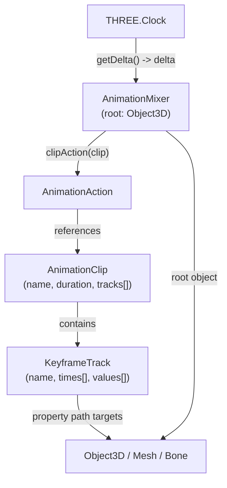
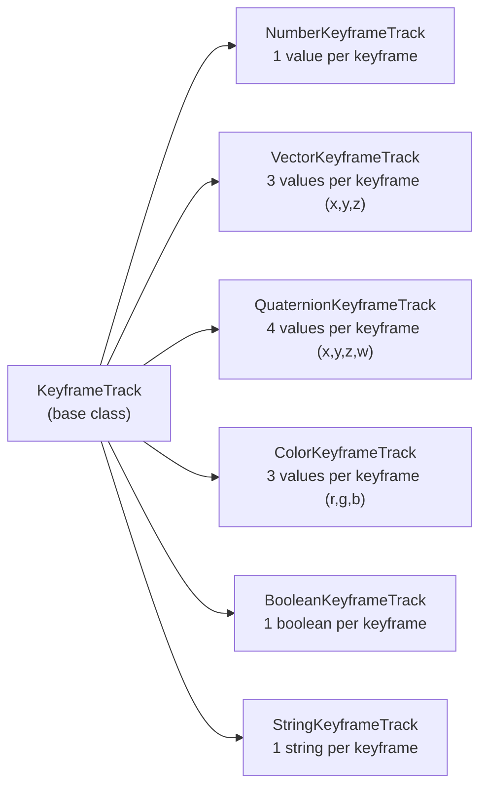
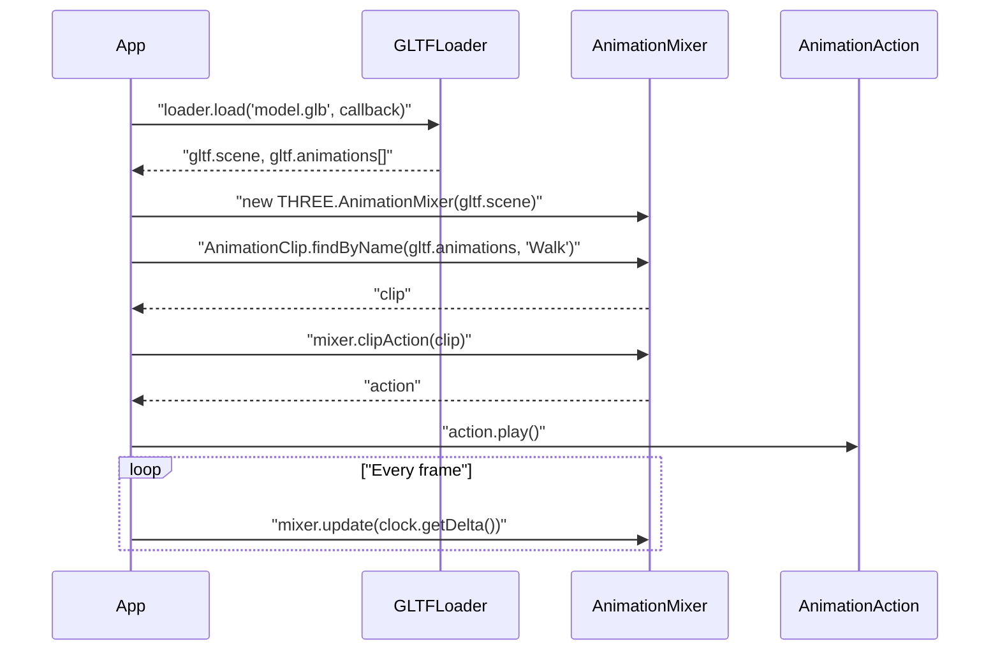
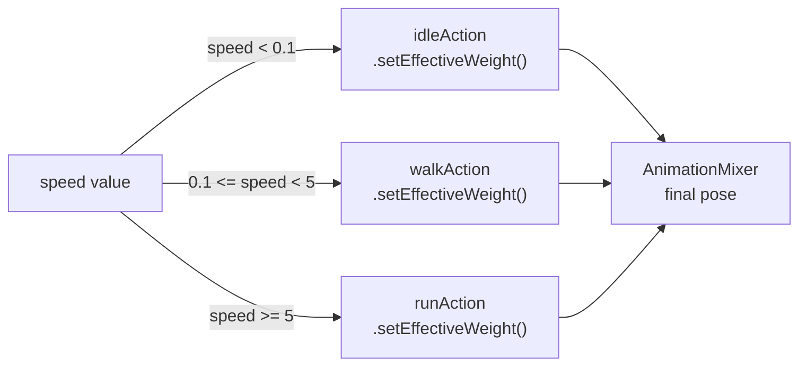

<!-- source: DeepWiki mcp.deepwiki.com · repo CloudAI-X/threejs-skills · extra page threejs-animation · fetched 2026-10-26 -->

# threejs-animation

<details>
<summary>Relevant source files</summary>

The following files were used as context for generating this wiki page:

- [skills/threejs-animation/SKILL.md](skills/threejs-animation/SKILL.md)

</details>


This page documents the `threejs-animation` skill file located at [skills/threejs-animation/SKILL.md](), which covers Three.js's keyframe animation system: `AnimationClip`, `AnimationMixer`, `AnimationAction`, `KeyframeTrack` subtypes, blending, skeletal animation, morph targets, and procedural motion utilities.

For loading animated GLTF models that produce `AnimationClip` arrays, see the loaders skill ([2.3.1](#2.3.1)). For the `Clock` and render loop that drives `mixer.update()`, see fundamentals ([2.1.1](#2.1.1)).

---

## System Overview

The Three.js animation system has three cooperating runtime objects:

**Animation System Object Graph**



Sources: [skills/threejs-animation/SKILL.md:31-53]()

| Object | Class | Role |
|---|---|---|
| Clip container | `AnimationClip` | Holds an array of `KeyframeTrack` objects and a total duration |
| Playback engine | `AnimationMixer` | Advances time, blends multiple actions, dispatches events |
| Playback handle | `AnimationAction` | Controls one clip's play state, weight, loop mode, and fade |
| Keyframe data | `KeyframeTrack` subclasses | Stores `times[]` and `values[]` arrays for a single property path |

---

## AnimationClip

`AnimationClip` is a named container. Constructor: `new THREE.AnimationClip(name, duration, tracks)`.

- `name` — string identifier; used by `AnimationClip.findByName()`
- `duration` — total length in seconds; `-1` auto-computes from tracks
- `tracks` — array of `KeyframeTrack` instances

Reference: [skills/threejs-animation/SKILL.md:38-53]()

### KeyframeTrack Types

Each track targets a single property via a dot-notation path string and stores flat arrays of keyframe times and values.

**KeyframeTrack Type Map**



Sources: [skills/threejs-animation/SKILL.md:55-106]()

| Track Class | Values per keyframe | Typical property path |
|---|---|---|
| `NumberKeyframeTrack` | 1 | `.opacity`, `.material.opacity`, `.morphTargetInfluences[smile]` |
| `VectorKeyframeTrack` | 3 (x, y, z) | `.position`, `.scale` |
| `QuaternionKeyframeTrack` | 4 (x, y, z, w) | `.quaternion` |
| `ColorKeyframeTrack` | 3 (r, g, b) | `.material.color` |
| `BooleanKeyframeTrack` | 1 | `.visible` |
| `StringKeyframeTrack` | 1 | `.morphTargetInfluences[name]` |

### Property Path Syntax

The first argument to any `KeyframeTrack` constructor is a path string resolved relative to the mixer's root object:

- `.position` — the root object's position
- `.material.opacity` — a child property
- `.morphTargetInfluences[smile]` — indexed by morph target name
- `BoneName.rotation` — targets a named descendant bone

### Interpolation Modes

Set on a track instance via `track.setInterpolation(mode)`.

| Constant | Behavior |
|---|---|
| `THREE.InterpolateLinear` | Default; linear interpolation between keyframes |
| `THREE.InterpolateSmooth` | Cubic spline; smoother curves |
| `THREE.InterpolateDiscrete` | Step function; snaps at each keyframe |

Reference: [skills/threejs-animation/SKILL.md:108-117]()

---

## AnimationMixer

`AnimationMixer` is constructed with a root `Object3D`: `new THREE.AnimationMixer(rootObject)`.

It must be advanced every frame via `mixer.update(delta)` where `delta` is the seconds elapsed since the last frame — typically from `clock.getDelta()`.

Reference: [skills/threejs-animation/SKILL.md:119-138]()

### Mixer Events

Listen via `mixer.addEventListener(type, callback)`.

| Event type | `event` payload properties |
|---|---|
| `'finished'` | `action` — the `AnimationAction` that finished |
| `'loop'` | `action` — the action that looped; `loopDelta` |

Reference: [skills/threejs-animation/SKILL.md:140-150]()

---

## AnimationAction

Obtained by calling `mixer.clipAction(clip)`. The mixer caches actions; calling `clipAction` twice with the same clip returns the same object.

### Playback Control Methods

| Method | Description |
|---|---|
| `action.play()` | Start or resume playback |
| `action.stop()` | Stop and reset to beginning |
| `action.reset()` | Reset time and weight; chainable |
| `action.halt(duration)` | Fade `timeScale` to zero over `duration` seconds |
| `action.isRunning()` | Returns `true` if currently advancing |
| `action.isScheduled()` | Returns `true` if activated on mixer |

### Playback State Properties

| Property | Type | Description |
|---|---|---|
| `action.time` | `number` | Current playback position in seconds |
| `action.timeScale` | `number` | Playback speed multiplier; negative reverses |
| `action.paused` | `boolean` | Suspends time advance when `true` |
| `action.weight` | `number` | Raw blend weight (0–1) |
| `action.clampWhenFinished` | `boolean` | Hold final frame instead of resetting |

### Loop Modes

| Constant | Behavior |
|---|---|
| `THREE.LoopRepeat` | Default; repeats indefinitely |
| `THREE.LoopOnce` | Plays once; fires `'finished'` event |
| `THREE.LoopPingPong` | Alternates forward and backward |

Set `action.repetitions` to an integer to limit loop count (default `Infinity`).

### Blend Modes

| Constant | Behavior |
|---|---|
| `THREE.NormalAnimationBlendMode` | Default; weights are normalized |
| `THREE.AdditiveAnimationBlendMode` | Adds on top of other active actions |

Reference: [skills/threejs-animation/SKILL.md:154-210]()

### Fade and Crossfade

```
action.reset().fadeIn(duration).play()   — fade weight from 0 to 1
action.fadeOut(duration)                 — fade weight to 0
action1.crossFadeTo(action2, duration, warp)  — combined fade out/in
```

The `warp` boolean argument to `crossFadeTo` additionally warps `timeScale` to synchronize clip durations.

Reference: [skills/threejs-animation/SKILL.md:193-210]()

---

## Loading GLTF Animations

The most common workflow. `GLTFLoader` produces a `gltf.animations` array of `AnimationClip` objects.

**GLTF Animation Loading Workflow**



Sources: [skills/threejs-animation/SKILL.md:212-258]()

Key helper: `THREE.AnimationClip.findByName(clips, name)` searches the clip array by name string.

---

## Skeletal Animation

### Accessing Bones

- `skinnedMesh.skeleton` — the `Skeleton` instance on a `SkinnedMesh`
- `skeleton.bones` — flat array of `Bone` objects
- `skeleton.bones.find(b => b.name === 'Head')` — find a named bone

Use `new THREE.SkeletonHelper(model)` and add it to the scene to visualize the skeleton during development.

Reference: [skills/threejs-animation/SKILL.md:262-281]()

### Bone Attachments

Any `Object3D` can be parented to a bone via `bone.add(object)`. The attached object follows the bone's world transform. Apply `object.position` and `object.rotation` to offset the attachment.

Reference: [skills/threejs-animation/SKILL.md:300-311]()

### Mixing Keyframe Clips with Procedural Bone Changes

`AnimationMixer` and direct bone `rotation` writes can coexist. Call `mixer.update(delta)` first, then overwrite individual bone properties — the manual values apply on top of what the clip set.

Reference: [skills/threejs-animation/SKILL.md:283-297]()

---

## Morph Targets

Morph targets blend between baked mesh shapes stored in `geometry.morphAttributes`.

| Property | Type | Description |
|---|---|---|
| `mesh.morphTargetInfluences` | `Float32Array` | Weight per morph target (0–1) |
| `mesh.morphTargetDictionary` | `{ [name]: index }` | Name-to-index lookup |

Access by name: `mesh.morphTargetInfluences[mesh.morphTargetDictionary['smile']] = 1`.

Morph targets can also be driven by a `NumberKeyframeTrack` targeting `.morphTargetInfluences[smile]` on the mesh.

Reference: [skills/threejs-animation/SKILL.md:313-351]()

---

## Animation Blending

Multiple `AnimationAction` objects can play simultaneously on the same mixer. Their contributions are summed according to each action's `weight`.

**Weight-Based Blending: Idle / Walk / Run**



Sources: [skills/threejs-animation/SKILL.md:353-407]()

All three actions are started with `play()`. The `updateAnimations(speed)` function shown in [skills/threejs-animation/SKILL.md:374-391]() adjusts the weights linearly based on a speed value.

### Additive Blending

Set `action.blendMode = THREE.AdditiveAnimationBlendMode` before calling `play()`. The additive clip's pose is added on top of the base pose rather than blended with a normalized weight. Use `THREE.AnimationUtils.makeClipAdditive(clip)` to convert an absolute clip into an additive reference-frame clip.

Reference: [skills/threejs-animation/SKILL.md:393-407]()

---

## AnimationUtils

`THREE.AnimationUtils` is a static utility namespace.

| Method | Description |
|---|---|
| `AnimationClip.findByName(clips, name)` | Search clip array by name |
| `AnimationUtils.subclip(clip, name, start, end, fps)` | Extract a time range as a new clip |
| `AnimationUtils.makeClipAdditive(clip, referenceFrame?, referenceClip?)` | Convert to additive |

`AnimationClip` instance methods:

| Method / Property | Description |
|---|---|
| `clip.clone()` | Deep copy of clip and tracks |
| `clip.optimize()` | Remove redundant keyframes |
| `clip.resetDuration()` | Recompute duration from tracks |
| `clip.duration` | Total clip length in seconds |

Reference: [skills/threejs-animation/SKILL.md:409-435]()

---

## Procedural Animation Patterns

These patterns do not use the keyframe system; they compute values directly in the render loop using `clock.getElapsedTime()` or `clock.getDelta()`.

| Pattern | Key formula / class |
|---|---|
| Sine oscillation | `Math.sin(t * freq) * amplitude` |
| Bounce | `Math.abs(Math.sin(t * freq)) * amplitude` |
| Circular orbit | `x = Math.cos(t) * r`, `z = Math.sin(t) * r` |
| Smooth damp | Custom `smoothDamp` function ([skills/threejs-animation/SKILL.md:447-463]()) |
| Spring physics | `Spring` class with `stiffness`, `damping`, `velocity` ([skills/threejs-animation/SKILL.md:469-493]()) |

The `Spring` class integrates a spring-damper system each frame inside its `update(dt)` method. Set `spring.target` to drive it toward a new value.

Reference: [skills/threejs-animation/SKILL.md:437-515]()

---

## Performance Tips

| Tip | Detail |
|---|---|
| Share clips | One `AnimationClip` can be referenced by many mixers without duplication |
| Optimize clips | Call `clip.optimize()` to strip redundant keyframes before use |
| Pause off-screen mixers | Set `action.paused = true` when the mesh leaves the frustum |
| Limit active mixers | `mixer.update()` has per-mixer CPU cost; stop unused mixers |
| LOD rigs | Use simpler skeletal rigs for distant characters |
| Cache clips | Use a `Map<string, AnimationClip>` to avoid redundant loads ([skills/threejs-animation/SKILL.md:539-545]()) |

Reference: [skills/threejs-animation/SKILL.md:517-546]()

---

## See Also

- [2.3.1](#2.3.1) — `threejs-loaders`: `GLTFLoader` output format, `gltf.animations`, async loading patterns
- [2.1.1](#2.1.1) — `threejs-fundamentals`: `THREE.Clock`, render loop, `Object3D` transform hierarchy
- [2.2.2](#2.2.2) — `threejs-shaders`: vertex displacement and animation in GLSL

---

