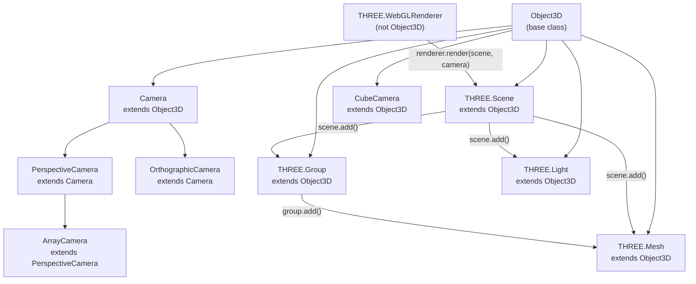
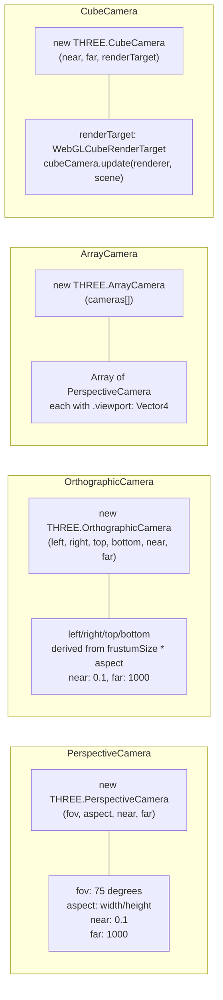
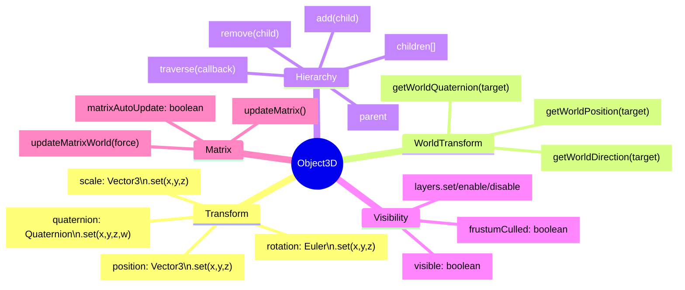
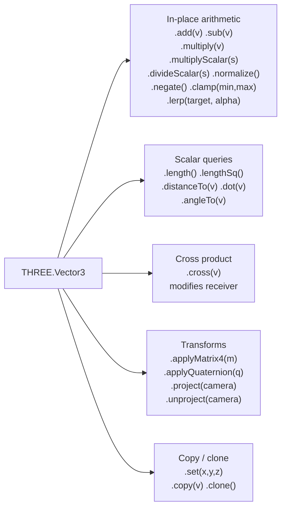

<!-- source: DeepWiki mcp.deepwiki.com · repo CloudAI-X/threejs-skills · extra page threejs-fundamentals · fetched 2026-10-26 -->

# threejs-fundamentals

<details>
<summary>Relevant source files</summary>

The following files were used as context for generating this wiki page:

- [skills/threejs-fundamentals/SKILL.md](skills/threejs-fundamentals/SKILL.md)

</details>


This page documents the `threejs-fundamentals` skill file ([skills/threejs-fundamentals/SKILL.md]()). It covers the foundational classes required to construct and render any Three.js scene: the `Scene` graph, camera types, `WebGLRenderer` configuration, the `Object3D` transform/hierarchy API, `Mesh`, `Group`, mathematical utility classes (`Vector3`, `Matrix4`, `Quaternion`, `Euler`, `Color`, `MathUtils`), `Clock`, and `LoadingManager`.

This skill file does **not** cover geometry construction (see [2.1.2](#2.1.2)), material configuration (see [2.1.3](#2.1.3)), textures (see [2.1.4](#2.1.4)), or lighting (see [2.2.1](#2.2.1)), though the Quick Start example in the skill file uses basic instances of those classes for completeness.

---

## Skill Activation

The `description` front matter field in [skills/threejs-fundamentals/SKILL.md:2-4]() reads:

> Three.js scene setup, cameras, renderer, Object3D hierarchy, coordinate systems. Use when setting up 3D scenes, creating cameras, configuring renderers, managing object hierarchies, or working with transforms.

Claude Code loads this skill when a request involves phrases like *"set up a 3D scene"*, *"configure a renderer"*, *"manage object hierarchies"*, or *"work with transforms"*. See [1.2](#1.2) for how the activation system works.

---

## Scene Graph Architecture

**Diagram: Three.js Scene Graph — class hierarchy and ownership**



Sources: [skills/threejs-fundamentals/SKILL.md:60-251]()

---

## THREE.Scene

`THREE.Scene` is the root container for all renderable objects. It extends `Object3D`.

| Property | Type | Description |
|---|---|---|
| `scene.background` | `Color \| Texture \| CubeTexture` | Rendered behind all objects. Set to `null` to clear. |
| `scene.environment` | `Texture` | Applied as environment map to PBR materials that have `envMap = null`. |
| `scene.fog` | `Fog \| FogExp2` | Applies distance-based fog to all materials. |
| `scene.overrideMaterial` | `Material` | Forces all meshes in the scene to use a single material. |

**Fog constructors:**

| Class | Constructor | Behaviour |
|---|---|---|
| `THREE.Fog` | `new THREE.Fog(color, near, far)` | Linear falloff between `near` and `far` distances. |
| `THREE.FogExp2` | `new THREE.FogExp2(color, density)` | Exponential falloff. `density` ≈ `0.02` is a typical value. |

Sources: [skills/threejs-fundamentals/SKILL.md:60-72]()

---

## Cameras

**Diagram: Camera types and key constructor parameters**



Sources: [skills/threejs-fundamentals/SKILL.md:74-138]()

### PerspectiveCamera

Defined at [skills/threejs-fundamentals/SKILL.md:76-90]().

- Constructor: `new THREE.PerspectiveCamera(fov, aspect, near, far)`
- `fov`: Vertical field of view in **degrees**.
- `aspect`: Typically `window.innerWidth / window.innerHeight`.
- `near` / `far`: Clipping planes. Objects outside this range are not rendered.
- After modifying `fov`, `aspect`, `near`, or `far`, call `camera.updateProjectionMatrix()`.

### OrthographicCamera

Defined at [skills/threejs-fundamentals/SKILL.md:92-106]().

- Constructor: `new THREE.OrthographicCamera(left, right, top, bottom, near, far)`
- The six frustum planes are specified directly. The standard pattern computes them from a `frustumSize` and `aspect` ratio to keep the viewport proportional.
- No depth distortion — parallel lines remain parallel. Useful for 2D, isometric, and technical views.

### ArrayCamera

Defined at [skills/threejs-fundamentals/SKILL.md:108-123]().

- Constructor: `new THREE.ArrayCamera(cameras: PerspectiveCamera[])`
- Each sub-camera requires a `.viewport` property of type `THREE.Vector4` specifying normalized viewport coordinates `(x, y, width, height)`.

### CubeCamera

Defined at [skills/threejs-fundamentals/SKILL.md:125-138]().

- Constructor: `new THREE.CubeCamera(near, far, renderTarget: WebGLCubeRenderTarget)`
- Renders the scene from six directions to populate a `WebGLCubeRenderTarget`.
- The resulting `renderTarget.texture` can be assigned to `material.envMap` for real-time reflections.
- Call `cubeCamera.update(renderer, scene)` each frame. This is expensive; avoid for static scenes.

---

## WebGLRenderer

The renderer is constructed with an options object and attached to the DOM via `renderer.domElement`.

### Constructor Options

| Option | Type | Default | Notes |
|---|---|---|---|
| `canvas` | `HTMLCanvasElement` | (new element) | Attach to an existing `<canvas>` element. |
| `antialias` | `boolean` | `false` | MSAA. Has GPU cost; use SMAA post-pass as alternative. |
| `alpha` | `boolean` | `false` | Transparent background. |
| `powerPreference` | `string` | `"default"` | `"high-performance"` or `"low-power"`. |
| `preserveDrawingBuffer` | `boolean` | `false` | Required to use `renderer.domElement.toDataURL()`. |

### Key Configuration Properties

| Property | Typical Value | Notes |
|---|---|---|
| `renderer.setSize(w, h)` | viewport dimensions | Must be called on init and resize. |
| `renderer.setPixelRatio(ratio)` | `Math.min(devicePixelRatio, 2)` | Cap at 2 to avoid GPU overload on high-DPI displays. |
| `renderer.toneMapping` | `THREE.ACESFilmicToneMapping` | Controls HDR → LDR mapping. |
| `renderer.toneMappingExposure` | `1.0` | Multiplier applied before tone mapping. |
| `renderer.outputColorSpace` | `THREE.SRGBColorSpace` | Required since r152 for correct gamma output. |
| `renderer.shadowMap.enabled` | `true` | Must be enabled before shadows appear. |
| `renderer.shadowMap.type` | `THREE.PCFSoftShadowMap` | Also: `BasicShadowMap`, `PCFShadowMap`, `VSMShadowMap`. |
| `renderer.setClearColor(color, alpha)` | `0x000000, 1` | Background color when `scene.background` is `null`. |

Sources: [skills/threejs-fundamentals/SKILL.md:140-170]()

---

## Object3D — Transform and Hierarchy API

`Object3D` is the base class for all scene graph nodes. Its properties and methods are available on `Mesh`, `Group`, `Light`, `Camera`, and all other scene objects.

**Diagram: Object3D API grouped by responsibility**



Sources: [skills/threejs-fundamentals/SKILL.md:172-213]()

### Transform Properties

- `position`, `rotation`, `scale` are updated independently. Three.js reconciles them into `matrix` each frame when `matrixAutoUpdate = true`.
- `rotation` is a `THREE.Euler`; `quaternion` is a `THREE.Quaternion`. They are kept in sync — setting one updates the other.
- Call `obj.lookAt(x, y, z)` to orient an object toward a world-space target.

### World-Space Queries

- `getWorldPosition(targetVector)`, `getWorldQuaternion(targetQuaternion)`, `getWorldDirection(targetVector)` — write into a provided target object (avoid allocation).
- **Avoid calling these inside tight loops** — they trigger `updateMatrixWorld` up the hierarchy chain.

### Hierarchy

| Method | Description |
|---|---|
| `obj.add(child)` | Attaches `child` to `obj`. Child's transform becomes relative to parent. |
| `obj.remove(child)` | Detaches `child`. Does not dispose geometry/material. |
| `obj.traverse(fn)` | Depth-first walk of `obj` and all descendants. |
| `obj.traverseVisible(fn)` | Like `traverse`, but skips invisible branches. |
| `obj.getObjectByName(name)` | Returns first descendant with matching `.name`. |
| `obj.getObjectById(id)` | Returns first descendant with matching `.id`. |

### Layers

`obj.layers` controls which cameras render the object and which `Raycaster` calls hit it. Each object and camera maintains a bitmask of 32 layers (0–31).

- `obj.layers.set(n)` — enable only layer `n`.
- `obj.layers.enable(n)` — enable layer `n` in addition to existing.
- `obj.layers.disable(n)` — remove layer `n`.
- Camera and object must share at least one layer bit for the object to be rendered.

Sources: [skills/threejs-fundamentals/SKILL.md:196-212]()

---

## Group

`THREE.Group` is a lightweight `Object3D` with no additional properties. It serves as a logical container.

- Transforms applied to the `Group` propagate to all children.
- Removing a `Group` from the scene removes all its children from rendering.
- Useful for articulated objects, scene sections, and instanced logical units.

Sources: [skills/threejs-fundamentals/SKILL.md:215-228]()

---

## Mesh

`THREE.Mesh` pairs a `BufferGeometry` with a `Material`. It extends `Object3D`.

| Property | Type | Notes |
|---|---|---|
| `mesh.geometry` | `BufferGeometry` | See [2.1.2](#2.1.2) for geometry API. |
| `mesh.material` | `Material \| Material[]` | Array form applies one material per geometry group. See [2.1.3](#2.1.3). |
| `mesh.castShadow` | `boolean` | Must be `true` for the mesh to cast a shadow. |
| `mesh.receiveShadow` | `boolean` | Must be `true` for the mesh to receive shadow. |
| `mesh.frustumCulled` | `boolean` | Default `true`. Set `false` if bounding box is stale or the mesh is always in view. |
| `mesh.renderOrder` | `number` | Higher values render later. Useful for transparent object ordering. |

Sources: [skills/threejs-fundamentals/SKILL.md:231-251]()

---

## Coordinate System

Three.js uses a **right-handed coordinate system**:

| Axis | Direction |
|---|---|
| `+X` | Right |
| `+Y` | Up |
| `+Z` | Toward viewer (out of screen) |

Use `new THREE.AxesHelper(size)` and add it to the scene to visualize axes during development. Red = X, Green = Y, Blue = Z.

Sources: [skills/threejs-fundamentals/SKILL.md:253-265]()

---

## Math Utilities

### Vector3

The most commonly used math type. All arithmetic methods mutate the instance in place and return `this` for chaining.

**Diagram: Vector3 method categories**



- `.lengthSq()` avoids a `Math.sqrt` call — use it when only comparing magnitudes.
- `.project(camera)` converts world coordinates to Normalized Device Coordinates (NDC). `.unproject(camera)` is the inverse.

Sources: [skills/threejs-fundamentals/SKILL.md:269-301]()

### Matrix4

A 4×4 column-major matrix. Underpins all `Object3D` world transforms.

| Method | Description |
|---|---|
| `m.identity()` | Reset to identity matrix. |
| `m.makeTranslation(x,y,z)` | Build a pure translation matrix. |
| `m.makeRotationX/Y/Z(theta)` | Build a rotation around a single axis. |
| `m.makeRotationFromQuaternion(q)` | Build rotation from a `Quaternion`. |
| `m.makeScale(x,y,z)` | Build a scale matrix. |
| `m.compose(pos, quat, scale)` | Combine TRS into one matrix (same as `Object3D` does internally). |
| `m.decompose(pos, quat, scale)` | Extract TRS components from a matrix. |
| `m.multiply(m2)` | `m = m * m2` (post-multiply). |
| `m.premultiply(m2)` | `m = m2 * m` (pre-multiply). |
| `m.invert()` | In-place inversion. |
| `m.lookAt(eye, target, up)` | Build a view matrix. |

Sources: [skills/threejs-fundamentals/SKILL.md:303-333]()

### Quaternion

Used for rotation to avoid gimbal lock. Prefer quaternions over Euler when interpolating rotations.

| Method | Description |
|---|---|
| `q.setFromEuler(euler)` | Convert from `Euler` angles. |
| `q.setFromAxisAngle(axis, angle)` | Axis must be a normalized `Vector3`. |
| `q.setFromRotationMatrix(m)` | Extract rotation from a `Matrix4`. |
| `q.multiply(q2)` | Combine two rotations (`q = q * q2`). |
| `q.slerp(target, t)` | Spherical linear interpolation. `t` in `[0,1]`. |
| `q.invert()` | In-place inversion (conjugate for unit quaternions). |
| `q.normalize()` | Normalize to unit length. |

Sources: [skills/threejs-fundamentals/SKILL.md:336-347]()

### Euler

Represents rotation as three successive angles around cardinal axes. The rotation order matters and must be specified.

- Constructor: `new THREE.Euler(x, y, z, order)`
- Valid orders: `'XYZ'`, `'YXZ'`, `'ZXY'`, `'XZY'`, `'YZX'`, `'ZYX'`. Default is `'XYZ'`.
- `euler.setFromQuaternion(q)` and `euler.setFromRotationMatrix(m)` convert from other representations.

Sources: [skills/threejs-fundamentals/SKILL.md:350-357]()

### Color

| Constructor form | Example |
|---|---|
| Hex integer | `new THREE.Color(0xff0000)` |
| CSS name | `new THREE.Color("red")` |
| CSS rgb string | `new THREE.Color("rgb(255,0,0)")` |
| Hex string | `new THREE.Color("#ff0000")` |

Mutation methods: `.setHex()`, `.setRGB(r,g,b)` (0–1 range), `.setHSL(h,s,l)` (0–1 range), `.lerp(other, alpha)`, `.multiply(other)`, `.multiplyScalar(s)`.

Sources: [skills/threejs-fundamentals/SKILL.md:359-374]()

### MathUtils

Static utility namespace at `THREE.MathUtils`.

| Function | Description |
|---|---|
| `clamp(value, min, max)` | Constrain value to range. |
| `lerp(start, end, alpha)` | Linear interpolation. |
| `mapLinear(v, inMin, inMax, outMin, outMax)` | Remap a value between ranges. |
| `degToRad(degrees)` | Convert degrees to radians. |
| `radToDeg(radians)` | Convert radians to degrees. |
| `randFloat(min, max)` | Random float in range. |
| `randInt(min, max)` | Random integer in range. |
| `smoothstep(x, min, max)` | Hermite smoothstep. Returns 0–1. |
| `smootherstep(x, min, max)` | Ken Perlin's smoother variant. |

Sources: [skills/threejs-fundamentals/SKILL.md:377-388]()

---

## Clock

`THREE.Clock` provides frame-delta timing for frame-rate-independent animation.

| Method | Returns | Description |
|---|---|---|
| `clock.getDelta()` | `number` (seconds) | Time elapsed since last `getDelta()` call. |
| `clock.getElapsedTime()` | `number` (seconds) | Total running time since `Clock` was created (or last `start()`). |
| `clock.start()` | — | Manually start the clock. |
| `clock.stop()` | — | Stop the clock; `getDelta()` returns 0 while stopped. |

`getDelta()` and `getElapsedTime()` should not both be called in the same frame — `getDelta()` resets the internal baseline used by `getElapsedTime()`. Use one or the other per frame.

Sources: [skills/threejs-fundamentals/SKILL.md:417-431]()

---

## LoadingManager

`THREE.LoadingManager` coordinates multiple concurrent loaders and provides a unified lifecycle callback surface.

| Callback | Signature | Trigger |
|---|---|---|
| `onStart` | `(url, loaded, total)` | First item begins loading. |
| `onLoad` | `()` | All items have finished loading. |
| `onProgress` | `(url, loaded, total)` | Each item completes. |
| `onError` | `(url)` | An item fails to load. |

Pass the `LoadingManager` instance to loader constructors:

```
new THREE.TextureLoader(manager)
new GLTFLoader(manager)
```

See [2.3.1](#2.3.1) for more detail on loader-specific patterns and the `THREE.Cache` mechanism.

Sources: [skills/threejs-fundamentals/SKILL.md:448-461]()

---

## Common Patterns

### Responsive Canvas

The resize handler at [skills/threejs-fundamentals/SKILL.md:433-447]() is the canonical pattern for keeping the renderer and camera synchronized with the viewport:

1. Update `camera.aspect`.
2. Call `camera.updateProjectionMatrix()`.
3. Call `renderer.setSize(width, height)`.
4. Optionally re-clamp `renderer.setPixelRatio(Math.min(devicePixelRatio, 2))`.

### Proper Disposal

Three.js does not automatically reclaim GPU memory. Unused objects must be disposed explicitly. See [skills/threejs-fundamentals/SKILL.md:392-414]() for the dispose pattern covering geometry, material, textures, and the renderer itself. The pattern is:

- `mesh.geometry.dispose()`
- `mesh.material.dispose()` (or iterate array)
- `texture.dispose()`
- `renderer.dispose()`
- `scene.remove(mesh)`

Failing to dispose textures and geometries is the most common source of GPU memory leaks.

---

## Performance Tips

| Tip | Mechanism |
|---|---|
| Merge static geometries | `mergeGeometries()` from `three/examples/jsm/utils/BufferGeometryUtils.js` |
| Use `THREE.LOD` | Swap meshes based on camera distance. `.addLevel(mesh, distance)` |
| Object pooling | Reuse `Mesh` instances; update geometry/material instead of creating new objects |
| Avoid `getWorldPosition` in loops | Cache the result; it rebuilds world matrices |
| Frustum culling | Enabled by default. Ensure `geometry.boundingBox` is accurate if modified manually |
| Pixel ratio cap | `renderer.setPixelRatio(Math.min(devicePixelRatio, 2))` — prevents 3–4× overdraw on high-DPI |

`THREE.LOD` usage: construct with `new THREE.LOD()`, add detail levels with `lod.addLevel(mesh, distanceThreshold)` in ascending distance order, then add to the scene. Three.js automatically switches meshes during rendering.

Sources: [skills/threejs-fundamentals/SKILL.md:463-482]()

---

## See Also

- [2.1.2](#2.1.2) — `threejs-geometry`: `BufferGeometry`, built-in geometry constructors, `InstancedMesh`
- [2.1.3](#2.1.3) — `threejs-materials`: `MeshStandardMaterial`, `ShaderMaterial`, PBR properties
- [2.1.4](#2.1.4) — `threejs-textures`: `TextureLoader`, `WebGLRenderTarget`, texture configuration
- [2.2.1](#2.2.1) — `threejs-lighting`: light types, shadow maps, IBL
- [2.3.1](#2.3.1) — `threejs-loaders`: `GLTFLoader`, `LoadingManager` advanced usage, `THREE.Cache`
- [2.4](#2.4) — `threejs-interaction`: `Raycaster`, `OrbitControls`, `TransformControls`

---

