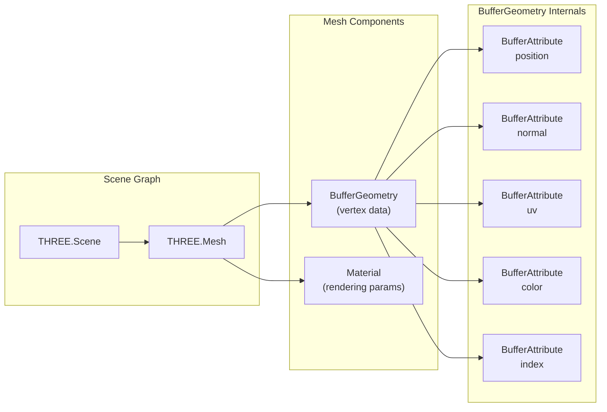
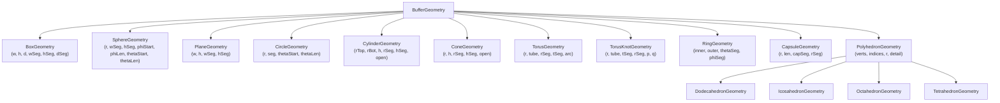
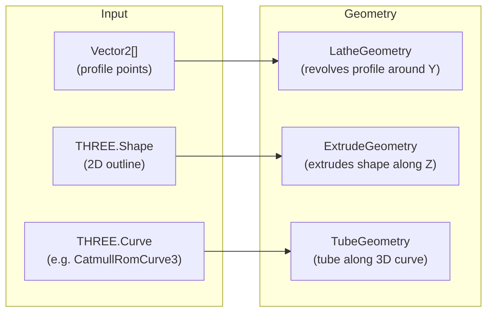
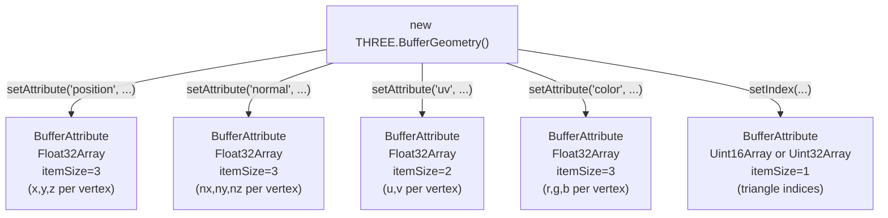
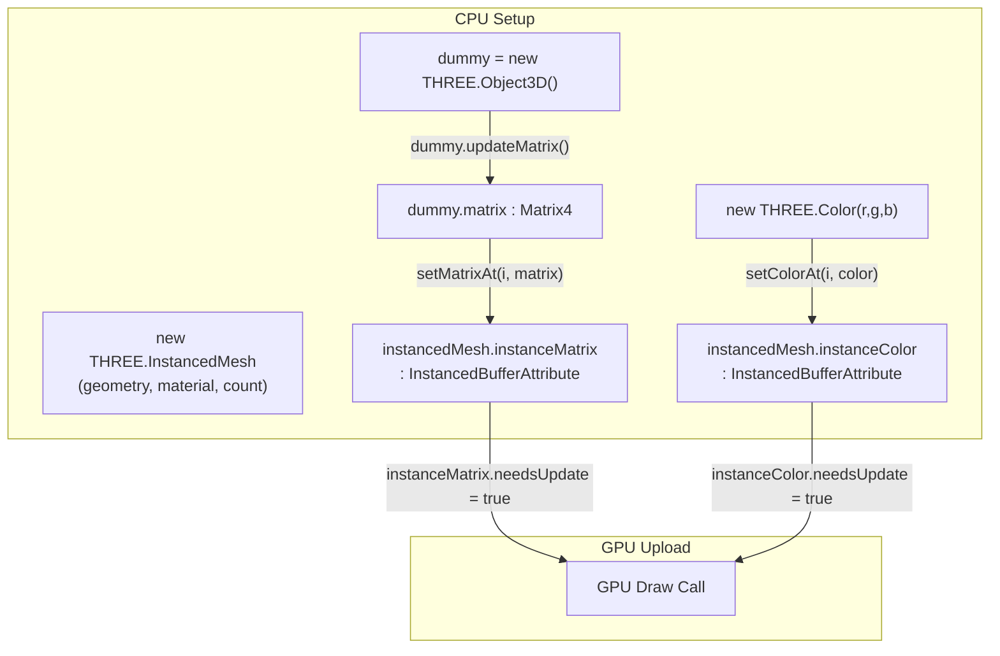

<!-- source: DeepWiki mcp.deepwiki.com · repo CloudAI-X/threejs-skills · extra page threejs-geometry · fetched 2026-10-26 -->

# threejs-geometry

<details>
<summary>Relevant source files</summary>

The following files were used as context for generating this wiki page:

- [skills/threejs-geometry/SKILL.md](skills/threejs-geometry/SKILL.md)

</details>


This page documents the geometry layer of Three.js as captured in [skills/threejs-geometry/SKILL.md](). It covers every built-in geometry constructor, the `BufferGeometry` / `BufferAttribute` API for custom meshes, instancing via `InstancedMesh` and `InstancedBufferGeometry`, line and point primitives, and the `BufferGeometryUtils` helper module.

This page does not cover materials, lighting, or how meshes are placed in a scene — see [2.1.1](#2.1.1) for `Mesh`, `Object3D`, and scene graph basics, and [2.1.3](#2.1.3) for material types.

---

## Role in the Rendering Pipeline

Every visible object in a Three.js scene is a `Mesh` composed of a **geometry** and a **material**. The geometry layer is responsible for defining the raw vertex data that flows to the GPU.

**Diagram: Geometry within the Mesh Component**



Sources: [skills/threejs-geometry/SKILL.md:153-215]()

---

## Built-in Geometry Constructors

Three.js ships with a complete set of procedural geometry factories. All of them extend `BufferGeometry` and return indexed, attributed meshes ready for rendering.

### Basic Shapes

**Diagram: Built-in Geometry Class Hierarchy**



Sources: [skills/threejs-geometry/SKILL.md:28-84]()

The table below documents constructor parameters for every basic shape. All classes are imported directly from the `three` package.

| Class | Required Parameters | Notable Optional Parameters |
|---|---|---|
| `BoxGeometry` | `width, height, depth` | `widthSegments, heightSegments, depthSegments` |
| `SphereGeometry` | `radius, widthSegments, heightSegments` | `phiStart, phiLength, thetaStart, thetaLength` |
| `PlaneGeometry` | `width, height` | `widthSegments, heightSegments` |
| `CircleGeometry` | `radius, segments` | `thetaStart, thetaLength` |
| `CylinderGeometry` | `radiusTop, radiusBottom, height, radialSegments` | `heightSegments, openEnded` |
| `ConeGeometry` | `radius, height, radialSegments` | `heightSegments, openEnded` |
| `TorusGeometry` | `radius, tube, radialSegments, tubularSegments` | `arc` |
| `TorusKnotGeometry` | `radius, tube, tubularSegments, radialSegments` | `p, q` |
| `RingGeometry` | `innerRadius, outerRadius, thetaSegments` | `phiSegments` |
| `CapsuleGeometry` | `radius, length, capSegments, radialSegments` | — |
| `DodecahedronGeometry` | `radius` | `detail` |
| `IcosahedronGeometry` | `radius` | `detail` (0 = 20 faces) |
| `OctahedronGeometry` | `radius` | `detail` |
| `TetrahedronGeometry` | `radius` | `detail` |
| `PolyhedronGeometry` | `vertices, indices, radius` | `detail` |

Sources: [skills/threejs-geometry/SKILL.md:28-84]()

**Practical notes:**
- `CylinderGeometry(0, 1, 2, 32)` produces a cone (zero top radius).
- `CylinderGeometry(1, 1, 2, 6)` produces a hexagonal prism.
- `SphereGeometry(1, 32, 32, 0, Math.PI)` produces a hemisphere by limiting `phiLength`.
- `detail` on the polyhedra subdivides each face, increasing vertex count quadratically.

Sources: [skills/threejs-geometry/SKILL.md:44-48]()

---

### Path-Based Shapes

Three geometries construct surfaces from explicit paths or curves.

**Diagram: Path-Based Geometry Construction**



Sources: [skills/threejs-geometry/SKILL.md:88-123]()

| Class | First Argument | Key Options |
|---|---|---|
| `LatheGeometry` | `Vector2[]` (profile) | `segments, phiStart, phiLength` |
| `ExtrudeGeometry` | `THREE.Shape` | `steps, depth, bevelEnabled, bevelThickness, bevelSize, bevelSegments` |
| `TubeGeometry` | `THREE.Curve` (path) | `tubularSegments, radius, radialSegments, closed` |

`ExtrudeGeometry` accepts a `THREE.Shape` built with the 2D path API: `moveTo`, `lineTo`, `quadraticCurveTo`, `bezierCurveTo`, `absarc`. See [skills/threejs-geometry/SKILL.md:99-114]().

`TubeGeometry` accepts any subclass of `THREE.Curve` — most commonly `CatmullRomCurve3`. See [skills/threejs-geometry/SKILL.md:117-122]().

---

### TextGeometry

`TextGeometry` is an addon, not part of the core `three` package.

```
import { FontLoader }    from "three/examples/jsm/loaders/FontLoader.js"
import { TextGeometry }  from "three/examples/jsm/geometries/TextGeometry.js"
```

It extends `ExtrudeGeometry` and requires a loaded font JSON. Key parameters:

| Parameter | Type | Notes |
|---|---|---|
| `font` | `Font` | Result of `FontLoader.load()` |
| `size` | `number` | Em height |
| `depth` | `number` | Extrusion depth (was `height` in r<160) |
| `curveSegments` | `number` | Smoothness of curves |
| `bevelEnabled` | `boolean` | |
| `bevelThickness` | `number` | |
| `bevelSize` | `number` | |
| `bevelSegments` | `number` | |

After construction, call `geometry.computeBoundingBox()` then `geometry.center()` to center the text at the origin. See [skills/threejs-geometry/SKILL.md:126-151]().

---

## BufferGeometry

`BufferGeometry` is the base class for all geometries. It stores all vertex data as typed arrays packed into `BufferAttribute` objects, which map directly to GPU buffer objects.

**Diagram: BufferGeometry Attribute Layout**



Sources: [skills/threejs-geometry/SKILL.md:153-215]()

### BufferAttribute Typed Arrays

| Attribute | Array Type | `itemSize` | Notes |
|---|---|---|---|
| `position` | `Float32Array` | 3 | Required for any visible mesh |
| `normal` | `Float32Array` | 3 | Required for lighting calculations |
| `uv` | `Float32Array` | 2 | Required for texture mapping |
| `color` | `Float32Array` | 3 | Enable with `material.vertexColors = true` |
| `index` | `Uint16Array` | 1 | Up to 65 535 vertices; use `Uint32Array` for larger meshes |

Sources: [skills/threejs-geometry/SKILL.md:219-235]()

### Modifying Geometry at Runtime

After initial upload to the GPU, geometry can be updated in-place:

- `positions.setXYZ(index, x, y, z)` — write a single vertex
- `positions.getX(index)` / `getY` / `getZ` — read a component
- `positions.needsUpdate = true` — flag the buffer for re-upload on the next render
- `geometry.computeVertexNormals()` — recalculate smooth normals after position changes
- `geometry.computeBoundingBox()` / `computeBoundingSphere()` — update spatial metadata

Sources: [skills/threejs-geometry/SKILL.md:239-259]()

### InterleavedBuffer

For large meshes, packing multiple attributes into a single contiguous array can reduce CPU-to-GPU transfers. Use `THREE.InterleavedBuffer` with `stride` (floats per vertex) and `THREE.InterleavedBufferAttribute` with an `offset` into that stride.

See [skills/threejs-geometry/SKILL.md:263-281]() for the pattern.

---

## Edge and Wireframe Overlays

Two wrapper geometries convert any `BufferGeometry` into line-based representations:

| Class | Behavior | Rendered with |
|---|---|---|
| `EdgesGeometry(geo, thresholdAngle)` | Only edges where adjacent face angle exceeds threshold (default 1°) | `THREE.LineSegments` |
| `WireframeGeometry(geo)` | All triangle edges | `THREE.LineSegments` |

Both are rendered using `THREE.LineSegments` with a `LineBasicMaterial`. See [skills/threejs-geometry/SKILL.md:283-299]().

---

## Point Clouds

`THREE.Points` renders each vertex as a billboard sprite:

- Geometry: a `BufferGeometry` with a `position` attribute only
- Material: `THREE.PointsMaterial` — key properties are `size` and `sizeAttenuation` (perspective scaling)

See [skills/threejs-geometry/SKILL.md:301-324]().

---

## Line Primitives

Three distinct line classes share the same `BufferGeometry` input format:

| Class | Behavior |
|---|---|
| `THREE.Line` | Draws a polyline connecting all vertices in order |
| `THREE.LineLoop` | Same as `Line`, but closes the last vertex back to the first |
| `THREE.LineSegments` | Pairs of vertices; vertex 0→1 is segment 1, vertex 2→3 is segment 2, etc. |

`BufferGeometry.setFromPoints(Vector3[])` is a convenience method for constructing the `position` attribute from an array of `THREE.Vector3` values. See [skills/threejs-geometry/SKILL.md:326-367]().

---

## InstancedMesh

`InstancedMesh` renders `count` copies of one geometry/material pair in a single draw call, with per-instance transform and optional color.

**Diagram: InstancedMesh Data Flow**



Sources: [skills/threejs-geometry/SKILL.md:369-431]()

Key API:

| Method / Property | Description |
|---|---|
| `setMatrixAt(index, matrix)` | Write a `Matrix4` transform for instance `index` |
| `getMatrixAt(index, matrix)` | Read the `Matrix4` for instance `index` into `matrix` |
| `setColorAt(index, color)` | Write per-instance color |
| `instanceMatrix.needsUpdate = true` | Required after any `setMatrixAt` calls |
| `instanceColor.needsUpdate = true` | Required after any `setColorAt` calls |

When raycasting against an `InstancedMesh`, the hit result includes `intersects[0].instanceId` identifying which instance was struck. See [skills/threejs-geometry/SKILL.md:419-431]().

---

## InstancedBufferGeometry

`InstancedBufferGeometry` provides lower-level instancing for custom per-instance attributes that go beyond transform and color — for use with `ShaderMaterial` or `RawShaderMaterial`.

- Copy base geometry data with `geometry.copy(sourceGeometry)`.
- Add per-instance attributes via `geometry.setAttribute('name', new THREE.InstancedBufferAttribute(array, itemSize))`.
- In GLSL, declare the attribute as `attribute vec3 offset;` — the driver advances this attribute once per instance rather than once per vertex.

See [skills/threejs-geometry/SKILL.md:433-453](). For the shader side of this pattern, see [2.2.2](#2.2.2).

---

## BufferGeometryUtils

`BufferGeometryUtils` is an addon module:

```
import * as BufferGeometryUtils from "three/examples/jsm/utils/BufferGeometryUtils.js"
```

| Function | Description |
|---|---|
| `mergeGeometries(geometries[])` | Combines multiple geometries into one, reducing draw calls |
| `mergeGeometries(geometries[], useGroups)` | `useGroups=true` adds material groups, enabling multi-material on merged mesh |
| `computeTangents(geometry)` | Required when using normal maps in `MeshStandardMaterial` |
| `interleaveAttributes(attributes[])` | Combines separate attribute arrays into a single `InterleavedBuffer` |

Sources: [skills/threejs-geometry/SKILL.md:455-475]()

---

## Common Patterns

### Center Geometry at Origin

Call `geometry.computeBoundingBox()` then `geometry.center()`. This repositions all vertices so the bounding box center is at `(0, 0, 0)`. See [skills/threejs-geometry/SKILL.md:479-484]().

### Normalize to Unit Scale

Compute bounding box size with `boundingBox.getSize(vector)`, find the maximum dimension, then call `geometry.scale(1/max, 1/max, 1/max)`. See [skills/threejs-geometry/SKILL.md:486-494]().

### Clone and Transform

`geometry.clone()` produces a deep copy. The resulting geometry exposes `rotateX`, `rotateY`, `rotateZ`, `translate`, and `scale` as chainable bake-in-place methods. These permanently modify vertex positions, unlike `Object3D` transforms. See [skills/threejs-geometry/SKILL.md:496-503]().

### Morph Targets

Morph targets allow smooth blending between vertex positions:

1. Create a second `Float32Array` of positions matching the base geometry vertex count.
2. Assign it to `geometry.morphAttributes.position = [new THREE.BufferAttribute(...)]`.
3. Control blend weight per target via `mesh.morphTargetInfluences[index]` (0–1).

See [skills/threejs-geometry/SKILL.md:505-524](). Morph target animation is driven through `AnimationMixer`; see [2.3.2](#2.3.2).

---

## Performance Tips

| Tip | Mechanism |
|---|---|
| Use indexed geometry | `setIndex(...)` lets vertices be shared between triangles, reducing memory and vertex shader invocations |
| Merge static meshes | `BufferGeometryUtils.mergeGeometries()` reduces draw calls to one per material group |
| Use `InstancedMesh` for repeated objects | One draw call regardless of instance count |
| Match segment counts to display needs | `SphereGeometry(1, 16, 16)` vs `(1, 64, 64)` is a 16× vertex count difference |
| Dispose unused geometry | `geometry.dispose()` releases GPU buffer memory |

Recommended sphere segment counts: 16 for performance, 32 for standard quality, 64 for high quality. See [skills/threejs-geometry/SKILL.md:526-542]().

---

## See Also

- [2.1.1](#2.1.1) — `Mesh`, `Object3D`, `Group`, and scene graph (required context for placing geometry)
- [2.1.3](#2.1.3) — Material types: choosing the right material for a given geometry
- [2.2.2](#2.2.2) — Custom GLSL shaders and `InstancedBufferGeometry` per-instance attributes
- [2.3.1](#2.3.1) — `GLTFLoader` for importing geometry from external files

---

